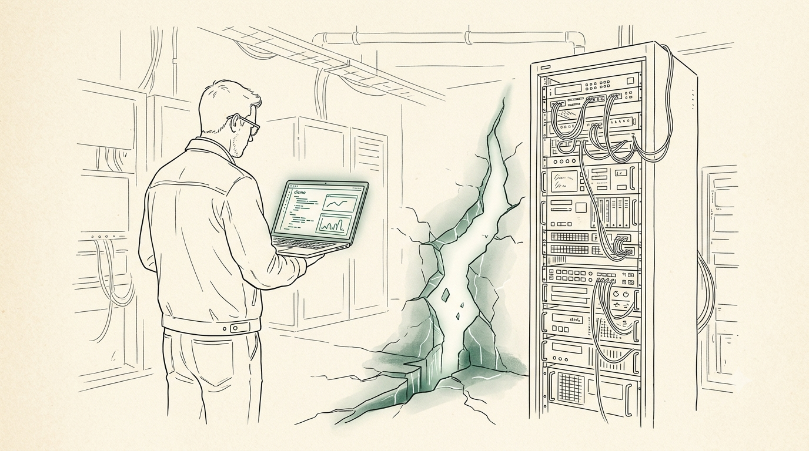
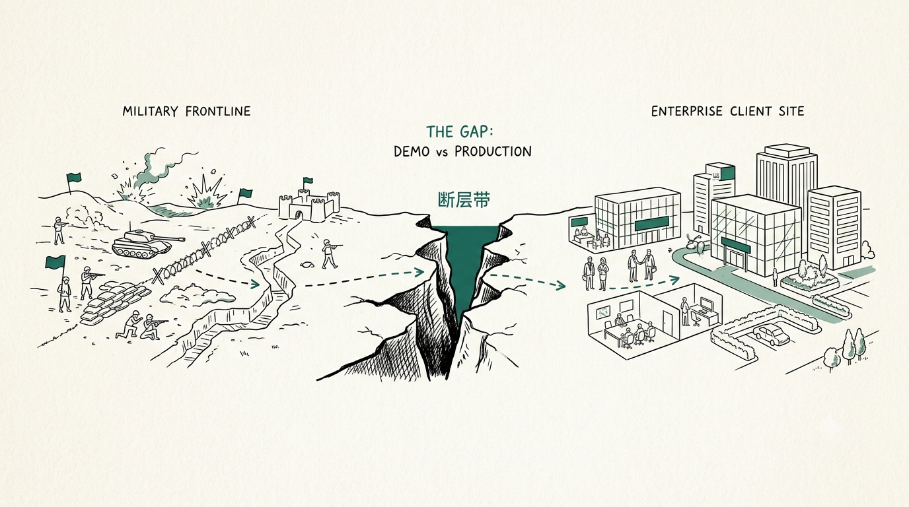
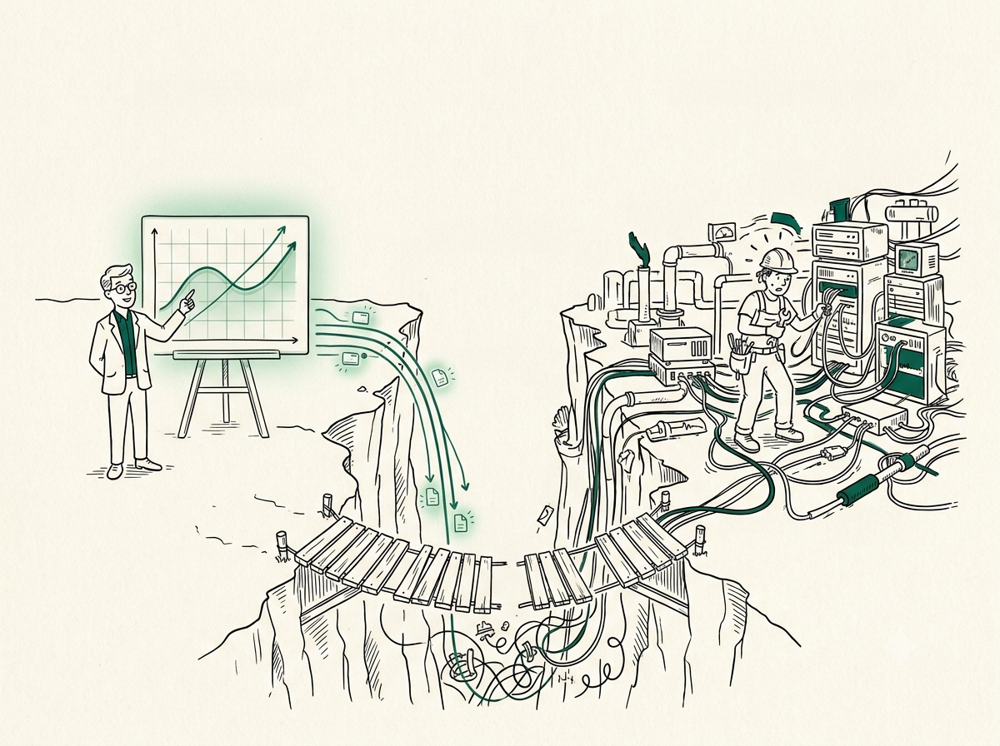
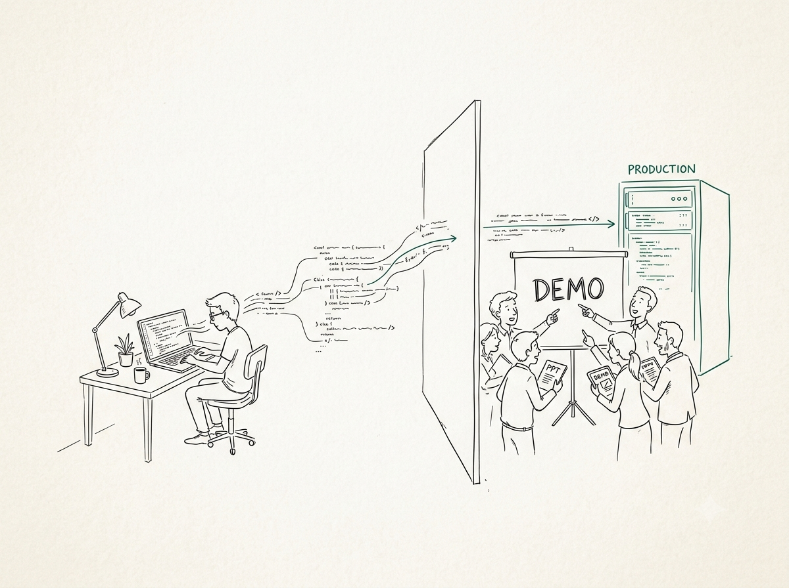
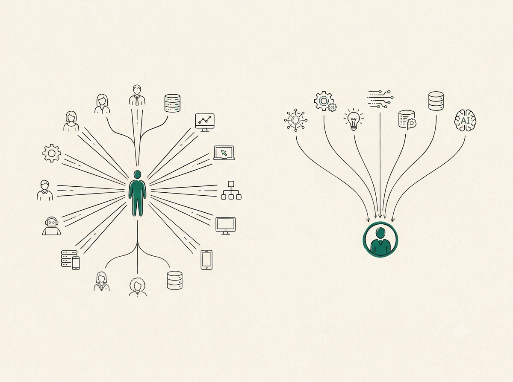
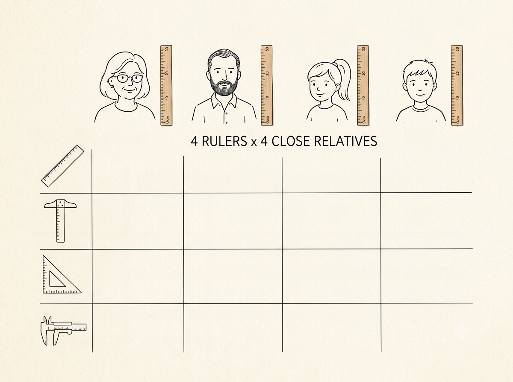
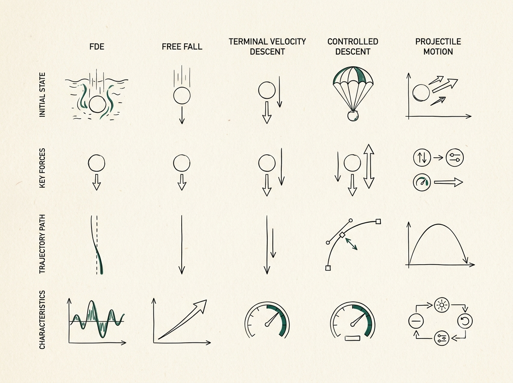

开篇词里我说过，这门课不打算再教你怎么调一个更聪明的模型。那活儿已经有一堆人抢着干了。你正坐在转型 FDE 的路口，心里大概有个没问出口的疑问：模型都这么强了，为什么还要一个专门"把它塞进客户机房"的岗位？这一讲就回答这一个问题。

我先把结论摆这儿：FDE 存在，不是因为模型不够好，而是因为**再好的模型，也过不了从"演示"到"上线"那道断层**。这一讲，我带你看清那道断层长什么样、有多宽，再给你一句能刻在脑子里的 FDE 定义，最后用一张判据表，把 FDE 和四个长得像它的岗位彻底分开。看懂这三件事，你后面所有的技能选择、投递决策，才有个锚。

## 一、95% 的试点，死在同一个地方

先给你一个数字，记住它，后面整门课都在绕着它转：**MIT 的 NANDA 项目调研发现，95% 的企业 GenAI 试点，对公司的损益（P&L）没有可测量的影响。**

别急着划走。这个数字不是说模型不行。95% 的项目里，模型在 demo 里跑得漂漂亮亮，PPT 上的指标一个比一个好看。问题是——它们没能变成生产环境里真正被人用、真正省了钱或赚了钱的东西。它们死在了 demo 和 production 之间。

我给你打个比方。这就像你精心做了一桌菜的样品图，色香味俱全，客户看了直点头。可等到真要天天开火、供应一整个食堂三百号人，你发现灶台不够、食材供应断链、厨师不会照你的菜谱做。样品图和一个能持续运转的厨房，中间隔着的东西，才是最难的部分。**那 95% 死掉的试点，都是只做出了样品图。**

这道断层里到底卡着什么？我给你拆开看：

- 客户的数据是脏的、散在十几个老系统里，没人给你洗干净了递上来。
- 客户的合规、权限、审计要求，能把一个跑得通的 demo 直接判死刑。
- 客户内部没人懂这套新东西，你走了，系统就烂在那儿没人维护。
- 最要命的：客户自己也说不清楚他到底要什么，你得现场一层层刨出来。

看明白了吗？这些没有一个是"模型能力"问题。全是**部署**问题、**落地**问题、**人**的问题。所以——

**这就是 FDE 存在的全部理由：有人得专门去跨越这道断层。**

所有巨头在 2026 年砸钱建 FDE 组织，官方说辞都指向同一个数字。微软、AWS、OpenAI、Anthropic 发新闻稿时，立论支点都是这句"95% 的试点没有可测影响"。他们的算盘很清楚：模型军备竞赛打到今天，谁能把模型**真正落进客户生产环境**，谁才收得到钱。模型是弹药，FDE 是把弹药送上前线并保证它打响的人。

所以对你意味着什么？意味着你要转的这个岗，不是"AI 时代的实施顾问 2.0"，也不是"会写 prompt 的售前"。它是一个被写进各家财报和战略的、专门解决"部署失败率"的工程岗。**你补的每一项技能，都应该冲着"让部署活下来"去，而不是冲着"让模型分数更高"去。** 这句话，你现在记不深没关系，后面第三章讲 evals 时你会撞上它。

## 二、FDE 是谁：一句话定义，一条铁律

结论先行：**FDE = 嵌入客户现场、把产品能力落地到企业真实生产环境、并把一线洞察反哺回核心产品的工程师。**

这句话有点长，你把它拆成三段咬一咬：

1. **嵌入客户现场**——不是坐在总部远程支持，是真的钻进客户的业务和系统里。
2. **落地到真实生产环境**——不做玩具，做每天有人用、坏了会出事的系统。
3. **反哺核心产品**——你在前线趟的坑、发现的缺，要变成产品的改进，而不是烂在你一个人的脑子里。

三段里最要命的是中间那段。所以 FDE 圈子里有一条铁律，你把它背下来：

> **FDE 不做 demo，直接写进客户生产环境的代码。**

这条铁律看着简单，分量很重。它的意思是：你交付的东西，不是给客户看个热闹然后扔掉的原型，而是要长期在客户那儿跑、要能被审计、要坏了能修的**耐用生产代码**。Cursor 的 JD 里有句话我特别喜欢，大意是"这些不是原型，是跑在生产环境里的、可扩展的系统"。同一个意思，反复被各家用不同的话讲。

先说清楚这个名字。中文里它有两个译名：**前线部署工程师（FDE）**，也叫**前沿部署工程师**——百度百科的词条和上海的政策文件用的是后一个。你以后搜政策、搜官方培训信息时，两个词都得试，不然会漏。它还衍生出一个新角色叫 FDR（前沿部署研究员），这个后面章节再说。

这个岗位的根，在 Palantir。"前线部署"本身就是个军事术语——指把工程师像作战单位一样，直接派到"前线"（客户现场）去。Palantir 内部管这条工程线叫 **Delta**。有个数据能说明它的分量：大约在 2016 年之前，Palantir 的 FDE 数量比普通软件工程师还多。这段渊源你了解一笔就够，不用深挖，我们要的是它提炼出来的两个心智模型。

第一个心智模型，来自 Palantir 官方的类比：**FDE 的职责像一家创业公司的 CTO。**

什么意思？小团队、极少的监督、端到端自己扛。没人给你写好详细需求文档，没人帮你把活儿切成小票排进看板。你面对的是一个开放的业务难题——Palantir 招聘里真的会用"我们为什么延误了这么多航班？"这种问题开场——你得自己拆解、自己定方案、自己写代码、自己扛到上线。这就像你不是去大公司当一颗螺丝钉，而是空降到一家只有你一个技术负责人的小创业公司，产品能不能活，看你。

第二个心智模型，是 FDE 和普通工程师最本质的分野。Palantir 把它讲得极精炼：

- 普通 SWE 是"**一个能力，服务众多客户**"（one capability, many customers）——你写一个功能，一百万用户一起用。
- FDE 是"**为单一客户，交付众多能力**"（one customer, many capabilities）——你围着一个客户，缺什么补什么，把它彻底搞定。

这个区别，决定了你的日常长什么样，也决定了下一节我们怎么把 FDE 和它那几个"近亲"分开。

## 三、把 FDE 和四个近亲分开：4×4 判据

结论先行：市面上一堆岗位长得像 FDE，但只要你拿四把尺子一量，真伪立刻现形。这四把尺子是——**客户接触时长、交付物、成功指标、交付完是否留守。**

为什么要较这个真？因为你投简历、谈 offer 时，会遇到一堆挂着"FDE"名头、干着别的活儿的岗位（这个坑第五章会专门教你排雷）。现在先把标尺立起来。我一个一个给你过。

**FDE vs 普通 SWE。**
最好分。SWE 的客户接触时长通常只有 10–20%，大部分时间对着代码和需求文档。FDE 反过来，60–80% 的时间在面对客户。一个"一个能力服务众多客户"，一个"为单一客户交付众多能力"，上一节讲透了。

**FDE vs 售前 / 解决方案工程师。**
这是最容易混的一对，你得盯紧。传统做法里，售前是**售前置**的——在合同签下来之前，做一个能打动客户的 demo，帮销售拿下单子；他按 bookings、按 quota（销售配额）拿钱；他交付的 demo，签完单就可以扔。FDE 反过来：它是**售后**的，在合同签完之后进场；它按"成功的生产部署"拿钱，不是按签单量；它交付的是进客户真实环境、长期要跑的生产代码。

一句话对比：**售前交付的是"让你相信"，FDE 交付的是"让它真的跑起来"。** 判断一个岗真假 FDE，你就问一句：他有没有 quota？有 quota、交付完就走、不碰生产代码的，多半是套了 FDE 皮的售前。

**FDE vs 顾问。**
顾问交付的是一次性的分析——一份报告、一套方案，讲完就走，任务完成即离场。FDE 不一样：你和客户**共建一个能持续运转的系统**，交接之后往往还得留守一阵，而且你的成功指标是"这套系统在生产里真的被用起来了"，不是"我交了一份漂亮 PPT"。这就像顾问是来给你看病开药方的医生，看完就走；FDE 是搬进你家、盯着你把药吃下去、还帮你改了作息的私人健康管家。

**FDE vs 客户成功 / 产品工程师。**
这一对的差别在"边界"。客户成功和产品工程师，是在产品**现有的能力边界内**帮客户做配置——产品能干什么，他就帮你调什么。FDE 会**越过这条边界**：客户需要的能力产品还没有？那你现场把它补出来，甚至亲手写一个产品里还不存在的 MCP server 塞进去。你是去**扩展**产品的，不是去配置产品的。

把这四把尺子拼成一张表，你随手就能查：

| 维度 | 普通 SWE | 售前/解决方案工程师 | 顾问 | 客户成功/产品工程师 | **FDE** |
|---|---|---|---|---|---|
| 客户接触时长 | 10–20% | 高（但售前置） | 中，项目制 | 中高 | **60–80%** |
| 交付物 | 服务众多客户的功能 | 可抛弃的 demo | 一次性分析报告 | 现有边界内的配置 | **进生产环境的耐用代码** |
| 成功指标 | 功能上线/用户量 | bookings / quota | 报告交付 | 客户续约/满意度 | **系统在生产中被真正使用** |
| 交付完是否留守 | 否 | 否，签单即走 | 否，离场 | 部分 | **是，共建后留守/交接** |

你把这张表记熟。它不只是用来考试的定义，它是你以后**给一个 offer 验真身**的工具。当有人跟你说"我们这也是 FDE"，你就拿这四列去套：客户接触时长够不够？交付物是 demo 还是生产代码？拿 quota 还是拿部署结果？走不走？四列一套，李逵李鬼当场分明。

最后补一句关于最近的争论，免得你被带节奏。网上偶尔有"FDE is dead（FDE 要凉）"的声音，但没成气候。主流的批评是说 FDE 像"给不成熟产品打的创可贴"，Bloomberg 也提示过这类业务的盈利风险——这些你听着，别全信也别不信，我们第六章会认真算这笔账。还有一种说法是 agentic AI（能自己规划执行的 AI）会取代 FDE。更准确的判断是：它改变了 FDE 的**工作内容**（从自己写代码，变成设计和监督 agent），但没取代这个**角色**。断层还在，就还需要有人去跨。

## 小结

这一讲你只要带走三件事。第一，95% 的企业 GenAI 试点死在 demo 到生产的断层里，FDE 存在的理由就是跨越这道断层，而不是把模型调得更聪明。第二，FDE 的一句话定义是"嵌入现场、落地生产、反哺产品"，一条铁律是"不做 demo，直接写进客户生产环境的代码"，心智模型是"像创业公司 CTO"和"为单一客户交付众多能力"。第三，用客户接触时长、交付物、成功指标、是否留守这四把尺子，你能把 FDE 和 SWE、售前、顾问、客户成功彻底分开——这张表以后就是你验 offer 真身的工具。

## 思考题

回想你现在或过去的一份工作，用本讲那四把尺子量一量：你的客户接触时长大概占几成？你交付的东西，是签完就扔的 demo，还是长期要跑的生产系统？你离这个"FDE 画像"最近的一条尺子是哪条，最远的又是哪条？想清楚这个，你就知道自己转型的起点在哪儿了。欢迎在评论区聊聊你的想法。

下一讲《2026 巨头军备竞赛：这不是风口是重组》，我带你看清这波钱到底从哪儿来、往哪儿去——为什么微软、AWS、OpenAI 会在同一个季度，集体押注这个岗位。
