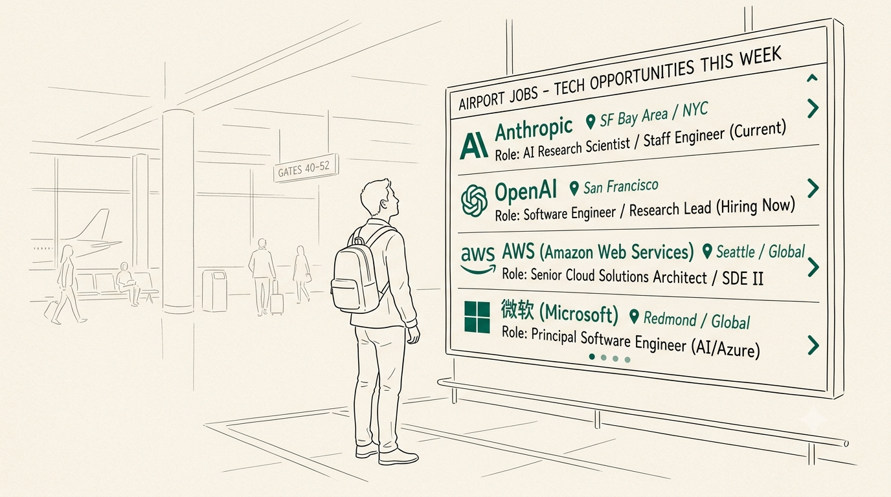

上一讲我们盯着一个扎心的数字：MIT NANDA 说 95% 的企业 GenAI 试点，对财报（P&L）没有任何可测量的影响。我们由此讲清了 FDE 为什么存在——它就是被派去跨越"能跑的 demo"和"真上生产"之间那道死亡峡谷的人。

那你可能会想：这会不会只是一阵风？听着热闹，明年就凉？

这一讲我就回答你这个问题。我把 2026 上半年巨头砸钱的时间线摊开给你看，再帮你把满天飞的"增长几倍"理清楚，最后带你听听唱衰的声音。一句话说清本讲目标：帮你判断现在到底该不该入场，以及入的是哪一种场。



## 三个月，五记重锤

先给结论：2026 年 5 到 7 月，这不是几家公司凑巧同时招人，这是整个软件交付层在重新洗牌。

你先记住一件事——判断"风口还是重组"，看的不是招聘广告多不多，而是**钱是怎么砸的**。风口是撒广告位；重组是成立独立公司、划事业部、写进五年回报承诺。2026 上半年发生的，全是后者。

把时间线拉出来，你自己感受下节奏。

| 日期 | 谁 | 干了什么 | 规模 |
|---|---|---|---|
| 2026-05-04 | Anthropic | 联合 Blackstone / H&F / Goldman 成立企业服务合资公司 | 估值 15 亿美元（三方各出 3 亿） |
| 2026-05-11 | OpenAI | 正式推出 Deployment Company（DeployCo），收购伦敦 Tomoro 一次性拿到约 150 名 FDE | 融资 40 亿+，估值 100–140 亿（口径不一） |
| 2026-06-30 | AWS | 成立 Forward Deployed Engineering 部门，5–6 人小队进驻客户 | 10 亿美元 |
| 2026-07-02 | 微软 | 组建 Frontier Company 内部事业部 | 25 亿美元 / 6000 名工程师 |

三个月，媒体口径合计约 80 亿美元。这不是四个 offer，这是四个新组织。


我知道你看到这堆数字容易发懵，别急，我帮你抓两个最要命的细节。

第一，OpenAI 那个 DeployCo，它不是内部团队，是**独立法人子公司**。它向私募（PE）投资人承诺了"五年 17.5% 年化回报"。你品品这句话——只有当一个业务被当成能持续赚钱的实体，才会去承诺年化回报。这就像开小卖部和开连锁公司的区别：前者今天开心就卖，后者要向股东交代增长曲线。FDE 被当成后者了。

第二，收购 Tomoro 那一步。OpenAI 没有慢慢招 150 个人，而是**直接买下一整支现成的 FDE 团队**。这说明什么？说明这个岗位的人才，已经稀缺到要靠并购来抢。稀缺的东西，才值得你现在挤进去。

再看微软那 25 亿、6000 人。它给自己的定位很有意思——"超越 FDE 的 outcome-driven 工程组织"，而且明说工具选型不限微软系，OpenAI、Anthropic、开源随便用。翻译成大白话：我不在乎你用谁的模型，我只在乎客户的业务结果。这正是 FDE 的灵魂。

那这四家形态一样吗？不一样。这恰恰是你要看清的东西，因为**不同形态就是你不同的应聘入口**。我给你归成四类。

```text
四类组织形态 = 四类入口
① 内部事业部    微软 Frontier / AWS FDE / Salesforce / Google / Meta
② 资本化 JV     OpenAI DeployCo / Anthropic 合资公司（有独立招聘通道）
③ SaaS + SI 联合  ServiceNow × Accenture
④ 咨询伙伴网络   Salesforce 30+ 伙伴 / Deloitte 平台绑定岗（转型低门槛旁路）
```


这里先埋个扣子：这四类入口具体怎么选、你该投哪一条，是下一讲《四类入口：组织形态图谱与你该投哪》要展开的。这一讲你只需要记住——入口不止一个，别以为只能去挤 OpenAI。

顺带说一句，别被"FDE"这三个字母框死。同一件事，招聘方起了至少六个名字：FDE、FDSE、FDSWE、Deployment Strategist、Agent Engineer、Customer Solutions Engineer。你搜工作时，这些词得一起搜，不然会漏掉一大半岗位。

哦对，还有个译名的坑得先给你提个醒。这个角色首次出现时，正式该写作"前线部署工程师（FDE）"——但它还有个名字叫"前沿部署工程师"，百度百科的词条和上海的政策文件用的是后者。所以你去查政策、查官方培训信息时，两个名字都得搜，衍生角色还有 FDR（前沿部署研究员）。搜索时漏一个字，信息就差一半。

## 四口径增长，千万别叠着看

先给结论：FDE 的岗位增长是真的猛，但市面上流传的"增长几倍"有四个完全不同的口径，**它们不能相加、不能混用**，谁把它们叠起来吹，谁就是在忽悠你。

我先把这四个数摆出来，每个都带上它的出处和时间窗。

| 口径来源 | 增长 | 时间窗 / 说明 |
|---|---|---|
| Indeed | +729% YoY | 643 条（2025-04）→ 5,330 条（2026-04） |
| Perspective AI | +1000%~1165% | 基于 1000 份 JD，2026 年初同比 |
| LinkedIn | 42 倍 | 2023–2025（同期 AI 工程师才 13 倍） |
| 国内主流招聘平台 | 10–20 倍 | 2026 上半年 |


看懵了也没关系，你只要抓住一个道理就行：这四个数字量的**不是同一件事**。

打个你熟悉的比方。这就像你要说一个人"长得快"——一个人用身高（去年到今年长了 10 厘米），一个人用体重（半年重了 5 公斤），一个人用鞋码（三年从 38 到 43）。每个都对，但你不能说"这孩子长了 10+5+43"。Indeed 数的是绝对岗位条数的同比，Perspective 数的是 JD 样本，LinkedIn 数的是三年跨度的劳动力占比，国内平台是另一套统计。混着念，只会得出一个假的天文数字。

那你该怎么用它们？我教你一句话的用法：**引用时永远带时间窗和来源**。你在简历、在面试、在自己写的博客里提到"FDE 岗位暴涨"，就说"LinkedIn 口径 2023–2025 涨了 42 倍"，或者"Indeed 口径过去一年 +729%"。带着出处说，你就是专业的；不带出处叠着吹，懂行的人一眼看穿你没做功课。

同样的纪律，用在薪资上更重要。你肯定刷到过"FDE 年薪百万"的标题。先冷静。

传统的看薪资方式，是看那个纸面总包数字，越大越兴奋。FDE 的正确看法反过来——**先看这笔钱由什么构成**。头部公司的 FDE，股权（equity）占总包的 55–70%（2024 年这个比例还只是 35–45%）。股权不是现金，它有归属期、有流动性限制、有估值缩水的风险。你看到的"百万"，可能有一多半是几年后才可能兑现、且金额会浮动的纸面数字。

国内更要拿真实数据校准。一线实证是：上海的初级 FDE，月薪其实就 2–3 万；高职级年包能到 40 万+；所谓"年薪百万"，猎聘上百万级的岗位全网也就 40 多个。国内还有个海外没有的东西——驻场补贴。


所以你该做什么？两条。第一，看 offer 别只盯总包，把现金和股权拆开算，问清归属期。第二，别拿海外头部的数字给自己画饼，用你所在市场的真实中位数做决策。诚实地管理预期，你才不会入场后落差感爆棚。

## "FDE 已死"？先听两种声音

先给结论：网上确实有唱衰的声音，但"FDE 已死"这个论调根本没成气候；真正值得你听进去的批评，是另一条——它可能是"不成熟产品的创可贴"。两种声音都听完，你反而更该现在入场。

我不想只给你打鸡血。一门诚实的课，得把冷水也端给你。

**第一种声音："FDE is dead"。** 这个说法零星有人喊，但它站不住脚。你想想，如果这个角色要死，四家巨头会在三个月里砸 80 亿美元、成立独立公司去做它吗？不会。喊"已死"的人，通常是把"agentic AI 会取代 FDE"当成了论据。但事实是——agentic AI 改变的是 FDE 干活的**内容**，不是**是否需要这个人**。

before 和 after 对比一下你就清楚了。以前 FDE 大量时间在亲手写集成代码；以后 FDE 更多时间在**设计和监督 agent 工作流**——写 spec、编排多个 agent、给它们建 eval、排查它们的失败模式。活儿变了，人还在，而且要求更高了。这就像自动挡取代手动挡，司机这个职业没消失，只是不用天天踩离合了。

**第二种声音才是真该警惕的：Bloomberg 的"创可贴"批评。** 它的意思是，FDE 之所以这么火，某种程度上是因为现在的 AI 产品还不够成熟、开箱即用性差，需要一个人肉贴上去把窟窿堵住。Bloomberg 由此提示了盈利风险——有从业者写过，某些试点的毛利"字面意义上的负无穷"。

这个批评你得认真对待，因为它是对的一半。FDE 确实是产品不成熟期的产物。但你换个角度看，这恰恰是入场的理由，而不是躲开的理由。

我给你讲个反直觉的逻辑。硅谷投资机构 a16z 有个说法，叫"用毛利换护城河"。意思是：巨头明知道嵌入式交付短期不赚钱、毛利难看，还是要做——因为一旦你的工程师深深嵌进客户的生产环境，你就变成了客户**拆不掉的承重墙**。客户想换供应商？先得把承重墙拆了，房子还不能塌。这个绑定关系，值钱到愿意用毛利去换。


所以，"创可贴"这个批评的正确读法是：**产品越不成熟的窗口期，越需要 FDE，也越是你入场的窗口。** 等产品成熟到开箱即用了，这个红利窗口才会收窄。而现在，MIT 那个 95% 的失败率，就是窗口大开的证据。

再给你一个让人安心的数据。你可能担心："万一我入了行，这行冷了，技能不就废了？"看看 Palantir 校友——他们大多是 FDE 出身，离开后已经创办了 111+ 家公司、累计融资 116 亿美元。这个角色练出来的能力——快速理解陌生业务、端到端交付、直面客户、在混乱里搭系统——是极度可迁移的。就算某天这个头衔降温，你手里的本事不会跟着降温。

那落到你身上，现在到底该做什么？我给你收成一句话：**现在入场正当时，但你必须看清入的是哪一种形态。** 是真交付岗（frontier lab、AI-native 公司，JD 明确写售后嵌入、按生产部署计酬），还是挂着 FDE 名头实为售前的岗（部分平台厂商确实含 pre-sales）。这两种形态对你的能力要求、风险、天花板完全不同。怎么一眼分辨、四类入口你该投哪——就是下一讲的事。

## 小结

2026 上半年，四家巨头三个月砸约 80 亿，成立独立公司和事业部——这是软件交付层的结构性重组，不是短期风口。市场增长有四个口径（Indeed +729% / Perspective 1000–1165% / LinkedIn 42 倍 / 国内 10–20 倍），各自独立、禁止叠加；薪资要拆开现金与股权看，国内入门实证仅月薪 2–3 万。唱衰声中"FDE 已死"没成气候，"创可贴"批评反而印证了入场窗口正开着。结论：现在入场正当时，但要先看清是哪种形态。

## 思考题

把这一讲的四类入口对照你自己的背景想一想：如果你现在就要投递，你会先瞄准哪一类组织（内部事业部 / 资本化 JV / SaaS+SI 联合 / 咨询伙伴网络），为什么这一类最匹配你手里现有的牌？欢迎在评论区聊聊你的想法。
