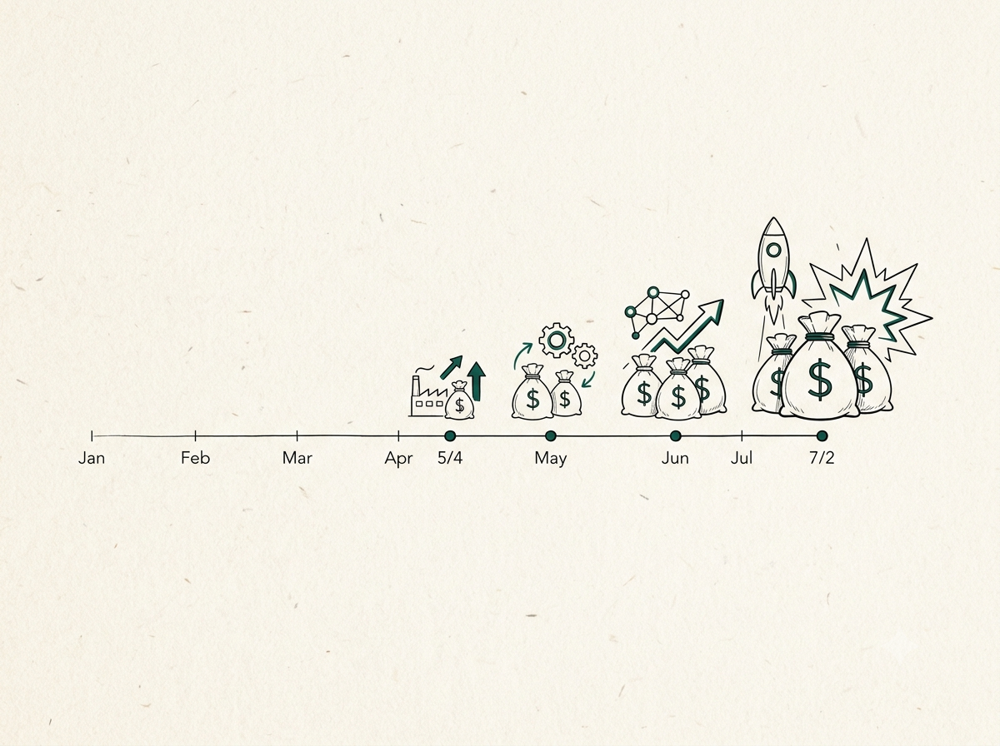
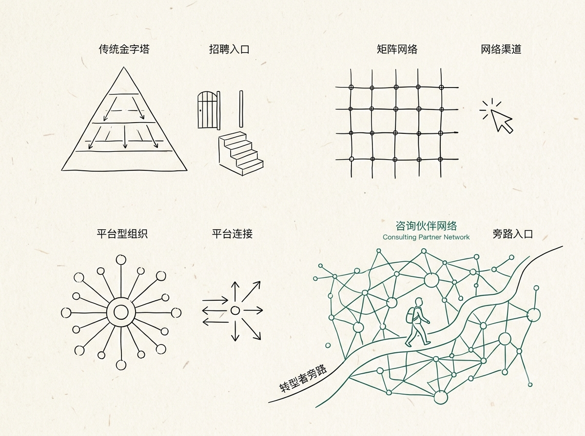
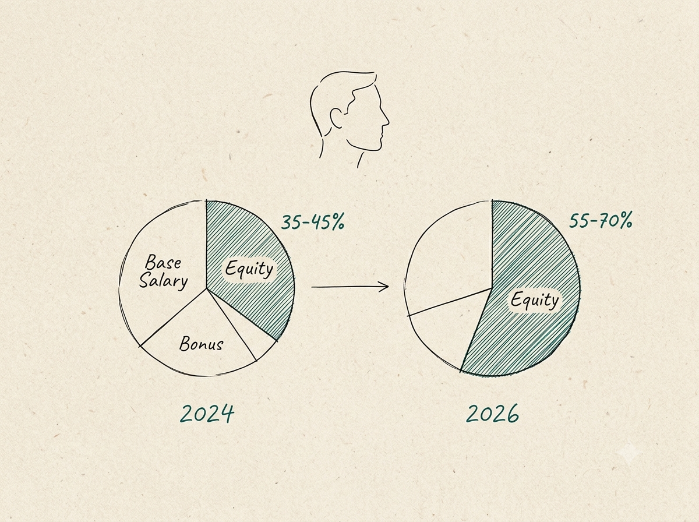

上一讲我们盯着一个扎心的数字：MIT NANDA 说 95% 的企业 GenAI 试点，对财报（P&L）没有任何可测量的影响。我们由此讲清了 FDE 为什么存在——它就是被派去跨越"能跑的 demo"和"真上生产"之间那道死亡峡谷的人。

那你可能会想：这会不会只是一阵风？听着热闹，明年就凉？

这一讲我就回答你这个问题。我把 2026 年巨头砸钱的完整时间线摊开给你看，再帮你把满天飞的"增长几倍"理清楚，最后带你听听下半年越来越锋利的反思声。一句话说清本讲目标：帮你判断现在到底该不该入场，以及入的是哪一种场。


## 半年时间，近百亿美元砸向"DeployCos"

先给结论：2026 年 4 到 10 月，这不是几家公司凑巧同时招人，这是整个软件交付层在重新洗牌——硅谷甚至专门给这批新物种造了个词，叫 **DeployCos（部署公司）**。

你先记住一件事——判断"风口还是重组"，看的不是招聘广告多不多，而是**钱是怎么砸的**。风口是撒广告位；重组是成立独立公司、划事业部、连环并购团队、写进五年回报承诺甚至 IPO 招股书。2026 年发生的，全是后者。

把截至 2026 年 11 月的时间线拉出来，你自己感受下节奏。

| 日期 | 谁 | 干了什么 | 规模 |
|---|---|---|---|
| 2026-04-22 | Google Cloud | 启动 FDE 伙伴基金；9 月再联手 Accenture 建 1,000 人 Gemini 专属 FDE 团队 | 7.5 亿美元 |
| 2026-05-04 | Anthropic | 联合 Blackstone / H&F / Goldman 设合资公司；7 月正式定名 **Ode with Anthropic**（连收 Fractional AI 与 Casper Studios），写进 10 月 S-1 招股书 | 估值 15 亿美元（三方各出 3 亿） |
| 2026-05-11 | OpenAI | 推出独立实体 **The Deployment Company**（`deploy.co`），连收伦敦 Tomoro（约 150 人）与 Palantir 头号精英伙伴 **Northslope**（再添百余人） | 融资 40 亿+，估值 100–140 亿 |
| 2026-06-30 | AWS | 成立 Forward Deployed Engineering 部门，推"AI 45"（45 天定额结果交付），10 月免费开放伙伴 FDE 动手认证 | 10 亿美元 |
| 2026-07-02 | 微软 | 组建 Frontier Company 内部事业部；截至 11 月已在 28 国 200+ 企业跑通近 500 个项目 | 25 亿美元 / 6000 名工程师 |
| 2026-10-02 | Anthropic | 启动 **Claude Frontier Academy**，按"住院医师"驻场模式目标 2027 年底前培养 10,000 名认证 FDE | 1 亿美元 |

按行业追踪站 `deploycos.com` 的汇总口径，光这六笔公开承诺加起来就已达 **98.5 亿美元（逼近 $10B）**。这不是几个零散 offer，这是一条长出来的新产业。



我知道你看到这堆数字容易发懵，别急，我帮你抓三个最要命的细节。

第一，OpenAI 那个 DeployCo 和 Anthropic 的 Ode，都不是内部部门，而是**资本化的独立法人**。DeployCo 向私募（PE）投资人承诺了"五年 17.5% 年化回报"；Ode 则在 10 月被正式写进 Anthropic 冲击上市的 SEC S-1 招股书，当作企业商业化的核心引擎。只有当一个业务被当成能持续造血的支柱，才会这么干。

第二，连环并购那一步。OpenAI 先买伦敦 Tomoro，7 月 8 日又买下 Palantir 生态里最顶尖的伙伴 Northslope；Ode 同样连收 Fractional AI 和 Casper Studios。两家巨头没有慢慢社招，而是**直接成建制买下现成的 FDE 团队**。这说明什么？说明真正能打的 FDE 已经稀缺到要靠并购来抢。

第三，看微软那 25 亿、6000 人和 AWS 的"AI 45"。微软明说工具选型不限微软系，OpenAI、Anthropic、开源随便用；AWS 则把 5–6 人小队的交付周期卡死在约 45 天、按固定业务结果收费。翻译成大白话：巨头已经不在乎卖哪个单点工具了，谁能替客户把业务结果跑出来，谁拿走整张大单。

那这几家形态一样吗？不一样。这恰恰是你要看清的东西，因为**不同形态就是你不同的应聘入口**。我给你归成四类。

```text
四类组织形态 = 四类入口
① 内部事业部    微软 Frontier / AWS FDE / Salesforce / Google / Meta
② 资本化 JV     OpenAI DeployCo (deploy.co) / Ode with Anthropic (ode.com)
③ SaaS + SI 联合  ServiceNow × Accenture / Google × Accenture / 火山引擎 × 安永
④ 咨询伙伴网络   Salesforce 30+ 伙伴 / Deloitte 平台绑定岗 / Claude Frontier Academy 提名伙伴
```



这里先埋个扣子：这四类入口具体怎么选、你该投哪一条，是下一讲《四类入口：组织形态图谱与你该投哪》要展开的。这一讲你只需要记住——入口不止一个，而且 Plank Research 10 月对全美 1,276 个去重在招 FDE 岗位的盘点发现：**90% 的岗位其实开在垂直 AI 应用和创业公司里，前沿实验室加 Palantir 只占 10%**。别以为只能去挤 OpenAI。

顺带说一句，别被"FDE"这三个字母框死。同一件事，招聘方起了至少六七个名字：FDE、FDSE、FDSWE、Deployment Strategist、Agent Engineer、ADE（Decagon 刚改叫 Agent Deployment Engineer）、Customer Solutions Engineer。你搜工作时，这些词得一起搜，不然会漏掉一大半岗位。

哦对，还有个译名的坑得先给你提个醒。这个角色首次出现时，正式该写作"前线部署工程师（FDE）"——工信部 2026 年 8 月的红头文件用的也是这个词；但它还有个官方孪生名叫"前沿部署工程师"，百度百科词条和上海人社局的职称评审文件用的是后者。所以你去查政策、查官方培训信息时，两个名字都得搜，衍生角色还有 FDR（前沿部署研究员）。搜索时漏一个字，信息就差一半。

## 四口径增长，千万别叠着看

先给结论：FDE 的岗位增长是真的猛，但市面上流传的"增长几倍"有多个完全不同的口径，**它们不能相加、不能混用**，谁把它们叠起来吹，谁就是在忽悠你。

我先把最常被引用的四个增长口径摆出来，每个都带上它的出处和时间窗。

| 口径来源 | 增长 | 时间窗 / 说明 |
|---|---|---|
| Indeed | +729% YoY | 643 条（2025-04）→ 5,330 条（2026-04） |
| Perspective AI | +1000%~1165%（下半年更新口径 +380%） | 基于 1000–1500 份样本；同期传统 SaaS 售前 SE 岗位萎缩 **-14%** |
| LinkedIn | 42 倍 | 2023–2025（同期 AI 工程师才 13 倍） |
| 国内主流招聘平台（猎聘等） | 上半年 10–20 倍；8 月单月新发岗逼近上半年总和 | 2026.09 猎聘报告：供需比仅 **0.28**（约 4 个岗抢 1 人） |


看懵了也没关系，你只要抓住一个道理就行：这几个数字量的**不是同一件事**。

打个你熟悉的比方。这就像你要说一个人"长得快"——一个人用身高（去年到今年长了 10 厘米），一个人用体重（半年重了 5 公斤），一个人用鞋码（三年从 38 到 43）。每个都对，但你不能说"这孩子长了 10+5+43"。更值得注意的是 Perspective AI 下半年揭开的那组结构性替代：**FDE 暴涨的同时，只会做标准化演示的传统 Solutions Engineer 缩水了 14%**——不是多了一批岗位，是旧岗位正在往新岗位换血。

那你该怎么用它们？我教你一句话的用法：**引用时永远带时间窗和来源**。你在简历、在面试、在自己写的博客里提到"FDE 岗位暴涨"，就说"LinkedIn 口径 2023–2025 涨了 42 倍"，或者"猎聘 2026 年 9 月报告供需比 0.28"。带着出处说，你就是专业的；不带出处叠着吹，懂行的人一眼看穿你没做功课。

同样的纪律，用在薪资上更重要。你肯定刷到过"FDE 年薪百万"的标题。先冷静。

传统的看薪资方式，是看那个纸面总包数字，越大越兴奋。FDE 的正确看法反过来——**先看这笔钱由什么构成**。头部公司的 FDE，股权（equity）占总包的 55–70%（2024 年这个比例还只是 35–45%）。Levels.fyi 2026 年 11 月的全美 FDE 总包中位数是 $225K（Plank 统计全市场底薪中位数 $203K），只有前沿实验室高级岗才冲到 $450K–$725K+。股权不是现金，它有归属期、有流动性限制、有估值缩水的风险。

国内更要拿真实数据校准。猎聘 2026 年 9 月报告给出全国 FDE 招聘平均年薪 40.8 万、中位数 36.6 万；但掰开看两极分化极猛——一线初级岗实证月薪就是 2–3 万（二三线换皮岗甚至压到 8–16K），百万级大包全网不过几十个塔尖席位。国内还有个海外少见的显性条款——驻场补贴（通常每天 300–800 元）。



所以你该做什么？两条。第一，看 offer 别只盯总包，把现金和股权拆开算，问清归属期。第二，别拿海外头部的数字给自己画饼，用你所在市场的真实中位数做决策。诚实地管理预期，你才不会入场后落差感爆棚。

## 下半年的冷思考：比"FDE 已死"更锋利的三记警钟

先给结论："FDE 已死"这个论调没成气候，但 2026 下半年行业进入深水区后，冒出了三记真正打在商业模式七寸上的批评——**毛利挤压、70% 弃用预警、以及"项目赢了公司输了"**。把这三盆冷水全接住，你才算真正看懂这局棋。

我不想只给你打鸡血。一门诚实的课，得把冷水也端给你。

**先拨开表层噪音："FDE is dead"。** 喊"已死"的人，通常是把"agentic AI 会取代 FDE"当成了论据。但事实是——agentic AI 改变的是 FDE 干活的**内容**（从手敲胶水代码，变成写 spec、编排多个 agent、建 eval、排查失败模式），不是**是否需要这个人**。这就像自动挡取代手动挡，司机没消失，只是不用天天踩离合了。

真正值得你警惕的，是 2026 年 9 到 10 月集中爆发的三条深层质疑：

**第一记警钟：毛利与"人海战术伪装 PMF"。** Bloomberg 最早批评 FDE 是"不成熟产品的创可贴"；到了 10 月，Crunchbase（《The FDE Trap》）和 ICONIQ 的财报追踪揭开了账面真相——由于审计准则把驻场 FDE 的高薪计入营业成本（COGS），不少 AI 公司的毛利率被压到了 **50–60%**（远低于传统 SaaS 的 75–85%），许多宣称拿到"产品市场匹配（PMF）"的公司，其实只是靠堆人跑通了"人力市场匹配（People-Market Fit）"。甚至为了绕开"帮客户提效反而砍掉自己按工时收费"的悖论，Thrive Holdings 联手 Apollo 在 10 月底干脆砸 153 亿美元买下传统安防巨头 ADT，掀起了直接控股传统企业自己改自己的 AI Rollup 浪潮。

**第二记警钟：Gartner 的"70% 弃用率"与"FDE Washing"。** 2026 年 9 月 29 日，Gartner 抛出一份重磅预测：**到 2028 年，70% 由供应商 FDE 代建的智能体系统会被企业弃用或推倒重来**。原因很扎心——很多厂商把普通售前或驻场外包改名叫 FDE（Gartner 管这叫 **FDE Washing，洗白式 FDE**），在客户机房里留下一堆每月维护费高达数万美元、客户自己根本改不动的定制黑盒，真正沉淀回通用产品的比例不到 20%。

**第三记警钟：CIO 们的反弹——"交付（Delivery）不等于扩散（Diffusion）"。** 10 月 13 日，CIO.com 一篇题为《Stop sending me engineers》的文章在甲方技术高管圈刷屏，里面有两句狠话值得你刻在脑子里：*"The project wins. The company loses."*（项目赢了，公司输了）；*"In an FDE engagement, the lab learns your business. You learn their product."*（一场驻场下来，厂商摸透了你的业务，你却只学会了依赖他的产品）。

这三记警钟听完，你还该入场吗？恰恰更该，而且你一下子知道怎么赢过 80% 的同行了。

硅谷 a16z 说巨头做嵌入式交付是"用毛利换护城河"，但下半年的现实证明：**只会把客户锁死在黑盒里的 FDE 会被甲方赶出门；真正稀缺的，是能帮客户建好 eval 护栏、写清交接 runbook、让系统在你离场后还能自转的 FDE。** 同样，产品越不成熟、甲方越怕"FDE Washing"的窗口期，越需要懂工程规范的真 FDE。再看看 Palantir 校友——大多是 FDE 出身，离开后创办了 111+ 家公司、累计融资 116 亿美元。这身本事，什么时候都不会贬值。


那落到你身上，现在到底该做什么？我给你收成一句话：**现在入场正当时，但你必须避开"FDE Washing"的换皮坑，瞄准有反哺闭环和工程规范的真入口。** 怎么一眼分辨四类入口、你该投哪——就是下一讲的事。

## 小结

2026 年前十个月，巨头与资本在"DeployCos"赛道公开承诺逼近 100 亿美元（OpenAI DeployCo 连收 Tomoro 与 Northslope、Anthropic 合资公司定名 Ode 并再投 1 亿建 Frontier Academy、微软四个月跑通近 500 个项目、AWS 推 45 天定额交付）——这是软件交付层的结构性重组，且 90% 的在招岗位分布在垂直 AI 与创业公司。市场增长口径各自独立、禁止叠加；薪资要拆开现金与股权看，国内中位数 36.6 万但入门实证仅月薪 2–3 万。下半年 Gartner 70% 弃用预警与 CIO 们的反思提醒我们：窗口正大开，但只有不做黑盒外包、能交付可自维护生产系统的真 FDE 才站得稳。

## 思考题

把这一讲的四类入口对照你自己的背景想一想：如果你现在就要投递，你会先瞄准哪一类组织（内部事业部 / 资本化 JV / SaaS+SI 联合 / 咨询伙伴网络），为什么这一类最匹配你手里现有的牌？欢迎在评论区聊聊你的想法。
