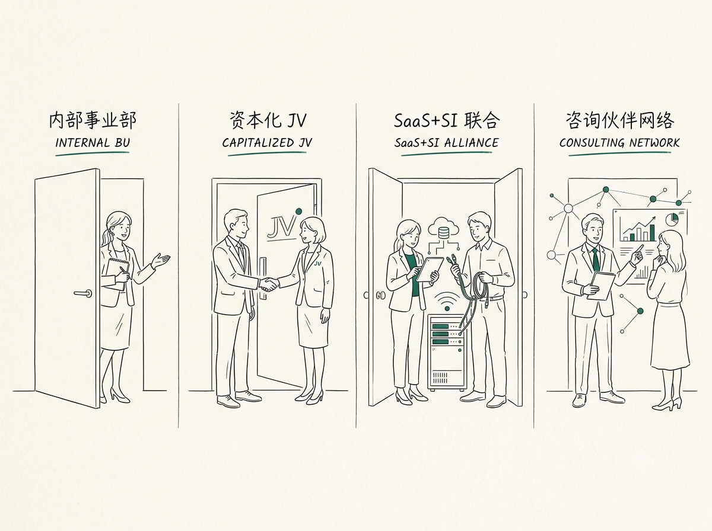
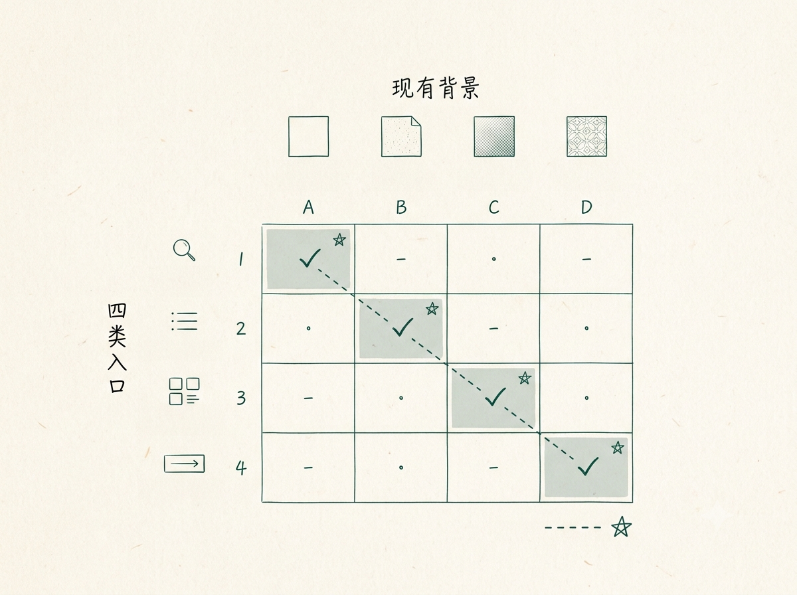

上一讲我们把 2026 上半年这场军备竞赛摊开看了：5 月 4 日 Anthropic 拉着 Blackstone、H&F、Goldman 攒了个企业服务 JV，估值 1.5B；一周后 OpenAI 的 DeployCo 融资 4B+，顺手把伦敦的 Tomoro 收了、一次性到手约 150 名 FDE。我说过，那不是风口，是整个交付层在重组。

但重组这个词太大，落到你身上就一个具体问题：这么多家在招 FDE，我到底该投哪一家、投哪个头衔？别急，这一讲我把这团乱麻拆成一张能用的地图。看完你会知道，招 FDE 的组织其实只有四种形态，每一种对应一类入口，而你现在的背景，恰好更适配其中某一两个。


## 四种组织形态，就是四道门

先给结论：招 FDE 的组织不是一锅乱炖，它们有清晰的四种形态。看懂形态，你就知道每道门后面站的是谁、卡的是什么。

这四种形态分别是：内部事业部、资本化 JV、SaaS+SI 联合体、咨询伙伴网络。名字有点绕，我一个个用大白话给你讲清楚。

**第一种，内部事业部。** 就是大厂在自己公司里划出一个部门专门做 FDE，人还是这家公司的员工。微软 7 月 2 日成立的 Frontier Company 就是典型——2.5B 投入、6000 工程师、内部事业部不是独立法人，总裁是 Rodrigo Kede Lima。AWS 6 月 30 日的 Forward Deployed Engineering 部门也是这种，5-6 人小队进驻客户，目标是「部署从月到天、离场客户可自维护」。Salesforce、Google、Meta 都走这条路。

这种门的特点是：品牌硬、流程重、级别阶梯清楚。Google Cloud 直接把 FDE I / III / Staff / Sr Staff 四档摊开，对应 2 / 5 / 8 / 10 年经验，同一句 JD 只改年限数字。好处是你一眼能看清自己站哪档，坏处是大厂招聘漏斗长、时间线慢。



**第二种，资本化 JV。** 这是 2026 最新、也最猛的一种。模型公司不自己养 FDE，而是拉上资本方另起一个独立实体来做交付。OpenAI 的 DeployCo 是标杆：TPG 领投，McKinsey、Bain、Capgemini 既出钱又当交付伙伴，还向 PE 承诺 5 年 17.5% 年化。Anthropic 那个和 Blackstone 的 JV 也一样。

这里有个关键信息，你一定要记住：JV 是独立法人，它有**自己独立的招聘通道**。这意味着什么？意味着你在 OpenAI 官网职位页翻不到的岗，可能挂在 DeployCo 或它收购来的 Tomoro 那边。就像你找一家公司的实习，光看总部官网没用，得去它那个独立运营的子品牌页面翻。投这类门，你得多花点力气找到那个独立入口。

**第三种，SaaS+SI 联合体。** SaaS 是软件公司，SI 是系统集成商。两家组队，一个出产品、一个出人力和行业关系，联合进驻客户建 agentic 工作流。ServiceNow × Accenture 就是这么干的。这种门适合谁？如果你现在就在 SI 或实施交付这条线上，这是你几乎不用换赛道就能靠过去的入口。

**第四种，咨询伙伴网络。** 这是我最想让你划重点的一种，因为它是**转型的低门槛旁路**。Salesforce 把它的 FDE Partner Network 开放给了 Accenture、Deloitte、PwC、IBM 等 30 多家咨询伙伴。也就是说，你不一定要挤进 Salesforce 本部，可以从它的伙伴那侧进场。

Deloitte 自己就开了平台绑定的 FDE 岗——AWS / Snowflake / Microsoft 三个平台方向。它的门槛低到什么程度？只要 3 年工程 + **仅 1 年** GenAI 生产经验 + 1 年指定平台经验。这是我在整个事实包里见到的最低 GenAI 年限要求。传统做法里，你想进 frontier lab 得攒 5 年 customer-facing + production LLM 经验；换到咨询伙伴这条旁路，1 年 GenAI 就够你敲门。这道缝，就是给转型者留的。

下面这张表，帮你把四种形态和适配背景对齐：

| 形态 | 代表玩家 | 入口特点 | 谁更适配 |
|---|---|---|---|
| 内部事业部 | 微软 Frontier / AWS / Google / Salesforce / Meta | 品牌硬、级别阶梯清晰、漏斗长 | 有大厂履历、能扛长流程的人 |
| 资本化 JV | OpenAI DeployCo / Anthropic JV | 独立法人，招聘通道单独挂 | 顶尖工程背景、想搏高包的人 |
| SaaS+SI 联合 | ServiceNow × Accenture | 产品方+集成商联合进驻 | 现在就在 SI / 实施交付线的人 |
| 咨询伙伴网络 | Salesforce 30+ 伙伴 / Deloitte 平台岗 | 门槛低、平台绑定、旁路进场 | GenAI 经验尚浅的转型者 |



顺带说一句谁不在这张图上。国内的 DeepSeek、月之暗面、MiniMax 这类纯模型研究公司**不设 FDE**，岗位几乎都围着 LLM 本身转。国内的 FDE 集中在云厂商（腾讯云、阿里云、火山引擎）和应用服务商那边。你要投国内，方向别搞反。

## 六个头衔是同一个岗，你得一起搜

再给一个结论：FDE 这个岗，在招聘网站上裂成了至少六个名字。你只搜「FDE」三个字，会漏掉一大半机会。

这六个变体是：FDE、FDSE、FDSWE、Deployment Strategist、Agent Engineer、Customer Solutions Engineer。它们指的基本是同一类工作——嵌入客户、把 AI 产品落到生产、再把洞察反哺回来。只是不同公司、不同侧重，起了不同的名。

我给你逐个拆一下侧重点，你就明白为什么会裂：

```text
FDE   = Forward Deployed Engineer，最通用的总称
FDSE  = Forward Deployed Software Engineer，Palantir 的 Delta 工程线，偏软件工程
FDSWE = OpenAI 的平行岗，7+ 年，专做交付抽象层、把每次 engagement 规模化
Deployment Strategist = Palantir 的 Echo 业务线 / Salesforce pod 里的策略角色，偏业务谜题拆解
Agent Engineer = Sierra 的叫法，发明了 ADLC，围着 agent 生命周期转
Customer Solutions Engineer = 更偏客户侧的解决方案头衔，同一活儿换个招牌
```

这就像你在电商上找同一件东西——有人叫它「运动鞋」，有人叫它「跑鞋」，还有人叫「慢跑训练鞋」。你只搜一个词，另外两批货就刷不出来。搜 FDE 也一样，你得把这六个同义头衔当成一组关键词，轮着搜、一起搜。


这里有个反直觉的点，我提醒你：**头衔的字面差异，往往对应背景适配的差异**。同样是这一摊活儿，公司用不同的名字在筛不同的人。

- 名字里带 **Software / SWE**（FDSE、FDSWE）的，通常更硬核工程，考你端到端写代码、做交付平台。OpenAI 的 FDSWE 直接要 7+ 年全栈。
- 名字里带 **Strategist**（Deployment Strategist）的，业务拆解权重更高。Palantir 的项目以「我们为什么延误这么多航班？」这种开放业务谜题开场，考的是 decomposition，不是刷题。
- 名字里带 **Agent**（Agent Engineer）的，把 agentic 开发和 eval 摆在最前。Sierra 的 Agent Engineer 薪酬 280-410K，就是冲着会设计 agent 生命周期的人去的。
- 名字里带 **Customer / Solutions** 的，客户面能力权重更高，更看你的沟通和需求发现。

所以搜的时候别只是无脑撒网。你可以反过来用：如果你是重工程背景，优先盯带 SWE 的；如果你是 PM 或售前转过来、强在客户沟通，优先盯带 Strategist 或 Customer Solutions 的。传统做法是「看到 FDE 就投」；更聪明的做法是「按头衔关键词反推它在筛谁，挑你长板对得上的那批先投」。

看懵了也没关系，这一段你只要记住两句话：六个头衔是一个岗，得一起搜；头衔里的词是暗号，透露它想要哪种人。


## 把形态和头衔叠起来，画出你的投递清单

最后一个结论，也是这一讲要落地的动作：把「四种形态」和「六个头衔」叠在一起，你就能画出一张属于你自己的分层投递清单。

怎么叠？很简单，两步。第一步，按你现在的背景，从四种形态里圈出最适配的一两道门。第二步，在这些门里，按对应头衔的暗号，挑你长板对得上的变体先投。

我给你几个具体走法，你对号入座：

**如果你 GenAI 经验还浅（不到 2 年）。** 别一上来硬刚 frontier lab。先走咨询伙伴网络这条旁路——Deloitte 平台岗只要 1 年 GenAI，Salesforce 30+ 伙伴也在放量。头衔上优先搜 Customer Solutions Engineer 和带平台名的 FDE。就像健身，你不会第一天就上最大重量，先从能完成的组数练起。

**如果你是重工程背景、想搏高包。** 盯资本化 JV 和内部事业部里带 SWE 的变体。但记住 JV 有独立招聘通道，你得专门去它的独立实体页面翻岗，别只在母公司官网找。别忘了低年限入口是成体系的：Google FDE I、Scale、Harvey Founding、微软 IC3 都有 2 年档，不是非 5 年不可。

**如果你是 PM 或售前转型。** 你的长板是客户面和需求拆解，这恰恰是 70%+ 的 JD 明确要的能力。优先盯 Deployment Strategist 和 Customer Solutions Engineer，形态上从内部事业部的 pod 制岗（Salesforce「1 个 Deployment Strategist + 2 个 FDE」）或咨询伙伴网络切入。

**如果你现在就在 SI / 实施交付线。** SaaS+SI 联合体几乎是给你留的门，你的行业关系和驻场经验直接能用。国内的话，投云厂商和应用服务商，别投模型公司。

把这些整理成一句操作指令：先定形态、再挑头衔、按长板排序，投递清单分层不撒网。这比你盯着一个「FDE」关键词从早刷到晚，命中率高得多。

下一讲我们换个视角。海外这套形态和头衔搬到中国，到底是洋名换皮、换汤不换药，还是真有本土机会？《中国语境：洋名换皮还是真机会》，我们下讲见。

## 小结

招 FDE 的组织只有四种形态：内部事业部、资本化 JV、SaaS+SI 联合、咨询伙伴网络——其中咨询伙伴网络（Deloitte 仅 1 年 GenAI）是转型者的低门槛旁路。这个岗又裂成六个头衔：FDE / FDSE / FDSWE / Deployment Strategist / Agent Engineer / Customer Solutions Engineer，你得当成一组关键词一起搜。头衔里的词是暗号，透露它在筛哪种人。把形态和头衔叠起来，按你的背景分层投递，别撒网。

## 思考题

把你现在的背景（工程、PM、售前、SI 实施，或别的）摊开，对照这一讲的四种形态和六个头衔，你会先圈出哪一两道门、优先搜哪两个头衔变体，为什么？欢迎在评论区聊聊你的想法。
