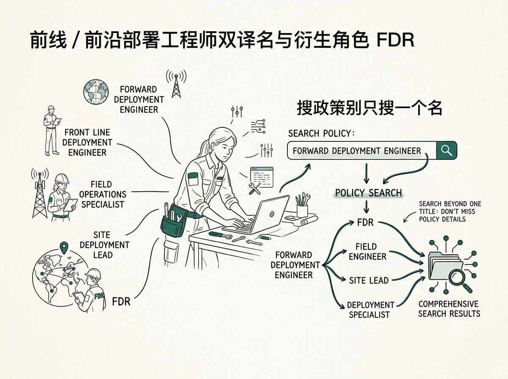
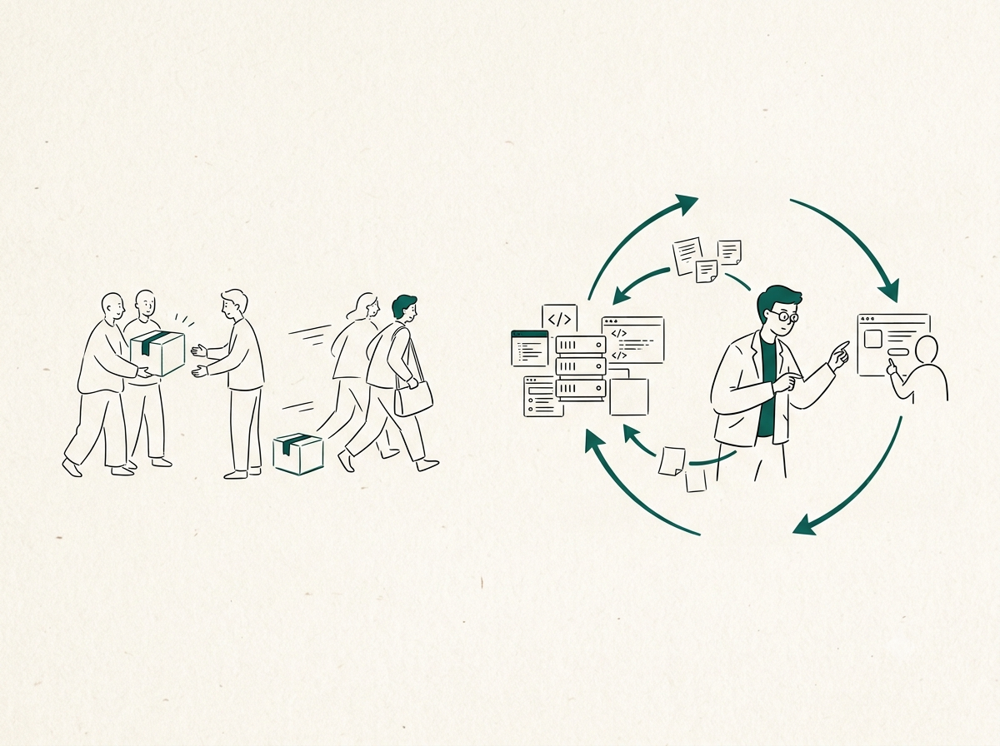

上一讲我们把海外招 FDE 的组织拆成了四类入口——内部事业部、资本化 JV、SaaS+SI 联合、咨询伙伴网络，还把裂成六个的职位变体（FDE、FDSE、FDSWE、Deployment Strategist、Agent Engineer、Customer Solutions Engineer）当成一组关键词，教你一起搜。但那都是海外的牌桌。这一讲，我把镜头拉回国内。

你心里大概一直憋着一个问题，我替你说出来：这个洋气的头衔，搬到中国是不是就换了层皮？说白了——它到底是真机会，还是把"定制外包""驻场实施"重新刷了层漆、换个英文缩写继续骗你入坑？

别急，这个疑心一点都不丢人，我第一次翻国内 FDE 招聘时也是这么想的。这一讲只干一件事：给你一把能自己上手的尺子，量出眼前这个岗到底是真 FDE，还是换皮外包。量准了，你才知道国内这局值不值得下注。


## 洋名换皮的疑心，与那句官方分界

先把结论摆桌上：国内确实有大量"换皮外包"顶着 FDE 的名字招人，但真机会也真实存在——而且划分真伪的那条线，不是我拍脑袋定的，是招聘方自己白纸黑字写进 JD 的。

先说个让人踏实的事实。腾讯云已经在 BOSS 直聘上直接挂出"AI 前线部署工程师 FDE"，35–65K/月、发 15 薪。这是目前国内最直接的同名岗位，头衔一个字没改。所以第一层疑心——"国内根本没有真 FDE，全是蹭热度"——先可以放下一半。

我也知道你真正怕的不是名字，是命运。国内转型者最担心的一句话是"被干成外包、次抛型员工"：项目一完就被丢开，绩效体系还不明不白。这担忧我不哄你，它对着换皮岗是成立的。但需求这一侧确实在爆发——国内主流招聘平台上，相关职位 2026 上半年涨了 10–20 倍。需求是真的，岗位却有真伪，这恰恰说明你更得学会分辨，而不是一竿子把整条赛道打死。

这里插一个你迟早会踩的坑：术语。首次出现我给你双注一下——前线部署工程师（FDE），亦称前沿部署工程师，百度百科的词条和上海的政策文件用的是"前沿"这个译名。别小看这一个字。你以后去搜官方培训、搜政策文件，只搜"前线"会漏掉一大半信息。顺带记一个衍生角色：FDR，前沿部署研究员，是国内政策语境里冒出来的新词。两个译名加一个 FDR，搜的时候一起搜。



好，回到腾讯云那份 JD。里面有一句原文，我建议你直接抄下来贴在显示器边上：

> 将一线经验沉淀为可复用的交付资产与行业方案模板，反哺产品。

这句话，就是国内 FDE 和传统驻场实施之间的分界线本身。

你品一下"反哺产品"四个字。传统驻场实施是什么逻辑？客户要什么，你现场搭什么，项目验收、结款、走人，代码烂在客户机房里，跟你母公司的产品没半毛钱关系。FDE 反过来：你在一线踩的坑、总结的模板、写的那套东西，得回流进产品，让下一个客户少踩坑。



这就像你在两家不同的餐馆打工。第一家，你炒完这一桌就结账走人，明天换一家从头再来，手艺全烂在自己脑子里；第二家，你每天把好用的做法写进后厨的标准菜谱，整个连锁店跟着一起变好。前者是外包，后者才是 FDE。就差一个"反哺"，职业价值差了十万八千里——前者你永远是那个被临时叫来的手，后者你是让产品越长越壮的那根神经。

所以你要做的第一个动作特别简单：拿到一份国内 JD，先拿眼睛扫"反哺""沉淀""可复用""产品化"这类词。扫得到，这岗有真 FDE 的基因；一个都扫不到，八成是驻场实施套了个洋名，你得提高警惕。

## 真伪 FDE 的三条硬标准

结论先给你：判断一个国内岗位是不是真 FDE，别盯头衔，盯三条硬标准——反哺闭环、产品发现投资、按结果收费。三条全中，是真的；缺一条，警惕；一条不沾，基本就是换皮。

**第一条，有没有反哺闭环。** 这条上一段讲透了，就是腾讯云那句话。给你一个能当场用的问法：面试时直接问用人经理——"我在客户现场做的东西，会怎么回流进你们产品？有没有具体机制？"真 FDE 岗，对方能给你讲出通道：方案模板库、内部 SDK、给产品团队的需求清单。换皮岗，对方会愣一下，然后说"就是帮客户把系统搭起来"。这一愣，你就听出来了。

这条对你还有一层私心：有没有反哺，决定了你三年后是攒下资产还是攒下工时。有反哺的岗，你每交付一个客户，公司的产品和你自己的方法论都长厚一层；没反哺的岗，你交付一百个客户，第一百个还得从零搭起，你就是那台被反复调用的机器。所以别只把它当筛岗标准，它其实是在替你筛"这三年到底喂不喂得肥你的履历"。

**第二条，有没有为产品发现投钱。** 这词有点抽象，我拆给你。真 FDE 不只是交付代码，公司还得为"从客户身上学东西"这件事付成本——给你时间做客户访谈、做需求澄清，而不是把你当纯人力，按天塞进客户现场榨干。

海外 JD 里 70% 以上都明确写着要 customer empathy 和 requirements discovery，这不是虚的软技能，是公司真金白银留给你的工作内容。国内换皮岗最典型的破绽就在这：它压根不给你"发现"的空间，需求早被销售在合同里谈死了，你只是个照图施工的手。


**第三条，按结果收费，还是按人天收费。** 这条最狠，也最好使。传统外包的商业模式是卖人天——干几天、收几天钱，毛利薄，员工被当耗材。真 FDE 的模式是按结果收费：客户产能提了多少、良率涨了几个点、成本降了多少，按这个结算。

深圳有家叫 53AI 的公司，三年实践就走"按结果收费"，而且用的是 Echo（业务专家）加 Delta（工程师）双人组：驻场 3–5 天先诊断，再共建，最后用 A/B 把效果量化出来。他们有句教训特别值钱——Prompt 工程师单独接项目必败。为什么？单枪匹马、只会调提示词的人，交付不了"结果"，只能交付"活儿"，那就退回外包了。


再给你一个工业界的实打实案例。金锃科技派 FDE 驻扎在川宁生物的发酵罐旁边，一待就是九个月。前期干的全是"脏活"：数据重新录入、参数校正、把老师傅几十年的经验数字化。听着是不是特别像苦力外包？但结局完全不同——产能提了 5%，一年多增收十个亿以上，精度从 88% 干到 97%。人家结算的是这个结果，不是九个月的人头费。同样是驻场九个月，一个按人头卖，一个按增收的十个亿谈价，这就是外包和 FDE 最赤裸的分野。

看懵了也没关系，这三条你不用背，记住下面这张对照表随身带着就行：

| 维度 | 换皮外包 | 真 FDE |
|---|---|---|
| 交付去向 | 烂在客户机房 | 反哺回母公司产品 |
| 你的时间 | 全是执行 | 含客户诊断与需求发现 |
| 收费方式 | 按人天／项目款 | 按业务结果（产能／良率／降本） |
| 团队形态 | 单兵驻场 | Echo＋Delta 双人组协同 |

嫌表格记不牢，那就把它压成三句面试话术，看到任何一个国内"FDE"岗，挨条问过去：

```text
反哺闭环 → 问：我在客户现场做的东西，怎么回流进你们产品？有没有具体机制？
产品发现 → 问：我未来一天的时间怎么分？多少花在客户诊断和需求挖掘上？
结果收费 → 问：这项目对客户是按人天结算，还是按产能／良率／降本这类结果结算？
```

三条量下来，真伪自现。

## 投递方向、薪资真相与官方旁路

结论直接给：国内想投 FDE，别往模型研究公司投，那儿根本不设这个岗；你该盯的是云厂商和应用服务商。

这是个反直觉但极其重要的点。你可能觉得，AI 最强的公司不就最需要 FDE 吗？恰恰相反。DeepSeek、月之暗面、MiniMax 这些明星模型公司，岗位几乎都围着 LLM 本身转——训模型、做研究、搞出海营销，它们不设 FDE。原因很简单：它们卖的是模型能力本身，不是"把 AI 塞进你工厂"的落地服务。


那 FDE 在哪？集中在三类地方：云厂商（腾讯云、阿里云、火山引擎）、应用层公司、垂直行业服务商。这就像你想学开挖掘机，不该跑去发动机制造厂应聘——发动机厂造的是核心部件，真正开着机器进工地干活的是工程队。模型公司是发动机厂，FDE 是工程队，这俩根本不在一个环节上。你把方向搞反，简历投得再多也是石沉大海。

所以你的投递清单应该长这样：投给那些"要把 AI 落进别人生产环境"的公司，而不是"自己造 AI"的公司。就这一条，能帮你省掉一大半无效投递。

薪资你也得清醒，别被叙事带跑。国内确实有神仙数字：智谱华章招"FDE 负责人"6–8 万/月，深圳有 FDE Leader 年薪超 300 万，猎聘上 50–100 万的岗近 300 个、过百万的 40 多个。但你要看清，这些是塔尖。

一线实证是另一幅画面：上海的初级 FDE，月薪就 2–3 万；高职级年包 40 万以上。跟满屏"年薪百万"的宣传落差不小。国内还有个海外没有的东西——驻场补贴，因为你是真得拎包去客户现场蹲着的。


把这些数字连起来看，其实是一条晋升序列：初级 FDE 先在客户现场把手练熟，往上是能独立带项目的 FDE Leader，再往上是能定打法、带团队的 FDE 负责人——智谱那个 6–8 万/月的"FDE 负责人"、深圳那个 300 万的 Leader，就是这条阶梯的上半段。你入门时盯的是月薪 2–3 万，但真正值钱的，是这条阶梯有没有铺到头。换皮外包最大的问题恰恰是：它压根没有上半段，你干三年还是那个初级，因为它不打算把你养成能定打法的人。

我讲这个不是给你泼冷水，是让你把预期摆正。真机会不等于遍地黄金。它是个正在长起来的新岗，入门段收入并不夸张，但天花板和成长通道摆在那——你要下注的是这条上升通道，不是幻想一进门就百万年薪。这就像你相中一支刚上市、基本面很硬的成长股：你赚的是它长大的钱，不是指望明天就翻倍。

最后给你一条零成本的官方旁路，很多人根本不知道它的存在。

上海创智学院办了全国首期 FDE 专题培训，免费。它搭了个"3+3+3"培养矩阵，2026 年度面向全社会招募，而且拟与人社的中级职称评定挂钩。国家层面还有人工智能应用中试基地，文件里白纸黑字写了"基于 FDE 的模式创新"。政府亲自下场给一个岗位铺路、还挂钩职称，这本身就是"真机会"最硬的信号之一。


你要是国内背景、预算又有限，这条免费官方通道值得第一时间去查。记住上一段的提醒：搜的时候用"前沿部署工程师"，别只搜"前线"，否则你可能连这扇门都刷不出来。

顺带再给你一个国内简历能用的证书锚点：阿里云大模型 ACP，报考成本大概一千块，考纲和 FDE 的技能栈六个模块高度重合。我把话说清楚——它不是万能敲门砖，光有证进不了真 FDE 岗。但它便宜、考纲对得上，配上你后面几讲要动手做的作品集，是国内路径上一个性价比不错的背书。免费的官方培训 + 千元的行业证书，这两样凑齐，你的启动成本其实低得让人意外。

## 国内独有的三个顺风

前面聊了那么多"怎么筛掉换皮岗"，容易让你觉得国内这局全是坑。所以最后这一段，我要把话说平衡：国内不光有真机会，还有三个海外没有的结构性顺风，而且专门利好转型进来的你。

**第一个顺风：低代码把落地门槛拉低了。** 国内低代码、私有化部署这套生态特别成熟。这意味着什么？意味着 FDE 在客户现场搭系统时，很多重复的地基活可以用现成组件拼装，你能把省下的精力压到真正值钱的地方——需求发现和反哺。这就像你装修，以前得从和水泥、砌砖开始，现在有整面预制墙板，拼上墙就行，手艺可以留给设计而不是搬砖。门槛一低，转型者更容易迈进第一只脚。

对你这个正在纠结"我技术够不够硬"的人，这一点尤其是好消息。它不是让你偷懒不学，而是把你的稀缺性从"能不能把系统跑起来"往上挪了一格——反正基础组件谁都能拼，真正拉开差距的是你能不能听懂客户没说出口的需求、能不能把老师傅的经验翻译成机器听得懂的规则。低代码替你把地板抬高了，你就站得离价值更近。

**第二个顺风：落地效果在国内特别好量化。** 这是国内被严重低估的一张牌。国内大量 FDE 需求落在制造、工业、政务这些场景里，而这些场景有个天然好处——ROI 是硬指标，A/B 一跑就见真章。


还记得川宁生物那个案例吗？产能 +5%、精度 88%→97%、年增收十个亿——这些全是能摆到老板桌上的硬数字。这就像减肥，你在很多虚头巴脑的项目里只能照镜子自我感觉良好；国内工业场景是直接让你站上体重秤，掉了几斤一目了然。对你转型有什么用？量化出来的效果，就是你简历上能写进去、别人抢不走的战绩。国内这个环境，天然帮你攒战绩。

**第三个顺风：可以按结果收费，这门生意在国内站得住。** 第二条讲的量化，直接托起了第三条。正因为产能、良率、降本这些结果能量出来，53AI 那种"按结果收费"的真 FDE 商业模式在国内才玩得转，而不是永远退回按人天卖的外包。

再补一个国内特有的协同打法：FDE 配上 FDR（前沿部署研究员），一个在前方驻场、一个在后方沉淀，把一次交付的迭代周期从三个月压到一两周，中小企业的落地成本能降到原来的五分之一。前后方一分工，你就不必一个人扛下所有脏活——这跟上一讲那个 Echo＋Delta 双人组，是同一个思路。

落点我给你收在一句话上：国内的机会是真的，这三个顺风也是真的，但它们只对"真 FDE 岗"生效。换皮外包既不反哺、也不给你量化战绩、更不会按结果跟你分钱。所以顺风再好，你也得先用那三条硬标准，把换皮岗一个个筛出去，再迈脚进场。

## 小结

国内 FDE 里混着大量换皮外包，但真机会真实存在，分界线是腾讯云 JD 那句"反哺产品"。量真伪用三条硬标准：有没有反哺闭环、有没有为产品发现投钱、是不是按结果收费。投递方向上，别投 DeepSeek、月之暗面这类模型研究公司，它们不设 FDE，盯住云厂商和应用服务商。薪资别被百万叙事带跑，初级月薪 2–3 万才是常态。国内还有三个顺风——低代码降门槛、效果好量化、能按结果收费，外加上海创智学院免费官方培训这条零成本旁路，记得用"前沿部署工程师"去搜。

## 思考题

拿你现在能搜到的一个国内"FDE"岗位，用这一讲的三条硬标准——反哺闭环、产品发现投资、按结果收费——逐条打分，它是真 FDE 还是换皮外包？如果三条只中一条，你打算在面试里用哪句话去追问、把剩下两条问清楚？下一讲我们进入《T 型能力地图：40% 写码 + 60% 面客》，看真 FDE 到底靠哪几样本事吃饭。欢迎在评论区聊聊你的想法。
