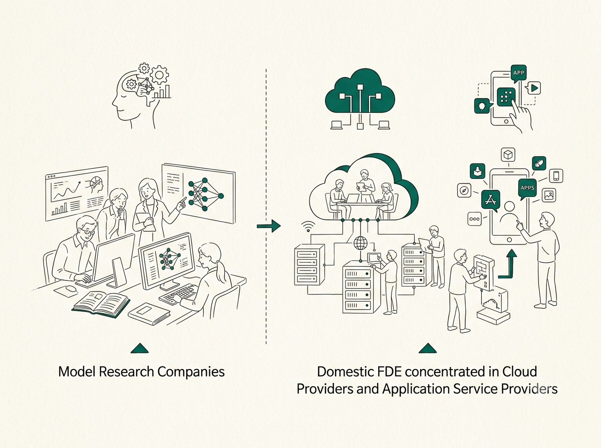
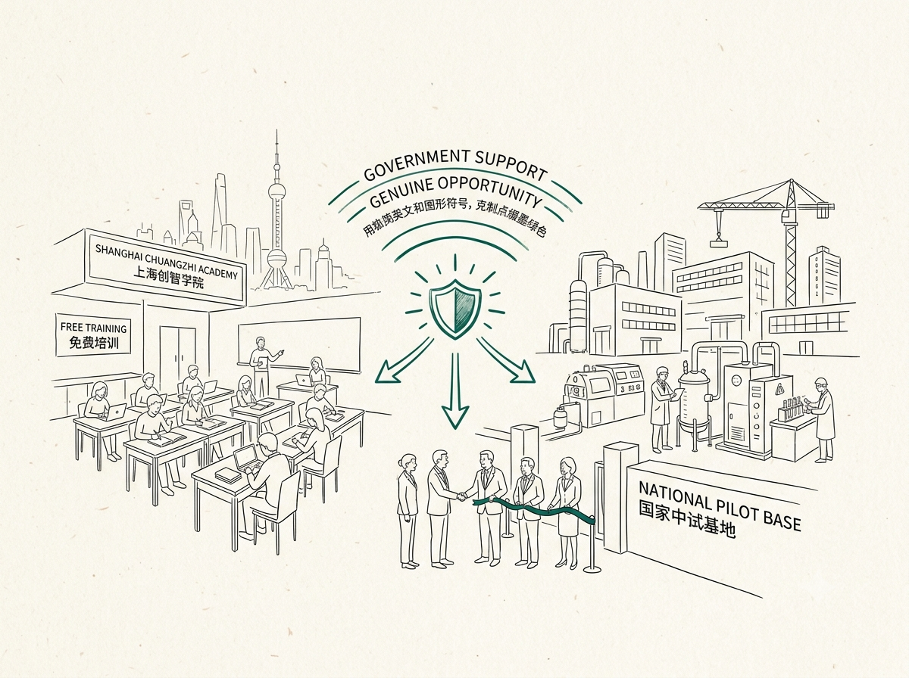

上一讲我们把海外招 FDE 的组织拆成了四类入口——内部事业部、资本化 JV、SaaS+SI 联合、咨询伙伴网络，还把裂成六个的职位变体（FDE、FDSE、FDSWE、Deployment Strategist、Agent Engineer、Customer Solutions Engineer）当成一组关键词，教你一起搜。但那都是海外的牌桌。这一讲，我把镜头拉回国内。

你心里大概一直憋着一个问题，我替你说出来：这个洋气的头衔，搬到中国是不是就换了层皮？说白了——它到底是真机会，还是把"定制外包""驻场实施"重新刷了层漆、换个英文缩写继续骗你入坑？

别急，这个疑心一点都不丢人，我第一次翻国内 FDE 招聘时也是这么想的。这一讲只干一件事：给你一把能自己上手的尺子，量出眼前这个岗到底是真 FDE，还是换皮外包。量准了，你才知道国内这局值不值得下注。


## 洋名换皮的疑心，与那句官方分界

先把结论摆桌上：国内确实有大量"换皮外包"顶着 FDE 的名字招人，但真机会也真实存在——而且划分真伪的那条线，不是我拍脑袋定的，是招聘方自己白纸黑字写进 JD 的。

先说两个让人踏实的硬事实。第一，企业端：腾讯云不仅在 BOSS 直聘挂出"AI 前线部署工程师 FDE"（35–65K/月、15 薪），腾讯 CSIG 还在下半年增设了"WorkBuddy - AI前线部署工程师"（月薪开到 50–80K），字节火山引擎、阿里云、蚂蚁数科也全面铺开同名岗。第二，国家政策端：**2026 年 8 月底，工信部正式印发《关于开展人工智能应用服务商培育专项行动的通知》（工信厅科函〔2026〕414号）**，首次在部委级红头文件里白纸黑字写明：**"鼓励服务商搭建前线部署工程师（FDE）团队，扎根用户现场，保障场景落地"**，并给出了官方十二字能力定义——**"懂业务、通模型、知安全、能交付"**；11 月初，全国数标委（CCSA TC601）又拉上信通院、阿里云、腾讯云、华为、三大运营商推进《前线部署工程师（FDE）能力分级要求》行业标准起草。所以第一层疑心——"国内根本没有真 FDE，全是蹭热度"——彻底可以放下了。

我也知道你真正怕的不是名字，是命运。国内转型者最担心的一句话是"被干成外包、次抛型员工"：项目一完就被丢开，绩效体系还不明不白。这担忧我不哄你，它对着换皮岗是完全成立的——10 月底虎嗅刚报道过一个荒诞的反面案例：某五线城市老板花 70 万请了一支所谓"野生 FDE 团队"，结果对方只是拿开源 RAG 套了个毫无权限隔离的聊天框，员工随手一问就把全公司高管和同事的工资条扒了个精光，老板当场气进医院。需求是真的爆发（猎聘 9 月报告显示，8 月单月新发 FDE 岗位几乎追平整个上半年，人才供需比低至 0.28），但鱼龙混杂也是真的，这恰恰说明你更得学会分辨。

这里插一个你迟早会踩的坑：术语。首次出现我给你双注一下——前线部署工程师（FDE，工信部文件用此名），亦称前沿部署工程师（百度百科词条和上海人社局文件用"前沿"这个译名）。别小看这一个字。你以后去搜官方培训、搜职称评审文件，只搜"前线"会漏掉一大半信息。顺带记一个衍生角色：FDR，前沿部署研究员，是国内政策语境里冒出来的新词。两个译名加一个 FDR，搜的时候一起搜。


好，回到腾讯云那份 JD。里面有一句原文，我建议你直接抄下来贴在显示器边上：

> 将一线经验沉淀为可复用的交付资产与行业方案模板，反哺产品。

这句话，就是国内 FDE 和传统驻场实施之间的分界线本身。

你品一下"反哺产品"四个字。传统驻场实施是什么逻辑？客户要什么，你现场搭什么，项目验收、结款、走人，代码烂在客户机房里，跟你母公司的产品没半毛钱关系。FDE 反过来：你在一线踩的坑、总结的模板、写的那套东西，得回流进产品，让下一个客户少踩坑。腾讯云生态伙伴安畅网络今年跑通的就是**"70% 跨行业资产复制 + 30% 现场定制"**；创企词元无限靠"AI Native FDE"沉淀出的原子组件，硬是把传统"10 人 × 3 个月"的驻场交付压成了**"3 人 × 2 周"**。


这就像你在两家不同的餐馆打工。第一家，你炒完这一桌就结账走人，明天换一家从头再来，手艺全烂在自己脑子里；第二家，你每天把好用的做法写进后厨的标准菜谱，整个连锁店跟着一起变好。前者是外包，后者才是 FDE。就差一个"反哺"，职业价值差了十万八千里——前者你永远是那个被临时叫来的手，后者你是让产品越长越壮的那根神经。

所以你要做的第一个动作特别简单：拿到一份国内 JD，先拿眼睛扫"反哺""沉淀""可复用""产品化"这类词。扫得到，这岗有真 FDE 的基因；一个都扫不到，八成是驻场实施套了个洋名，你得提高警惕。

## 真伪 FDE 的三条硬标准

结论先给你：判断一个国内岗位是不是真 FDE，别盯头衔，盯三条硬标准——反哺闭环、产品发现投资、按结果收费（外加工信部点名的"知安全"底线）。三条全中，是真的；缺一条，警惕；一条不沾，基本就是换皮。

**第一条，有没有反哺闭环。** 这条上一段讲透了，就是腾讯云那句话。给你一个能当场用的问法：面试时直接问用人经理——"我在客户现场做的东西，会怎么回流进你们产品？有没有具体机制？"真 FDE 岗，对方能给你讲出通道：方案模板库、内部 SDK、给产品团队的需求清单。换皮岗，对方会愣一下，然后说"就是帮客户把系统搭起来"。这一愣，你就听出来了。

这条对你还有一层私心：有没有反哺，决定了你三年后是攒下资产还是攒下工时。有反哺的岗，你每交付一个客户，公司的产品和你自己的方法论都长厚一层；没反哺的岗，你交付一百个客户，第一百个还得从零搭起，你就是那台被反复调用的机器。所以别只把它当筛岗标准，它其实是在替你筛"这三年到底喂不喂得肥你的履历"。

**第二条，有没有为产品发现和客户赋能投钱。** 这词有点抽象，我拆给你。真 FDE 不只是闷头敲代码，公司还得为"从客户身上挖真问题、并带教客户团队"付成本——给你时间做业务访谈、做联合共建，而不是把你当纯人力按天榨干。

看看 2026 下半年腾讯云在山东鲁信集团（管理资产 7000 亿的省属金控国企）跑出的标杆打法：6 名腾讯云 FDE 驻场两个月，不是替客户包办一切，而是和鲁信内部选拔的 **35 名业务骨干（种子选手）**结对子，手把手共建出 31 个智能体场景，把财报勾稽核验从"4 个人干 1 天"压到了"10 分钟"。海外 JD 里 70% 以上都明确写着要 customer empathy 和 requirements discovery，鲁信这个案子就是它在国内国企现场的真实投影。换皮岗最典型的破绽就在这：需求早被销售在合同里死死锁住，你只是个照图施工的手。


**第三条，按结果收费，还是按人天收费。** 这条最狠，也最好使。传统外包的商业模式是卖人天——干几天、收几天钱，毛利薄，员工被当耗材。真 FDE 的模式是按结果立军令状：客户产能提了多少、故障定位缩了多少、成本降了多少，拿硬指标说话。

深圳有家叫 53AI 的公司，三年实践就走"按结果收费"，而且用的是 Echo（业务专家）加 Delta（工程师）双人组：驻场 3–5 天先诊断，再共建，最后用 A/B 把效果量化出来。他们有句教训特别值钱——Prompt 工程师单独接项目必败。为什么？单枪匹马、只会调提示词的人，交付不了"结果"，只能交付"活儿"，那就退回外包了。


再给你两个工业界的实打实案例。一个是金锃科技派 FDE 驻扎在川宁生物的发酵罐旁边，一待就是九个月，前期干的全是数据重录入、参数校正、把老师傅几十年手感数字化的"脏活"，最终把发酵精度从 88% 干到 97%、产能提了 5%、年增收超十个亿。另一个是下半年阿里云 FDE 团队联合中石油昆仑数智攻坚石化炼化核心装置——把工艺机理和实时 DCS 传感流绑进多智能体，让异常根因定位从 **30 分钟以上压到 2 分钟以内**，并在生产环境连续稳定跑了 60 多天零人工干预。人家交付的是这种真刀真枪的生产结果，不是九个月的人头费。

看懵了也没关系，这三条你不用背，记住下面这张对照表随身带着就行：

| 维度 | 换皮外包 | 真 FDE |
|---|---|---|
| 交付去向 | 烂在客户机房 | 反哺回母公司产品（70% 复用 + 30% 定制） |
| 你的时间 | 全是照图施工 | 含客户诊断、需求发现与带教业务种子 |
| 收费方式 | 按人天／项目款 | 按业务结果（产能／时效／良率／降本） |
| 团队与安全 | 单兵驻场、无权限隔离 | Echo＋Delta 协同，严守数据与权限安全 |

嫌表格记不牢，那就把它压成三句面试话术，看到任何一个国内"FDE"岗，挨条问过去：

```text
反哺闭环 → 问：我在客户现场做的东西，怎么回流进你们产品？有没有具体机制？
产品发现 → 问：我未来一天的时间怎么分？多少花在客户诊断和需求挖掘上？
结果收费 → 问：这项目对客户是按人天结算，还是按产能／良率／降本这类结果结算？
```

三条量下来，真伪自现。

## 投递方向、薪资真相与官方旁路

结论直接给：国内想投 FDE，**八成以上的主力席位在云厂商和应用服务商**；至于大模型独角兽，2026 年秋天刚刚发生分化——别盲投 DeepSeek，但可以盯紧刚下场建队的月之暗面（Kimi）、智谱、MiniMax 和阶跃星辰。

这个格局变化非常新，我帮你把时间线校准到 2026 年 11 月。今年上半年，国内纯模型独角兽几乎都不设 FDE；但到了 9–10 月，商业化压力倒逼出了两条截然不同的路：**DeepSeek** 依然是彻底的异类，坚持纯研究组织、零线下驻场 FDE（虽然企业私有化现场到处都在跑它的模型）；而另一边，**月之暗面**在 9 月 10 日推出"Kimi 企业合作伙伴计划"拉上华胜天成、金山云等共建 FDE 队伍，10 月更直招年薪百万级的资深 FDE；**MiniMax** 9 月开始直招企业与出海 FDE；**阶跃星辰**联合金蝶等喊出"FDE + SaS"。



即便如此，从招聘体量看，真正的蓄水池依然集中在三类地方：**云厂商及大厂 2B 事业群**（腾讯云、阿里云、字节火山引擎与飞书、蚂蚁数科、商汤）、**联合交付生态**（如火山引擎 × 安永千人团队、软通动力 AI 中心 700+ 人 FDE 池、安畅网络）、以及**垂直行业服务商**。所以你的投递清单很清楚：把火力压在"要把 AI 塞进别人生产环境"的云厂商、头部应用与刚开闸的 Kimi/智谱 B 端团队上，别闭着眼往纯研究实验室海投。

薪资你也得清醒，别被叙事带跑。猎聘 2026 年 9 月报告给出了全网最准的一组标尺：全国 FDE 招聘平均年薪 **40.8 万**、中位数 **36.6 万**。塔尖确实有神仙数字——月之暗面资深 FDE 挂到 109 万/年，智谱招"FDE 负责人"6–8 万/月，腾讯 WorkBuddy 岗开 50–80K/月，深圳甚至出过年薪 300 万的 Leader 极值。

但塔底是另一幅画面：一线城市初级 FDE 实证月薪就是 **2–3 万**；要是撞上二三线城市的换皮集成岗，月薪甚至掉到 8–16K（还有日薪 200 元招驻场实习生充数的）。跟满屏"人人年薪百万"的自媒体标题落差不小。国内还有个海外少见的显性补偿——**驻场补贴**，正规大厂与头部服务商通常在薪资外另补 **300–800 元/天**（或包食宿差旅），因为你是真得拎包去客户现场蹲着的。


把这些数字连起来看，其实是一条晋升序列：初级 FDE 先在客户现场把手练熟，往上是能独立带项目的 FDE Leader，再往上是能定打法、带团队的 FDE 负责人。你入门时盯的是月薪 2–3 万，但真正值钱的，是这条阶梯有没有铺到头。换皮外包最大的问题恰恰是：它压根没有上半段，你干三年还是那个初级。

最后给你一条已经**真正兑现**的零成本官方旁路，很多人还停留在上半年的旧消息里。

上海创智学院不仅办了全国首期免费 FDE 专题培训（"3+3+3"培养矩阵），而且当初承诺的"职称挂钩"在 **2026 年 11 月已经正式落地**！上海市人社局专门下发《沪人社专〔2026〕161号》设立"前沿部署工程师"职称评审学科组，采取"以赛代评"机制——**11 月 9 日首批公示，来自 121 家单位的 274 名工程师（含正高 40 人、副高 102 人、中级 132 人）正式拿下官方工程职称**；紧接着上海市长宁区还开出了全国首个区级免费公益 FDE 实训营（携程、春秋航空、黑湖科技等 50 多家企业派人参训）。政府亲自建学科组、发正高级和副高级职称，这是国内给一个新工种最硬的体制内背书。



你要是国内背景、预算又有限，上海创智学院和各区人社公益实训营值得第一时间去盯（记得用"前沿部署工程师"搜）。

顺带再给你一个国内证书锚点与一条防割韭菜提醒：**阿里云大模型 ACP**（官方报名 1200 元，活动价常在 840 元左右）2026 年刚把 Agent、Context 工程和 Skills 更新进考纲，性价比实在；如果你身处腾讯云或阿里云的伙伴公司，还可以考厂商面向 B 端生态发的 FDE 伙伴认证。但请注意：**目前没有任何一家大厂 JD 要求自费考取几千块钱的社会培训机构"FDE 岗位证书"**——看到收你三五千块承诺"考证包推荐百万年薪"的机构，直接绕道，把钱省下来做作品集。

## 国内独有的三个顺风

前面聊了那么多"怎么筛掉换皮岗"，容易让你觉得国内这局全是坑。所以最后这一段，我要把话说平衡：国内不光有真机会，还有三个海外没有的结构性顺风，而且专门利好转型进来的你。

**第一个顺风：低代码与智能体底座把落地门槛拉低了。** 国内私有化部署、低代码编排与企业微信/飞书/钉钉生态特别成熟。这意味着 FDE 在客户现场搭系统时，很多重复的地基活可以用现成组件拼装，你能把省下的精力压到真正值钱的地方——需求发现、权限安全、评测和反哺。门槛一低，转型者更容易迈进第一只脚。

**第二个顺风：落地效果在国内特别好量化。** 这是国内被严重低估的一张牌。国内大量 FDE 需求落在制造、石化、能源、金融国企这些重场景里，而这些场景有个天然好处——ROI 是硬指标，A/B 一跑就见真章。


还记得川宁生物、中石油昆仑数智和山东鲁信那三个案例吗？发酵产能 +5%、故障定位 30 分钟压到 2 分钟、财报核验 1 天变 10 分钟——这些全是能摆到老板桌上的硬数字。量化出来的效果，就是你简历上能写进去、别人抢不走的战绩。国内这个环境，天然帮你攒战绩。（顺便提一句，2026 年 10 月人民邮电出版社刚出了国内第一本同名纸质书——范冰写的《前线部署工程师（FDE）：人工智能时代的客户价值交付》，偏商业与管理视角、不涉及代码实现，恰好可以和我们这门纯工程实操课互补着翻。）

**第三个顺风：可以按结果收费，这门生意在国内站得住。** 第二条讲的量化，直接托起了第三条。正因为产能、时效、良率、降本这些结果能量出来，53AI 那种"按结果收费"的真 FDE 商业模式在国内才玩得转，而不是永远退回按人天卖的外包。

再补一个国内特有的协同打法：FDE 配上 FDR（前沿部署研究员），一个在前方驻场、一个在后方沉淀，把一次交付的迭代周期从三个月压到一两周，中小企业的落地成本能降到原来的五分之一。前后方一分工，你就不必一个人扛下所有脏活——这跟上一讲那个 Echo＋Delta 双人组，是同一个思路。

落点我给你收在一句话上：国内的机会是真的，工信部 414 号文和上海 274 张职称证书也是真的，但它们只对**"懂业务、通模型、知安全、能交付"的真 FDE 岗**生效。所以顺风再好，你也得先用那三条硬标准把换皮岗筛出去，再迈脚进场。

## 小结

国内 FDE 里混着换皮外包甚至草台班子，但真机会已被工信部〔2026〕414 号文与企业高薪岗双重坐实，分界线是腾讯云 JD 那句"反哺产品"与工信部"懂业务、通模型、知安全、能交付"十二字标准。量真伪用三条硬标准：反哺闭环、产品发现与客户带教投入、按结果收费。投递方向上，主力盯云厂商、大厂 2B 与应用服务商（纯模型公司里 DeepSeek 仍零 FDE，而月之暗面、MiniMax、阶跃星辰已在下半年下场）。全国招聘中位数 36.6 万，但入门实证月薪 2–3 万（另加 300–800 元/天驻场补贴）。上海"前沿部署工程师"职称评审已正式落地（首批 274 人获评），记得双译名同搜，并避开高价卖证机构。

## 思考题

拿你现在能搜到的一个国内"FDE"岗位，用这一讲的三条硬标准——反哺闭环、产品发现投资、按结果收费——逐条打分，它是真 FDE 还是换皮外包？如果三条只中一条，你打算在面试里用哪句话去追问、把剩下两条问清楚？下一讲我们进入《T 型能力地图：40% 写码 + 60% 面客》，看真 FDE 到底靠哪几样本事吃饭。欢迎在评论区聊聊你的想法。
