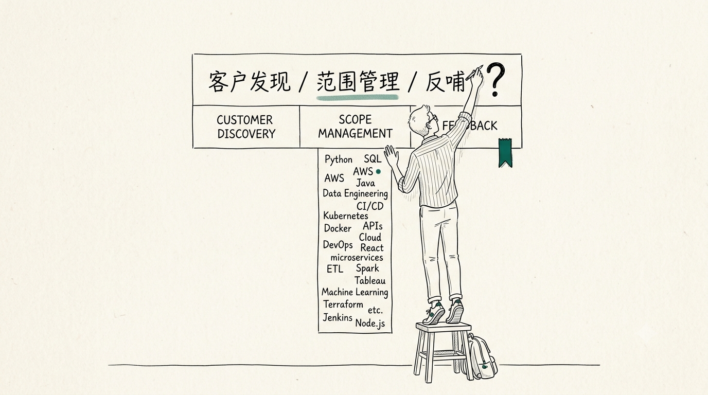
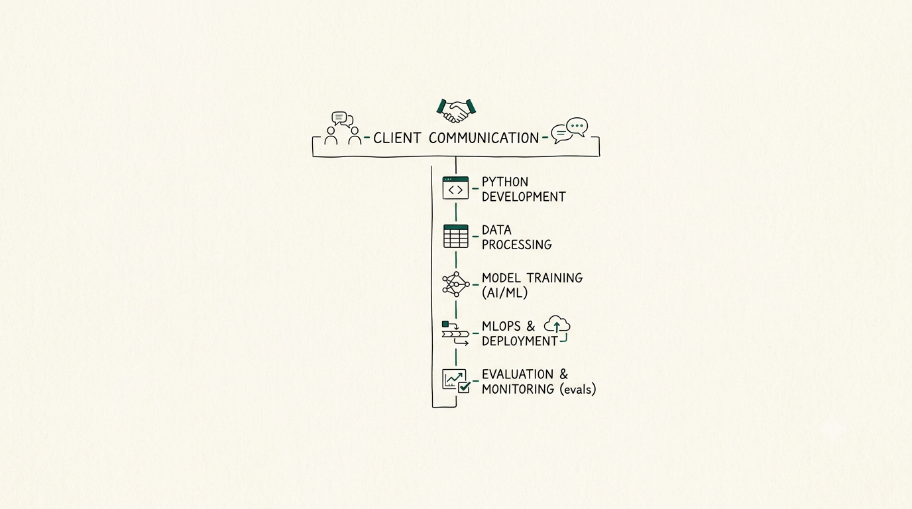
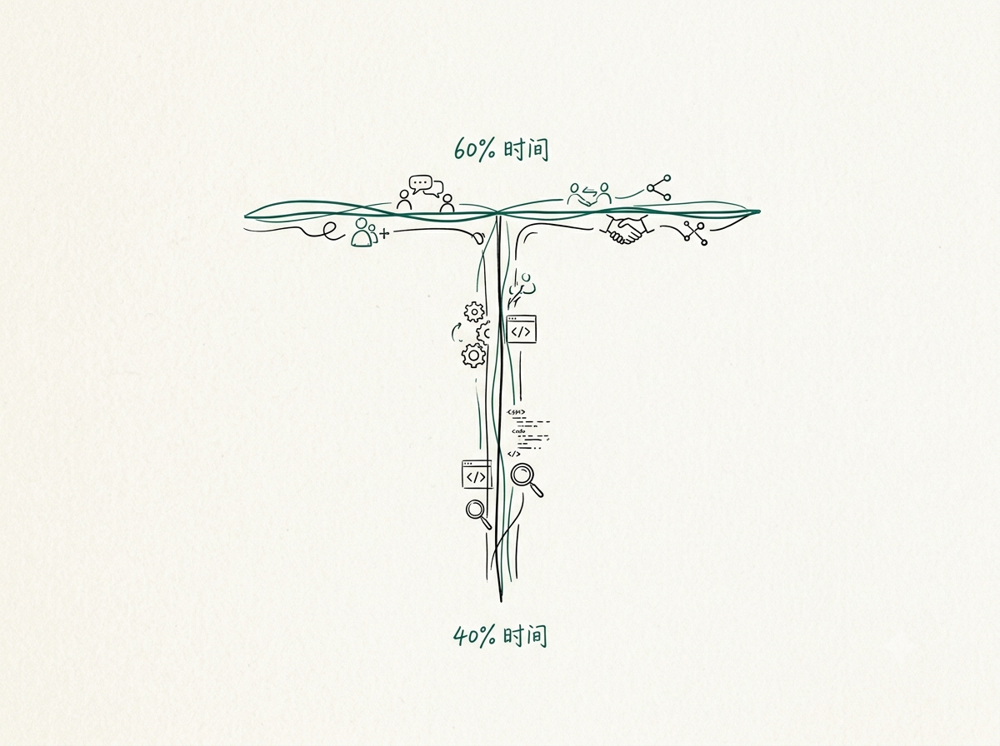
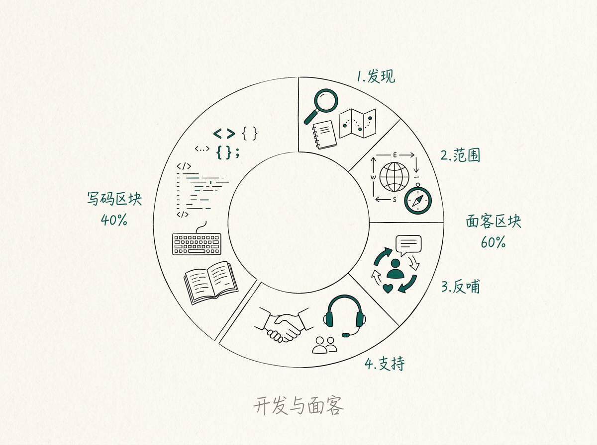
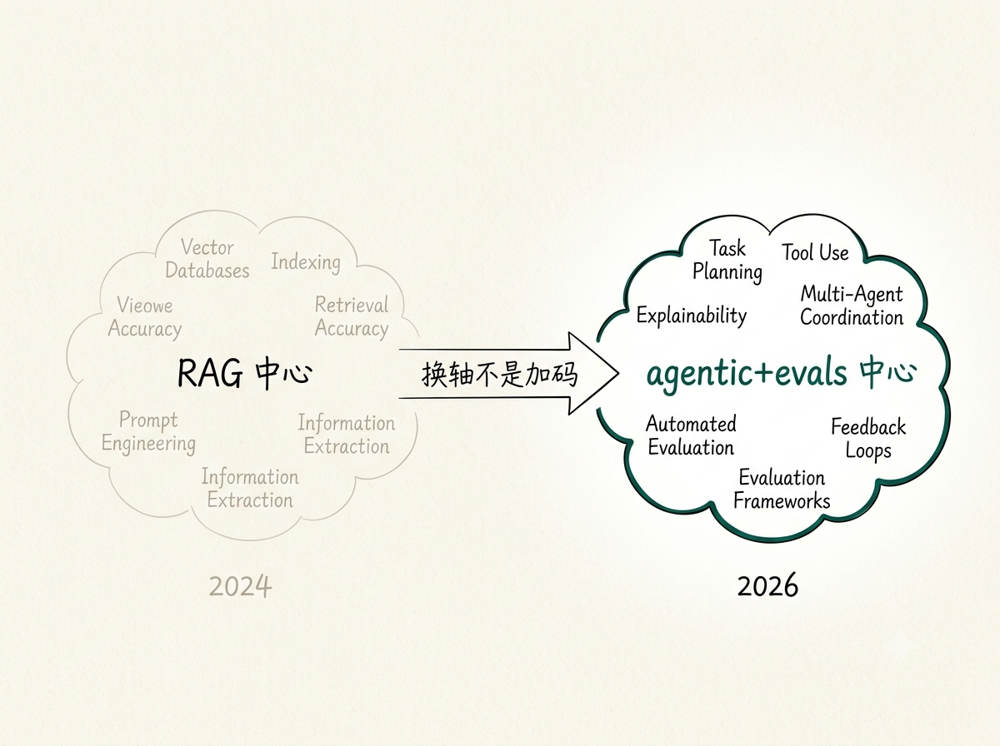

上一讲我们把"洋名换皮还是真机会"这个心结正面拆了。结论你还记得吧：腾讯云已经直接挂出"AI 前线部署工程师 FDE"、35–65K×15 薪，JD 白纸黑字要你"将一线经验沉淀为可复用的交付资产与行业方案模板，反哺产品"。这不是定制外包换了个洋名，这是一个有独立能力要求的新工种。

那问题就来了：这个工种到底要你会什么？你现在手里的技能，够不够得着？缺的那部分，是缺在"写码"这一半，还是"面客"这一半？

这一讲我给你一张地图。一张 T 型的能力地图，让你把自己往上一贴，就知道自己站在哪、缺哪块。说白了：先看清 T，再谈补哪一笔。





## 为什么是 T，而不是一根竖线

先给结论：FDE 不是"技术更强的工程师"，也不是"会写码的售前"。它是一个 **T 型**角色——一竖到底的技术深度，加一横铺开的客户面能力，缺哪一笔都不成立。

我知道很多人第一反应是把它想成一根竖线：技术越硬越值钱。这个直觉对普通 SWE 成立，对 FDE 不成立。为什么？因为这两个岗的价值来源根本不同。

普通 SWE 是"一个能力服务众多客户"——你写一个功能，一百万人用。FDE 反过来，"为单一客户交付众多能力"——你嵌进一家客户，把他家那摊活从头趟到尾。前者客户接触占 10–20%，后者占 60–80%。这个数字差，就是竖线和 T 的差别。

就像你去看病。普通 SWE 是药厂研究员，在实验室里把药做出来，不见病人。FDE 是那个下到县医院、蹲在病床边、根据这个具体病人的情况调药量的医生。药做得再好，不会面对真实病人，在 FDE 这行就是半残。

所以这一横不是"软技能加分项"，它是承重墙。Palantir 官方给 FDE 的类比是"你的职责像创业公司 CTO"——小团队、极少监督、端到端 own 一个高风险项目。CTO 会只写码不见人吗？不会。



来把这张 T 拆开看。

**竖柱，是技术底座 + AI 工程栈两段。** 底座是 Python 为主、SQL/数据处理垫底——这是你能"亲手把东西写进客户生产环境"的前提。往上一段是 2026 年真正值钱的 AI 工程栈：context engineering、evals、agent 编排、MCP。这一段后面几讲会一格一格展开，这里你只要记住它长在底座之上，不是空中楼阁。

**横梁，是交付软技能三件套。** 客户发现（搞清楚客户到底要什么，而不是他嘴上说要什么）、范围管理（把一个模糊的大需求切成能交付的小块）、反哺（把一线洞察带回去改产品）。腾讯云那句"反哺产品"，考的就是横梁最右边这一格。

竖柱决定你能不能把东西做出来，横梁决定你做的是不是客户真正要的东西。两笔缺一，这个 T 就塌了。

别急，我不是要你两边都变满级。恰恰相反——这一讲的全部目的，是让你看清自己**天生站在哪一笔上**，然后只补另一笔的缺口。工程师出身的，横梁短；PM 和售前出身的，竖柱短。你是哪一种，心里大概已经有数了。

## 40% 写码 + 60% 面客：时间配比说明了一切

再给个结论：FDE 的时间大致是 **40% 写码、60% 面客**。这个配比不是我拍的，是从大量 JD 和从业者自述里反推出来的，它一句话说清了这个岗到底长什么样。

我们看一个真实的构成。Het Trivedi，创业失败后自学 GenAI、写了篇部署博客被 Baseten 联创私信挖走。他自己拆过工作构成：

```text
模型性能调优   60%
工程实现       20%
销售           10%
客户支持       10%
```

你注意到没有？纯"敲代码"的工程实现只占 20%。剩下八成里，模型调优要贴着客户的真实数据和场景来，销售和支持全是面客。加起来，面客确实压过了写码。他那句名言很传神：**"You're the one they call when shit hits the fan."**（出事的时候，客户第一个打电话找的就是你。）

这跟传统实施/驻场有什么不一样？我给你摆个对比。

- **传统驻场实施**：先签合同定需求，再按排期把既定方案部署下去，客户接触主要在验收环节，交付完就撤，代码是一次性的。
- **FDE 做法**：先蹲到客户现场做发现，边谈边把一个能跑的粗糙版本搭出来让他当场信，然后一轮轮硬化到能上生产，撤场后系统还得能被客户自己维护，洞察还要带回去改产品。

就像你装修房子。传统实施是包工头照着图纸把活干完就走。FDE 是那个跟你一起住进毛坯房、边住边改、还把你家户型的坑记下来反馈给设计院的人。前者交付"一套动作"，后者交付"一段持续的共建关系"。



这个 60% 意味着什么？意味着如果你现在的岗位面客接触是个位数百分比，你要补的不是"更多算法题"，是**开口跟人打交道的肌肉**。反过来，如果你是 PM 或售前，面客对你是舒适区，你要补的是那 40% ——真能把代码写进生产环境的硬手艺。

Milos Mandic 说过一句更狠的：**"If you need long stretches of uninterrupted focus to be productive, this role will break you."**（如果你非得靠大段不被打扰的时间才能高产，这个岗会把你榨垮。）60% 面客，就是这句话的来源。这不是劝退，是让你提前对表——看懵了也没关系，你只要知道：选这行，等于选了一种被频繁打断的工作节奏。

## 2026 技能换代：从 RAG 中心，转向 agentic + evals 中心

第三个结论，也是这一讲最"值钱"的一句：**如果你手里那套是 2024 年的 FDE 技能表，它已经过期了。** 主线从"RAG 中心"整体挪到了"agentic + evals 中心"。你补技能之前，先得知道往哪个方向补。

我怕你踩坑，先把这次换代讲清楚。2024 年，FDE 的技术叙事核心是 RAG——切块、embedding、检索、rerank，一套管线走下来就是硬本事。2026 年不是这样了。

RAG 没死，但降级了。它从"独立主线"变成了"检索光谱里的一段"——现在更准确的说法是"RAG 是 agent 的记忆层"。有多夸张？Amazon Science 的数据，agentic 关键词搜索能达到 RAG 忠实度的 94.5%，而且零向量库。所以你要还抱着"我把 RAG 管线练到炉火纯青就能进 FDE"，方向就偏了。

那新中心是什么？两个词：**agentic** 和 **evals**。

Agentic 从加分项变成了主线。Google Cloud 的 FDE JD 直接点名 LangGraph/CrewAI/ADK，还要你会 ReAct、self-reflection、hierarchical delegation 这些模式。Kurian 那句话你可以背下来：**"the era of the pilot is over. The era of the agent is here."**

Evals 则是全线最重的一格。Andrew Ng 的判断是——能不能做好 evals 和 error analysis，是你能不能构建出 agent 能力的**最大预测因子**。OpenAI 给 FDE 的成功标准里，白纸黑字写着 "eval-driven feedback that changes product and model roadmaps"。重要到什么程度？"AI Evals Engineer" 已经独立成了一个岗，入门就 $130–173K。



我把这次换代整理成一张表，你对着自己的旧认知划一遍：

| 能力项 | 2024 定位 | 2026 定位 | 趋势 |
|---|---|---|---|
| Evals（error analysis/judge/harness） | 加分 | 全线最重 | ▲▲ |
| Agentic（multi-agent/编排框架） | 加分 | 主线 | ▲▲ |
| MCP | 基本没有 | 新晋硬门槛 | ▲▲ |
| 客户面（发现/范围管理） | 软技能 | 70%+ JD 硬要求 | ▲ |
| 与 coding agent 协作 | 无 | 新增技术面信号 | ▲ |
| Context engineering | prompt 为主 | context 为主 | prompt ▼ / context ▲ |
| RAG/检索 | 核心主线 | 降为"记忆层"一段 | ▼ |

看这张表，你该干的事很清楚：别再往"prompt engineering"和"纯 RAG 管线"上砸时间了——"prompt engineer"这个职位名 2026 基本已经消失。把省下来的力气挪到 evals、agentic、MCP 上。

这里插一句特别要划重点的：**MCP**（Model Context Protocol）。它是这轮换代里冒出来的新硬门槛。Anthropic 的 FDE JD 直接把交付物写成 "MCP servers, sub-agents, and agent skills"，面试环节直接考"用 MCP 让模型规划并执行长任务"。而且它已经下沉了——连 Sarvam 这种非头部公司都要求你会写 MCP server。

别被这个词唬住。就像你写过 REST API 就能理解它一样——MCP 本质就是"给模型接一个能调你系统的标准插头"。你之前给前端写接口，现在给模型写接口，同一块肌肉。真到后面的技术讲里，我会带你亲手写一个。

## 九维自评：先定位自己缺哪一半

最后落到动作。给你一个九维自评框架，让你把前面这张 T 具体成九个可打分的格子。目的只有一个：**定位你缺的是竖柱那一半，还是横梁那一半。**

这九维是从跨公司 JD 的共性硬要求排序里提炼的，其中 **MCP** 和 **orchestration（与 coding agent 协作）** 是这一版新加进来的两维——它们在旧地图上根本不存在。

你拿张纸，每一维给自己打 0–3 分（0=没碰过，1=玩过 demo，2=做过真项目，3=能上生产/能带面试讲）：

```text
【竖柱 · 技术侧】
1. 全栈交付       Python 为主 + TS 为辅，能端到端做出应用
2. Evals          error analysis / 二元 judge / per-client harness
3. Agentic 编排   multi-agent + LangGraph/CrewAI/ADK + ReAct 等模式
4. MCP            能从零写一个生产级 MCP server           ← 新维
5. Context 工程   系统提示/检索/记忆/工具返回的分层架构
6. 检索光谱       传统 RAG → agentic search，会讲取舍

【横梁 · 客户侧】
7. 客户发现       Mom Test 式提问，挖真实需求而非嘴上需求
8. 范围管理       把模糊大需求切成能交付的小块 + 硬化节奏
9. 反哺闭环       把一线洞察转成产品建议带回去          
                  （orchestration/与 coding agent 协作贯穿 1–9） ← 新维
```

打完分，做一个简单动作：把 1–6 的分加起来，再把 7–9 的分加起来，各自算个均值。哪边低，你缺的就是哪一半。


然后对号入座，我给你两类典型：

- **你是工程师出身**（后端/数据/ML）：多半 1–6 分不低、7–9 塌方。你的短板是横梁。别再刷算法题了——招聘方明说了，FDE 技术水位跟普通工程团队一致，筛的是动机和客户面。你要补的是 Mom Test 提问、咨询 case 式的快速诊断。Kanav Bhatnagar 从 Amazon SWE 转 Rippling 创始 FDE，就是靠"咨询行业 case 面题"备考的，他自述最难的两关是 context switching 和直面客户建立信任——全在横梁上。

- **你是 PM / 售前出身**：多半 7–9 天然达标、1–6 是硬伤。你的短板是竖柱，而且要补的是最硬那截——真能把代码写进生产环境。好消息是横梁这块 70%+ 的 JD 要求你天生就有；坏消息是竖柱躲不掉，旗舰作品集必须自己亲手写，不能靠嘴。

就像你健身，得先照镜子看清是缺胸还是缺腿，再决定今天练哪块。这张九维表就是那面镜子。别急着两边一起猛冲——先把低的那一半的均值，从 1 拉到 2，你的转型就实质性地动起来了。

## 小结

FDE 是 T 型角色：竖柱是"技术底座 + AI 工程栈"，横梁是"客户发现 / 范围管理 / 反哺"，时间大致 40% 写码、60% 面客。2026 年技能主线已从 RAG 中心换轴到 agentic + evals 中心，MCP 成为新硬门槛。用九维自评（含 MCP、orchestration 两新维）给自己打分，把技术侧 6 维和客户侧 3 维分别求均值，低的那一半就是你要补的缺口。工程师缺横梁，PM 和售前缺竖柱——先看清 T，再补一笔。

## 思考题

拿今天这张九维表给自己打完分后，你技术侧和客户侧哪一半的均值更低？把最低的那一维拎出来，想一个你下个月就能动手、且能产出可展示证据（一段代码、一次真实客户对话、一篇博客）的具体动作——它会是什么？欢迎在评论区聊聊你的想法。

下一讲，我们把镜头从"你自己"转到"招聘方"，钻进硬门槛技术栈，看看八家大厂的 JD 真正卡的是哪五项。
