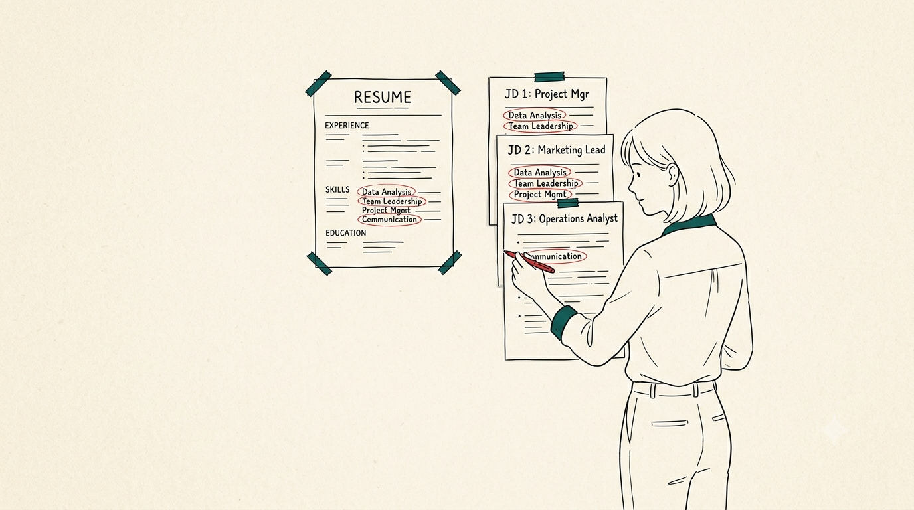
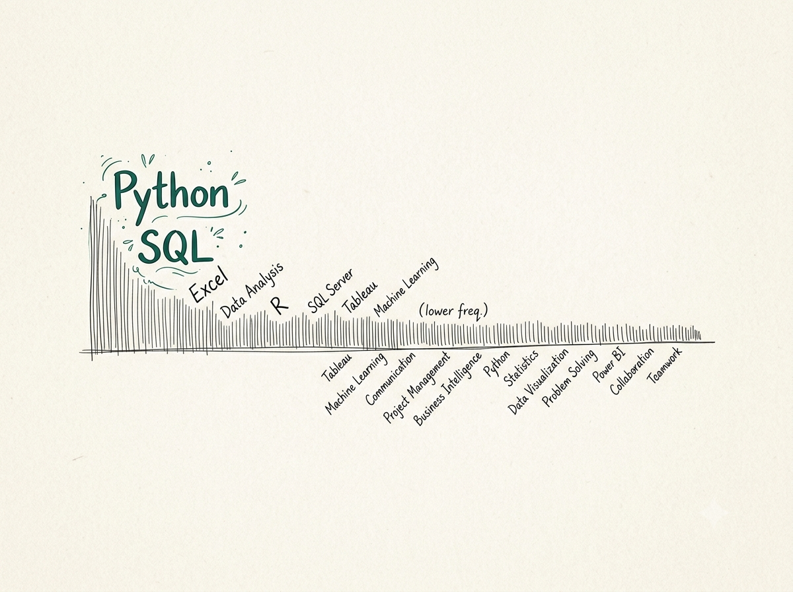
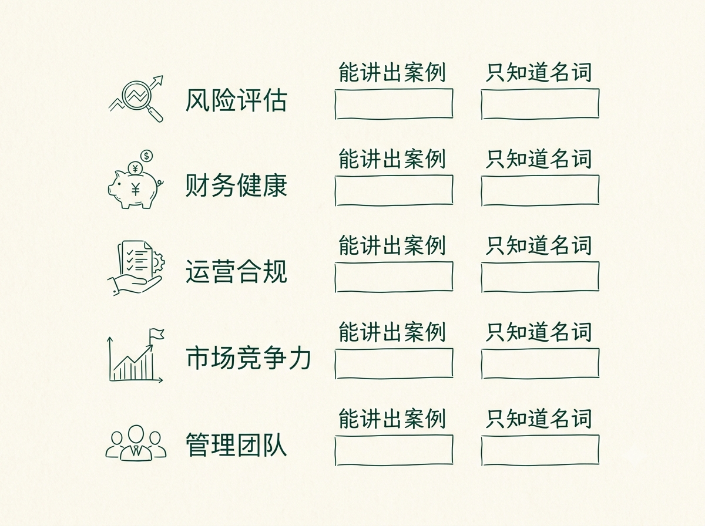
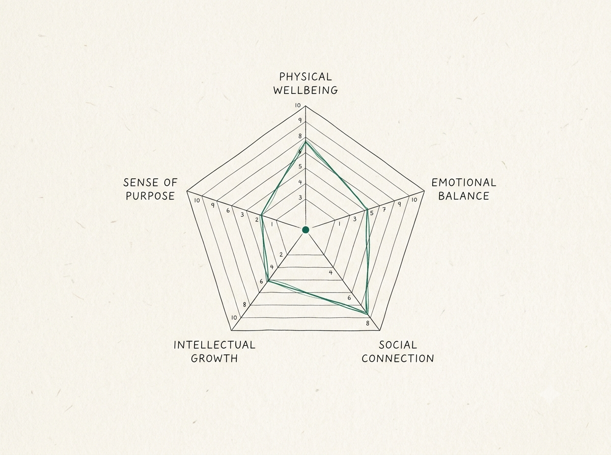
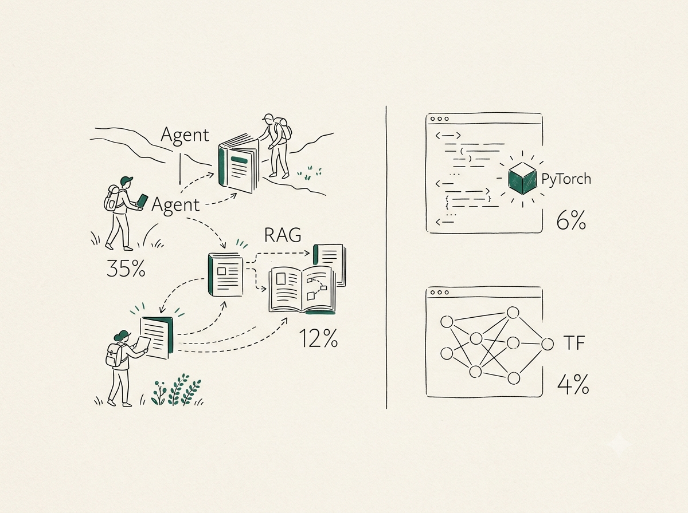
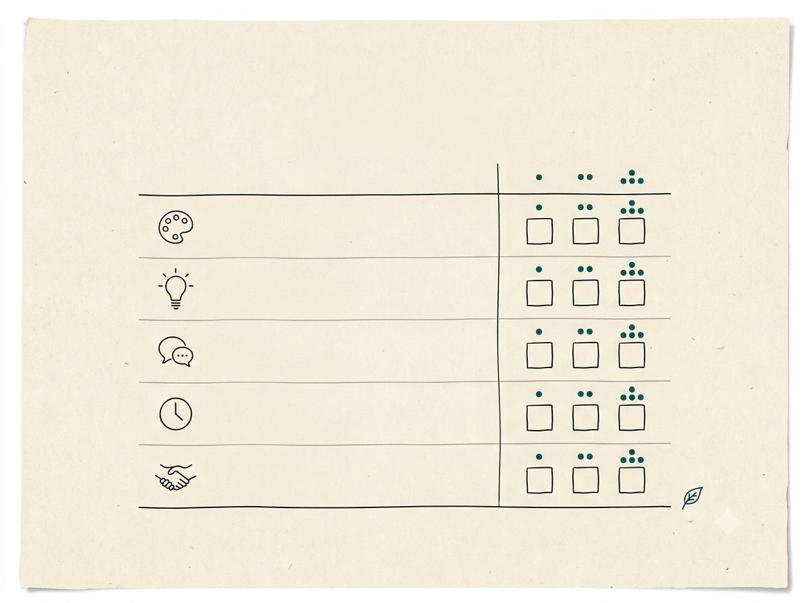

上一讲我们画了一张 T 型能力地图：竖柱是技术底座加 AI 工程栈，横梁是面客能力。那张图告诉你"往哪长"。但它没回答一个更扎心的问题：招聘方筛简历时，到底先卡哪几项？

这一讲我们把竖柱拆开，只看硬门槛。我把几十份 JD 里出现的技能词摊在桌上数了一遍频率，结果很清楚：有些词几乎每份都在，缺了直接出局；有些词听着高大上，其实招的人根本没几个。我们要分清哪些是地基、哪些是区分度、哪些是你以为重要其实在贬值的。

说白了，这一讲帮你干一件事：拿词频当尺子，给你自己的技能栈打个分，算出你现在离门槛还差几格。



## 不可谈判的地基：Python、SQL 和一朵云

先给结论：Python + 高级 SQL + 至少一朵云，这三样是地基。地基的意思是——它们不帮你加分，但缺一样，你连被看到的机会都没有。

Python 出现在大约三分之二的 FDE JD 里。Google 的 FDE JD 从初级到 Staff，同一句话只改年限："building and shipping production-grade AI-driven solutions using Python, Typescript"。注意，是 production-grade，不是 notebook 里跑通就行。Anthropic 也写明 Python 为主、最好会 TS。所以别纠结语言之争，Python 是默认母语，TS 是第二语言。



SQL 这一项容易被低估。很多人觉得"我会写 SELECT 就行了"。不是的，FDE 面的是高级 SQL——窗口函数、CTE、查询优化、面对客户脏数据库时的排查能力。Snowflake 的离场标准写得很直白："When you leave a customer engagement, their data is structured, trusted, and agent-ready."（客户的数据在你离场时是结构化、可信、agent 就绪的。）数据不干净，你后面所有的 agent 都是空中楼阁。

就像你去别人家装修，水电是隐蔽工程，客户验收时看的是墙面，但水电不通，全屋作废。Python 和 SQL 就是 FDE 的水电。

云这一项，AWS 领先。在提到具体云平台的 JD 里，AWS 大约占三成，GCP、Azure 紧随其后。这里有个转型者常犯的错：想把三朵云都学一遍。别急，没必要。你只要在一朵云上能端到端跑通——部署、监控、成本可见——就够敲门了。Deloitte 那种平台绑定型的岗位甚至只要 1 年某个平台的 GenAI 经验，就是最低门槛旁路。

所以你该做什么？拿这三样先自查：Python 能不能写出带类型标注、能上线的服务？SQL 能不能在陌生库里三分钟定位一张脏表？有没有在任意一朵云上亲手部署过一个带监控的东西？三个都是"能"，你才算摸到地基线。三个里有"不能"的，这就是你未来两周的第一优先级，别的先放放。

## 五大区分度筛查项：把你从"及格"拉到"想要"

地基让你及格，但招聘方在一堆及格简历里挑人时，卡的是另外五项。我把它叫"2026 五大区分度筛查项"。先记结论，再逐个展开：eval 设计、成本优化、MCP 集成、agent 编排的失败模式、frontier 模型手感。这五项在 JD 里权重全线上升，而且好几项直接进了面试题。



**第一，eval 设计。** 这是全线最重的一项。OpenAI 把 FDE 的成功标准直接写成 KPI 三件套："production adoption, measurable workflow impact, and eval-driven feedback that changes product and model roadmaps." evals 在这里是闭环货币——它反哺产品路线图。Harvey 更狠，要求"按客户逐一建 eval 与 harness"，不是全局跑个分。现在"AI Evals Engineer"已经独立成岗，入门就 $130–173K。新的面试题型也来了：给你一个 agentic eval 设计题，比如"为物流改线 agent 设计一套 eval，保证 99% 送达率还不超支"。

这项怎么补？记住三个动作就行：error analysis 优先，用二元 pass/fail 别用五档评分，LLM-as-judge 要用 100 多个人工标注对齐过才算数。

```python
# 一个最小 eval 的骨架：二元判定 + 逐条 error analysis
def evaluate(cases, agent, judge):
    results = []
    for case in cases:
        output = agent(case["input"])
        verdict = judge(case["input"], output, case["rubric"])  # 返回 pass/fail
        results.append({"id": case["id"], "pass": verdict, "output": output})
    pass_rate = sum(r["pass"] for r in results) / len(results)
    return pass_rate, results  # results 留着做 error analysis，不是跑完就扔
```

**第二，成本优化。** FDE 要会算钱。Google 的加分项里明明白白写着"LLM-native metrics (e.g., tokens/sec, cost-per-request)"。传统做法是模型能跑就交付；FDE 做法是同时盯着这个 workflow 每次调用花多少钱、延迟多少，因为客户续不续费看的是单位成本。这就像你开餐馆，菜好吃只是及格，算得清每道菜的毛利才留得下来。

**第三，MCP 集成。** 这是 2026 新晋的事实硬门槛。别被这三个字母唬住——MCP 本质就是"给模型接一个能调你系统的插头"，你写过 REST API 就能上手。Anthropic 的交付物逐字写着"MCP servers, sub-agents, and agent skills"，面试还直接考"用 MCP 让模型规划并执行长任务"。关键是它已经下沉了，连印度的 Sarvam AI 都要求候选人亲手构建 MCP server。所以你的动作很具体：亲手写一个 MCP server，最好接一个真实的内部系统。

**第四，agent 编排的失败模式。** 注意这项的重点不是"会用 LangGraph"，而是"讲得出它怎么崩的"。Google 把 multi-agent 框架加 ReAct、self-reflection、hierarchical delegation 列进加分项。但真正区分你的，是你能不能说清楚：agent 在什么地方会陷入死循环、工具调用怎么静默失败、上下文怎么被污染。招聘方要的是踩过坑的人，不是读过文档的人。

**第五，frontier 模型手感。** 这个词有点虚，我给你翻译成人话：你对当前最强那几个模型的脾气熟不熟。哪个模型长上下文更稳、哪个工具调用更听话、同一个 prompt 换个模型为什么就崩了。这种手感只能靠天天用堆出来，堆不出捷径。



这五项，你现在能对每一项说出一个自己的真实案例吗？能，就是"想要"；只知道名词，就还是"及格"。

## 反直觉信号：别去卷调模型

这一节的结论可能和你的直觉相反：FDE 招的是 LLM 系统工程能力，不是传统 ML 能力。想靠"我会调模型、我懂 PyTorch"进 FDE 的，方向错了。

看词频就明白了。在 FDE 的 JD 里，Agent 相关的词出现率大约 35%，RAG 大约 12%；而传统 ML 的招牌——PyTorch 大约 6%、TensorFlow 大约 4%。差距一目了然。招聘方在意的是你能不能把模型编排成一个在客户生产环境里稳定跑的系统，而不是你能不能把某个 benchmark 刷高零点几个点。



为什么会这样？因为 frontier 模型本身已经足够强了，FDE 面对的瓶颈从来不是模型质量，是部署失败率。所以传统做法里那套"数据清洗→特征工程→训练调参"的手艺，在 FDE 的日常里占比很低。取而代之的是 context engineering、agent 编排、evals、MCP 这套 LLM 系统工程栈。

顺便说个信号：连 RAG 都在降级。它从"核心技能主线"退成了"检索光谱里的一段"——你可以理解成 agent 的记忆层。agentic search 已经能做到接近 RAG 的忠实度还不用向量库。所以别再把"我搭过一个 RAG"当成压箱底的亮点，它现在只是基本功。

那"prompt engineer"呢？这个职位名基本从市场上消失了，被并进了 context engineering。就像你手机里的"美颜"从一个独立 App 变成了系统自带功能——不是它没用了，是它不再单独构成一个岗位。

所以你该做什么？如果你是从传统 ML 背景转过来的，先别急着补 agent，你手里其实攥着一张别人没有的牌：你懂数据、懂评估的严谨。把这张牌接到 evals 上，你的转化会比纯前端的人快。反过来，如果你想去 FDE，就别再往调模型的方向使劲了，那不是这个岗位卡的地方。

## 用词频给自己打分

讲了这么多，落到一个可执行的动作：拿词频当尺子，给自己打一张分。方法很土但很有效——找 8 到 10 份你真心想投的 FDE JD，把技能词逐个划出来，数频率，然后对着下面这张表给自己每项打 0 到 2 分。



| 层级 | 技能项 | 打分标准（0=不会 / 1=会用 / 2=有可讲案例） |
|---|---|---|
| 地基 | Python（production 级） | 能否写出能上线的服务 |
| 地基 | 高级 SQL | 能否在脏库里定位与优化 |
| 地基 | 一朵云（AWS 优先） | 能否端到端部署带监控 |
| 区分 | eval 设计 | 能否建二元 rubric + 对齐 judge |
| 区分 | 成本优化 | 能否算 cost-per-request |
| 区分 | MCP 集成 | 有没有亲手写过 MCP server |
| 区分 | agent 编排失败模式 | 能否讲清 3 种崩溃场景 |
| 区分 | frontier 模型手感 | 能否说清模型间脾气差异 |

算总分：地基三项没拿满 6 分，先补地基，别碰区分项——地基不稳，区分项讲得再花也白搭。地基满了、区分五项低于 5 分，你的两周计划就是挑最弱的两项各做一个能留档的产出。区分项过 8 分，你已经可以开始投递了，剩下的靠面试和作品集补。

记住一件事：这张分不是让你焦虑的，是让你把"我好像还差点火候"这种模糊感，变成"我 SQL 是 1 分、MCP 是 0 分"这种能动手的具体项。焦虑没法执行，具体项可以。

## 小结

地基三样——Python、高级 SQL、一朵云——缺一即出局，先补满。区分度看五项：eval 设计、成本优化、MCP 集成、agent 编排失败模式、frontier 模型手感，每项都要能讲出真实案例才算数。方向上认准一个反直觉信号：招的是 LLM 系统工程，不是传统调模型，别去卷 PyTorch。最后用词频给自己打一张分，把模糊的"差火候"变成能动手的具体项。

## 思考题

拿你现在的岗位和技能，对照上面那张自评表打一遍分：你的地基三项满 6 分了吗？区分五项里，哪一项是 0 分但你觉得最容易在两周内做出一个可留档产出的？把你的分数和那一项的补齐计划写下来。欢迎在评论区聊聊你的想法。

下一讲我们做一件更具体的事：把一份国际大厂的 FDE JD 逐字拆开，看每一句话背后招聘方到底在筛什么。
