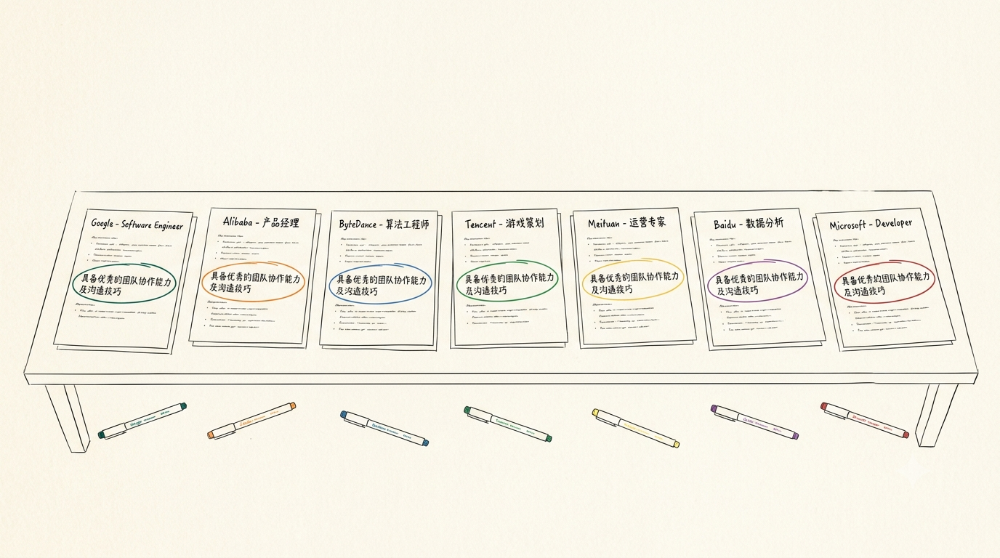
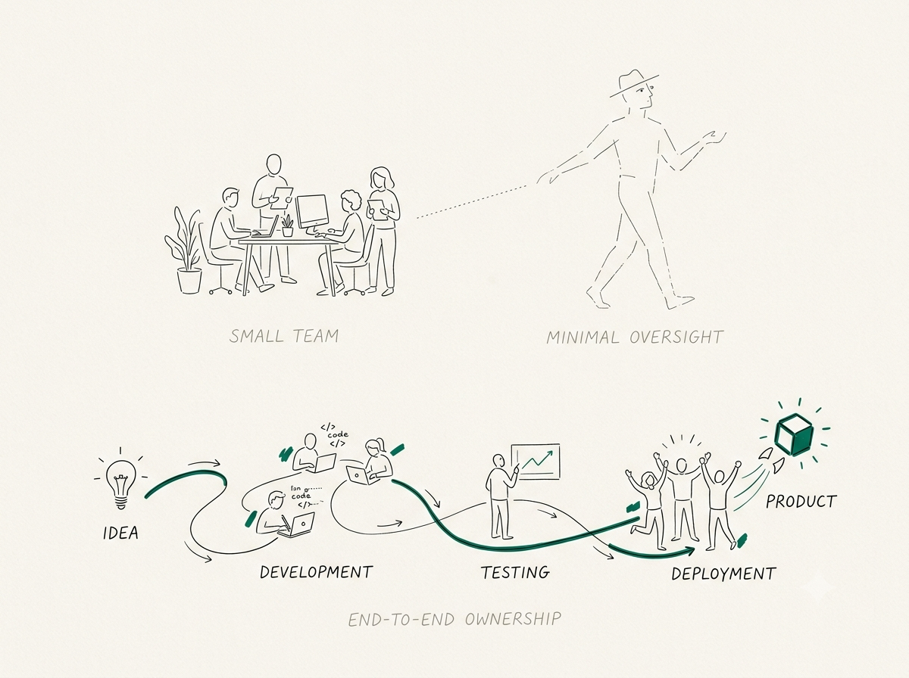
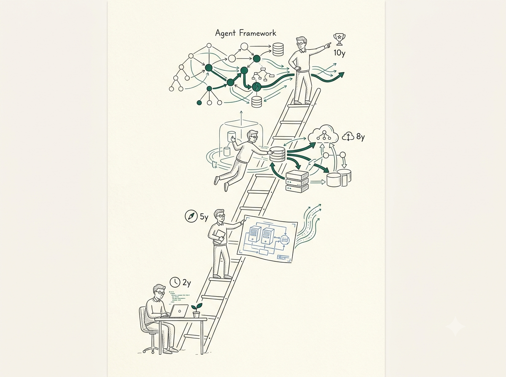
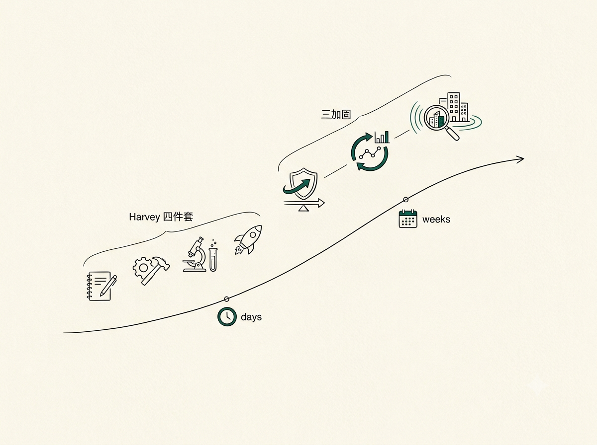
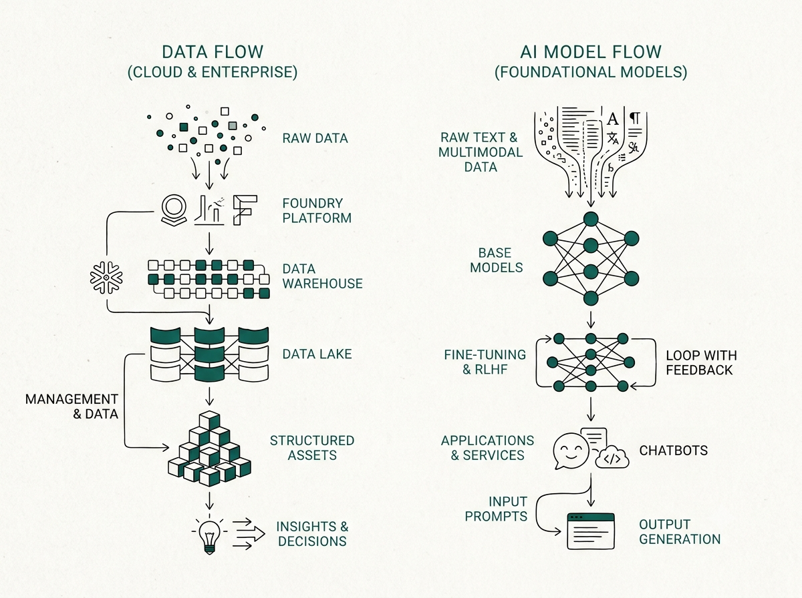
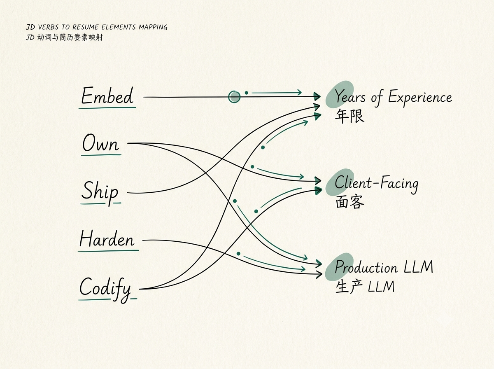

上一讲我们把地基敲实了：Python(66% 的 JD 点名)加高级 SQL,再加一朵云——AWS 出现在 32% 的岗位里,GCP、Azure 紧随。那些是招聘方连谈都不谈的门槛,过不了就没有然后。

但门槛之上,每家公司到底想要一个什么样的人?这一讲,我们把七家大厂的 JD 原文摊到桌面上,一句一句抠。你会发现一个反直觉的事:它们措辞五花八门,内核却在反复说同一句话。抠完这些句子,你手里就有了一副改简历的骨架——照着填,你的经历就能被招聘方读懂。



## 七家 JD,同一句潜台词

先给结论:这七家嘴上说的是不同的活,底下要的是同一种人——能把前沿模型亲手写进客户生产环境、并且对结果负责到底的人。别急,我们一家家看,你会越看越清楚。

**OpenAI——它开了两个岗,你得分清投哪个。**FDE 要 5 年,FDSWE 要 7 年。JD 里那句 KPI 三件套值得你背下来:"production adoption, measurable workflow impact, and eval-driven feedback that changes product and model roadmaps"。翻译过来:上线被真人用、工作流有可测的影响、evals 反过来改产品和模型路线图。注意最后半句——你的评测结果不是自娱自乐,是能倒逼总部改 roadmap 的"货币"。FDSWE 则是把这套交付抽象成平台,规模化所有 engagement。一个下场干,一个把干的方式产品化。


**Anthropic——它把交付物写死了。**这是最狠的一句,你逐字看:"Deliver technical artifacts for customers like MCP servers, sub-agents, and agent skills that will be used in production workflows." 加一句 "white glove deployment support"。什么意思?2026 年,交付物已经具体到"你要亲手写 MCP server、子代理、agent skills",而且是进客户生产工作流的。白手套,就是贴身高端伺候。看懵了也没关系——你只需要记住:Anthropic 的 JD 等于一张交付清单,清单上第一项是 MCP。3 到 4 年面客经验就能投,薪资 $200–300K,高档能到 $280–400K,差旅约 25%。

**Palantir——FDE 的元话术出处。**这句话你在无数别家 JD 里会看到变体:"your responsibilities look similar to those of a startup CTO: you'll work in small teams with minimal supervision and own end-to-end execution of high stakes projects." 小团队、极少监督、端到端 owner——像个创业公司的 CTO。Palantir 还有一句更劝退的:"increasing your pain threshold to deliver real value"。提高你的痛苦阈值。它不装,它直接告诉你这活儿疼。Palantir 属于数据流,面试开场常抛一个开放业务谜题(比如"我们为什么延误了这么多航班"),每周 3–4 天驻场,平均总包 $238K,Staff 能上 $630K+。



**Google——同一句话,只改一个数字。**这是我最喜欢拿来讲级别的例子。Google Cloud 的 FDE 分 I / III / Staff / Sr Staff,对应 2 / 5 / 8 / 10 年。神奇的是,JD 主句几乎一字不改——"building and shipping production-grade AI-driven solutions using Python, Typescript"——只把年限那个数字换掉。这就像你去健身房,四档私教课程内容一样,区别只是你练了几年。它的加分项才是主战场:LangGraph / CrewAI / ADK,配 ReAct / self-reflection / hierarchical delegation,还要会算 tokens/sec 和 cost-per-request。所以你该做什么?别纠结投哪一级,先把主句里那半句"production-grade AI solutions"变成你能拿出手的东西。



**xAI——流程快到吓人。**Forward Deployed AI Engineer,4 年起,Enterprise 岗 6 年,薪资跨度极大 $180–440K。它的公开面试样本是:CV 加陈述 → 15 分钟电话 → 一周内走完 4 场技术面(coding、systems hands-on、project deep-dive、team meeting)。一周四轮。你要是简历没准备好,连喘气的工夫都没有。

**Harvey——一句话讲完整个 FDE 工作流。**法律 AI,Founding 岗 2 年、Senior 岗 5 年。它这句是全行业最完整的工作流单句,你抄作品集选题就照它抄:"Design → prototype → productionize custom workflows … then harden them for reliability, observability, and scale." 设计 → 原型 → 产品化,再加固到可靠、可观测、可扩展。四件套加三加固。还有一句点出 evals 的做法:"Build and maintain evals & harnesses … on a client-by-client basis"——评测是按客户逐个建的,不是全局跑个分了事。

**Cursor——一句筛人句,顶一百句。**它招 AI 编码类 FDE,5 年 Python/JS/TS 加 2 年面客。节奏那句是标准表述:"Ship a fast first version in days, then harden it into something reliable over weeks." 几天出粗糙版,几周加固成可靠系统。然后甩出一句 2026 年最高频的筛人话:"These aren't prototypes." 这不是原型。传统做法里,乙方交个能演示的 demo 就算交差;FDE 反过来,demo 只是第一天,后面几周把它锤成生产系统才是活儿。这一句,基本把"只会做演示的人"当场刷掉。



看完七家,你把那些金句叠一块儿:end-to-end、production、not just prototypes、own、harden、eval-driven。这就是那句潜台词——**FDE 不做 demo,直接写进客户生产环境的代码。** 招聘方绕着圈子,反复说的是这一件事。

## 两组流派:你学的东西,离职能带走吗

结论先行:同样叫 FDE,底下站着两组流派,选错了,你攒的经验可能带不走。你在挑 offer 时,得先把公司拍进这两个坐标里。

**第一组分法:数据流 vs 大模型流。**这决定你每天跟什么打交道。

- 数据流的祖师爷是 Palantir。它的 FDSE 横跨数据工程、数据建模、业务谜题,底座是把客户脏数据理顺。Snowflake 也在这一挂,它的离场金句很能说明问题:"When you leave a customer engagement, their data is structured, trusted, and agent-ready." 你走的时候,客户的数据得是结构化、可信、agent 就绪的。
- 大模型流是 2026 的主流增量:OpenAI、Anthropic、Google、xAI、Harvey、Cohere、Sierra 全在这边。核心是 agent、MCP、evals、prompt/context 工程。你每天在跟模型的能力边界较劲,不是在跟数据库较劲。

这两条不是高下之分,是气质之分。你要是本来就做数据的,数据流是你的顺风局;你要是做应用、做后端的,大模型流的学习曲线对你更友好。



**第二组分法,更关键:平台绑定型 vs 模型通用型。**这直接关系到"你离职那天,技能还值不值钱"。

Vercel 的 JD 写得毫不遮掩:TypeScript "this is your primary language",再"Build production AI solutions using Vercel's AI SDK"。Snowflake 绑 Cortex,Cohere 绑 North,Deloitte 绑 Bedrock / Cortex / Azure AI Foundry。这类岗上手快、门槛友好(Deloitte 甚至只要 1 年 GenAI 经验),但你练的很大一块是那个平台的私有 API。

模型通用型不一样。微软 Frontier Company 明说工具选型不限微软系,可以用 OpenAI、Anthropic、开源。Anthropic 要你写的 MCP server,是跨厂商的开放协议。这就像你学开车:学的是"开车"这门通用手艺,还是只学会了"开某一款特定车型的自动泊车按钮"?前者换车照样开,后者换个平台就得从头。

所以你该怎么用这组坐标?不是说平台绑定型不能投——它常常是转型者的最低门槛旁路,先上车再说。但你心里要有数:绑定型岗位,拿它当跳板,同时刻意补通用能力(MCP、evals、agent 编排);通用型岗位,值得你多花力气长期押注。


## 把 JD 措辞,直接变成简历骨架

结论先行:JD 不是给你看"够不够格"的,是给你抄改简历的模板。招聘方用什么词描述这个岗,你就用什么词描述你的经历——这样对方一眼能对上号。

先记一个万能句式,几乎每家硬性要求栏都在用它:**年限 + customer-facing + production LLM experience**。你改简历第一步,就是把过往每段经历强行翻译成这三个要素。你带过客户吗?你的系统真上过生产吗?带了几年?哪怕你现在是纯后端,你也一定服务过内部"客户"、上过线——把它显性写出来。

第二步,换动词。传统简历爱写"负责""参与""协助",这些词在 FDE 眼里等于没说。你换成 JD 里的动词库:embed(嵌入)、own(主导)、ship(交付上线)、codify(沉淀成可复用资产)、harden(加固)、operationalize(落地运营)、white-glove(贴身交付)。而且全程用 "I",不用 "we"——招聘方要看的是你一个人扛下了什么,不是团队。

举个对照你就懂了。同一段经历:

```text
Before(传统写法):
- 参与公司内部知识库问答系统项目,协助完成模型接入与测试。

After(FDE 骨架):
- Owned end-to-end delivery of an internal knowledge-base agent for
  the sales team (my "customer"); shipped to production in 3 weeks,
  built a 25-case eval harness, hardened it with guardrails, and
  codified a runbook the team now self-serves.
```

看出差别了吗?后者把 own / ship / eval / harden / codify / runbook 全填进去了,还落到了"客户""上线""评测""交接"这几个 FDE 关心的锚点。同样一件事,读起来就像招聘方 JD 里走出来的人。

第三步,对着中文岗补一版。腾讯云的 JD 原话是「将一线经验沉淀为可复用的交付资产与行业方案模板,反哺产品」。你投国内云厂商,就把简历里那个"反哺"闭环显性写出来:你不只交付了,你还把经验回流成了模板。这句话,是国内 FDE 和传统驻场实施的官方分界线,你踩在线的哪一边,招聘方看得很清楚。



一句话收口:你不用编造经历,你只需要用招聘方的语言,重新讲一遍你真做过的事。

## 小结

这一讲我们把七家大厂 JD 逐字拆了:OpenAI 双岗、Anthropic 的 MCP 交付清单、Palantir 的 startup CTO、Google 只改年限的级别阶梯、xAI 的极速面试、Harvey 的完整工作流、Cursor 的"not just prototypes"。它们说的是同一句潜台词——不做 demo,写进生产。你还拿到两组选公司的坐标:数据流 vs 大模型流、平台绑定 vs 模型通用,后者决定你的技能能不能带走。最后,JD 是简历模板:换动词、填三要素、全用 "I"。

## 思考题

挑一家你最想去的公司,把它 JD 里的一句职责原文抄下来,再用今天的动词库(own/ship/harden/codify…)和"年限+面客+生产 LLM"三要素,把你自己最拿得出手的一段经历改写成对得上那句话的一行简历。你会发现哪个要素最空、最需要补?欢迎在评论区聊聊你的想法。

下一讲,我们聊钱——《级别与薪酬矩阵:别被年薪百万骗了》,把纸面数字背后的股权、归属和风险一层层扒开。
