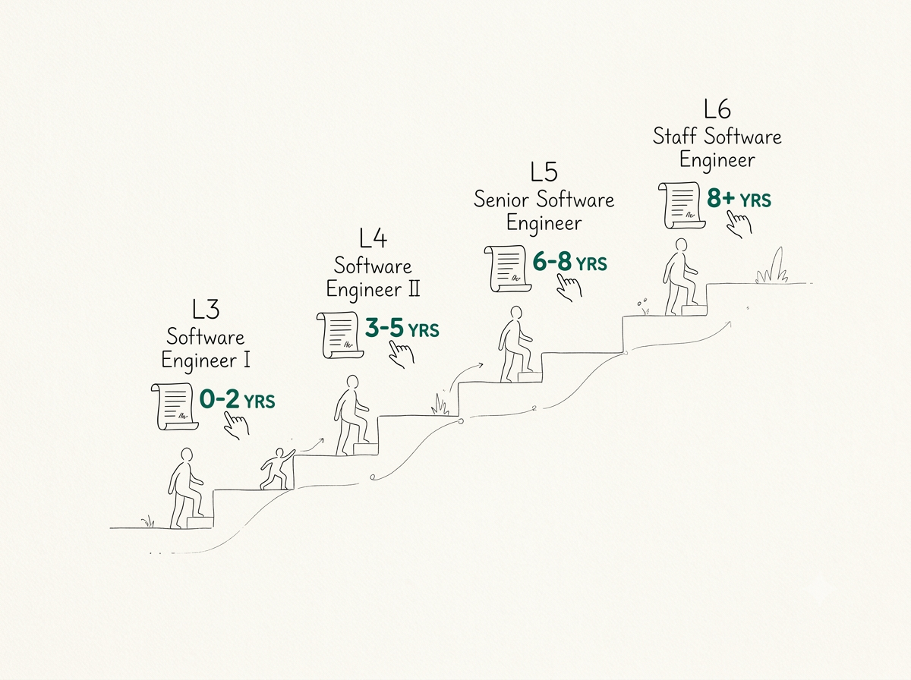
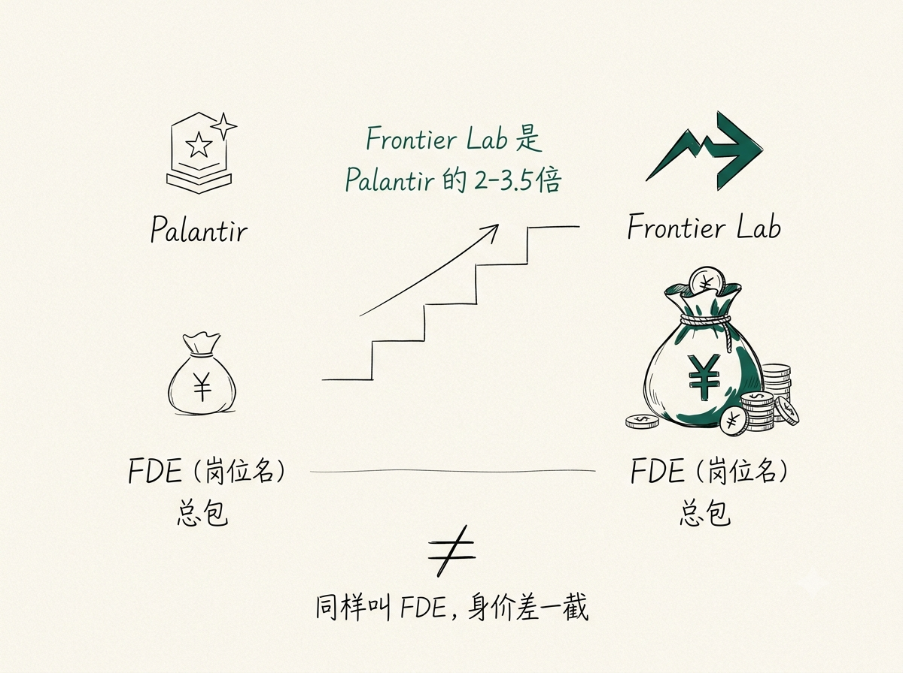
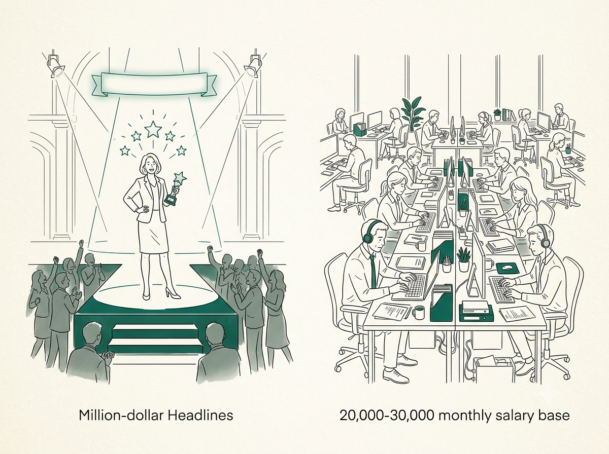

上一讲我们把八家大厂的 JD 逐字摊开：OpenAI 的双岗 FDE/FDSWE、Anthropic 那句"交付物 = MCP servers、sub-agents、agent skills"。你现在知道招聘方在卡什么了。但 JD 上还有一栏我们故意没细讲——薪酬那串数字。

这一讲专门收拾它。因为这栏最容易骗人。你在招聘平台上刷到"年薪百万""$400K"，心跳一下，然后呢？那个数字到底是现金，是股票，还是一个五年后才知道真假的承诺？不同级别之间差的是本事还是年限？

说白了，这一讲就干一件事：教你把一个吓人的标题数字，拆成你真正能拿到手的东西。


## 级别阶梯：年限换台阶，不是换本事

先给结论：大厂 FDE 的级别，八成是拿年限堆出来的，不是拿难度堆出来的。你别一看到 Staff、Senior Staff 就腿软，觉得那是遥不可及的高手区。很多时候，那只是"多干了几年"的标价。

看 Google Cloud 最直白。它的 FDE 阶梯公开挂着：FDE I / III / Staff / Sr Staff，对应 2 / 5 / 8 / 10 年经验。妙就妙在，这四档的 JD 是同一句话，只改了年限那个数字。技术栈都是 Python + TypeScript、production AI、加分项写 LangGraph/CrewAI/ADK。级别之间的分水岭，写得明明白白，就是你毕业多久。



这对你是个好消息。它意味着入口比你想的低。FDE I 只要 2 年经验，你不用等成为大神才敢投。行业里还有个更狠的例子：Kanav Bhatnagar，24 岁，毕业大概 3 年，就进了 Rippling 当创始 FDE。所以"必须 5 年以上"那种印象，你可以先扔掉一半。

再看 OpenAI，它把 FDE 拆成了两个平行岗，你得分清楚：

- FDE：5 年以上，基本工资 \$162–280K，干的是在客户现场把前沿模型带上生产。
- FDSWE：7 年以上，基本工资 \$185–325K，干的是给交付这件事搭抽象层、做平台化，让所有 FDE 的活能规模化。

一个是前线打仗，一个是给前线造武器。别把两个岗的薪资混着比——FDSWE 数字高，是因为它要 7 年且偏平台工程，不是因为它"更 FDE"。

Anthropic 走的是双档路线。基础档面客 3–4 年起，\$200–300K；高档能到 \$280–400K。它的交付物我们上一讲讲过，逐字点名 MCP server、子代理、agent skills，还有约 25% 的差旅。

然后是 Palantir，FDE 这个物种的老祖宗。它的 FDSE（内部代号 Delta）平均总包 \$238K，Staff 级能到 \$630K 以上。部分岗位挂 4 年经验门槛，每周 3–4 天驻客户现场。它开面试的方式很有意思——直接甩一个开放业务谜题给你，比如"我们为什么延误了这么多航班"，让你现场拆解。

把这几家再放进 2026 年下半年的大盘里对表：据 Levels.fyi（2026-11）全美统计，FDE 总包中位数为 **\$225K**；Plank（2026-10）统计全市场基本工资中位数为 **\$203K**（且 **90% 的岗位集中在初创公司**）；FDE Pulse（2026-11，覆盖 1,116 个活跃岗）测算全行业披露 Base 中位数为 **\$182K**。而站在金字塔尖的 Frontier Labs，则会拉出一条惊人的落差线。



frontier lab 给的钱，是普通大厂和 Palantir 的 2–3 倍。同一级别横着比：mid 级大约 \$385K、Senior/Staff 级普遍冲到 **\$450K–\$725K+**、Principal 极值能破 **\$1.2M–\$1.45M**。都叫 FDE，为什么差这么多？

这就像同样是开车送货，一个在市区送快递，一个在无人区开矿卡。听着都是"驾驶员"，风险、稀缺度、议价权完全不是一回事。frontier lab 卡的是最前沿模型 + 最战略客户，人少、盘子大、股票故事讲得响，所以它敢开高。但——注意这个但——那多出来的一大截，很可能根本不是现金。

这就带出下一节，也是这一讲最想让你记住的事。

## 总包解剖：那 55–70% 到底是什么

先记结论，后面展开：头部 FDE 的总包里，股权（equity）占 55–70%。也就是说，你看到的那个大数字，一多半不是打进你工资卡的钱。

对比一下你就懂了。2024 年时，这个 equity 占比还只是 35–45%。短短一两年，天平就往股权那边狠狠压过去了。为什么？因为这些公司现金烧得凶，愿意用"未来的一张纸"换你现在的劳动。这不是骗局，但这是一笔你必须看懂的账。

我们把一个"\$400K"的 offer 拆开给你看，直观感受一下：

```text
标题总包(TC)  $400,000  ← 招聘平台/JD 上那个让你心跳的数字
├─ 基本工资    $150,000  (37.5%)  每月真金白银到账
├─ 签字费/奖金  $ 30,000  ( 7.5%)  一次性或按年,现金
└─ 股权(equity) $220,000  (55%)   ← 这一栏,才是你要盘问的地方
     · 归属:多数初创 4 年 vesting + 1 年 cliff(OpenAI PBC 已取消 1 年 cliff)
     · 流动性:是否已提交 S-1 / 有定期要约回购(tender offer)?
     · 估值:按哪一轮估值折算?下一轮会不会 down round?
```

看到没？\$400K 里，真正稳稳到手的现金就 \$180K 出头。剩下 \$220K，挂着三个大问号。


第一个问号是归属（vesting）。股权不是签了就是你的，它按时间一点点解锁，通常四年。绝大多数初创公司第一年还有个 **1 年 cliff**——干满一年才开始归属，干到第 8 个月裸辞，这部分一分拿不走（不过 2026 年有个重要分化：OpenAI 完成 PBC 架构重组后取消了传统的 1 年 cliff，改为入职后按季度归属，对高压岗位友好不少；但大部分独角兽依然保留 1 年 cliff，签字前必须逐条核实）。

第二个问号是流动性。如果公司没上市，你手里的股权就是一张暂时换不成钱的纸。当然，2026 年下半年不同梯队的流动性预期已经彻底拉开：像 Anthropic 在 2026 年 10 月底公开提交了 S-1 招股书、11 月启动纳斯达克（代码 `ANT`）IPO 路演，OpenAI 等超头部也有相对规律的员工要约回购（tender offer）；但占全市场 90% 岗位容量的中早期垂直 AI 独角兽，给你的依然是要等好几年 IPO 或并购才见分晓的期权。把这两者算进同一个"总包数字"，含金量天差地别。

第三个问号是估值。\$220K 这个数，是按公司某一轮融资的估值折算出来的。可估值会变。碰上下一轮 down round（估值下调），你手里同样股数，账面价值直接缩水。你入职时算的 \$400K，两年后可能悄悄变成了 \$300K，而没人会发邮件通知你。

传统做法，你比 offer 就看总包那一个数，谁高去谁家。FDE 这行，你得反过来——把总包当成一道应用题，先问清楚现金基数多少、股权按什么估值算、几年归属、有没有 cliff、公司离流动性还有多远。同样两个"\$400K"，一个现金六成、一个现金三成，实际到手能差出一辆车。


还有个数据你顺手记一下：这类岗位 time-to-fill 平均 29 天，招得急；地理上 NY 占 35%、SF 占 11%。急着招 + 集中在高成本城市，意味着你有议价空间，也意味着那个高数字里有一部分是在替你抵高房租。别把地域溢价当成你的本事溢价。

所以看 offer 的正确姿势就一句话：看总包结构，别看标题数字。数字是用来吸引你点进来的，结构才是你未来几年真实的生活。

## 国内的两张脸：百万头条与两三万底盘

先给结论：国内 FDE 的薪资，头条和地板之间隔着一条鸿沟。猎聘大数据研究院 2026 年 9 月发布的《2026 FDE 人才供需趋势洞察报告》给出了最客观的横截面：**全国 FDE 平均年薪 40.8 万元、中位数 36.6 万元，人才供需比仅 0.28**（接近 4 个岗位抢 1 个人）。

你刷到的国内新闻，往往只截最亮的那张"百万脸"：猎聘上 50–100 万的岗位近 300 个，百万以上的 40 多个，深圳有 FDE Leader 开到年薪 300 万，月之暗面 2026 年秋补招高阶 FDE 也开到年包 109 万；腾讯 CSIG 的 WorkBuddy FDE 月薪 50–80K，腾讯云 FDE 35–65K×15 薪，字节豆包大模型 FDE 35–70K×15 薪，智谱"FDE 负责人"6–8 万/月。看着确实诱人，但这些几乎全是资深骨干或管理序列。



另一张"地板脸"，新闻不爱写，但对刚转型的你更真实。上海一线的实证：初级 FDE 月薪普遍在 **2–3 万**，干到中高职级才摸到 36–40 万+ 的中位数线；更底层甚至混着一批月薪 8–16K、由传统驻场外包直接改名的伪 FDE 岗。看懵了也没关系，你只要记住：百万是天花板上的聚光灯，两三万起步、三四十万中位数才是脚下的实路。

这里有个国内独有的东西，你算账时别漏掉——**驻场差旅补贴**。国内正规大厂与头部服务商除了基本年包，通常还会按天发放 **300–800 元/天**的异地驻场补贴，补偿你长期蹲在能源基地、银行机房或工厂车间。海外 JD 一般不单列这项，国内拎出来单算，恰恰说明这活儿真得长期离家驻场。

再帮你把国内地图的方向标好（注意 2026 年秋天刚发生的最新分化），省得你投错门：

| 你该重点投的 | 你别盲投的 | 为什么 |
|---|---|---|
| 云厂商与大厂 2B（腾讯云 / 阿里云 / 火山引擎 / 蚂蚁数科） | 纯研究零商业交付团队（如 **DeepSeek**） | DeepSeek 至今坚持纯研究导向、不设 FDE；云厂商与 2B 团队则是岗位容量最大的主战场 |
| 垂直行业 AI 公司 + 2026 秋转向商业化的模型厂（月之暗面 Kimi / MiniMax / 阶跃星辰） | 月薪 8–16K 按人天计费的改名外包 | 前三家模型厂已在 2026 年 9–10 月开放少量高阶 FDE；低薪按人天计费的则是换皮驻场坑 |

最后还有一条零成本的官方通道已经在 2026 年底兑现：上海创智学院办的免费 FDE 培训与上海市人社局职称评审通道已彻底打通——**2026 年 11 月，《沪人社专〔2026〕161号》正式公布了全国首批 274 名获评中级/高级职称的 FDE 名单**，长宁区还同步开启了全额补贴的免费高研班。国内这波有工信部和地方人社局实打实背书，直接连着职称与积分落户。

把国内这三件事串起来给你的动作就是：投递方向瞄准云厂商、大厂 2B 团队与头部垂直应用商，心理预期按"入门两三万、中位三十六万、驻场补三五百一天"来定，同时盯紧政府人社免费培训通道。

## 小结

这一讲拆了级别与薪酬两件事。级别上，大厂 FDE 阶梯多按年限分档，Google 2/5/8/10 年就是最直白的证据，入口比你想的低。薪酬上，北美 FDE 中位数总包 \$225K（Base 中位数 \$182K–\$203K），而头部实验室高总包里 55–70% 是股权，要逐条核实 cliff（如 OpenAI 已取消 1 年 cliff，多数初创仍在）、IPO/回购流动性（如 Anthropic 已交 S-1）与估值水位。国内均薪 40.8 万、中位数 36.6 万，入门底盘两三万月薪外加 300–800 元/天驻场补贴，上海首批 274 人官方职称也已落地。一句话收尾——看总包结构，别看标题数字。

## 思考题

拿你现在能搜到的一个真实 FDE offer 或 JD（国内国外都行），把它的总包按这一讲的方法拆一遍：现金占多少、股权占多少、股权几年归属、公司离流动性还有多远。拆完你会怎么重新给这个 offer 排序？欢迎在评论区聊聊你的想法。

下一讲，我们把镜头拉回国内，做一张《国内 JD 与雇主地图》——到底哪些公司在招、招什么样的人、你该从哪扇门进去。
