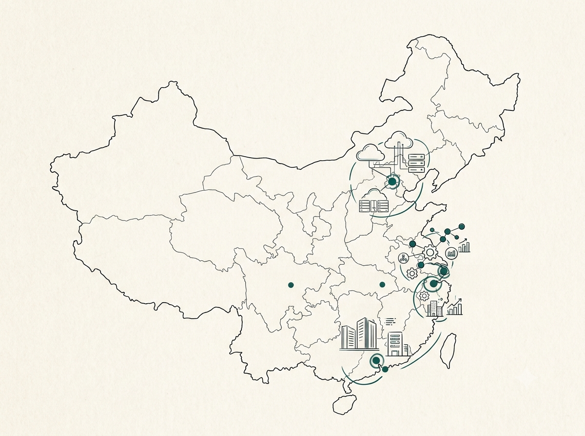
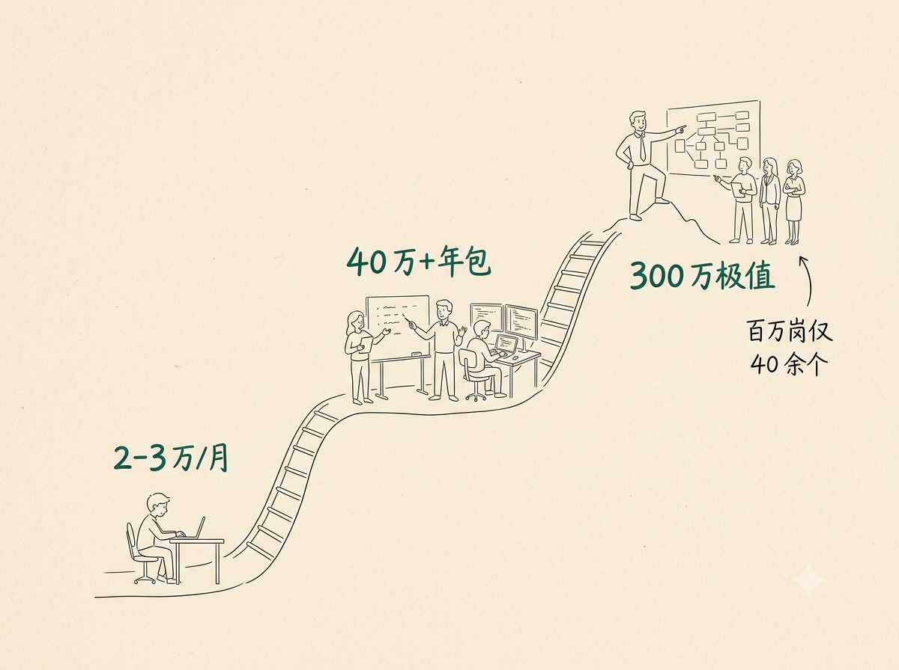
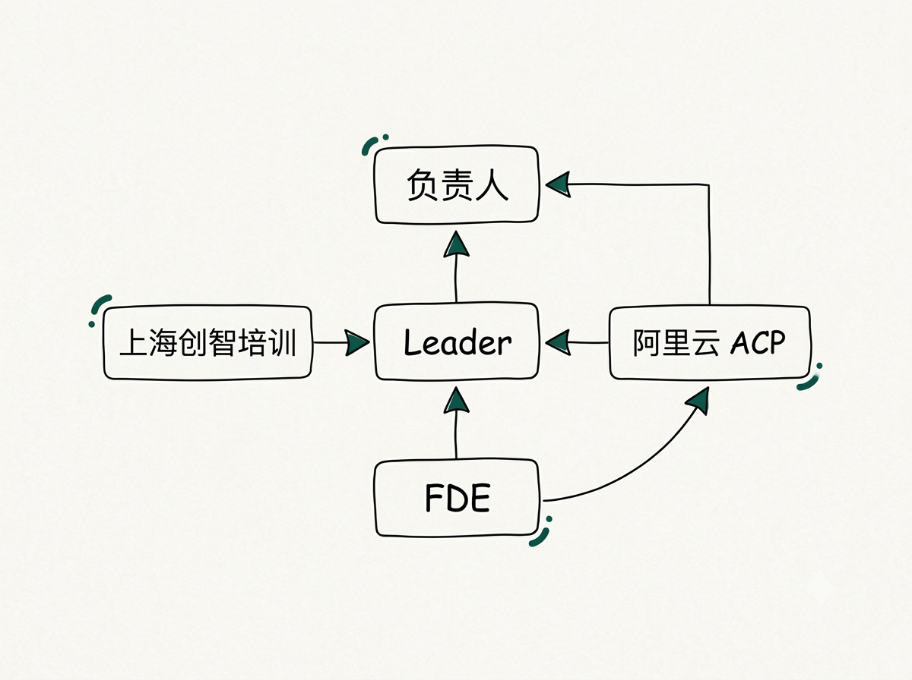
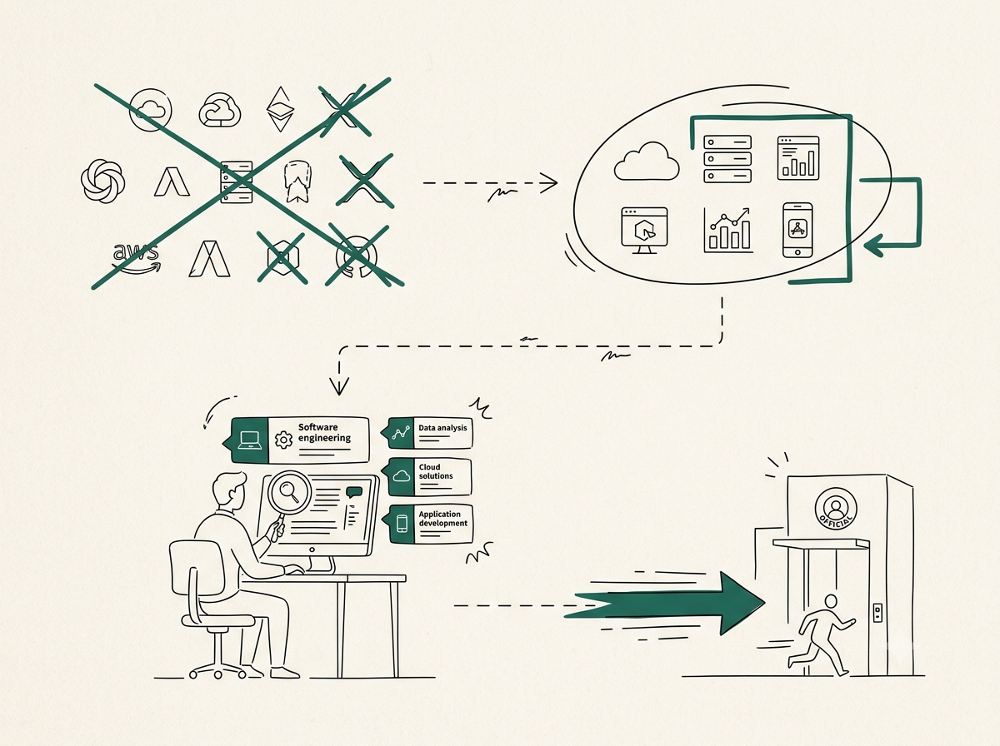

上一讲我们把级别-薪酬矩阵摊开了：Google 的 FDE I/III/Staff/Sr Staff 对应 2/5/8/10 年，OpenAI 两档、Anthropic 两档，还有那句提醒——头部年薪高，但股权占了大头，"年薪百万"是极少数人的故事。那都是海外的坐标系。

这一讲我们把镜头拉回国内。你真正要面对的问题很具体：国内到底有没有 FDE 这个岗？谁在招？招进去多少钱？哪些公司压根不招、你投了也是白投？还有一条你更关心的——你现在这份工作，离 FDE 到底差几步。

一句话说清本讲目标：把国内的真实岗位、真实薪资、真实雇主摊在你面前，让你合上这一讲就知道简历该往哪儿投。

## 先看清：国内 FDE 藏在哪几类公司里

先给结论：国内确实已经有成建制的同名 FDE 岗了，主力大盘扎堆在**云厂商、大厂 2B 事业群与垂直应用服务商**；至于大模型“六小龙”，则在 2026 年秋天出现了戏剧性分化——除了 DeepSeek 依然不设一兵一卒，其余几家也开始下场抢人了。

最直接的样本是腾讯。腾讯云在 BOSS 直聘挂着"AI 前线部署工程师 FDE"（35–65K/月×15 薪），腾讯 CSIG 还在北上深广成铺开了更高阶的"WorkBuddy - AI前线部署工程师"（50–80K/月）。注意这里译名的坑：媒体和企业 JD 多写"前线部署工程师"，但工信部文件、百度百科词条和上海人社政策统一用的是"前沿部署工程师（FDE）"，还衍生出一个 FDR（前沿部署研究员）。你搜岗位、搜政策，两个名字都得搜一遍，不然会漏掉一半信息。

腾讯云那条 JD 里有句话值得你抄下来：「将一线经验沉淀为可复用的交付资产与行业方案模板，反哺产品」。这句话就是国内 FDE 和传统驻场实施的官方分界线。传统实施是把项目交付完就走人；FDE 要求你把这次交付的东西产品化、回流到产品里。就像你修完一个 bug，不只是提交代码，还要把它抽成一个别人能复用的工具函数——差别就在这个"反哺"上。

把 2026 年下半年国内真正在放量的雇主摊开，主要有四股力量：

1. **云厂商与互联网大厂 2B 线（岗位容量最大）**：除了腾讯系，字节跳动火山引擎 FDE（25–60K×15 薪）与豆包大模型 FDE（35–70K×15 薪，JD 里甚至白纸黑字要求“熟练掌握 Vibe coding”）扩招最凶，火山引擎还在 2026 年 9 月联合安永宣布共建 **1,000 名企业级 FDE 团队**；阿里云围绕百炼与通义千问开出 20–55K×16 薪（资深岗破百万，内部已有大批后端与售前架构师转岗 FDE，外围还配了软通动力 700+ 人的认证交付池）；蚂蚁数科（40–60K×15 薪）、商汤（25–45K×14–15 薪）、360、贝壳等也都在招驻场落地团队。
2. **商业化提速的大模型创业公司（精选高阶岗）**：2026 年上半年，国内明星模型厂确实普遍不招 FDE；但到了 **2026 年 9–10 月**，智谱（负责人岗 6–8 万/月）、月之暗面（新设 Kimi Partner FDE，高阶岗年包开到 109 万）、MiniMax、阶跃星辰（推“FDE+SaS”企业服务模式）纷纷转身补齐 FDE 编制。
3. **垂直行业与央国企数科（高壁垒稳定岗）**：中石油昆仑大模型、山东鲁信科技、工业质检与医疗金融垂直服务商，专门招既懂行业合规又能写 Agent 的复合人才。
4. **唯一不招的异类**：**DeepSeek（深度求索）**。它至今保持纯基础研究基因，不设任何 FDE 或定制驻场团队——你的简历不用往那儿递。

## 你现在的岗位，离 FDE 有多远

先给结论：你不是从零开始。国内很多现成岗位就是 FDE 的"前身"，你手里大概率已经攥着一半的牌了。据 2026 年末行业盘点，企业 FDE 团队约 **30% 直接来自大厂内部研发与售前架构师活水转岗**。关键是看清你的岗位往 FDE 迁移，缺的是哪一块。

我把几条最常见的迁移路径列出来，你对号入座。

| 你现在的岗位 | 离 FDE 的距离 | 你缺的那一块 |
|---|---|---|
| 云厂商解决方案架构师(SA)/售前 | 最近 | 从"讲方案、抛 demo"转到"写进客户生产环境的耐用代码" |
| 华为等 ICT 大厂的交付工程师 | 近 | 补 LLM/agent 栈；把交付经验翻译成 AI 语境 |
| 2B 软件公司的驻场实施 | 中 | 从配置化实施升级到"扩展产品、补能力缺口" |
| AI 公司的交付工程师/应用工程师 | 中 | 补客户面能力、evals、MCP 这套新硬门槛 |
| 后端/全栈工程师 | 中 | 补客户面能力 + 生产级 LLM 项目经验 |

离得最近的是云厂商的 SA 和售前。你天天和客户打交道、懂企业需求、能画架构图，这些正是 FDE 最看重的"客户面能力"。你缺的只有一步：售前交付的是可以抛弃的 demo，FDE 交付的是要长在客户生产环境里的代码。就像你原来是那个在客户会议室里画蓝图的人，现在要变成那个留在机房里、把蓝图真盖起来还得保证它不塌的人。

华为这类 ICT 大厂的交付工程师也很吃香。你已经趟过"驻场把复杂系统跑起来"这条最难的路，客户现场那些文档和现实对不上的坑，你都踩过。你要补的是上层——把交付经验套进 LLM 和 agent 的新栈里。

2B 软件公司的驻场实施离得稍远一点，但也不远。传统实施是在产品现有边界内做配置；FDE 要的是"当产品能力不够时，你亲手扩展它、补上缺口"。这一步的门槛，是你得会写代码去补产品的洞，而不只是调参数、填表单。

别急，看到这张表里没有你的岗位也没关系。核心判断只有一条：**你离客户越近、越懂真实业务场景，转 FDE 的起点就越高**。技术短板可以补，但"懂客户"这张牌，很多纯技术背景的人反而没有。

## 薪资真相与晋升序列

先给结论：国内 FDE 的薪资是一条很长的坡，头部确实能到百万级，但入门段远没有自媒体渲染的那么浮夸——先把预期校准好，你才不会入行就落差感爆棚。

把猎聘《2026 FDE 人才供需趋势洞察报告》（2026-09）与脉脉、一线实证叠在一起看：

- **市场大盘基准**：2026 年 1–7 月国内 FDE 岗位发布量同比激增 **1522.73%**；全国 FDE **平均年薪 40.8 万元、中位数 36.6 万元**，人才供需比仅 **0.28**。
- **入门段**：上海一线从业者的实证是，初级 FDE 月薪普遍在 **2–3 万**（若看到月薪 8–16K 还要求常驻买断人天的，基本是传统外包换皮，直接绕开）。
- **中高段**：成熟骨干总包集中在 **40–80 万**（如腾讯云 35–65K×15、豆包 35–70K×15、蚂蚁数科 40–60K×15），外加国内特有的异地**驻场差旅补贴（普遍 300–800 元/天）**。
- **高阶与管理段**：智谱"FDE 负责人"6–8 万/月，月之暗面高阶 FDE 年包 109 万，深圳有 FDE Leader 年薪超 300 万；全猎聘超百万岗位也就 40 多个，属于金字塔尖。

看懂这张阶梯，你就明白晋升序列长什么样了。国内已经跑出了清晰的三级台阶：**FDE → FDE Leader → FDE 负责人**。而且工信部在 2026 年 8 月印发的《工信厅科函〔2026〕414号》已正式将“懂业务、通模型、知安全、能交付”的前沿部署人才纳入国家级培育导向。

除了在公司内往上爬，国内还有两条低成本正规通道已经跑通：

一是**上海创智学院与上海市人社局的官方 FDE 通道**。上海创智学院推出的"3+3+3"免费培养矩阵，到了 **2026 年 11 月已正式结出硬果——上海市人社局（`沪人社专〔2026〕161号`）公布了全国首批 274 名获评中级/高级职称的 FDE 名单**，上海市长宁区还同步开设了政府全额补贴的免费 FDE 高研班。这不只是张结业纸，而是实打实能进人事档案、帮办积分落户的硬职称。

二是**阿里云大模型工程师 ACP 认证**，官方报名费约 1200 元（活动期约 840 元），2026 版新考纲已全面纳入多智能体编排、Context Engineering 与企业级安全护栏，和国内云生态 FDE 高度咬合。（顺手提醒一句：千万别花几千上万去报市面上商业机构吹嘘“包就业”的山寨 FDE 培训证，面试官根本不认。）

对比一下你就有数了：海外靠的是 Claude Academy 免费课程 + 厂商实战认证 + Levels.fyi 薪资透明；国内则是"工信部政策定调 + 上海人社官方职称落地 + 阿里云 ACP"这套组合。玩法不同，但国内这条政策通道直接连着职称和落户，非常实在。

## 所以你该往哪投

前面铺了这么多，落到最后一个动作：国内的简历，你到底该往哪投。给你一份可以直接执行的投递清单。

**第一，主攻云厂商、大厂 2B 线与商业化模型厂，避开纯研究岗与低端换皮外包。** 腾讯云/CSIG、火山引擎/豆包、阿里云百炼、蚂蚁数科是容量最大的主战场；月之暗面、智谱、MiniMax、阶跃星辰的高阶 FDE 适合有硬核 Agent 落地经验的老兵冲刺；DeepSeek 这类纯研究团队直接跳过。

**第二，同义头衔一起搜。** 国内的岗位名还在裂变，别只搜"FDE"三个字。你该同时搜的关键词：AI 前线部署工程师、前沿部署工程师、智能体交付架构师、AI 交付工程师、大模型应用架构师、解决方案架构师（偏代码落地方向）。两个译名都要搜。

**第三，用你现在的岗位反推切入点。** 如果你在大厂做后端、SA 或售前，**优先走内部活水转岗**——磨合期最短、成功率最高。如果你是外部交付/实施背景，主打你的复杂现场排障经验，把它翻译成 AI 语境，再用一个带评测和权限隔离的生产级项目当敲门砖。

**第四，把官方通道当加速器。** 盯紧上海创智学院与地方人社的免费高研班/职称通道，顺手考下 2026 新版阿里云 ACP。

还有一句大实话得跟你交底：国内的 FDE 有大量"脏活"。工业驻场可能要你在设备旁边待上几个月，做数据重录入、把老师傅的经验数字化这类不性感的活。中文社区里，一线从业者甚至自嘲是"救火大管家"，还要在国企和民企现场反复给幻想“靠 AI 一键裁员”的老板做预期降温。投之前，把这份清醒装进兜里。

## 小结

国内 FDE 已进入政策正名与规模放量期：全国均薪 40.8 万、中位数 36.6 万、供需比 0.28，主力扎堆在腾讯、字节火山/豆包、阿里云、蚂蚁数科等大厂 2B 线及 2026 年秋转向商业化的模型厂（唯独 DeepSeek 仍不设 FDE）。初级月薪 2–3 万是真实底盘，上海首批 274 人官方职称已于 2026 年 11 月正式落地。投递就三步：主攻云与大厂 2B（有条件优先内部转岗）、双译名多头衔搜索、借人社免费通道与新版 ACP 加速。

## 思考题

打开招聘软件，用你自己现在的岗位名和"FDE / 前线部署 / 前沿部署 / AI 交付"这几个词各搜一遍，找出 3 个你今天就够得着的真实岗位——它们分别缺你哪一块能力？下一讲《用 JD 反推个人差距》，我们就拿这几条 JD 动手，把你和岗位之间的缝一寸寸量出来。欢迎在评论区聊聊你的想法。
