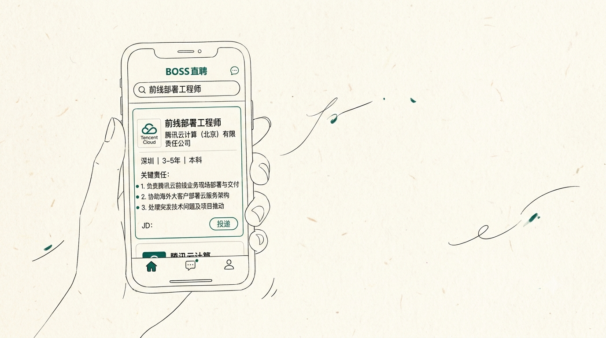
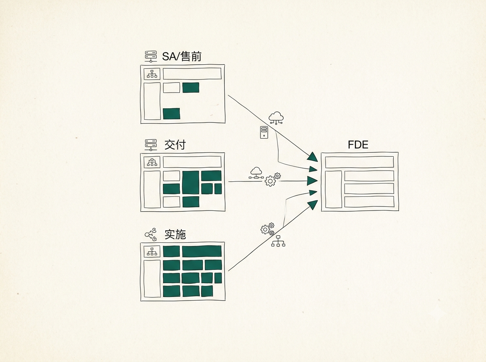

上一讲我们把级别-薪酬矩阵摊开了：Google 的 FDE I/III/Staff/Sr Staff 对应 2/5/8/10 年，OpenAI 两档、Anthropic 两档，还有那句提醒——头部年薪高，但股权占了大头，"年薪百万"是极少数人的故事。那都是海外的坐标系。

这一讲我们把镜头拉回国内。你真正要面对的问题很具体：国内到底有没有 FDE 这个岗？谁在招？招进去多少钱？哪些公司压根不招、你投了也是白投？还有一条你更关心的——你现在这份工作，离 FDE 到底差几步。

一句话说清本讲目标：把国内的真实岗位、真实薪资、真实雇主摊在你面前，让你合上这一讲就知道简历该往哪儿投。

## 先看清：国内 FDE 藏在哪几类公司里

先给结论：国内确实已经有同名 FDE 岗了，但它扎堆在云厂商和应用服务商，不在你以为的那几家明星模型公司。投错门，你连简历关都过不了。

最直接的样本是腾讯云。它在 BOSS 直聘上就挂着"AI 前线部署工程师 FDE"，薪资 35-65K/月、按 15 薪算。注意这里译名的坑：媒体和腾讯云 JD 写"前线部署工程师"，但百度百科词条和上海的政策文件用的是"前沿部署工程师(FDE)"，还衍生出一个 FDR（前沿部署研究员）。你搜岗位、搜政策，两个名字都得搜一遍，不然会漏掉一半信息。

腾讯云这条 JD 里有句话值得你抄下来：「将一线经验沉淀为可复用的交付资产与行业方案模板，反哺产品」。这句话就是国内 FDE 和传统驻场实施的官方分界线。传统实施是把项目交付完就走人；FDE 要求你把这次交付的东西产品化、回流到产品里。就像你修完一个 bug，不只是提交代码，还要把它抽成一个别人能复用的工具函数——差别就在这个"反哺"上。

除了腾讯云，国内 FDE 岗集中在三类公司：云厂商（腾讯云、阿里云、火山引擎这类）、垂直行业的应用服务商、还有做企业级 AI 落地的解决方案公司。智谱这样的公司甚至已经开出了"FDE 负责人"的管理岗。字节的豆包、蚂蚁数科、360、阿里云这些大厂的 2B 团队，都是同一类土壤——它们有真实的企业客户、有要落地的场景，才养得起 FDE。

那反过来，哪些公司不招？记住这条，能帮你省下大把投递时间：**模型研究公司基本不设 FDE**。DeepSeek、月之暗面、MiniMax、Z.ai 这些，岗位"几乎都围着 LLM 转"——它们要的是训模型、做研究的人，不是驻到客户现场把东西跑起来的人。MiniMax 出海走营销，Z.ai 走 B2B 销售，路子都不一样。

这里要和上一讲呼应一下。海外的 frontier lab（OpenAI、Anthropic）是招 FDE 的主力，但国内的对应物——那几家明星大模型公司——恰恰不招。你要是照搬海外的认知，盯着国内模型公司投 FDE，方向从一开始就错了。国内的钱和岗，在云厂商和应用层。

## 你现在的岗位，离 FDE 有多远

先给结论：你不是从零开始。国内很多现成岗位就是 FDE 的"前身"，你手里大概率已经攥着一半的牌了。关键是看清你的岗位往 FDE 迁移，缺的是哪一块。

我把几条最常见的迁移路径列出来，你对号入座。

| 你现在的岗位 | 离 FDE 的距离 | 你缺的那一块 |
|---|---|---|
| 云厂商解决方案架构师(SA)/售前 | 最近 | 从"讲方案、抛 demo"转到"写进客户生产环境的耐用代码" |
| 华为等 ICT 大厂的交付工程师 | 近 | 补 LLM/agent 栈；把交付经验翻译成 AI 语境 |
| 2B 软件公司的驻场实施 | 中 | 从配置化实施升级到"扩展产品、补能力缺口" |
| AI 公司的交付工程师/应用工程师 | 中 | 补客户面能力、evals、MCP 这套新硬门槛 |
| 后端/全栈工程师 | 中 | 补客户面能力 + 生产级 LLM 项目经验 |

离得最近的是云厂商的 SA 和售前。你天天和客户打交道、懂企业需求、能画架构图，这些正是 FDE 最看重的"客户面能力"。你缺的只有一步：售前交付的是可以抛弃的 demo，FDE 交付的是要长在客户生产环境里的代码。就像你原来是那个在客户会议室里画蓝图的人，现在要变成那个留在机房里、把蓝图真盖起来还得保证它不塌的人。

华为这类 ICT 大厂的交付工程师也很吃香。你已经趟过"驻场把复杂系统跑起来"这条最难的路，客户现场那些文档和现实对不上的坑，你都踩过。你要补的是上层——把交付经验套进 LLM 和 agent 的新栈里。

2B 软件公司的驻场实施离得稍远一点，但也不远。传统实施是在产品现有边界内做配置；FDE 要的是"当产品能力不够时，你亲手扩展它、补上缺口"。这一步的门槛，是你得会写代码去补产品的洞，而不只是调参数、填表单。

别急，看到这张表里没有你的岗位也没关系。核心判断只有一条：**你离客户越近、越懂真实业务场景，转 FDE 的起点就越高**。技术短板可以补，但"懂客户"这张牌，很多纯技术背景的人反而没有。

## 薪资真相与晋升序列

先给结论：国内 FDE 的薪资是一条很长的坡，头部确实能到百万级，但入门段远没有宣传的那么香——先把预期校准好，你才不会入行就落差感爆棚。

我把国内的薪资分布摊开给你看，都是一线实证，不是宣传口径：

- **入门段**：上海一线从业者的实证是，初级 FDE 月薪只有 2-3 万。这和满天飞的"年薪百万"是两码事。
- **中高段**：高职级年包能到 40 万+。国内还有一个海外没有的东西——**驻场补贴**，头部高端岗在 50-100 万+ 之外，另给驻场补贴。
- **管理段**：智谱的"FDE 负责人"开到 6-8 万/月；深圳有 FDE Leader 年薪超 300 万，这是极值，别拿它当锚点。
- **市场盘子**：猎聘上，年薪 50-100 万的 FDE 岗近 300 个，超百万的 40 多个。百万级是真的稀缺。

看懂这张阶梯，你就明白晋升序列长什么样了。国内已经跑出了清晰的三级台阶：**FDE → FDE Leader → FDE 负责人**。智谱的"负责人"岗和深圳的"Leader"岗，就是这条路的实证——这个角色在国内不是干几年就到头的临时工，是有管理序列、能往上走的。

除了在公司内往上爬，国内还有两条官方通道，都是零成本或低成本，你该知道：

一是**上海创智学院的免费 FDE 培训**。2025 年 11 月开的全国首期，推"3+3+3"培养矩阵，2026 年度面向全社会招募，而且**拟与人社中级职称评定挂钩**。这点很关键——它不只是发个结业证，是往你的职称档案里加分。国家的 AI 应用中试基地也把"基于 FDE 的模式创新"写进了文件。这是官方在给这个角色背书。

二是**阿里云大模型 ACP 认证**，报考费约 1000 元，考纲和 FDE 的技能栈六个模块高度重合。国内简历上，这是一个能实打实写上去的证书锚点。

对比一下你就有数了：海外靠的是 Anthropic Academy 那串免费证书 + levels.fyi 上的薪资透明；国内则是"政府背书的免费培训 + 职称挂钩 + 阿里云 ACP"这套组合。玩法不同，但对你这个转型者来说，国内这条政策通道反而更实在——它直接连着你的职称和落户，这是海外证书给不了的。

## 所以你该往哪投

前面铺了这么多，落到最后一个动作：国内的简历，你到底该往哪投。给你一份可以直接执行的投递清单。

**第一，投云厂商和应用服务商，别投模型公司。** 腾讯云、阿里云、火山引擎这些云厂商的 FDE / AI 交付岗是主战场；字节豆包、蚂蚁数科、360 这类大厂的 2B 团队同样是土壤。DeepSeek、月之暗面这些明星模型公司，直接跳过——它们不设这个岗，你投了也是石沉大海。

**第二，同义头衔一起搜。** 国内的岗位名还在裂变，别只搜"FDE"三个字。这就像你找房子不能只搜"两居室"，还得搜"两室一厅""double room"。你该同时搜的关键词：AI 前线部署工程师、前沿部署工程师、AI 交付工程师、应用工程师、解决方案架构师（往交付方向的那种）、大模型落地工程师。两个译名都要搜。

**第三，用你现在的岗位反推切入点。** 如果你是云厂商 SA 或售前，走内部转岗最快——你已经在门里了。如果你是交付/实施背景，主打你的驻场经验，把它翻译成 AI 语境。如果你是纯技术背景，先补客户面能力，再用一个真实的生产级 LLM 项目当敲门砖。

**第四，把官方通道当加速器。** 报上海创智学院的免费培训，考阿里云 ACP。这两样既是能力背书，也是你简历上"我认真转型"的可信证据。

还有一句大实话得跟你交底：国内的 FDE 有大量"脏活"。工业驻场可能要你在设备旁边待上几个月，做数据重录入、把老师傅的经验数字化这类不性感的活。中文社区里，一线从业者甚至自嘲是"大管家"，也有人担心"被干成外包"。投之前，你得把这份心理预期备好——这不是劝退，是让你投得清醒。

## 小结

国内 FDE 已经落地，但它扎堆在云厂商和应用服务商，模型研究公司不招这个岗。腾讯云 35-65K×15 薪的同名 JD、智谱 6-8 万/月的负责人岗，是最直接的坐标；但初级月薪 2-3 万的实证提醒你，别被百万叙事晃了眼。你现在的岗位——SA、售前、交付、实施——大多是 FDE 的前身，缺的那块能力可以补。投递就三步：锁定云厂商、多头衔搜索、用官方通道加速。

## 思考题

打开招聘软件，用你自己现在的岗位名和"FDE / 前线部署 / 前沿部署 / AI 交付"这几个词各搜一遍，找出 3 个你今天就够得着的真实岗位——它们分别缺你哪一块能力？下一讲《用 JD 反推个人差距》，我们就拿这几条 JD 动手，把你和岗位之间的缝一寸寸量出来。欢迎在评论区聊聊你的想法。
