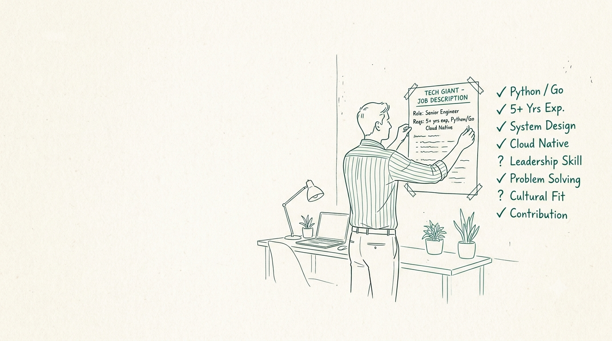
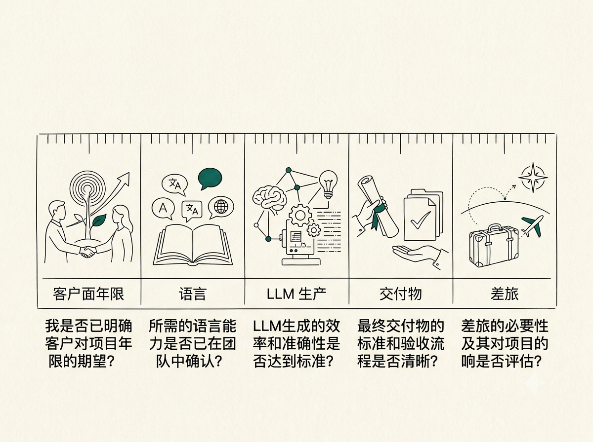
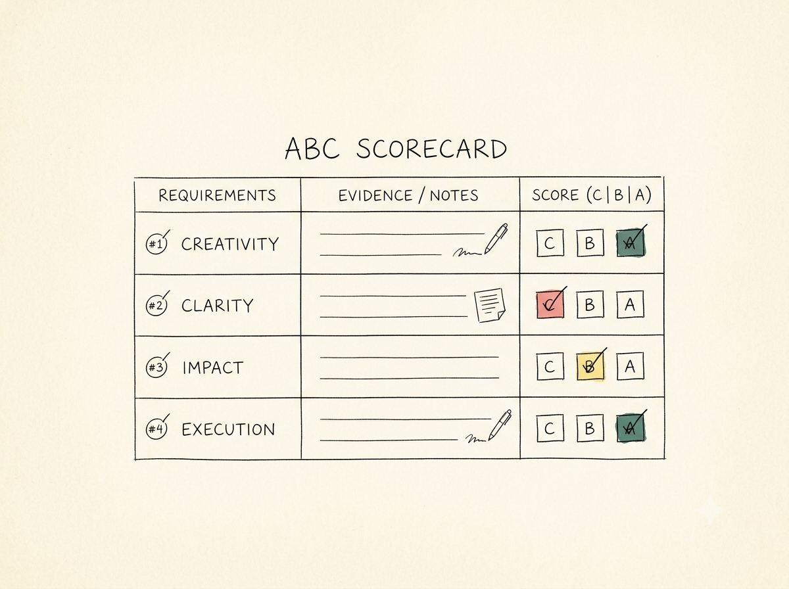
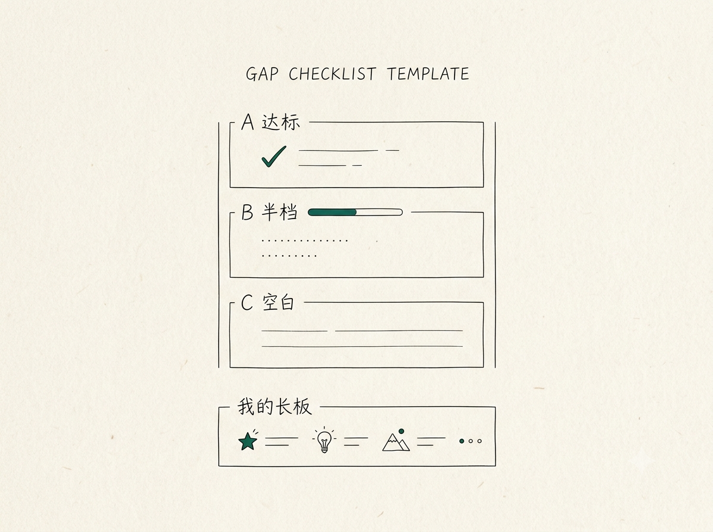
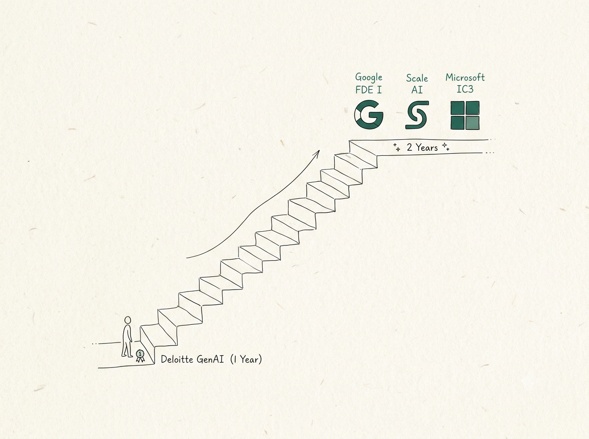
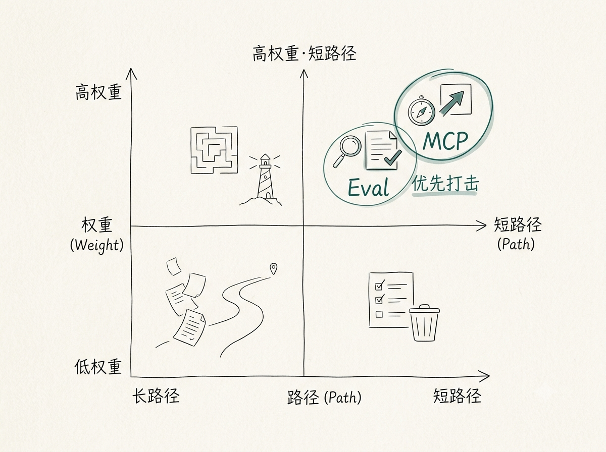

上一讲我们把国内的招聘地图摊开了：腾讯云的「AI 前线部署工程师」开 35–65K×15 薪，智谱的「FDE 负责人」月薪 6–8 万，字节豆包、蚂蚁数科、360 也都在建队。你看完可能有点上头，也可能有点发怵——薪资是真香，可这些岗到底要什么样的人？我够不够格？

这一讲就干一件事：把一份顶配 JD 当成尺子，量一量你自己。我选 Anthropic 的 FDE 画像做标尺——它是全行业写得最细、最狠的一份。我们不空谈"你要很强"，而是逐条对照，量出你缺哪块、缺多少，最后落成一张你能拿去动手的差距清单。

说白了：这一讲结束，你手里要多出一张纸，写着"我离目标还差这几步、先补哪一步"。这张纸就是后面实战篇的起点。



## 一把尺子：Anthropic 目标画像

先给结论：你不需要"全能"，你需要"对得上尺子"。所以第一步是把尺子拿出来，看清它每一格量的是什么。

我为什么选 Anthropic？因为它的 JD 把要求写到了交付物级别，别的公司还在说"熟悉 LLM"，它已经点名要你交出 MCP server。这就像别人问你"会做饭吗"，它直接问"能不能上一桌四菜一汤、几点开席"。标准越具体，你越好自查。

把这份画像拆成五格，你逐格对号入座：

| 尺子的一格 | Anthropic 的原话/口径 | 它在量什么 |
|---|---|---|
| 客户面年限 | 3–4+ 年 technical customer-facing | 你直接对客户干活的年头 |
| 语言底座 | Python 为主，ideally TypeScript/Java | 你能不能独立把系统写上线 |
| LLM 生产经验 | production LLM，含 prompt / agent / eval | 你做的是上线系统还是 demo |
| 交付物 | MCP servers、sub-agents、agent skills | 你能不能交出"进生产"的东西 |
| 差旅 | ~25% | 你愿不愿意上门驻场 |



这五格里，最容易被误读的是第三格和第四格，我多说两句。

**"LLM 生产经验"不是"我用过 GPT 写过脚本"。** 它量的是三件事叠在一起：你会不会调 prompt（现在归到 context engineering 里）、你会不会搭 agent、你会不会做 eval。这三样里，eval 是权重最高的那个——OpenAI 把 FDE 的成功标准直接写成 "production adoption, measurable workflow impact, and eval-driven feedback"。翻译过来就是：你交付的东西得有可量测的效果，而量测这件事本身就是硬技能。

**"交付物"这一格是 Anthropic 最狠的地方。** 它逐字写了要你交付 "MCP servers, sub-agents, and agent skills that will be used in production workflows"，还补一句 "white glove deployment support"。别被"white glove"唬到，它就是"贴身高端交付"的意思。关键在后半句——used in production。

这里给你一个能一辈子记住的对比。传统做法：你做个原型，跑通了，演示给客户看，客户点头，项目结束。FDE 做法：你写一个 MCP server，接进客户真实的工单系统，它每天在客户那儿跑，出了问题半夜打电话找你。前者交付的是"看起来能行"，后者交付的是"真的在行"。这两者之间隔着的，正是这份 JD 在筛的东西。

看懵了也没关系。你现在不用会写 MCP server，你只需要认清：这五格就是你要量的维度。下一节我们拿真尺子量你自己。

## 逐条自查：产出你的差距清单

结论先行：自查不是"感觉一下"，是逐格打分、写证据。没有证据的自评等于没评。

我给你一套五档打分法，每一格都问自己同一个问题——"我能拿出什么证据？"证据可以是一段经历、一个仓库、一篇博客、一份线上系统。拿不出证据的，一律算不达标，别自己给自己放水。

打分标准就三个字母：

- **A（达标）**：有可展示的证据，能在面试里讲 5 分钟不心虚。
- **B（半档）**：沾过边，但拿不出"进生产"的证据。
- **C（空白）**：完全没碰过。

来，把尺子和你自己叠在一起，填这张表：

| 尺子的一格 | 目标水位 | 你的证据 | 打分 A/B/C |
|---|---|---|---|
| 客户面年限 | 3–4 年直接对客户 | ？ | ？ |
| Python 生产 | 独立写系统上线 | ？ | ？ |
| Eval 能力 | 建过 eval harness | ？ | ？ |
| Agent 编排 | 做过多 agent 系统 | ？ | ？ |
| MCP 交付 | 手写过 MCP server | ？ | ？ |
| 差旅意愿 | 能接受 ~25% | ？ | ？ |



填的时候，你大概率会遇到三种典型模式，我按转型来路给你对号：

**如果你是后端/数据/ML 出身**，你的表大概是"右边三格（Eval/Agent/MCP）容易 B，左边客户面那格是 C"。你的技术底子够，缺的是"直接对客户"这段经历和叙事。这就像你厨艺很好，但从没上过前厅招呼客人——菜没问题，缺的是把菜端出去、看客人脸色的那套本事。

**如果你是产品经理出身**，几乎反过来：客户面天然达标（70%+ 的 JD 都要 requirements discovery，你本来就在干），但 Python 生产、Eval、MCP 三格可能连着 C。你要补的是"工程身份"——旗舰项目必须自己写，不能挂名。

**如果你是售前/顾问出身**，你的坑最隐蔽：你可能觉得自己"做过很多客户项目"，一打分才发现，你交付的都是 demo 和方案，不是 production 代码。你的 B 和 C 集中在"从 demo 到上线"这条线上。

写到这儿，你手里应该有一张填满 ABC 的卡了。别急着焦虑分数难看——第一次量出来全是 C 才正常，说明你量得诚实。

现在把它固化成一个你能持续更新的清单。我建议你直接用这个文本模板存一份，放进你的转型记录：

```markdown
# 我的 FDE 差距清单（对标 Anthropic 画像）
更新日期：2026-07-15

## 达标（A）——面试可讲 5 分钟
- [ ] 客户面：______（证据：______）

## 半档（B）——沾过边，缺"进生产"证据
- [ ] Eval：只在项目里跑过分，没建过 harness
- [ ] Agent：用过框架，没做过多 agent 编排

## 空白（C）——完全没碰
- [ ] MCP：没写过 server
- [ ] Python 生产：没独立上线过系统

## 我的长板（别人没有的牌）
- ______（例：五年金融行业 know-how，Anthropic 偏好监管行业）
```



注意最后那一段——**长板**。自查不是只找短板。Anthropic 明确偏好金融/医疗背景，OpenAI 和 Anthropic 都把"前创始人/早期工程师"写成显性加分。你过去那段看似不相关的经历，可能正是别人补不出来的牌。先盘长板，再补短板，你会没那么慌。

## 别被"5 年+"吓退：低门槛入口

先说结论，因为这一节可能直接改变你的行动：**"FDE 必须 5 年经验起"是个误解，2 年档的入口成体系地存在。**

很多人量完差距清单，看到"3–4 年客户面"就泄气了：我才两年，是不是没戏？不是。你盯错了那把最贵的尺子。Anthropic 是顶配，但整个行业不是只有顶配这一档。

我把 2 年档甚至 1 年档的真实入口给你列出来，你对照自己的年限看：

| 入口 | 经验门槛 | 薪酬 | 特点 |
|---|---|---|---|
| Google Cloud FDE I | 2 年 | 未公开 | 大厂阶梯最低一级，同句式只改年限 |
| Scale AI FDE | 仅 2 年 | $179.4–224.25K | 全栈+快速实验 |
| Harvey Founding FDE | 2 年 | $165–200K | 法律 AI，per-client eval |
| 微软 FDE（IC3） | 2 年编码+1 年生产 ML/LLM | $100.6–199K | 大厂最低门槛 IC 锚点 |
| Deloitte FDE | 3 年工程+**仅 1 年 GenAI** | $134.5–265.1K | 咨询旁路，转型最低门槛 |



看到 Deloitte 那行没有？**3 年工程经验 + 1 年 GenAI 生产 + 1 年指定平台**，这是整张表里门槛最低的一格。它对咨询、实施、售前出身的人特别友好——因为咨询公司现在既出资又开岗，Salesforce 的 FDE 伙伴网络里 Accenture、Deloitte、PwC、IBM 都在（30+ 家）。这条旁路，v1 版本的攻略几乎没人讲。

再给你一个能治焦虑的实证。Kanav Bhatnagar，24 岁，从 Amazon 干了大概 3 年跳出来，先在一家早期公司做 6 个月 FDE，然后进了 Rippling 的创始 FDE 团队，级别还是 Senior。他毕业才三年。他备考靠的不是刷五年经验，是拿咨询行业的 case 题练"快速诊断、澄清式提问、行动计划"。

所以，如果你的差距清单上"年限"那格是 C，正确的动作不是"再熬三年"，而是：**把投递目标从 Anthropic 顶配，换成 2 年档入口，同时用别的格子的证据去补年限的不足。** 门槛是分层的，你要做的是找到对得上你现在这把尺子的那一层，而不是盯着最高那格发愁。

国内也一样。上海创智学院办了全国首个官方 FDE 免费培训，"3+3+3"培养矩阵，还打算挂钩人社中级职称。这是官方给你铺的低门槛台阶，别浪费。

## 排优先级：90 天补哪一格

结论先行：差距清单不是待办堆，是排过序的作战图。你不可能 90 天补齐所有 C，得挑那几格"性价比最高"的先打。

怎么排？我给你一个简单的判断法，两个维度相乘——**这一格在 JD 里的权重 × 你补它的最短路径**。权重高、又能快速拿出证据的，先打。

按这个法子过一遍，行业共识的优先级是这样的：

1. **Eval（最高优先）**：全行业权重最重，Andrew Ng 说它是"能否构建 agent 的最大预测因子"。而且入门极快——一门约 1 小时的免费课就能起步，给你手上任意一个项目建个 harness，证据当天就有。权重顶格、路径最短，它排第一没有争议。
2. **MCP**：2026 新晋硬门槛，Anthropic 写进交付物、面试直接考。它不难，本质就是"给模型接一个能调你系统的插头"，你写过 REST API 就能上手。亲手写一个接真实系统的 server，你的清单上最扎眼的那个 C 就变 A 了。
3. **Agent 编排**：从加分项变成主线。用 Claude Agent SDK 或 LangGraph 做一个多 agent 项目，把"哪里失控、怎么收敛"记下来。
4. **客户面叙事**：如果你技术出身、这格是 C，别去"攒经验"，去"翻译经验"。把你过去任何一段对接人、扛需求、救火的经历，改写成 2–3 个 STAR 故事（诊断→定界→交付→量化）。
5. **Python 生产 / 差旅意愿**：底座和心态，边做上面四格边补。



给你翻译成一句能落地的话：**未来 90 天，你的主线就是"建一个 eval harness + 写一个 MCP server + 搭一个多 agent 项目"，每做完一个写一篇博客当证据。** 这三样正好把你清单上权重最高的三个 C 变成 A。

为什么强调写博客？因为有个真实案例：Het Trivedi 创业失败后自学 GenAI，就写了一篇部署博客，被 Baseten 的联合创始人私信挖走了。这就像你找工作时，与其在简历上写"精通 X"，不如直接甩出一个链接——"这是我做的，你自己看"。作品集里一个能跑的部署，60 秒就能验证你行不行，比一摞证书都好使。

到这儿，你的差距清单已经从"一张打满 ABC 的卡"，升级成"一张排好序、标了动作的 90 天作战图"。这就是我们这一讲要的东西。

## 小结

这一讲我们只做一件事：把 Anthropic 的顶配 JD 当尺子，量出你自己的差距。五格尺子——客户面、Python 生产、Eval、Agent、MCP 交付、差旅——逐格用 ABC 打分，写证据不写感觉。别被"5 年+"吓退，2 年档入口（Google FDE I、Scale、Harvey、微软 IC3）和 Deloitte 的 1 年 GenAI 旁路都真实存在。最后按"权重×路径"排序，把 Eval 和 MCP 排在最前。你现在手里应该有一张排好序的差距清单了——这就是实战篇的起点。

## 思考题

拿出你刚填好的差距清单，找出那一格"权重最高、但你打了 C"的短板。如果只给你未来两周，你会用什么最小的动手项目，把它从 C 挪到 B？把你的答案写下来，它很可能就是你转型的第一步。下一讲我们讲《怎么学：Anthropic Academy 免费证书串 + 中文平行线》，手把手给你铺补齐这些格子的学习路线。欢迎在评论区聊聊你的想法。
