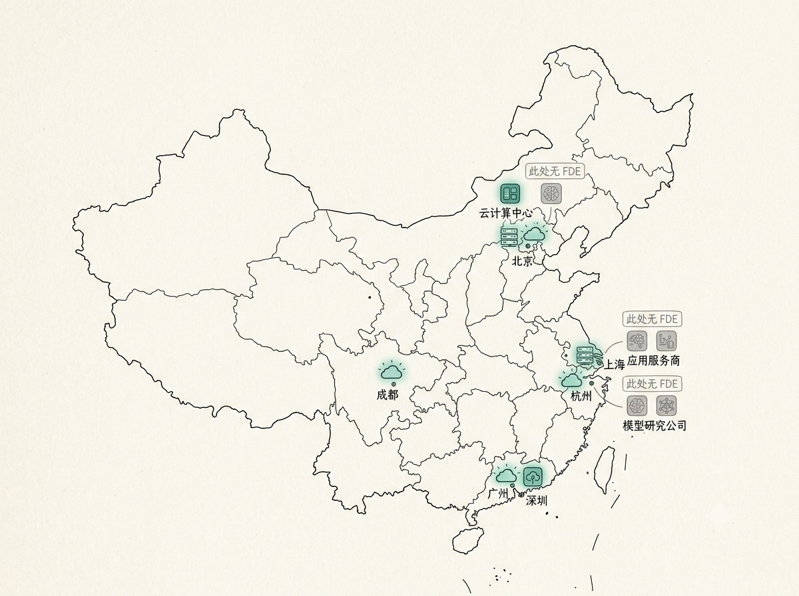
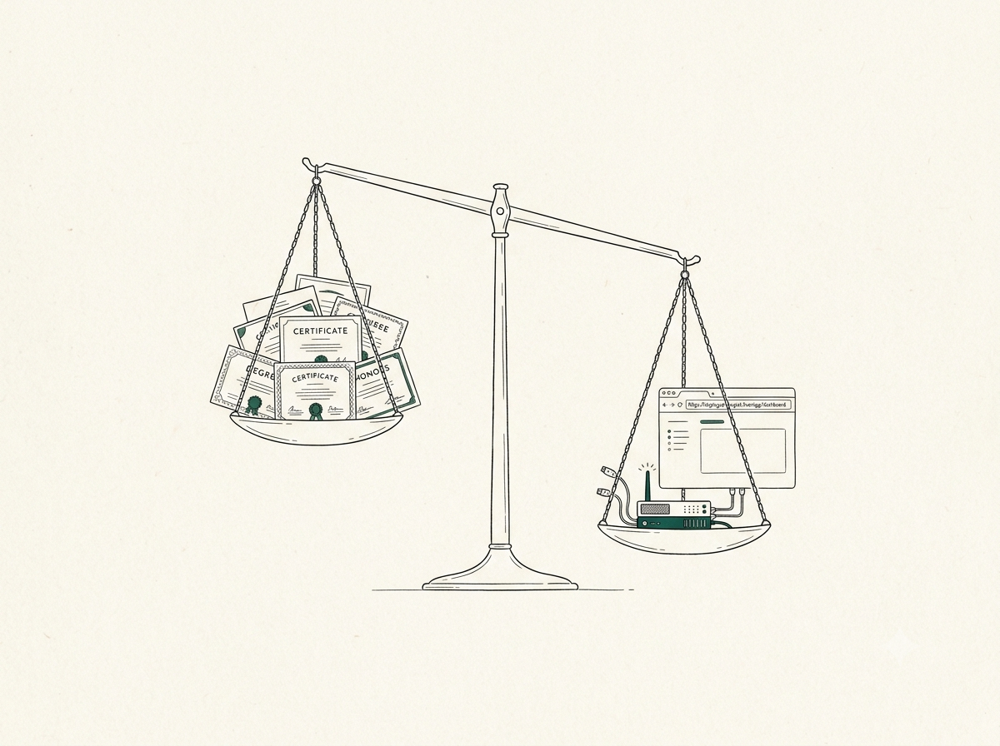

上一讲我们干了件苦活：把八家大厂的 JD 摊开，用 Anthropic 的目标画像（4+ 年面客经验、Python 生产应用、含 prompt 和 evals 的 LLM 生产经验）反推你现在缺什么。差距清单出来了，问题也就来了：这堆缺口，到底该从哪一门课、哪一个项目开始补？

这一讲我回答一个特别实在的问题：从今天起，你按什么顺序学，才能既省钱又出凭证。我不给你堆一百个链接。我给你一条主线、一条中文平行线，外加一个贯穿全书的机制。先记结论：官方免费课就能起步，Day1 就能攒下第一张能展示的证书。


## 主线：Anthropic Academy 的免费证书串

先给判断：2026 年，官方免费主线就是 Anthropic Academy 的开发者路径，别再从零散的 GitHub 教程起步。

它 2026 年 3 月上线，十几门课全免费，每门带结业证书。路径是固定的，你照着走就行：

```text
Claude Platform 101
  → Building with the Claude API
  → Introduction to MCP
  → MCP: Advanced Topics
  → Introduction to Agent Skills / Subagents
  → Claude Code in Action
```

为什么是这条、不是别的？因为它和 JD 逐字对齐。还记得上一讲 Anthropic 的交付物原文吗——"MCP servers, sub-agents, and agent skills"。这条路径的后半段，一门课对一个交付物。你学完不是"懂了个概念"，是手里攥着招聘方点名要的东西。


说个你能对上的场景。这就像你学做菜，不是先背一百种调料的化学成分，而是跟着一张菜谱把一道菜从头做到尾。每做完一道，端上桌，拍张照。Academy 的证书就是那张照片——证明你真的下过厨。

来对比一下。传统的自学路径是：找一堆博客、收藏几十个 YouTube、然后在"该先学哪个"里瘫痪三个月。Academy 的做法反过来：路径给你钉死，你唯一要做的就是往前走，每走一步掉一张证书出来。别小看这个心理差别。转型最大的敌人不是难，是不知道下一步点哪里。

这里插一句 2026 的现实：MCP 已经不是加分项，是硬门槛了。Anthropic 的 JD 把"用 MCP 构建自定义工具"写进日常职责，技术面直接考 MCP 的长任务场景。连 Sarvam 这种非头部公司都在 JD 里要求"构建 MCP server"。所以路径里那两门 MCP 课，你别跳。

别急，MCP 这个词听着唬人，本质就是"给模型接一个能调你系统的插头"。你写过 REST API，理解它就是半天的事。真正花时间的是亲手写一个、再接进你日常用的 Claude Code——那才叫会。


关于证书，我把 2026 年中的实话给你：

| 类型 | 值得拿吗 | 说明 |
|---|---|---|
| 免费结业证书链 | 值得，且优先 | Anthropic Academy 全系 + HF MCP Course + DLAI 短课，集齐一串可展示凭证 |
| 阿里云 ACP | 值得（国内） | 约 ¥1000，考纲六模块和 FDE 栈高度重合，国内简历能用 |
| Claude Certified | 关注即可 | Pearson VUE 监考，目前偏合作伙伴 |
| OpenAI 认证 | 不要等 | 仍在企业试点，没对个人开放考试 |

看懵了也没关系，这张表你只要记一句：**能免费拿的先拿满，别为一张付费证书卡住手脚，更别傻等 OpenAI 开放。**

那 evals 呢？它是全书最重的技能，可这一讲不展开方法论——那是后面的专章。这里只给你入门资源的档位，让你知道花不花钱：免费入门用 Braintrust 的 Evals Foundations（约 1 小时）加 Hamel Husain 的《Evals FAQ》；想系统化，等 Hamel 和 Shreya 的 O'Reilly《Evals for AI Engineers》（2026-10-31 出版）；预算充足才考虑那门 $4,200 的 Maven 课。Andrew Ng 有句话我贴墙上了："能否做好 evals 和 error analysis，是能否构建 agent 的最大预测因子。"免费档就够你入门，先动手，别被价格吓退。

## 平行线：中文资源与国内证书

结论先给：如果你更习惯中文、或者要投国内的岗，就在英文主线旁边并行跑一条中文线，别二选一。

中文这条线的骨架是 Datawhale 三件套加阿里云 ACP：

| 资源 | 干什么用 | 价格 |
|---|---|---|
| Datawhale all-in-rag | RAG 技术全栈，有在线阅读站 | 免费开源 |
| Datawhale tiny-universe | 手搓 LLM+RAG+Agent+Eval 的白盒教程，补原理 | 免费开源 |
| Datawhale llm-cookbook | 吴恩达系列中文版，含高级 RAG 评估 | 免费开源 |
| 阿里云大模型 ACP | 约 ¥1000，六模块考纲与 FDE 栈重合 | ~¥1000 |
| 上海创智学院 FDE 培训 | 全国首个官方 FDE 培训，拟挂钩中级职称 | 免费 |


我怎么建议你搭配？英文主线负责"对齐大厂 JD 的最新交付物"，中文线负责"补底层原理和拿国内认可的证"。举个例子：你在 Academy 学 MCP 学的是最新标准和实战，但如果你想真正搞懂检索管线里每一层在干嘛，Datawhale 的 tiny-universe 那种手搓白盒教程会让你更踏实。两边不冲突，是互补。

阿里云 ACP 我单独说一句。它的考纲六模块——检索增强 19%、应用开发 17%、微调 17%、生产实践 17%、多 Agent 16%、提示词 14%——几乎就是 FDE 技能栈的缩影。你为考它而学，顺手就把主线知识过了一遍。这就像你为了考驾照去练车，练着练着发现自己是真的会开了，证只是副产品。

上海创智学院那个官方培训也提一句：全国首个、免费、还拟挂钩人社中级职称。这对国内转型者是实打实的资源。顺便说个术语坑——搜政策和培训信息时，你要同时用"前线部署工程师"和"前沿部署工程师(FDE)"两个名字搜；后者是百度百科词条和上海政策文件的用名，只搜一个会漏。

投递方向上我也帮你把雷排掉。国内 FDE 岗集中在云厂商和应用服务商：腾讯云直接挂过"AI 前线部署工程师 FDE"（35–65K×15 薪），智谱招"FDE 负责人"（月薪 6–8 万）。但 DeepSeek、月之暗面、MiniMax 这些模型研究公司**不设 FDE 岗**，简历投过去是打水漂。这条信息，记进你的求职清单。



## 贯穿机制：资源怎么变成作品集

这是这一讲最想让你记住的一节。结论一句话：**证书是入场券，作品集才是筹码；一个能 60 秒验证的部署项目，胜过十张结业证书。**

为什么这么说。证书证明你"学过"，但招聘方要的是你"做过"。Het Trivedi 这个人你可以记一下：他创业失败后自学 GenAI，写了一篇"用 Truss 部署开源 LLM"的技术博客，结果被 Baseten 的联合创始人私信挖走。不是靠证书堆，是靠一篇能看见成果的博客。

所以本课的机制是"资源+项目"贯穿：你学的每一门课，都要落到一个能公开展示的产出上。别只收集证书。



具体怎么贯穿？给你一条极简的起步链路：

```text
学 Claude API 那门课
  → 做一个小 demo（哪怕只是个能回答问题的 agent）
  → 部署上线，拿到一个 live URL
  → 写一篇博客：讲清你踩了什么坑、怎么修的
```

注意这里的对比。学完就存进收藏夹，是 before——三个月后你只剩一堆看过的课，简历上写不出一行东西。学完就部署+写博客，是 after——你有 URL 能点开、有博客能转发，招聘方 60 秒就能验证"这人真的会"。同样的时间，产出天差地别。

我知道你可能想说：我还没学到能做旗舰项目的程度。别急。这一讲不要求你现在就交付那个端到端的大作品（那是后面专章的事）。这一讲只要你完成两件事，本周之内：

- **第一，注册 Anthropic Academy，拿下 Claude Platform 101 的结业证书。** 这是你的第一张可展示凭证，当天就能到手。
- **第二，跑通第一个 demo。** 用 Claude API 做个最小可用的东西，本地能跑就算过关，能部署更好。


这两件事加起来，可能就占你一个周末。但它们的意义不在难度，在于**启动**。转型这件事，最贵的成本是迟迟不开始。你今天点下"注册"，这条路就真的从脚下开始了。而且这里还藏着一个红利：中文社区到现在都没有第一人称的 FDE 转型案例——你把自己这 90 天的学习和踩坑公开记录下来，本身就是稀缺内容，是别人抄不走的作品集。

## 小结

这一讲我给了你三样东西。一条主线：Anthropic Academy 的免费证书串，从 Claude 101 到 Claude Code，每门带证、逐字对齐大厂交付物。一条中文平行线：Datawhale 三件套补原理，阿里云 ACP 拿国内认可的证。一个贯穿机制：作品集大于证书，每学一门就落到一个能 60 秒验证的产出。落点很简单——本周注册 Academy、拿下第一张证书、跑通第一个 demo。

## 思考题

结合你上一讲盘出来的差距清单，你打算把英文主线和中文平行线怎么搭配？哪一门课是你这周就点下"注册"的那一门，配上一个什么样的最小 demo 来验证它？欢迎在评论区聊聊你的想法。

下一讲我们进客户现场，聊 FDE 的第一门手艺：客户发现——怎么挖出客户真正的需求，而不是他嘴上说要的那个。
