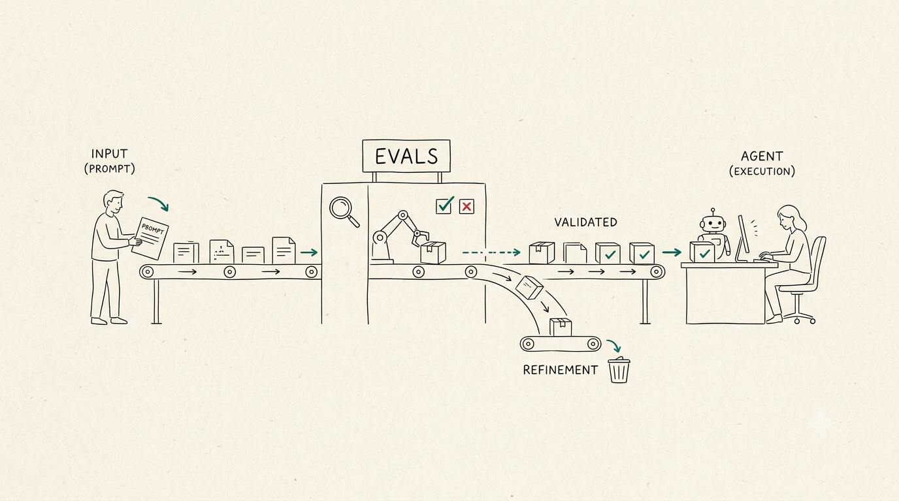
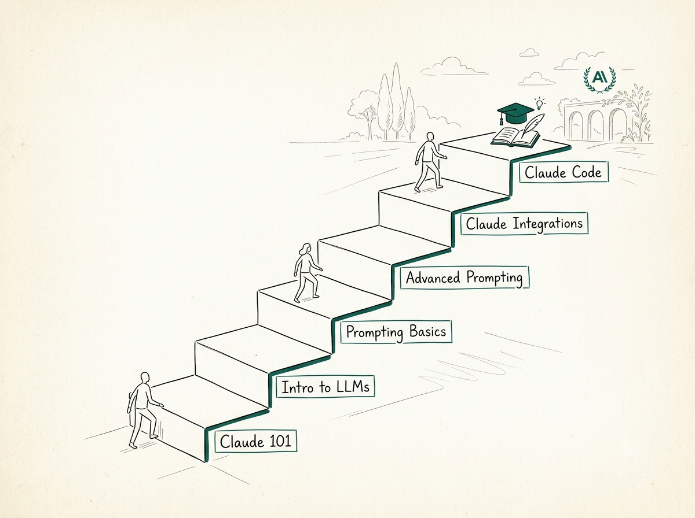
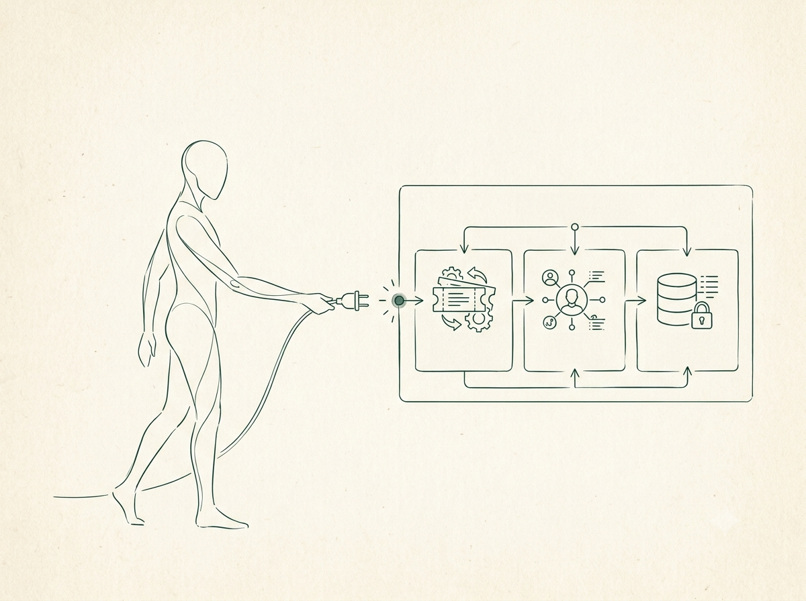
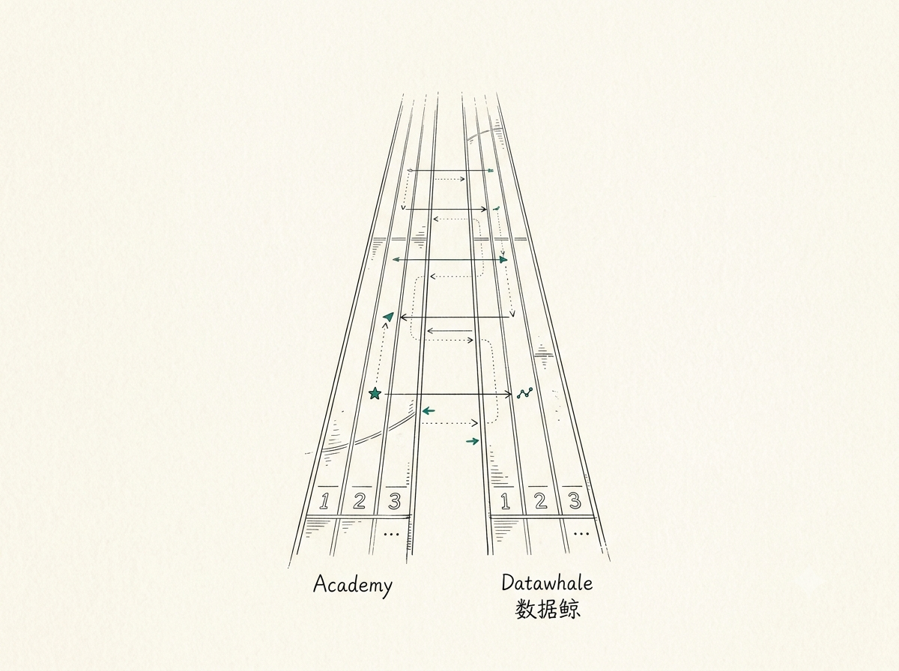
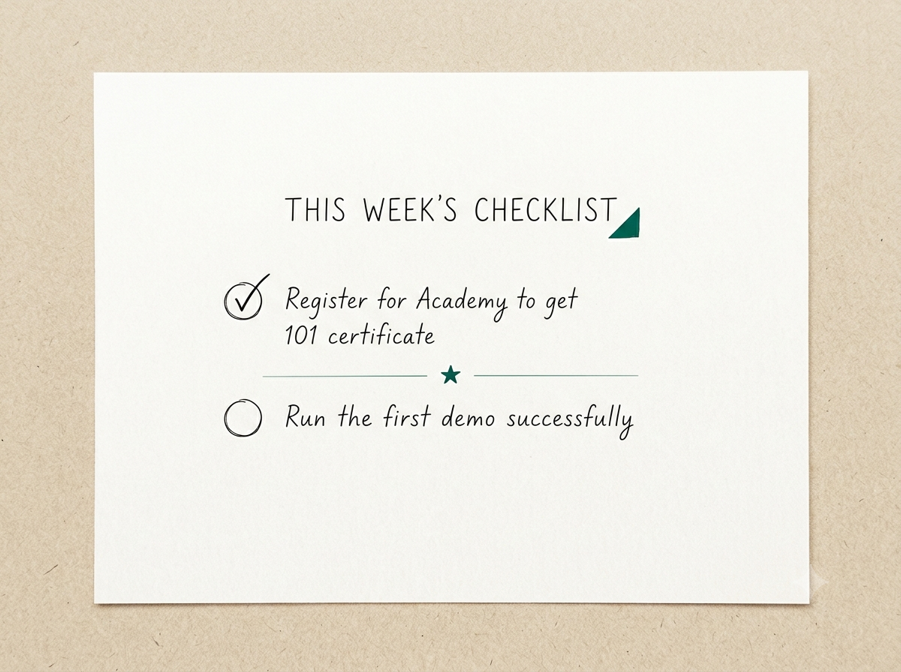

上一讲我们干了件苦活：把八家大厂的 JD 摊开，用 Anthropic 的目标画像（4+ 年面客经验、Python 生产应用、含 prompt 和 evals 的 LLM 生产经验）反推你现在缺什么。差距清单出来了，问题也就来了：这堆缺口，到底该从哪一门课、哪一个项目开始补？

这一讲我回答一个特别实在的问题：从今天起，你按什么顺序学，才能既省钱又出凭证。我不给你堆一百个链接。我给你一条主线、一条中文平行线，外加一个贯穿全书的机制。先记结论：官方免费课就能起步，Day1 就能攒下第一张能展示的证书。




## 主线：Claude Academy（原 Anthropic Academy）的免费证书串

先给判断：2026 年，官方免费主线就是 Anthropic 官方学院的开发者路径，别再从零散的 GitHub 教程起步。

注意一个 2026 年下半年的入口迁移：Anthropic 在 2026 年 3 月上线的 `anthropic.skilljar.com` 已于 **2026 年 8 月 20 日正式升级迁入 `academy.claude.com`（更名为 Claude Academy，旧 Skilljar 站点于 2026 年底停用）**，免费课程库一口气扩充到了 **29 门**，每门都带官方结业证书。核心开发者路径给你排好了，照着走就行：

```text
Claude 101 / Claude Code 101
  → Building with the Claude API
  → Introduction to MCP
  → MCP: Advanced Topics
  → Introduction to Agent Skills / Subagents
  → Introduction to evals & Deploying Claude Enterprise with confidence
```

为什么是这条、不是别的？因为它和 JD 逐字对齐。还记得上一讲 Anthropic 的交付物原文吗——"MCP servers, sub-agents, and agent skills"。这条路径的后半段，一门课对一个交付物，8 月新增的 `Introduction to evals` 和企业部署课更是直接补齐了生产上线闭环。你学完不是"懂了个概念"，是手里攥着招聘方点名要的东西。



说个你能对上的场景。这就像你学做菜，不是先背一百种调料的化学成分，而是跟着一张菜谱把一道菜从头做到尾。每做完一道，端上桌，拍张照。Academy 的证书就是那张照片——证明你真的下过厨。

来对比一下。传统的自学路径是：找一堆博客、收藏几十个 YouTube、然后在"该先学哪个"里瘫痪三个月。Academy 的做法反过来：路径给你钉死，你唯一要做的就是往前走，每走一步掉一张证书出来。别小看这个心理差别。转型最大的敌人不是难，是不知道下一步点哪里。

这里插一句 2026 的现实：MCP 已经不是加分项，是硬门槛了。Anthropic 的 JD 把"用 MCP 构建自定义工具"写进日常职责，技术面直接考 MCP 的长任务与安全鉴权场景。连 Sarvam 这种非头部公司都在 JD 里要求"构建 MCP server"。所以路径里那两门 MCP 课，你别跳。

别急，MCP 这个词听着唬人，本质就是"给模型接一个能调你系统的插头"。你写过 REST API，理解它就是半天的事。真正花时间的是亲手写一个、再接进你日常用的 Claude Code——那才叫会。



到了 2026 年下半年，各大巨头的认证版图发生了一轮大洗牌，我把截至 2026 年 11 月的实话给你列成一张表：

| 类型 | 值得拿吗 | 2026 年末最新状态与说明 |
|---|---|---|
| 免费结业与实操徽章链 | **值得，第一优先** | **Claude Academy**（29 门免费课）+ **OpenAI Academy**（`academy.openai.com` 9 月上线的 8 门免费 `Build with AI` 开发者徽章）+ **AWS Partner FDE 免费实操认证**（10 月上线，按 `Ground`/`Orchestrate`/`Prove` 三阶沙箱实验验证）+ HF MCP Course |
| 阿里云大模型 ACP | **值得（国内）** | 官方约 ¥1200（活动期约 ¥840），2026 新考纲纳入多 Agent、Context 工程与安全护栏，国内简历硬锚点 |
| Google Cloud PAA | **值得（海外/云线）** | **Professional Agentic Architect**（\$200，2026-11 正式上线），考纲直接脱胎于 Google 内部 FDE 培训体系 |
| Claude Certified（4 门） | 按需（有伙伴邮箱可考） | Pearson VUE 监考，已扩充为 `CCAO-F`（\$99）、`CCDV-F`（\$125）、`CCAR-F`（\$125）、`CCAR-P`（\$175）四门，需免费注册 Claude Partner Network 机构账号报考 |
| 企业住院医/内训认证 | 个人不必干等 | **Claude Frontier Academy**（1 亿美元培养 1 万名 FDE）与 OpenAI 正式认证目前仅面向合作企业提名开放 |

看懵了也没关系，这张表你只要记一句：**先把 Claude Academy、OpenAI Build with AI 和 AWS FDE 沙箱这串免费凭证拿满，千万别为高价商业培训班掏冤枉钱。**

那 evals 呢？它是全书最重的技能，可这一讲不展开方法论——那是后面的专章。这里只给你入门资源的档位，让你知道花不花钱：免费入门用 Claude Academy 的 `Introduction to evals`、Braintrust 的 `Evals Foundations`（约 1 小时）加 Hamel Husain 的《Evals FAQ》；想系统吃透，直接读 Hamel 和 Shreya 刚在 **2026 年 10–11 月由 O'Reilly 正式出版的新书《Evals for AI Engineers》**（配套站 `ai-evals.com`）；预算极度充裕的企业报销党才需要看那门 \$4,200 的 Maven 课。Andrew Ng 有句话我贴墙上了："能否做好 evals 和 error analysis，是能否构建 agent 的最大预测因子。"免费档加一本 O'Reilly 新书就完全够你打通关了。

## 平行线：中文资源与国内证书

结论先给：如果你更习惯中文、或者要投国内的岗，就在英文主线旁边并行跑一条中文线，别二选一。

中文这条线的骨架在 2026 年下半年升级成了 **Datawhale 四件套 + 阿里云新版 ACP + 上海官方职称通道**：

| 资源 | 干什么用 | 价格 |
|---|---|---|
| **Datawhale hello-agents** | 2026 爆款（8.7 万+ Stars），从零构建智能体并覆盖 Context Engineering、MCP 与 A2A | 免费开源 |
| Datawhale all-in-rag | RAG 与混合检索技术全栈，有在线阅读站 | 免费开源 |
| Datawhale tiny-universe | 手搓 LLM+RAG+Agent+Eval 的白盒教程，补底层原理 | 免费开源 |
| Datawhale llm-cookbook | 吴恩达系列中文版，含高级 RAG 与评估实战 | 免费开源 |
| 阿里云大模型 ACP（2026 版） | 考纲升级覆盖 Agent、Context 与安全，贴合国内云生态 | ~¥1200（促销 ¥840） |
| 上海创智学院 / 长宁人社高研班 | 官方免费 FDE 培养体系，**2026-11 已正式落地首批 274 人中高级职称评审** | 免费 |



我怎么建议你搭配？英文主线负责"对齐大厂 JD 的最新交付物"，中文线负责"补底层原理和拿国内认可的证"。举个例子：你在 Claude Academy 学 MCP 学的是最新标准和实战，再配 Datawhale 的 `hello-agents` 和 `tiny-universe` 把白盒代码手搓一遍，两边互补，底子最稳。（另外如果你想翻一本中文纸质通识书对表本土语境，也可以顺手翻翻范冰在 2026 年 10 月刚由人民邮电出版社出版的《前线部署工程师（FDE）：人工智能时代的客户价值交付》。）

阿里云 ACP 我单独说一句。它的考纲六模块——检索增强、应用开发、微调、生产实践、多 Agent、上下文与提示工程——几乎就是国内云生态 FDE 技能栈的缩影。你为考它而学，顺手就把主线知识过了一遍；但切记认准大厂官方认证，绕开市面上收费几千上万、号称“包推荐就业”的商业山寨 FDE 证书。

上海创智学院与上海市人社局那条通道在 2026 年 11 月更是从“拟挂钩”变成了真金白银的现实：《沪人社专〔2026〕161号》正式公布了全国首批 **274 名**获评工程师/高级工程师职称的 FDE 名单，长宁区等还在持续开办政府补贴的免费高研班。顺便提醒术语坑——搜国内政策和招聘时，同时用"前线部署工程师"和"前沿部署工程师(FDE)"两个名字搜，后者是工信部与上海人社文件的标准译名。

投递方向上也同步更新一下 2026 年秋的盘面：国内岗位大盘依然集中在云厂商与大厂 2B 线（腾讯云 35–65K×15、腾讯 CSIG 50–80K、字节豆包 35–70K×15、阿里云 20–55K×16）；大模型创业公司里，智谱、月之暗面（Kimi Partner FDE）、MiniMax、阶跃星辰已在 2026 年 9–10 月开放精选 FDE 岗，唯独 **DeepSeek** 依然坚持纯研究零 FDE 编制，别盲投错门。


## 贯穿机制：资源怎么变成作品集

这是这一讲最想让你记住的一节。结论一句话：**证书是入场券，作品集才是筹码；一个能 60 秒验证的部署项目，胜过十张结业证书。**

为什么这么说。证书证明你"学过"，但招聘方要的是你"做过"。Het Trivedi 这个人你可以记一下：他创业失败后自学 GenAI，写了一篇"用 Truss 部署开源 LLM"的技术博客，结果被 Baseten 的联合创始人私信挖走。不是靠证书堆，是靠一篇能看见成果的博客。

所以本课的机制是"资源+项目"贯穿：你学的每一门课，都要落到一个能公开展示的产出上。别只收集证书。


具体怎么贯穿？给你一条极简的起步链路：

```text
学 Claude API 那门课
  → 做一个小 demo（哪怕只是个能回答问题的 agent）
  → 部署上线，拿到一个 live URL
  → 写一篇博客：讲清你踩了什么坑、怎么修的
```

注意这里的对比。学完就存进收藏夹，是 before——三个月后你只剩一堆看过的课，简历上写不出一行东西。学完就部署+写博客，是 after——你有 URL 能点开、有博客能转发，招聘方 60 秒就能验证"这人真的会"。同样的时间，产出天差地别。

我知道你可能想说：我还没学到能做旗舰项目的程度。别急。这一讲不要求你现在就交付那个端到端的大作品（那是后面专章的事）。这一讲只要你完成两件事，本周之内：

- **第一，打开 `academy.claude.com` 注册 Claude Academy，拿下 Claude 101 / Claude Code 101 的结业证书。** 这是你的第一张可展示凭证，当天就能到手。
- **第二，跑通第一个 demo。** 用 Claude API 做个最小可用的东西，本地能跑就算过关，能部署更好。



这两件事加起来，可能就占你一个周末。但它们的意义不在难度，在于**启动**。转型这件事，最贵的成本是迟迟不开始。虽然 2026 年下半年中文播客和社区已经开始热聊 FDE 概念，但真正带着可运行代码、评测对比表和排障日志的第一人称 90 天转型实战记录依然凤毛麟角——你把自己这 90 天的学习和踩坑公开写出来，本身就是别人抄不走的硬核作品集。

## 小结

这一讲我给了你三样东西。一条主线：升级迁入 `academy.claude.com` 的 **Claude Academy** 免费证书串（配 OpenAI `Build with AI` 与 AWS FDE 免费实操徽章，以及刚正式出版的 O'Reilly《Evals for AI Engineers》）。一条中文平行线：Datawhale 四件套（新增 `hello-agents`）补原理，2026 新版阿里云 ACP 与已落地首批 274 人职称的上海人社通道拿国内硬背书。一个贯穿机制：作品集大于证书，每学一门就落到一个能 60 秒验证的产出。落点很简单——本周注册 Claude Academy、拿下第一张证书、跑通第一个 demo。

## 思考题

结合你上一讲盘出来的差距清单，你打算把英文主线和中文平行线怎么搭配？哪一门课是你这周就点下"注册"的那一门，配上一个什么样的最小 demo 来验证它？欢迎在评论区聊聊你的想法。

下一讲我们进客户现场，聊 FDE 的第一门手艺：客户发现——怎么挖出客户真正的需求，而不是他嘴上说要的那个。
