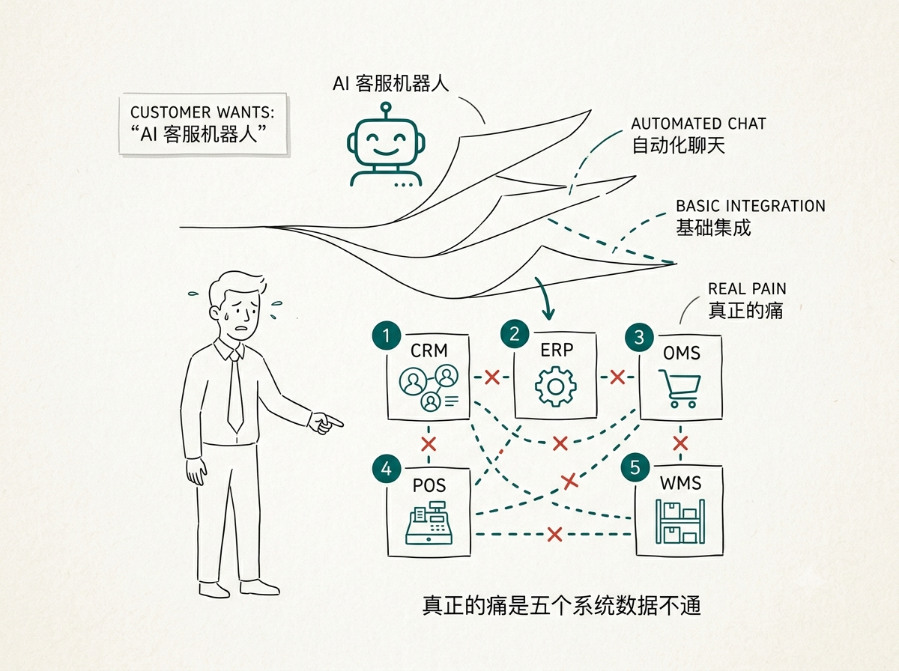
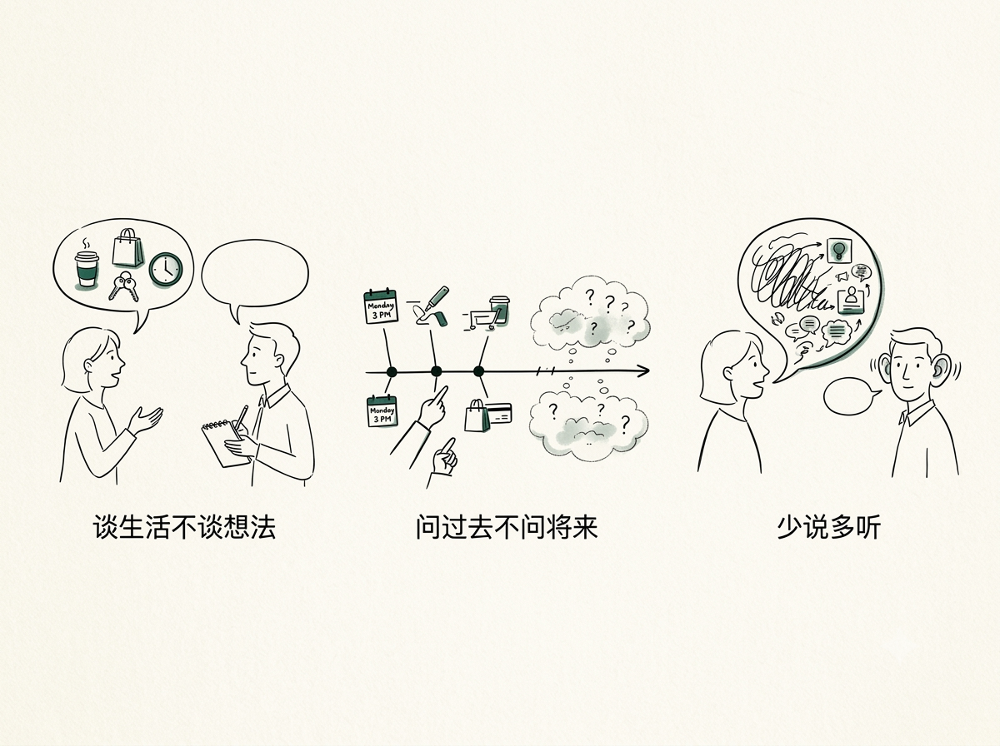
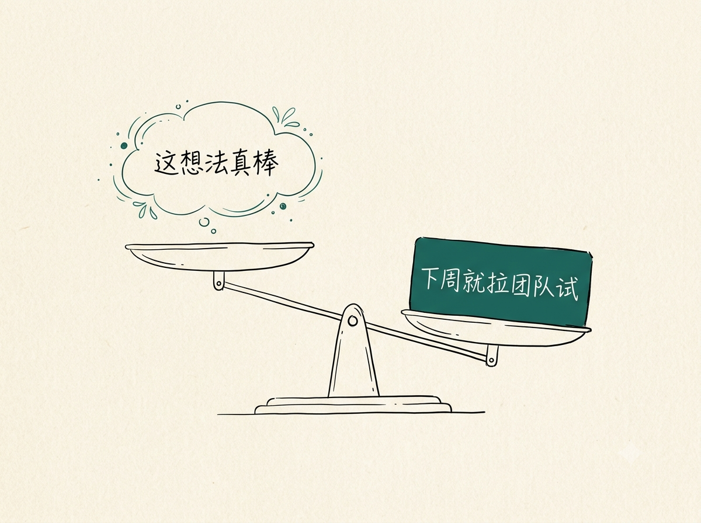
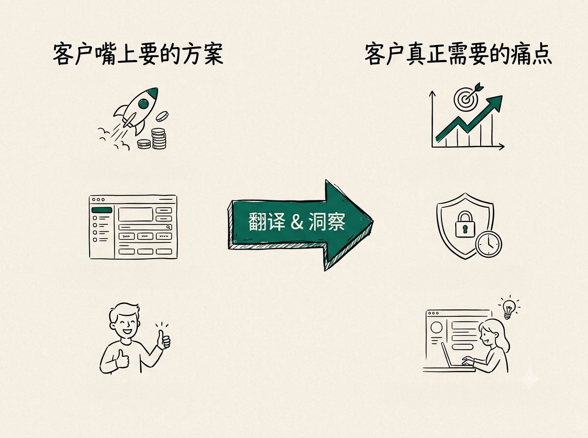
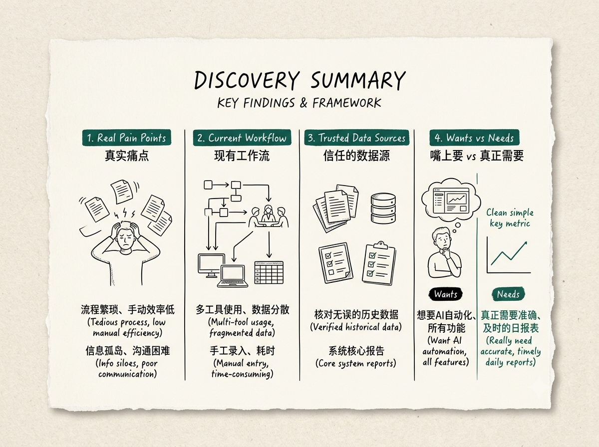
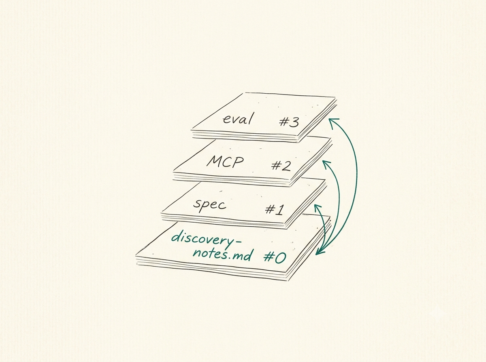

上一讲我们把"怎么学"这条主线铺完了：那串免费的开发者证书、evals 的三档资源，再加一条中文平行线。我还塞给你一句更重的话——作品集大于证书，一个能 60 秒验证的项目，胜过十张结业证。那一讲是攒弹药。

从这一讲起，我们端着枪进战场。FDE 的第一门手艺，不是写代码，是坐到客户对面，把他的话听完。

问题也跟着来了：客户会告诉你他真正要什么吗？我先把冷水泼给你——不会。不是他存心骗你，是他自己也说不清。他嘴上要的，和他真正需要的，中间隔着一条缝。这一讲，就教你怎么把这条缝撬开，把真需求捞出来。一句话先记住：先搞清楚做什么，再动手，别急着写代码。


## 客户的第一句话：方案，不是需求

先给结论：客户递给你的从来不是需求，是他自己脑补出来的解决方案。你的活儿，是把这个方案拆回它背后的问题。

这事有多要命？回到这门课反复砸你脑袋的那个数字——95% 的企业 GenAI 试点，对公司损益毫无可测的影响。九成五打了水漂。不是模型不行，是做出来的东西根本没碰到真问题。而 FDE 这个岗位存在的全部意义，就是去堵这个部署失败率。你要是照着客户嘴上那句话直接开干，你就是在给那 95% 添砖加瓦。

我给你拆一个最典型的场景。客户说："我们要一个 AI 客服机器人。"传统做法是什么？需求单一签，排期，三个月后交一个能自动回话的 bot。FDE 的做法反过来——先别急着接这句话，往下挖三层：

- 他说要机器人，是因为客服回消息太慢。
- 客服慢，是因为每个问题都得翻五个系统，查订单、查物流、查库存。
- 真正的痛，是这五个系统数据不通，全靠人在中间当胶水。

你看，挖到第三层，才是真需求。他真正需要的，可能压根不是一个会聊天的 bot，而是一个能一次把五个系统串起来查的工具。你要是只做了个会说话的机器人，客服照样得手动翻系统，上线三个月就没人点了，妥妥进那 95%。



这就像你去看医生，一进门就说"给我开点头孢"。好医生不会真给你开，他会问你哪儿不舒服、疼了几天、之前吃过什么药。你嘴里那个"头孢"，是你自己脑补的药方；医生真正要的，是你的症状。客户找你，跟你找医生，是一模一样的错位。你要当那个耐心问诊的医生，不是那个照单抓药的药房窗口。


你可能会问：客户又不傻，他为什么说不清自己要什么？就像你自己剪不了后脑勺的头发——不是手笨，是你离得太近，看不见。客户在自己那套流程里泡了三五年，早把绕路当成了正常，把忍了很久的痛当成了"本来就这样"。他能感觉到烦，却指不出烦在哪根神经上。这恰恰是你的机会：你是那个从外面进来、还没被驯化的人。

我见过一个反面例子，够你记很久。有个团队接了"做个 AI 知识库问答"的活儿，客户说得清清楚楚，团队也做得漂漂亮亮，三周上线，答得又快又准。结果两个月后打开率归零。为什么？员工真正的痛不是"查不到答案"，是"根本不知道该问什么"——卡点在不会描述问题，而不在检索。这个团队做对了客户点的菜，却没做对客户的饿，这一口白吃了。

为什么这一步这么重？因为 FDE 这个岗位，六成时间是客户工作，不是敲键盘。前面拆 JD 的时候你已经看见了——七成以上的岗位，白纸黑字要 customer empathy 和 requirements discovery 这两样。招聘方翻来覆去说的是同一件事：他们要的不是一个只会写 agent 的人，是一个能先搞清楚"该写哪个 agent"的人。先 clarify，再 build。这个顺序一旦反了，后面写得再漂亮也是白费。

你可能觉得花半天问问题是浪费。其实这是整条流程里性价比最高的半天。问对方向，你省下的是三个月白干；问错方向，你省下的这半天，会变成推倒重来的三个月。

## The Mom Test：让客户说真话的三条原则

结论先行：想让客户说真话，你得先管住自己的嘴——去问他的生活，别推销你的想法。

这套方法出自一本小书，叫《The Mom Test》。书名的意思是：把问题设计成"连你妈都没法用善意的谎言忽悠你"的那种。为什么偏偏拿妈妈举例？就像你问你妈"我这个创业点子好不好"，她一定说好——这不是她骗你，是你这个问题本身就在求表扬。客户也一样。你问他"你会用这个 AI 工具吗"，他出于客气八成回你"会啊，挺好的"，然后上线之后一次都不打开。

书里就三条原则。记住这三条，你的访谈已经赢了一半。

第一条，谈客户的生活，别谈你的想法。别一开口就吹你要做的 agent 多牛。你越描述你的方案，客户越会顺着你的方案给反馈，你听到的全是自己的回音。反过来，你只问他每天怎么干活、哪一步最闹心，他吐出来的才是真的。

再给你个"回音"的现场感。你说"我打算做个能自动分类工单的 agent"，客户马上接"对对，自动分类好，最好还能自动分配"。听着特别像需求，其实全是被你带出来的——他不是在讲他的痛，是在帮你完善你的方案。你走的时候本子记得满满当当，回去一看，全是你自己的影子。

第二条，问过去具体发生的事，别问将来假设的事。"你以后会用 AI 处理工单吗"——这是假设题，答案一文不值。换成"你上周处理了多少工单，最耗时间的是哪一单，当时你怎么弄的"——这是记叙题，答案是金子。人对未来爱撒谎（乐观），对过去却懒得编。

为什么过去比未来可信？就像你问朋友"你下次旅行想去哪"，他能给你扯出十个地方，全是幻想；你问"你上次旅行去了哪、花了多少、最后悔哪件事"，他一张嘴全是细节。人对没发生的事张口就来，对发生过的事才有一本实打实的账。你要的，就是这本账。

第三条，少说多听。你嘴动得越勤，挖到的信息越少。一场好的 30 分钟访谈，客户该说 25 分钟，你说 5 分钟——而且那 5 分钟，大半是"然后呢""当时你怎么做的"。

少说多听最难的地方，是熬过沉默。客户答完一句就停住，你会本能地想接话、想补充。忍住。你就"嗯"一声，然后等三秒。那三秒的尴尬里，客户常常会自己补上一句最真的话——那句往往比前面十句都值钱。



给你一组对照，一眼看清好问题和坏问题长啥样：

| 坏问题（喂出恭维） | 好问题（挖出真需求） |
|---|---|
| 你觉得我们做个 AI 客服好不好？ | 你上一次被客户问题卡住，是什么问题？ |
| 你会为这个功能付费吗？ | 现在这个活儿，你们花了多少人、多少钱？ |
| 你希望它能自动回消息吗？ | 带我走一遍你今天早上处理的第一个工单。 |
| 这个界面你喜欢吗？ | 上次你弃用某个工具，是因为什么？ |

看懵了也没关系，核心就一句话：把所有"你会不会 / 你觉得 / 你喜不喜欢"的问题，全改成"上次你是怎么做的"。就这一个改动，你的访谈质量能直接翻倍。

还有个特别值钱的信号，你得学会分辨——承诺，和恭维。客户说"这想法真棒"，是恭维，不值钱。客户说"你下周做出来，我就拉团队试"，或者当场把负责人拉进群、给你排下一次会——这是承诺。掏了时间或声誉的，才算数。就像你追一个人，对方嘴上说"你人很好"没用，愿意周末腾出整块时间陪你，才是真的。你盯着承诺走，恭维一律打七折。



## 需求剥层：把方案翻译回问题

结论先行：客户递到你手上的，是一道已经点好的菜。你真正的本事，是把这道菜翻译回他的"饿"。

上一节的三原则讲"怎么问"，这一节讲"问完之后怎么翻译"。你手里攒了一堆客户原话，接下来要做的，是分两栏摆开——左边是他嘴上要的，右边是他真正需要的：

- 嘴上要的："给我一个 AI 客服机器人。" —— 真正需要的：五个系统一次查完的工具。
- 嘴上要的："我要一个能自动写周报的功能。" —— 真正需要的：别再每周五手动从四个看板里抠数字。
- 嘴上要的："帮我接个大模型问答。" —— 真正需要的：让新员工不用追着老师傅问那 20 个重复问题。
- 嘴上要的："给我做个数据大屏。" —— 真正需要的：每天早上不用再等分析师手动拉三张表，才敢开晨会。

看出门道了吗？左边永远是一个方案，右边永远是一个痛。方案是客户拍脑袋想的，痛才是真实存在的。你的交付价值，就藏在从左栏跳到右栏的那一下翻译里。

这就像你请人装修，你说"我要一个开放式厨房"。照单干活的师傅，拆了墙就完事。好设计师会先问你：平时谁做饭、几口人吃饭、爱不爱爆炒。问完他可能告诉你，你要的根本不是开放式厨房——你家天天爆炒，油烟能糊满客厅——你真正要的是一个更大的备菜台。同一句话，两种结局。



这里有个反直觉的地方，我得提醒你：把真需求挖出来，不等于当场推翻客户。你要是直愣愣来一句"你要的这个是错的"，客户的脸立马就绿了。手法是——顺着他的原话往下追问，让他自己走到那个真需求跟前。就像那个好医生，不会说"你自己诊断得真差劲"，他只是一个问题一个问题问下去，最后是你自己说出"哦，原来是我熬夜熬出来的"。

话说回来，剥层也别剥上瘾。你不是来做心理咨询的，挖到"能指导你该做哪个系统"那一层就够了，别把客户按在椅子上问到他想报警。就像医生问诊，问清症状就开方，不会追着你查你祖上三代——够用即止。

普通外包照单做菜，客户点什么上什么，做完拍拍屁股走人。FDE 先改菜单，先把客户真正的饿搞清楚，再决定端哪道菜。这一改，就是 FDE 和普通乙方之间那道最深的分水岭。别小看这一步——你后面所有的技术活儿，MCP、evals、部署，都盖在这一层翻译之上。翻译错了，上面盖得越高，塌得越惨。

## 30 分钟访谈：产出一页发现纪要

结论先行：这一节不是"听懂就行"，你得真做一次访谈，产出一页纸——而且这页纸，直接进你的旗舰作品集。

还记得上一讲那句话吗——作品集大于证书。这门课的旗舰作品集，第一步就是需求发现。招聘方把整套工作流写成 "Design → prototype → productionize"，而 Design 的第一块砖，就是需求发现。所以你作品集的第 0 号文件，就该是一份像样的发现纪要。它证明你不是一个只会调 API 的人，你会先把问题问清楚。

动作很简单：找一个真实或模拟的对象，做一次 30 分钟需求访谈。对象上哪找？三条路，任选一条：

- 你公司里被某个流程折磨得够呛的同事，运营、客服、财务都行。
- 你身边做实体生意的朋友，开店的、做制造的、跑物流的。
- 实在没有，就让 Claude 扮演一个"制造业车间主任"或"律所行政"，你来访谈它——模拟也能练出手感。

访谈之前，先把提纲写好。别超过 8 个问题，全部用第二条原则改成"过去具体事"。给你一段可以直接抄的脚本：

```text
开场（你说，控制在 1 分钟以内）：
"我想先搞清楚你平时怎么干这块活儿，不聊我要做什么。
 你就当没有 AI 这回事，正常讲你的一天就行。"

主问题（挑 4-5 个往深里挖，别一口气全问）：
1. 带我走一遍你昨天做这件事的完整流程。
2. 这里面最闹心、最耗时间的是哪一步？
3. 那一步你现在用什么工具？出过什么岔子？
4. 你查数据、做判断的时候，最信哪个系统、哪份表？为什么信它？
5. 上一次这个流程出大篓子，是怎么回事？

收尾（探承诺）：
"要是我针对刚才最闹心那步做个小东西，你下周愿意花 20 分钟试试吗？"
```

留意收尾那句"下周愿意花 20 分钟试试吗"，它不是客套，是探雷。他要真答应、还当场把时间定了，说明这个痛是真的；他要含糊来一句"到时候看看"，那你八成挖的是个假痛，回去得重挖。

还有个细节：访谈时你别光顾着聊，得留痕。最省事的办法是手机开录音（先征得同意），你只在纸上记关键词和"承诺"信号，别埋头打字——你一低头记录，客户那头就停了。聊完趁热把录音里的原话摘进那四栏，别隔夜，隔夜就只剩你的转述、没了他的原话。

访谈做完，把它压成一页纸。就四栏，别贪多：

| 栏目 | 记什么 |
|---|---|
| 真实痛点 | 他到底卡在哪（记症状，不是他要的方案） |
| 现有工作流 | 他现在一步步怎么干、用了哪些系统 |
| 信任的数据源 | 他做判断时信哪份数据、哪个系统——这决定你的 agent 该接哪里 |
| 嘴上要 vs 真正需要 | 左边写他原话要的，右边写你挖出来的真需求 |



给你看一行填好的长啥样，你心里就有谱了：

| 真实痛点 | 现有工作流 | 信任的数据源 | 嘴上要 vs 真正需要 |
|---|---|---|---|
| 报一次价要等两天 | 手动翻 Excel 报价单，再微信问同事历史成交价 | 只信那份"老王维护的"总价表 | 要"AI 自动报价" vs 真正要的是把老王脑子里的定价规则显性化、可查 |

最后那一栏，是全场最贵的。它就是你交付价值的、白纸黑字的证据——你能把"我要个客服机器人"翻译成"你需要一个接了订单、物流、库存三个系统的查询 agent"，这一下翻译，就是你比别人值钱的地方。

"信任的数据源"这一栏也别小瞧。它就像你走进一栋陌生大楼，先拦住保安问一句"哪部电梯是好的"。它直接告诉你，agent 上线之后该接哪个系统、该信哪份数据。很多人跳过这一步，结果 agent 接了一张连客户自己都不信的破表，输出算得再准，也没人认。

把这页纸存好，命名成 `discovery-notes.md`，它就是你旗舰作品集的第 0 号文件。后面几讲我们写 spec、写 MCP server、搭 eval，全都要回头翻这页纸——你所有的技术活儿，都得能追溯到这里的某一条真需求。别嫌这步慢，地基这一步挖不准，上面盖得再快也是空中楼阁。



还有个隐藏红利别错过：中文社区到现在都没几份公开的 FDE 需求访谈范本。你把这页纸脱敏之后写成一篇博客，讲讲你怎么从"客服机器人"一路挖到"系统打通"，这本身就是别人抄不走的作品。这正好接上一讲那句话——公开写作，就是被验证过的敲门砖。

## 小结

一句话拎出来：客户嘴上要的是方案，不是需求，你的活儿是把方案剥回真问题。《The Mom Test》三条原则——谈生活别谈想法、问过去别问将来、少说多听——是你撬客户说真话的撬棍。别忘了 FDE 六成时间是客户工作，先 clarify 再 build，顺序不能反。这一讲你得真下场做一次 30 分钟访谈，产出一页四栏发现纪要——这页 `discovery-notes.md`，就是你旗舰作品集的第 0 号文件。

## 思考题

挑一个你身边正被某个流程折磨的人——同事、朋友，实在没有就让 Claude 扮演——用本讲的开场脚本，对他做一次 30 分钟访谈，然后老老实实填出那张"嘴上要 vs 真正需要"的对照表。填完你多半会愣一下：他嘴上要的，和他真正需要的，到底差了多远？欢迎在评论区聊聊你的想法。

下一讲，我们拿着这页发现纪要往前走一步，进《问题分解与 walking-skeleton MVP》：把挖出来的真需求，切成一个今天下午就能开工、还能端到端跑起来的最薄骨架。
