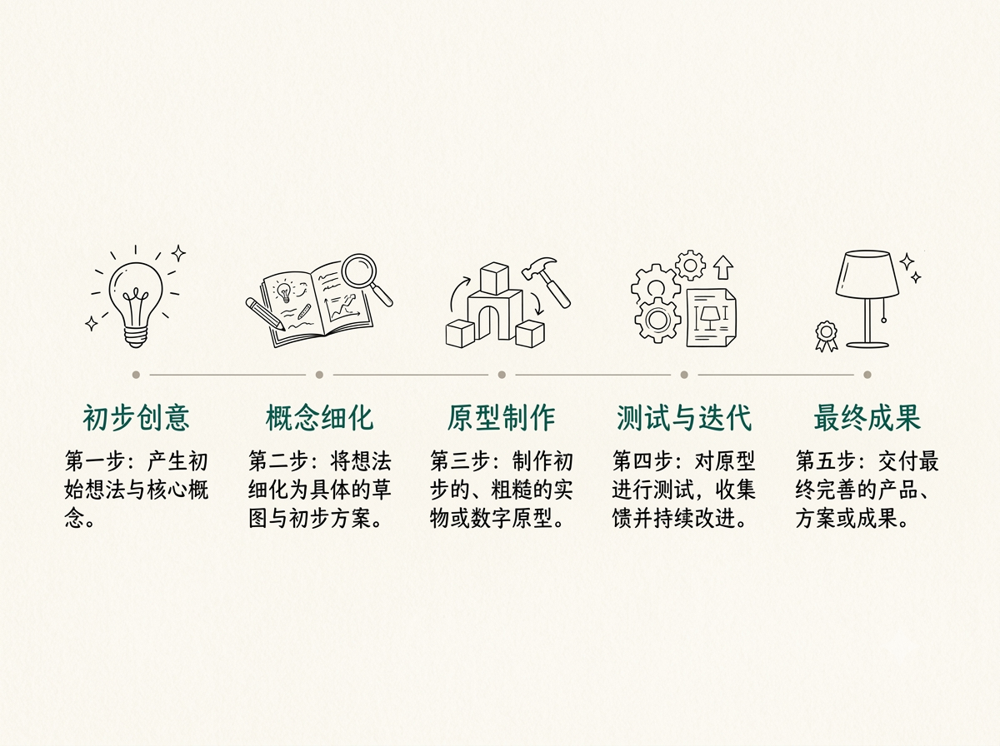
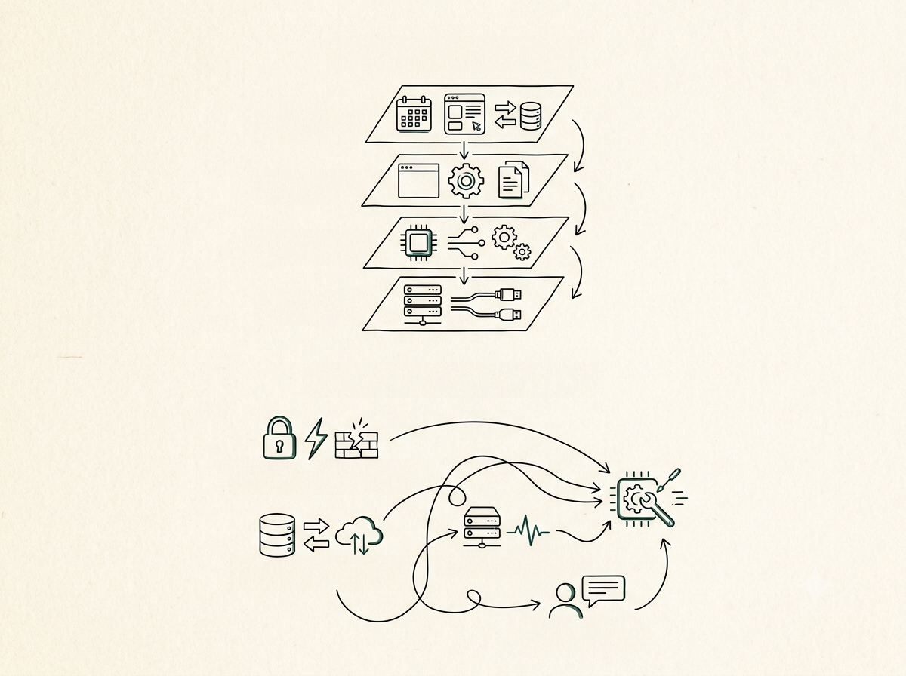
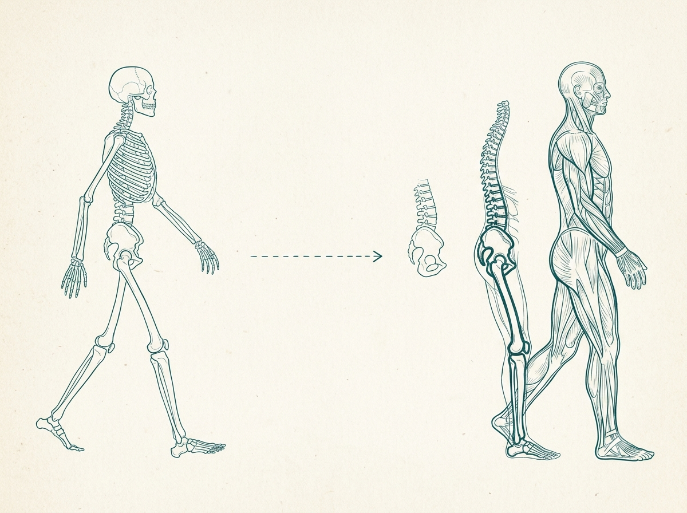

上一讲我们用 The Mom Test 挖到了客户真正的痛，也学会了别急着给客户嘴上要的方案。现在假设你手里攥着一句话：客户说"我们想用 AI 把工单处理效率提上来"。够含糊吧？这一讲就回答一个问题：拿到这么一坨模糊的大需求，你第一步该怎么把它拆成能动手的东西。

我先把结论撂这儿：好的 FDE 不是上来就写代码，而是先把大问题分解成一串带优先级的小问题，然后只挑最关键的那条线，端到端做出一个能跑起来的最薄版本。这一讲我们把这套 5 步分解法走一遍，顺便告诉你，这也正是面试 decomposition 轮考的东西。

说白了，这一讲教你把"一个吓人的大问题"变成"一个今天下午就能开工的小目标"。


## 五步分解法：把模糊大问题剁成能动手的小块

先给你整套动作，再逐个展开。拿到一个含糊需求，你依次做五件事：澄清成功标准、定干系人指标、盘数据输入、按风险排序拆子问题、提一个 walking-skeleton MVP。顺序不能乱，因为后一步都踩在前一步的答案上。



**第一步，澄清成功标准。** 客户说"提升效率"，你得追问：提升到什么算成功？是工单平均处理时间从 20 分钟降到 5 分钟，还是首次响应准确率到 90%？没有数字的成功标准，等于没有标准。这就像你打车不说目的地，司机只能原地打转。FDE 的第一动作永远是把"变好"翻译成"某个数从 X 到 Y"。

**第二步，定干系人指标。** 同一个项目，一线客服看的是"少加班"，客服主管看的是"人均工单量"，CTO 看的是"这套系统会不会半夜宕机"。这三拨人要的指标不一样，你得先问清楚：这次谁签字验收？他盯的是哪个数？盯错人，你做得再漂亮也交不了差。

**第三步，盘数据输入。** 现在把手伸进客户的系统，看你到底有什么料。历史工单在哪张表？字段全不全？脏不脏？有没有客户提过但根本没落库的东西？还记得上一讲说的吗——文档写的和现实对不上，价值就在这道缝里。这一步你经常会发现：客户以为自己有干净数据，其实是一堆手填的 Excel。

**第四步，按风险排序拆子问题。** 把大问题拆成子问题，这一步谁都会。关键在排序——按风险排，不按顺手排。风险最高的子问题排最前面。什么叫风险高？就是"这块要是搞不定，整个项目就废了"的那块。

传统做法是按开发顺序拆：先搭数据库、再写后端、最后接模型，一层层堆。FDE 反过来：先找出最可能翻车的那个假设，第一个就去验它。比如"模型到底能不能从乱糟糟的工单里认出问题类别"——这事要是不成，后面全白搭，那它就得排第一个动手。



**第五步，提 walking-skeleton MVP。** 前四步都是想，这一步开始动手。但你不做完整功能，你做一具"会走路的骨架"——把从输入到输出的整条主链路打通，每个环节都只用最粗糙的实现。这是本讲的核心，下一节专门讲。

先记住一个判断：这五步里，真正区分高手和新手的不是拆得多细，而是第一步的成功标准问得够不够狠、第四步的风险排得对不对。

## Walking skeleton：先让骨架走起来，再往上长肉

先给结论：walking-skeleton MVP 的意思是，你先把端到端最薄的一条链路跑通，让它能从真实输入产出真实输出，哪怕每一环都丑得要命。然后再一环一环加厚。

打个比方。你要盖一栋楼，walking skeleton 不是先把一楼装修到能入住，而是先把地基、承重柱、楼梯、水电主管道从一楼贯通到顶楼——楼还是毛坯，但你已经能从地下室走到天台了。传统做法常常反着来：把一楼精装到样板间级别，结果做到三楼发现电梯井位置错了，推倒重来。

回到那个工单的例子。一个 walking skeleton 长这样：读一条真实工单 → 塞给模型分个类 → 把分类结果写回一个字段 → 打印出来给你看。就这么四步，全部串起来能跑。

```python
def walking_skeleton(ticket: dict) -> dict:
    # 1. 读一条真实工单（先硬编码一条，别急着接数据库）
    text = ticket["description"]

    # 2. 最粗糙的分类：一个 prompt，先不管准不准
    category = classify_with_llm(text)  # 返回"退款/物流/技术"之一

    # 3. 写回结果（先写进内存 dict，不接生产库）
    ticket["category"] = category

    # 4. 打印出来，肉眼看一眼对不对
    print(f"工单 {ticket['id']} -> {category}")
    return ticket
```

看懵了也没关系，这段代码的重点根本不在代码本身，而在它证明了一件事：从输入到输出这条路是通的。`classify_with_llm` 现在可能就是一句最烂的 prompt，准确率 60%，无所谓。骨架的任务是走起来，不是走得漂亮。

为什么非要这样？因为它逼你最早撞见真问题。你会立刻发现：哦，工单描述里一半是截图没有文字，模型根本读不到；哦，客户的"分类"其实有 40 种不是 3 种。这些坑，你要是先精雕第一个模块，得两周后才撞上；用骨架，第一天就撞上了。



加厚的顺序也有讲究：哪个环节风险最高、离成功标准最远，就先加厚哪个。这跟第四步的风险排序是一条逻辑。骨架跑通后，你手里有了真实反馈，加厚就不再是猜，而是有数据支撑的决策。

这里引入一个课程词汇：Sierra 提出的 **ADLC**（Agent Development Life Cycle，Agent 开发生命周期）。它把 agent 的交付看成一个持续循环——设计、评估、部署、再根据线上表现回炉。你可以把 walking skeleton 理解成 ADLC 的第一圈：先转起来最小的一圈，再靠 evals 一圈圈把质量拧上去。后面讲 evals 的那几讲，你会反复见到这个词。

对比一下你就懂它的价值。传统项目是"想清楚全部功能 → 做三个月 → 上线 → 发现方向错了"；ADLC 加 walking skeleton 是"最薄一版当天上线 → 每圈拿真实反馈修正 → 方向错了第二天就知道"。before 是一次性豪赌，after 是小步快跑。FDE 吃的就是 after 这碗饭。

## 出声推理：面试 decomposition 轮的真正考点

先撂结论：在 decomposition 面试轮里，沉默等于卡住。面试官要看的不是你最后给的答案，而是你脑子怎么从模糊走到清晰的整个过程。你闷头想三分钟再抛一个方案，哪怕方案对，也是低分。

为什么？因为 FDE 真实工作就是当着客户的面拆问题。客户扔给你一个含糊需求，你得当场把思路讲出来，让他跟着你的推理点头。Palantir 那句被引烂的话——你的职责像创业公司 CTO，小团队、极少监督、端到端 owner——潜台词就是没人给你标准答案，你得自己出声把路想明白，还得让旁边的人信。


所以 decomposition 轮的打法，就是把上一节那五步大声讲出来。别在心里默算。你应该这样说：

> "我先确认成功标准——您说的效率提升，是指处理时间还是准确率？假设是处理时间，目标从 20 分降到 5 分。接下来我想知道谁验收，因为客服主管和 CTO 关心的指标不一样……我先假设是主管，他盯人均工单量。然后我想盘一下数据，历史工单在什么系统里、字段全不全？在我拿到答案前，我先假设有一年的结构化工单。基于这些，我会把风险最高的子问题排前面——我判断最大的不确定性是模型能不能从脏文本里稳定分类，所以我想先做一个 walking skeleton 去验这一点……"

看到没？这段话里全是"我先确认""我假设""我判断""在我拿到答案前"。这就是出声推理的形状：每走一步,你都把假设摆到台面上，把追问抛出来，把不确定性标清楚。面试官顺着你的话就能看见你怎么思考。

有个反直觉的点你得记住：承认"我不知道，所以我先假设"是加分项，不是减分项。不假装全知，反而显得专业。这就像老医生看病，会边查边说"先排除最要命的可能"，而不是一句不吭直接开药——你更信哪个？

给你一个能马上上手的动手练习。找一个含糊大问题，比如"帮销售团队用 AI 提高线索转化率"，掐 10 分钟，对着录音或者一张白纸，把五步全程出声走一遍，最后落到一个具体的 walking skeleton：哪条主链路、每环最粗糙实现是什么、你第一个要验的高风险假设是哪个。走完你会发现，难的从来不是第五步的骨架，而是第一步敢不敢把"提高转化率"逼成一个具体的数。

练三五个不同场景，你在面试里就不会卡壳了。因为 decomposition 轮考的不是天赋，是你有没有把这套动作练成肌肉记忆。

## 小结

拿到模糊大需求，别急着写代码，先走五步：澄清成功标准、定干系人指标、盘数据输入、按风险排序拆子问题、提 walking-skeleton MVP。骨架的要义是先把端到端最薄一条链路跑通，再按风险从高到低一环环加厚，这正是 Sierra ADLC 的第一圈。面试的 decomposition 轮考的不是答案，是你出声推理的过程——沉默等于卡住，把假设和追问全摆到台面上。下一讲我们把这套思路收进 Context Engineering：你会看到，prompt 只是其中一层。

## 思考题

拿你自己工作里一个真实的含糊需求，掐 10 分钟出声走一遍五步分解，最后写出你的 walking skeleton——哪条主链路、每环最粗糙实现、你第一个要验的高风险假设是什么？欢迎在评论区聊聊你的想法。
