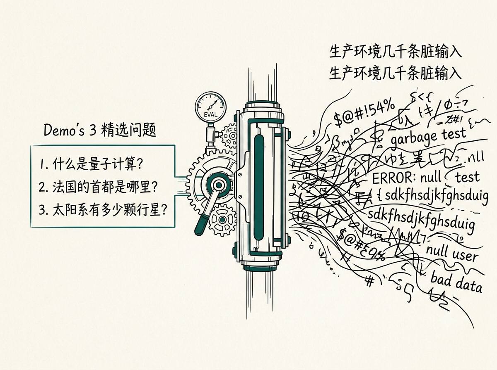
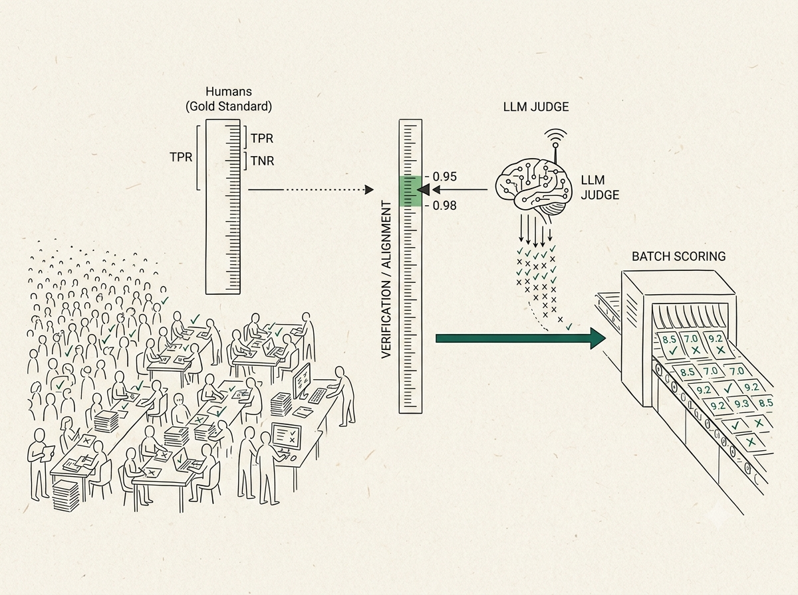
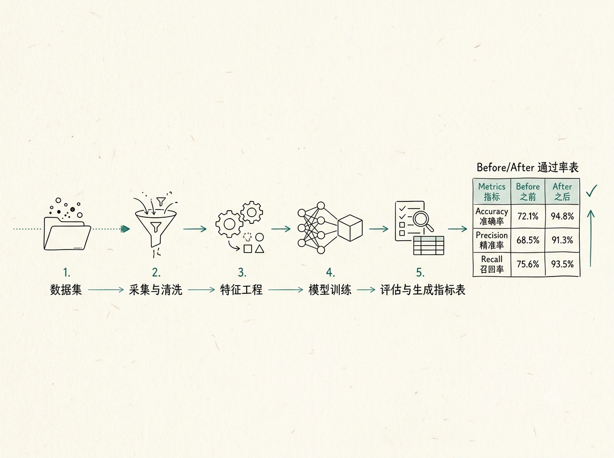
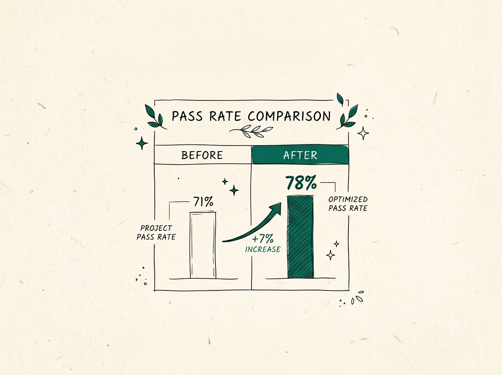

上一讲我们聊了 context engineering，我留了个尾巴：为什么"prompt engineer"这个职位名基本消失了。答案是它被拆进了更大的系统——系统提示、检索、记忆、工具返回，prompt 只是其中一层。可拆完之后有个更要命的问题冒出来：这么多层拼在一起，你怎么知道它到底靠不靠谱？

这一讲我回答这个。它是全书我最想让你记住的一讲。因为招聘方筛人、你和别人拉开差距，很大一部分就卡在这三个字母：evals。先记结论：evals 是把"看着能用的 demo"和"真能上线的系统"分开的那道线——没有它，你连自己错在哪都不知道。


## 为什么 demo 会骗你：流畅是最好的伪装

先给判断：模型最危险的地方，不是它会出错，是它出错的时候仍然说得特别顺。

你想想传统软件。一个 bug，程序要么崩、要么报错、要么算出个明显离谱的数。错误会自己跳出来喊你。可 LLM 不一样。它把一个事实编错了，语气跟说对时一模一样，标点都工整。就像一个特别会来事的实习生，什么都答得头头是道，你不去核对，根本发现不了他在瞎编。

这就是分水岭的由来。demo 现场，你喂几个精心挑过的问题，它答得漂亮，客户当场信了。可上线之后是几千条真实、脏乱、你没预料过的输入。流畅的输出把错误盖得严严实实。你不知道通过率是 95% 还是 60%，改了个 prompt 是变好了还是变差了——全靠感觉。凭感觉迭代，就是原地打转。



Andrew Ng 有句话我贴在墙上："evals 与 error analysis 是构建 agent 能力的最大预测因子。"注意他的用词——不是"之一"，是"最大"。翻译成大白话：你能不能把 agent 做上线，最能预测的单一变量就是你会不会做 evals。

再看招聘方怎么说。OpenAI 把 FDE 的成功标准逐字写成三件套："production adoption, measurable workflow impact, and eval-driven feedback that changes product and model roadmaps。"看到没，eval-driven 直接写进 KPI。Harvey 的 JD 更狠，要求你"按客户逐一建 eval harness"。所以别把 evals 当成一个可选的技术点，它是这个岗位的定义性动作。

所以你该做什么？从今天起，你写的每一个 AI 功能，都必须配一套 eval，哪怕只有二十条测试。没有 eval 的项目，在 FDE 眼里不算完成，只算做了个 demo。

## error analysis 优先：先去当两小时人肉标注员

结论先行：别一上来就搭花哨的自动打分器。evals 的第一步，是你亲手去看模型到底错在哪。

这是 Hamel Husain 和 Shreya Shankar 在 2026 年反复强调的方法论核心，也是新手最容易跳过的一步。他们的建议很具体：拉出 20 到 50 条真实 trace，一条一条读，把每条的失败原因写成一句大白话。这件事该占掉你做 evals 六到八成的时间。

我知道你会犯嘀咕：手看几十条，这也太土了吧，不该写代码自动跑吗？别急。这一步土，但它是整套方法的地基。就像医生看病，你不能上来就开一堆化验单，得先亲手按一按、问一问，才知道该查什么。你不先用眼睛看清错误长什么样，后面写的自动评测器根本抓不到点子上。


看的时候记住两条铁律。

第一，打分用二元 pass/fail，别用 Likert 五分制。你可能觉得五分更精细。恰恰相反。让你给一个回答打 3 分还是 4 分，你自己下次都打不一样，两个标注员更是对不齐。可"这条到底能不能交给客户"——过还是不过——这个你答得干脆。二元逼你把标准想清楚，也让指标能被复现。

第二，先把失败归类，再想解法。把二十条读完，你会发现错误就那么几类：也许一半是检索没召回对文档，一小撮是格式崩了，剩下是它自己瞎编。这张分布图比任何工具都值钱——它直接告诉你，力气该往哪儿使。

那什么时候上 LLM-as-judge？就是让一个模型去给另一个模型的输出打分。它能省人力，但你不能闭着眼睛信它。判据很硬：你得先攒 100 条以上你自己标注好的样本，拿它们去校准这个 judge，测它的 TPR 和 TNR——真阳性率和真阴性率。说人话就是：你判过的那些"过"，judge 也判过吗（TPR）；你判的"不过"，它也拦下来了吗（TNR）。



打个比方。judge 就像你新招的一个质检员。你敢不敢让他独立验货，取决于你先拿一批你亲自验过的货考过他没有。没对过答案的 judge，只是又一个说得很顺的模型——你等于用一个没验过的东西，去验另一个没验过的东西。

对齐之后呢？judge 帮你把评测规模从几十条扩到几千条，你重新拿回了那个凭感觉时丢掉的东西：确定性。改一版 prompt，跑一遍，通过率从 71% 到 78%，白纸黑字。这时候你才算真正开始迭代，而不是打转。

## 工具四象限和三档资源：别在选型上卡住

先给结论：evals 的工具不用纠结，按用途分四类，各挑一个够你用很久了。方法论才是稀缺的，工具是可替换的。

四个象限你记一下：

| 象限 | 代表工具 | 干什么用 |
|---|---|---|
| 托管平台 | Braintrust / LangSmith | 云端跑评测、看仪表盘，起步快 |
| 开源自托管 | Langfuse / Phoenix | 自己部署，数据不出门，适合企业合规 |
| 离线指标库 | DeepEval / Ragas | 塞进 CI，每次提交自动跑一遍 |
| 回归与红队 | promptfoo | 批量对比、攻击性测试找漏洞 |


行业里一个事实标配是"DeepEval 做 CI + Braintrust 做生产追踪"，你可以直接抄这个组合起步。但这里有个 FDE 必须留意的坑：promptfoo 在 2026 年 3 月已经被 OpenAI 收购、并进它的 Frontier 平台。工具本身没问题，可你作为要嵌进客户环境的人，得替客户想一层——一个评测工具被某个模型厂商收了，独立性上要不要打个问号。这种"帮客户看长远账"的意识，恰恰是 FDE 和普通调包工程师的分界。

资源上，我给你三档，按预算挑，免费档就能完整入门：

```text
免费入门：Braintrust《Evals Foundations》(约 1h) + Hamel《LLM Evals FAQ》(hamel.dev)
低价系统化：Hamel & Shreya《Evals for AI Engineers》(O'Reilly, 2026-10-31 出版)
高预算可选：Hamel & Shreya 的 Maven 课 ($4,200，先修要求"已在构建 AI 应用")
```

看懵了也没关系，这三档你只记一句：**先把免费那门一小时的课刷了，动手建你的第一套 harness，别为 $4,200 那门课卡住。** 顺带说一句，"AI Evals Engineer"现在已经独立成岗了，入门就 $130–173K，还不要求 PhD——这是 FDE 旁边一条现成的相邻入口，你练这套东西不亏。

## 项目 2：给一个已有功能，补一条 eval pipeline

光看不练是假的。这一讲配一个能立刻上手的项目，我把它叫项目 2。

传统做法是等你从零起一个新项目再谈评测。FDE 做法反过来：找一个你手头已经在跑的 AI 功能——你之前的 RAG、一个客服 bot、甚至一段调 API 的小脚本都行——给它补上评测，把"改动前 vs 改动后"用一张指标表摆出来。为什么挑已有功能？因为真实工作里，你八成不是从白纸开始，而是接手一个"能演示但没人敢保证质量"的东西，然后负责让它能上线。这就是 FDE 的日常。

具体五步走：

```text
1. 攒数据集：从真实/仿真输入里取 20+ 条，覆盖你手看时发现的几类失败
2. error analysis：手读这些 trace，每条写一句失败原因，归类
3. 定 rubric：把评判标准写成二元 pass/fail，不用 Likert
4. 建 judge：写个 LLM judge，用 100+ 人工标注对齐，报出 TPR/TNR
5. 出指标表：改一版实现，跑评测，交出改动前后的通过率对比
```



那张改动前后的指标表，就是你作品集里最值钱的一页。它是 60 秒就能被验证的硬证据——招聘方扫一眼，就知道你不是只会喊"我懂 evals"，而是真跑通过一条完整链路。别忘了 Het Trivedi 的路子：做完写一篇技术博客，把你怎么做 error analysis、怎么对齐 judge 讲清楚。这一篇博客，比十个没有 eval 的 side project 都管用。



最后落到面试。2026 有个新题型正在普及，叫 agentic eval 设计题，比如："给一个物流改线 agent 设计 eval suite，保证 99% 送达率且不超支。"你要是没系统练过这一套，当场就会露怯；练过，你张口就是 error analysis 先行、二元 rubric、judge 对齐——这就是面试防失分的一环。OpenAI 的面试实测里 evals 权重极高，xAI 一周四轮技术面也躲不开。说白了：会 evals，你多一张别人没有的牌；不会，你就是那个 demo 很漂亮、一问质量保证就哑火的候选人。

## 小结

这一讲只讲一件事：evals 是 demo 和上线之间的那道分水岭。模型出错时依然流畅，所以流畅骗不了带 eval 的人。方法论记三条——error analysis 优先、亲手看 20–50 条 trace，二元 pass/fail 不用 Likert，LLM judge 要用 100+ 标注对齐、量 TPR/TNR。工具按四象限各取一个，资源免费档就能入门。然后动手做项目 2：给已有功能补一条 pipeline，交出改动前后的指标表。这张表，是你面试最硬的底牌。

## 思考题

挑一个你现在手头就在跑、或最近做过的 AI 功能，先别写代码——花二十分钟，手动读 20 条它的真实输出，把每条的失败原因写成一句大白话，然后归个类。你会发现失败集中在哪一类？这一类占了多少？欢迎在评论区聊聊你的想法。

下一讲我们接着往检索这条线走：《检索光谱：从 RAG 到 context architecture》——聊清楚为什么"RAG 没死，它变成了 agent 的记忆层"。
