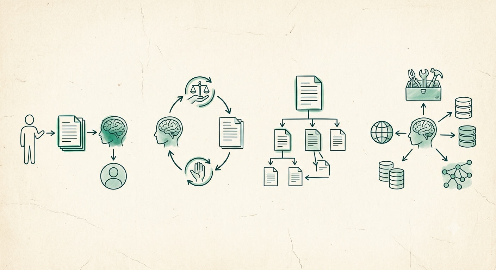
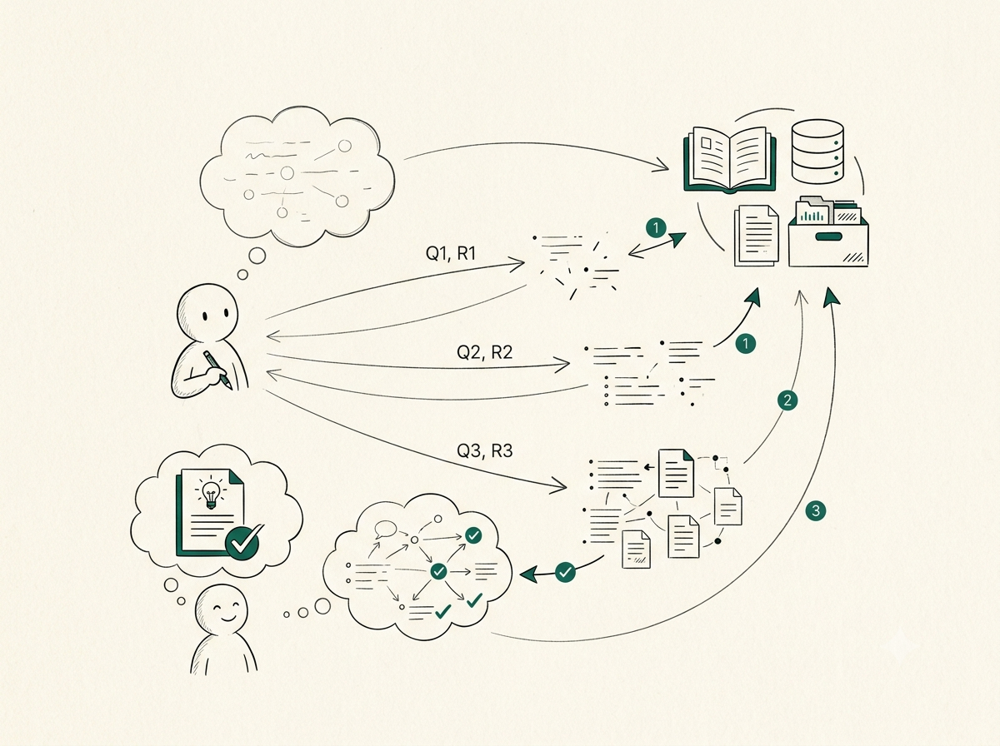
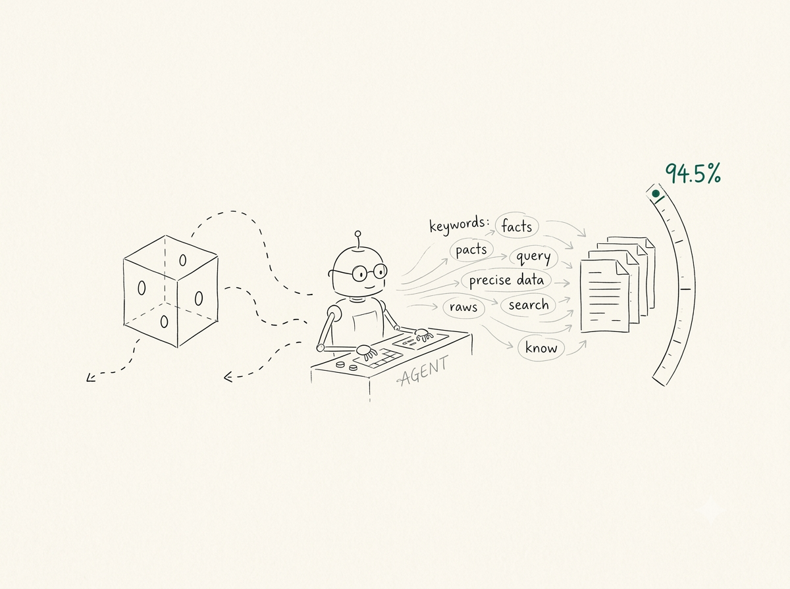
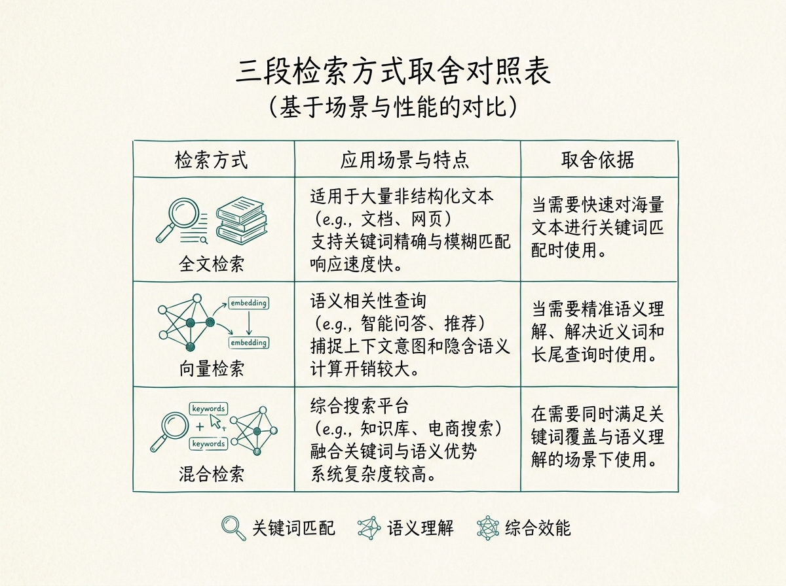

上一讲我们把 evals 立成了分水岭：没有它，流畅的输出会掩盖错误，迭代会原地打转。这一讲换个角度——你搭出来的那套系统，靠什么把正确答案喂给模型？答案十有八九会指向一个词：RAG。但这两年网上到处是「RAG is dead」的标题，你可能已经被搞懵了：到底还学不学？

我的结论先给你：RAG 没死，它只是从主角降成了 agent 的记忆层。真正该学的不是某一条管线，而是「检索光谱」——从传统 RAG 到 agentic search 再到 context architecture 的一整条谱系。这一讲我带你把这条谱走一遍，最后落到你能上手的项目 3。


## 别把 RAG 当主线，先看清整条光谱

先记结论：RAG 不是一门独立主课，它是检索光谱上的第一段。看懵了也没关系，我先给你一张地图，再逐段展开。

这条光谱从左到右其实是五段：**CAG（缓存直塞）→ 传统/混合 RAG → agentic RAG → agentic search → context architecture**。

在动手切块之前，2026 年的 FDE 会先看一眼最左端的 **CAG（Cache-Augmented Generation，缓存增强生成）**：如果客户这批规章手册或产品文档总长度不到 **100K–200K tokens** 且更新不频繁，配合上一讲的 Prompt Caching（命中输入成本打 0.5–1 折），直接整库塞进系统前缀缓存起来，准确率和首字延迟双杀传统 RAG，连向量库都不用建！只有当文档规模远超窗口、或者每天高频变动时，才往右走检索管线。

越往右，模型越像个会自己找资料的人，能多轮、能反思、能决定要不要检索。你要学的不是背下每一段，而是知道什么场景落在哪一段。



传统与混合 RAG 这一段还是得先吃透，它是你理解后面所有花样的地基。核心三步——切块（chunking）、向量化与混合索引（hybrid indexing）、召回后重排（rerank）——在 2026 年的生产交付里多了两个标配升级：
1. **Contextual Retrieval（上下文切块增强）**：切完块入库前，先用便宜的快模型给每个 chunk 头部拼上一句“本段摘自《XX 合同》第 X 章，讨论违约金条款”，彻底治好切片断章取义（比如光写“上述费率上浮 5%”却丢了主语）的老毛病；
2. **Hybrid Search（稠密向量 + BM25 关键词混合召回）**：纯向量检索一碰精确订单号、零件型号（SKU）就抓瞎，生产上必须用向量语义召回拼上全文关键词召回（RRF 融合），再送进 Reranker 精排。

```python
# 生产级 RAG 骨架：Contextual 切片 + 混合召回 + 权限过滤 + Rerank
chunks = contextualize_and_split(doc, size=512, overlap=64)  # 1. 带上下文前缀切块
store.upsert_hybrid(chunks, acl_groups=doc.allowed_roles)    # 2. 向量 + BM25 + 权限标签

def answer(query, user_roles: list[str]):
    # 生死红线：召回阶段必须按当前用户 RBAC/ACL 角色过滤！
    hits = store.hybrid_search(query, filter={"acl": {"$in": user_roles}}, top_k=20)
    ranked = rerank(query, hits)[:5]                         # 3. rerank 精排
    return llm(build_prompt(query, ranked))
```

看清上面代码里那行 `filter={"acl": {"$in": user_roles}}` 了吗？这是企业检索的**生死红线：Query-time RBAC/ACL（查询时动态权限过滤）**。还记得第 4 讲提过的 2026 年 10 月国内那起翻车惨案吗？某制造民企花 70 万请团队搭内部知识库，因为没做文档级 ACL 过滤，结果普通员工一搜就调出了高管薪酬表。在 FDE 眼里，不带权限过滤的 RAG 绝对禁止进生产。


向量库怎么选，也别一上来就纠结。我的建议很直接：**先用 pgvector（配合 Postgres 原生全文检索做 Hybrid）起步**。你手上大概率已经有 Postgres，装个扩展就能跑，数据和业务权限表还在同一个事务里，做 ACL 联表过滤最顺手。等你的数据量到千万级向量、并发真的把 pgvector 压不住了，再去评估 Pinecone、Weaviate、Milvus 或 Qdrant 的取舍。传统做法是团队一开工就上重型专用向量集群，结果三个人维护一套用不满的基础设施；FDE 做法是 pgvector 先跑通业务与权限闭环，用真实压力数据去证明「该换了」再换。


## 从 agentic RAG 到 agentic search

结论先行：光谱越往右，「检索」这个动作越不再是固定的一次，而是模型自己决定的一连串动作。这一节的核心变化，是把检索的控制权交给 agent。

传统 RAG 是「先检索、再回答」，一锤子买卖。agentic RAG 把这个动作变成可以反复做的工具：模型看一眼问题，觉得不够，就再检索一次；换个关键词，再检索一次；甚至先检索一批，读完发现方向错了，回头改查询。就像你查资料，很少一次搜索就搞定，通常是搜一下、看两眼、再换词搜——agentic RAG 让模型也这么干。

```python
# agentic RAG：把带权限隔离的混合检索包成工具，交给模型决定何时调、调几次
def search_tool(query: str) -> list[str]:
    hits = store.hybrid_search(query, filter={"acl": {"$in": current_user_roles}}, top_k=10)
    return [h.text for h in rerank(query, hits)[:5]]

# agent 循环里，模型可以多轮调用 search_tool，直到自认为证据够了
agent = Agent(tools=[search_tool], stop_when="evidence_sufficient")
```



再往右一段更颠覆，叫 agentic search。这里有个能让你重新审视整条光谱的数据：Amazon Science 测出来，用 agentic 关键词搜索的方式，**达到了 RAG 忠实度的 94.5%，而且零向量库**。你没看错——不切块、不做 embedding、不维护向量库，让 agent 像人一样用关键词去搜、去翻、去交叉验证，效果逼近了那套重管线。

别急，这不等于向量库要扔。它的意思是：当你的数据本身就带好的搜索接口（比如企业内网搜索、日志系统、数据库全文检索），你可能根本不需要先建一套向量管线。FDE 的判断力就体现在这儿——不是所有场景都值得上向量库，有时候一个好用的 search API 加一个会用它的 agent，就够了。



我把四段的取舍给你摆一张表，你选型时对着看：

| 段位 | 检索次数 | 要不要向量库 | 适合场景 |
|---|---|---|---|
| CAG（缓存直塞） | 0 次（走前缀缓存） | 不要 | 知识库 `<150K` tokens 且低频更新 |
| 混合 RAG（Contextual + Hybrid） | 固定一次 | 要（pgvector 优先） | 大规模静态/半静态文档库、高频低延迟问答 |
| agentic RAG | 模型决定多次 | 要 | 需要多跳找证据、复杂对比分析 |
| agentic search | 模型决定多次 | 可不要 | 已有成熟全文检索/SQL 接口的业务系统 |



## context architecture：检索只是记忆层的一种

先给判断：光谱的最右端不是「更强的 RAG」，而是压根换了个问法——不再问「怎么检索」，而问「模型这一步该看到什么」。这就是 context architecture，上一讲评测、这一讲检索，其实都在为它服务。

把视角拉高你会发现，检索回来的文档，只是模型上下文里的一层。完整的上下文是好几层叠起来的：系统提示、检索注入、记忆（历史对话、用户偏好）、工具返回、agent 的状态。RAG 负责的，就是「检索注入」这一层。所以「RAG 未死」的准确说法是：**它是 agent 的记忆层**，是 context architecture 里负责「从外部知识调取受权限管控的相关片段」的那块。


这也是为什么「RAG is dead」是标题党。死掉的不是检索，是「以为搭好一条裸奔的 chunk-embed 管线就完事」的心态。传统做法是把 RAG 当终点，管线跑通就交付；FDE 做法是把检索当 context architecture 的一个组件，先判要不要用 CAG 省掉管线，上了管线就补齐 Contextual 切块、混合检索和 Query-time ACL 权限锁。

对你的实际动作是什么？两条。第一，别再把「我会搭基础 RAG」写进简历当卖点，把「支持 Contextual 混合检索 + 动态 RBAC 权限过滤」亮出来，面试官立刻知道你干过真生产。第二，你每做一个检索项目，都顺手画一张「上下文与权限架构图」——这一步喂给模型的东西来自哪几层、在哪一步做权限裁剪。这张图，就是你区别于「只会调 API」的人的证据。

## 项目 3：同一份数据，两个版本，一张对比表

结论先给：这一讲最值钱的产出，是一个能挂 live URL 的对比项目。它一次性证明你会检索、会 evals、还会写作——一石三鸟。

具体怎么做，我给你拆成四步。选一份真实、够脏的数据集（客服工单、产品文档、政务问答都行），然后在**同一份数据**上做两版实现：

1. **传统 RAG 版**：pgvector + chunk/embed/rerank，就是本讲第一节那套。
2. **agentic search 版**：给 agent 一个 search 工具，让它多轮自己找，尽量少依赖甚至不依赖向量库。
3. **用你上一讲搭的 eval harness 去测两版**：同一套测试集、同一个二元 judge，量忠实度和成本。别只报「感觉 agentic 更好」——报数字。
4. **写成一篇对比博客 + 部署出一个 live URL**：把前后指标摆成一张表，讲清楚哪个场景该选哪版。

```text
# 对比报告该长这样（示意）
数据集：某公司 1200 条客服工单
              忠实度    平均延迟   单次成本   维护复杂度
传统 RAG        86.0%     0.8s      $0.004     要维护向量库
agentic search  81.5%     2.3s      $0.011     零向量库
结论：静态高频问答用传统 RAG；长尾、需交叉验证的用 agentic search
```


为什么非要两版对比、而不是只做一个「更潮」的 agentic 版？因为 FDE 的价值不是「我用了最新技术」，而是「我能替客户判断该用哪种」。一张带真实数字的对比表，比十句「我熟悉 agentic RAG」都有说服力。记住这门课反复讲的那条：作品集的 live URL 加 eval 指标，胜过任何证书，一个部署项目 60 秒就能被验证。


## 小结

RAG 没死，它降级成了检索光谱的第一段、agent 的记忆层。这条光谱从传统 RAG（chunk/embed/rerank，pgvector 先起步）走到 agentic RAG、再到零向量库也能逼近 94.5% 忠实度的 agentic search，终点是把检索当作一层的 context architecture。别被「RAG is dead」的标题党带偏——死的是把管线当终点的心态。你的动作很明确：做项目 3，同一份数据两版实现、一张对比表、一个 live URL。

## 思考题

回到你自己手头或想做的那个检索场景：如果只允许你做一版，你会选传统 RAG 还是 agentic search，判断依据是什么——是数据在不在向量库里、是延迟成本能不能接受，还是客户有没有现成的搜索接口？把你的选型逻辑写下来，它就是下一讲《Agent 编排 + MCP：亲手写一个 MCP server》里，你给检索工具接上「插头」的起点。欢迎在评论区聊聊你的想法。
