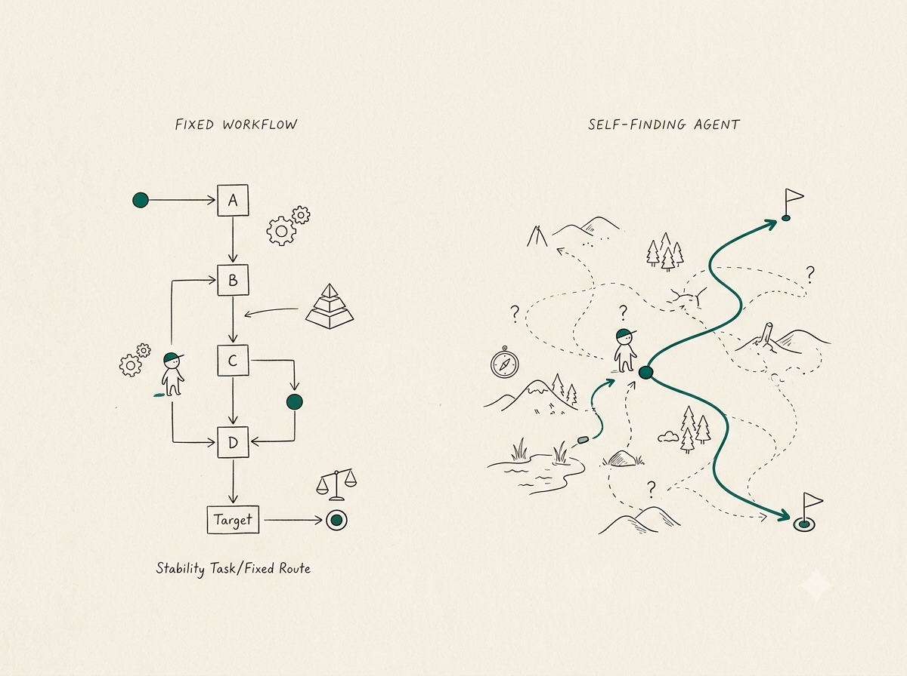
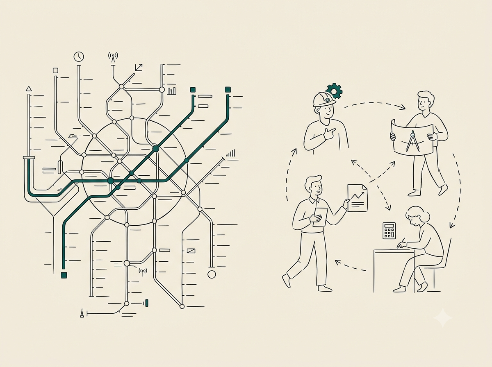
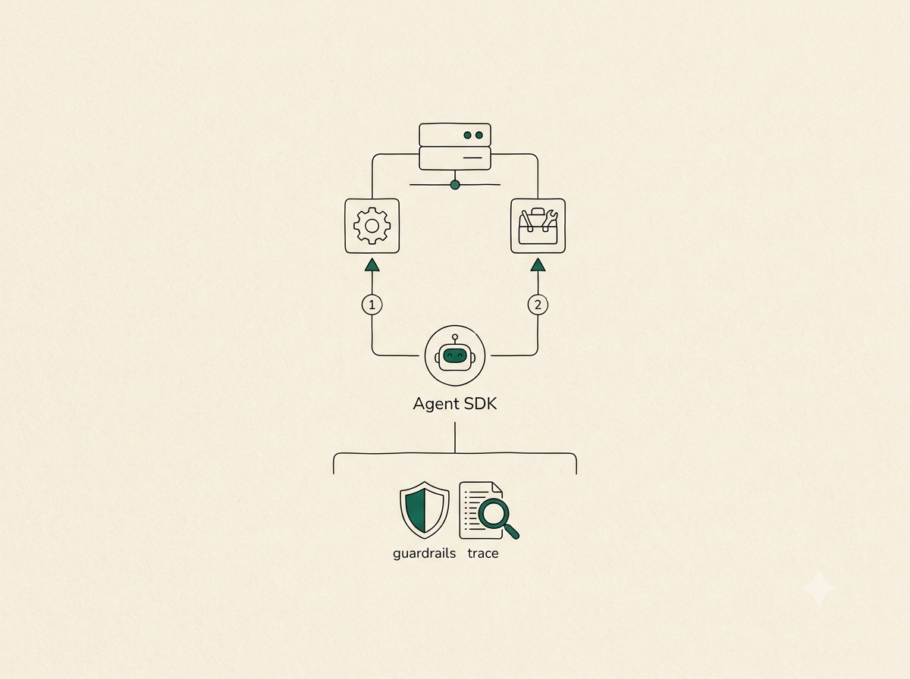

上一讲我们把 RAG 重新摆了位置：它不是主线，只是"检索光谱"的一段，从 chunking、embedding、rerank 一路走到 context architecture。检索解决的是"模型能看到什么"。这一讲往前一步——让模型不只是看，还能动手：调你的数据库、发你的工单、跑你的脚本。

于是新问题来了。你要让模型"能动手"，是不是就得上一套花哨的 multi-agent 编排？MCP 这个被 Anthropic 写进交付物、被面试直接考的词，到底是什么？这一讲我要回答的就是这两件事，最后带你亲手写一个能跑的 MCP server。

一句话记住目标：先学会"什么时候别用 agent"，再学会"给模型接一个能调你系统的插头"。剩下的我们一步步搭。


## 先问一句：这活儿到底要不要 agent

先给结论：大多数任务，你根本不需要 agent。这是 Anthropic 那篇《Building Effective Agents》开篇就摆出的态度——最简优先，能用一次模型调用解决的，别搭编排。

我知道这话反直觉。你好不容易学到 agent 这一节，我却先劝你少用。别急，这恰恰是招聘方最看重的判断力。真实生产里，agent 每多一步自主决策，就多一个失控点、多一份 token 账单、多一处难排查的 trace。FDE 不是来炫技的，是来交付能稳定跑的东西。

我给你一条简单的分界线。**workflow** 是你把步骤写死：第一步检索、第二步总结、第三步写库，路径固定，模型只填空。**agent** 是你把方向盘交给模型：它自己决定下一步调哪个工具、要不要再来一轮、什么时候收工。

打个比方。workflow 就像你给外卖员一张写好的路线图，他照着走。agent 是你只告诉他"把餐送到"，让他自己看路况绕行。路线稳定时，地图又快又可靠；路况天天变、岔路多，才轮到让他自己判断。你手上的任务是哪种？



对照一下传统做法和 FDE 做法你就懂了。传统做法是一上来就搭最复杂的多智能体，觉得越自主越先进。FDE 做法反过来：先用最笨的固定流程跑通，只有当固定流程明显扛不住任务的开放性时，才一步步加自主性。这不是保守，这是省钱、省事故、省你半夜被 on-call 叫醒。

所以你该做什么？做任何 agent 项目前，先写一行字回答自己：这个任务的路径是固定的，还是必须让模型临场决定？答"固定"，就用 workflow，收工。答"必须临场"，才继续往下读。

## 编排框架选型：状态机 vs 角色

结论先给你：真到了要 agent 的时候，两大主流框架的差别，一句话就能记住——LangGraph 让你画状态机，CrewAI 让你分角色。Google 的 FDE JD 直接点了 LangGraph 和 CrewAI 的名，所以这不是可选知识，是面试会问的。

LangGraph 的世界观是**状态机**。你把整个流程画成一张图：每个节点是一步，节点之间连边，一个共享的 state 在图里流动。它适合流程有明确阶段、需要条件分支和回环的场景——比如"检索不够就回去再检索一轮"。你在画图，控制权始终攥在你手里。

```python
# LangGraph：把流程画成带状态的图
from langgraph.graph import StateGraph, END

graph = StateGraph(dict)
graph.add_node("retrieve", retrieve_docs)
graph.add_node("answer", generate_answer)
graph.add_edge("retrieve", "answer")
graph.add_conditional_edges(
    "answer",
    lambda s: "retrieve" if s["confidence"] < 0.7 else END,
)
graph.set_entry_point("retrieve")
app = graph.compile()
```

CrewAI 的世界观是**角色**。你不画图，你招人：一个"调研员"、一个"审校员"、一个"写手"，给每人一段职责描述和几个工具，让他们像一个小团队一样协作。它适合任务能自然拆成几个拟人分工的场景。

我给你个生活化的对照。LangGraph 像你在画地铁线路图，哪站换乘、哪段折返，线路清清楚楚。CrewAI 像你在组一个项目小组，你定好谁负责什么，剩下让他们自己开会推进。前者你要的是可控，后者你要的是省心。



那你到底学哪个？我的建议很实在：先用 Claude Agent SDK 把最基础的"模型 + 工具循环"跑通，这是所有框架的共同底座。框架是壳，底座是"模型调工具、看返回、再决定下一步"这个 ReAct 循环。底座通了，LangGraph 和 CrewAI 你几天就能上手，别在选型上纠结太久。看懵了也没关系，下一节我们就把这个底座里最关键的一环——工具，讲透。

## MCP：给模型接一个能调你系统的插头

先给判断：MCP 是 2026 年 FDE 的新硬门槛，绕不过去。Anthropic 的交付物逐字写着"MCP servers, sub-agents, and agent skills"；面试直接考；连非头部公司的 JD 都开始要求你会写 MCP server。这一节你必须拿下。

MCP 全称 Model Context Protocol。名字唬人，本质特别朴素——它就是**给模型接一个能调你系统的插头**。你写过 REST API 就能上手。以前每个模型、每个工具都要你手写一套对接胶水，一对一，乱成一团。MCP 做的事，就是定了一个统一的插座标准：你的系统按这个标准把能力暴露成"工具"，任何支持 MCP 的模型插上就能用。

打个比方，MCP 就像 USB-C。以前每个设备一种充电口，你抽屉里塞满了线。USB-C 定了一个口，一根线通吃。MCP 之于"模型调系统"，就是这根统一的线。


一个 MCP server 你要设计三样东西。**工具（tool）**：模型能调的动作，比如"查订单""建工单"，每个工具要有清楚的名字、参数、描述——描述写得烂，模型就不会用或者乱用。**鉴权**：谁能调、调的时候带什么凭证。**错误处理**：调失败了返回什么，模型才能优雅地重试或收手。

别把 MCP 只当个玩具接口。在 **2026 年下半年，MCP 已正式捐入 Linux 基金会旗下的 Agentic AI Foundation（AAIF）并发布了里程碑式的 `2026-07-28` 核心规范**——这也是近期面试的高频考点：
- **无状态核心（Stateless Protocol Core）**：移除了早期有状态会话（`Mcp-Session-Id`）和强制初始化握手，彻底解除了企业负载均衡器背后的 Sticky Session（会话粘滞）束缚，Serverless 与多副本水平扩缩容变得跟普通 HTTP 微服务一样丝滑；
- **Tasks 长任务原语（`SEP-2663`）与渐进式工具发现（Progressive Discovery）**：原生支持异步长耗时作业轮询；当企业内部挂了 200+ 个工具时，支持按需搜索加载而非一次性灌爆 7 万 tokens 上下文（Sierra 在其覆盖全公司 89% 员工的 MCP 网关复盘里还留了句名言 *"Don't fight the weights"*：如果把几百个底层接口全暴露成 MCP 工具反而撑爆窗口，不如收敛成高层业务工具或签发受限只读 Token 调受控 CLI）；
- **企业级安全红线（OAuth 2.1 / DPoP + 严禁 Token Passthrough）**：MCP Server 必须校验令牌的 `aud` 声明并独立换取下游最小权限凭证，严禁把客户端传来的 Token 原样透传给内网 API（防止 Confused Deputy 糊涂副手攻击）。

顺带用一句话帮你理清它的两个邻居：**A2A（Agent2Agent）协议**管的是“横向跨团队/跨厂商智能体之间怎么对话协作”，**MCP** 管的是“纵向智能体怎么调工具和数据”，而 **Agent Skills（`SKILL.md`，2026 年 10 月也已捐入 AAIF）** 则是给智能体写一本按需翻阅的标准操作手册（SOP）。三者各司其职，拼成完整的企业智能体底座。

传统做法和 FDE 做法在这里又分了岔。传统做法是把工具逻辑硬编进某个 agent 脚本里，换个模型、换个客户就得重写。FDE 做法是把能力沉淀成一个独立的 MCP server：一次写好，接进 Claude Code 能用，接进客户的 agent 也能用，交接给客户后他们自己还能维护。这正是 AWS 那句卖点——"离场后客户可自维护"。

所以你该做什么？下一节，我们就把这个插头亲手焊出来。

## 项目 4：亲手写一个 MCP server + 带两次 tool call 的 agent

结论先行：这一节的产出物，是你作品集里最能直接对标 Anthropic JD 的一块。你要交付两样东西——一个自己写的 MCP server，一个用 Claude Agent SDK 编排、会连着调至少两个工具的 agent，并且带 guardrails 和 trace。别怕，我给你拆成能照着跑通的最新骨架。

先写 server。**特别注意官方 Python `mcp` SDK v2 的大版本变更**：升级到 **`v2.0+`（`pip install "mcp>=2.0"`）**后，已移除早期 `mcp.server.fastmcp` 子模块，统一收敛为 **`from mcp.server.mcpserver import MCPServer`**（如果你偏爱 Prefect 独立维护的第三方 `fastmcp` v3+ 框架，则是装 `fastmcp` 包后写 `from fastmcp import FastMCP`——千万别再混写成旧版的导入路径）。下面我们用官方 `mcp` v2 暴露两个工具：查订单、建工单。注意每个工具的 docstring——那是模型判断"要不要调、怎么调"的核心依据，你得当接口契约一样认真写。

```python
# server.py —— 基于官方 Python mcp SDK v2.x 的最小生产级骨架
from mcp.server.mcpserver import MCPServer

mcp = MCPServer("order-ops")

@mcp.tool()
def get_order(order_id: str) -> dict:
    """按订单号查订单状态。order_id 形如 'A1023'。查不到返回 error 字段。"""
    order = DB.get(order_id)
    if not order:
        return {"error": f"订单 {order_id} 不存在"}
    return {"id": order_id, "status": order["status"], "amount": order["amount"]}

@mcp.tool()
def create_ticket(order_id: str, issue: str) -> dict:
    """为某订单创建售后工单。issue 是问题描述。返回工单号。"""
    if not DB.get(order_id):
        return {"error": "订单不存在，不能建工单"}
    ticket_id = TICKETS.create(order_id=order_id, issue=issue)
    return {"ticket_id": ticket_id}

if __name__ == "__main__":
    # 本地调试默认走 stdio；部署到企业内网网关时改为 mcp.run(transport="streamable-http")
    mcp.run()
```

看清楚一个细节：`create_ticket` 里我先校验订单存不存在，不存在就拒绝。这就是 **guardrail** 的第一层——在工具内部把"不该发生的事"挡在门外，别指望模型永远听话。模型可能幻觉出一个订单号就来建工单，你的 server 得替你守住。

再写 agent。我们用官方 `claude-agent-sdk`（`pip install claude-agent-sdk`）把上面这个 `server.py` 挂进来，通过 `allowed_tools` 显式白名单授权这两个 MCP 工具，让模型自己完成两跳调用：先 `get_order` 查出订单状态，再 `create_ticket` 开售后单。

```python
# agent.py —— 用 claude-agent-sdk 挂载 MCP server，跑通两步 tool call 并采集 trace
import asyncio
from claude_agent_sdk import (
    AssistantMessage,
    ClaudeAgentOptions,
    ResultMessage,
    ToolUseBlock,
    query,
)

async def main():
    options = ClaudeAgentOptions(
        model="claude-sonnet-4-6",
        system_prompt=(
            "你是售后助理。只能通过工具查真实数据，"
            "禁止编造订单或工单号。信息不全时先追问，不要瞎猜。"
        ),
        mcp_servers={
            "order-ops": {"command": "python", "args": ["server.py"]}
        },
        allowed_tools=[
            "mcp__order-ops__get_order",
            "mcp__order-ops__create_ticket",
        ],
        max_turns=6,  # 成本护栏：封顶推理轮数，防死循环烧穿账单
    )

    trace = []
    async for message in query(
        prompt="订单 A1023 客户说没收到货，帮我查下状态并建售后工单",
        options=options,
    ):
        if isinstance(message, AssistantMessage):
            for block in message.content:
                if isinstance(block, ToolUseBlock):
                    trace.append({"tool": block.name, "input": block.input})
                elif hasattr(block, "text"):
                    print(block.text)
        elif isinstance(message, ResultMessage):
            print(f"Done in {message.duration_ms}ms | Cost: ${message.total_cost_usd:.4f}")

    print("Tool trace:", trace)

asyncio.run(main())
```

这里有三处生产级 guardrail 你别漏：system_prompt 里"禁止编造、信息不全先追问"是**行为护栏**；`allowed_tools` 最小权限白名单是**安全护栏**；`max_turns=6` 加 `total_cost_usd` 核算是**成本护栏**。生产里这三样缺一不可。

最后是 **trace**。上面代码把每一步 `ToolUseBlock` 的工具名、入参以及整轮耗时和美元账单都记了下来。这东西为什么重要？因为客户问"你的 agent 上周三那笔为什么建错工单"，你不能靠猜，你得能翻出那次调用的完整轨迹。想更进一步，把 OpenTelemetry / trace 接到内网自托管的 Langfuse v4 或 LangSmith，截图直接进作品集。

我给你把这个项目的验收清单收一下，你照着自查：server 至少两个工具、每个工具有内部校验 guardrail；agent 一次任务连调 ≥2 个工具；有行为护栏 + 权限白名单 + 成本护栏；trace 能完整还原每一步。四条都做到，你手里就有了一块能拿去面试逐条讲的硬货。



## 小结

这一讲我们做了三件事。先学会克制：大多数任务用固定的 workflow 就够，别上来就搭 agent，最简优先是 FDE 的判断力。再认清编排：LangGraph 是画状态机，CrewAI 是分角色，底座都是"模型调工具"的循环。最后用 2026 下半年最新的 `mcp` v2 SDK（`MCPServer`）和 `claude-agent-sdk` 把无状态、带三道护栏和全链路 trace 的 MCP 工具链亲手焊了出来。这块产出，直接对标 Anthropic 的交付物原文。

## 思考题

回到你自己现在或过去负责的一个系统——工单、CRM、内部数据库都行。如果要把它做成一个 MCP server，你会先暴露哪两个工具？每个工具你会加一道什么样的 guardrail 来防止模型乱调？欢迎在评论区聊聊你的想法。

下一讲我们换个话题：与 coding agent 协作——编码的门槛不是降低了，而是换了一根轴。
