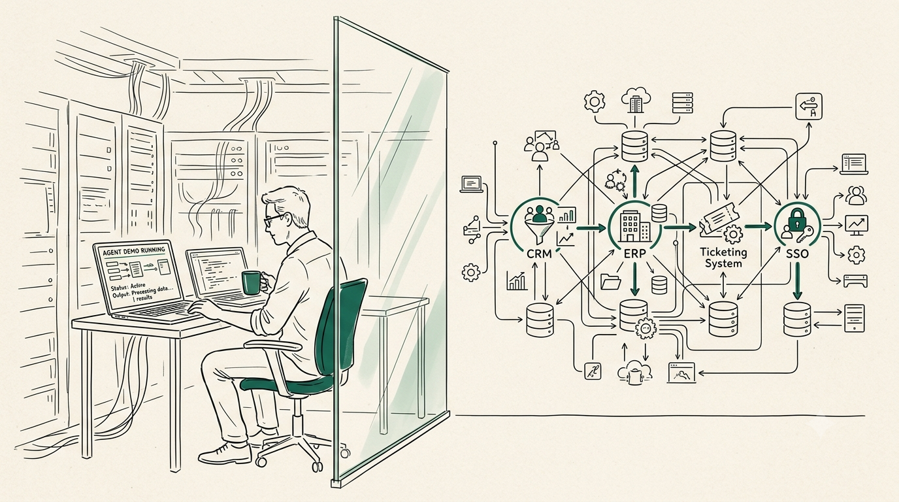
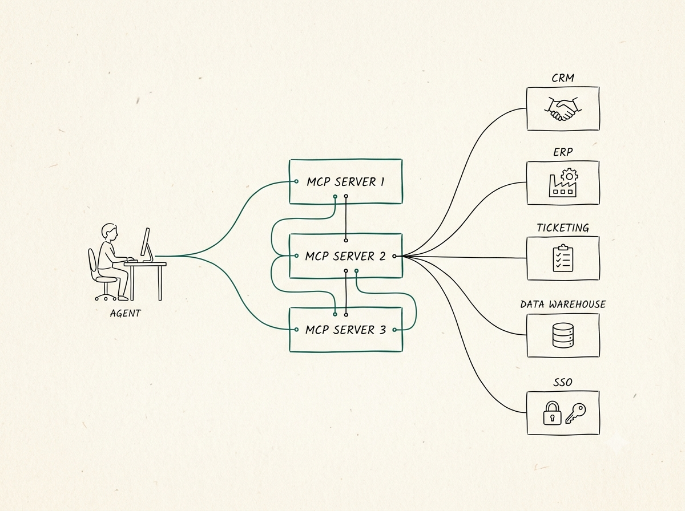
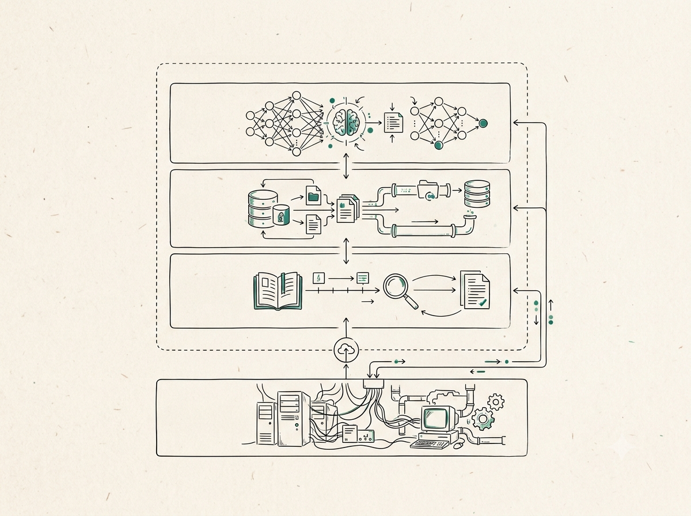
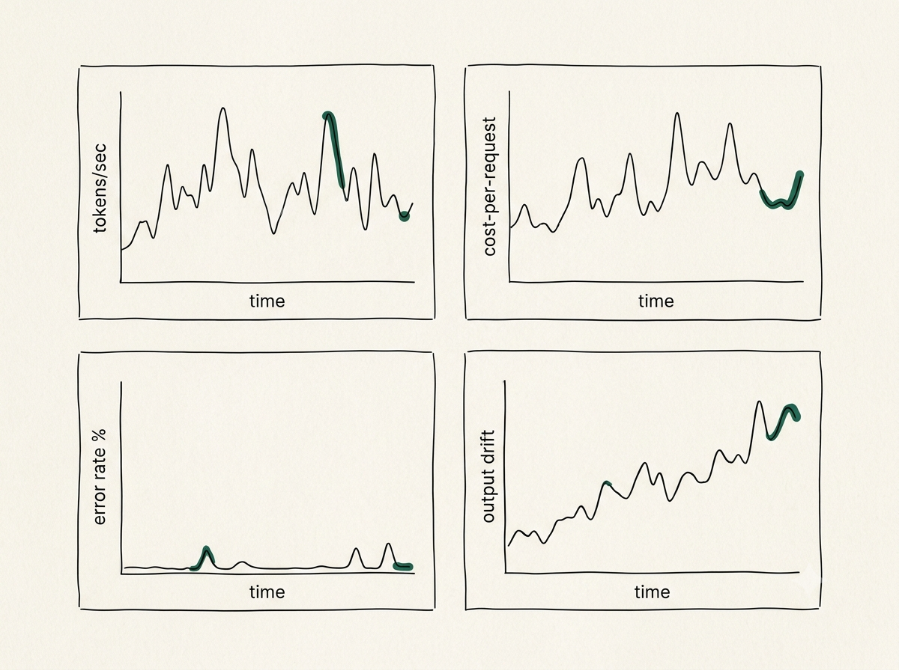

上一讲我们说清楚了：coding agent 普及后，编码门槛是「换轴」不是降低——你手写的代码量降了，但写 spec、拆 AGENTS.md、排 orchestration 故障这些更高抽象层的活儿反而变重。这一讲我们往下走一步，回答一个更扎心的问题：你的 agent 在自己电脑上跑得再漂亮，怎么才能真正长进客户那套又老又乱的企业系统里？

我的结论先给你：这一环，才是把 demo 和「生产」分开的那条真正的线。模型能力谁都能接，难的是接进 SSO、啃动客户十年的脏数据、扛住合规审计、还得让它上线后不失控。这一讲我带你把这四件事走一遍，最后落到项目 5。



## 把模型接进企业系统：那道玻璃墙

先给判断：企业系统集成是 FDE 和普通 AI 工程师的分水岭。招聘方在 JD 里把它排进硬要求第 8 位（SSO/DMS/工单/治理审计），不是凑数——它是你能不能交付的前提。

看看 Harvey 的 JD 原文怎么说工作流：

> "Design → prototype → productionize custom workflows … then harden them for reliability, observability, and scale."

注意那个 productionize。它后面紧跟着一句 "Integrate workflows with clients systems"——DMS（文档管理系统）、SSO 单点登录、per-client 的集成。这不是加分项，这是活儿本身。

说个你能对上的场景：这就像你搬进一栋别人住了十年的老房子，水电煤气的接口全是非标的，你不能拆墙重装，只能带着一堆转接头去适配。企业系统就是这栋老房子——CRM 是 Salesforce，ERP 是 SAP，工单在 ServiceNow，身份认证走内部的 SSO，数据躺在一个你没见过的数据仓库里。你的 agent 要干活，就得一个个把插头接上。

这里最关键的连接件，就是我们前面几讲反复讲的 MCP。别急，它没那么玄——MCP 就是「给模型接一个能调你系统的插头」，你把每个企业系统包一层 MCP server，agent 就能通过标准协议去调它。

```python
# 用官方 mcp SDK v2.x 把一个内部工单系统包成远程无状态 MCP server
from mcp.server import MCPServer

mcp = MCPServer("ticket-system")

@mcp.tool()
def create_ticket(title: str, priority: str, assignee: str) -> dict:
    """在客户的 ServiceNow 里开一张工单，返回工单号与状态。"""
    # 严禁原样透传客户端 token！先校验本服务 aud，再置换下游最小权限凭证
    downstream_token = exchange_obo_token(audience="servicenow-api")
    return servicenow_api.post("/incident", auth=downstream_token, json={
        "short_description": title,
        "priority": priority,
        "assigned_to": assignee,
    })

if __name__ == "__main__":
    mcp.run(transport="streamable-http")
```



传统做法和 FDE 做法在这里分岔得很明显。传统集成项目：先花三个月出一份接口文档，评审、排期、联调，走完流程再上线。FDE 做法反过来——先在客户现场把一个能跑的粗糙版本接出来，哪怕只接通一个工单系统，让业务方当场看见 agent 真的开出了一张单，再一步步 harden 成可靠的东西。Cursor 那句话你记一下：

> "Ship a fast first version in days, then harden it into something reliable over weeks."

SSO 与 OAuth 2.1 这一环我单独提醒你。企业不会给你一个万能静态 API key 就完事，它要求走它自己的身份体系——OAuth 2.1、SAML、细粒度 RBAC。尤其是 MCP `2026-07-28` 规范落地后，面试官和客户安全团队必查一条铁律：**严禁 Token Passthrough（禁止把客户端传给 MCP Server 的令牌原样透传给下游内网系统，防止 Confused Deputy 糊涂副手越权攻击）**，必须在网关或 Server 层校验 `aud` 后单独做 OBO（On-Behalf-Of）最小权限令牌置换。这既是合规要求，也是它上线的通行证。

## 数据工程：把脏数据整成 agent-ready

先给结论：客户的数据永远是脏的，把它整干净是 FDE 绕不过去的体力活，也是你区别于「只会调 API」的人的地方。

Snowflake 的 JD 把离场标准写得特别狠，你背下来：

> "When you leave a customer engagement, their data is structured, trusted, and agent-ready."

structured、trusted、agent-ready——这三个词就是你数据工程的验收线。客户交给你的原始数据长什么样？国内有个川宁生物驻场 9 个月的案例，工程师干的核心活儿之一就是把老师傅脑子里的经验和产线上一堆格式混乱的数据数字化。这就是现实：字段命名不统一、时间格式五花八门、同一个客户在三个系统里有三个 ID、还有大把手工填错的脏值。

说个你能对上的场景：这就像你接手一个前任留下的 Excel，日期列里有「2026-07-15」也有「7/15/26」还有「上周三」，你得先把它们全掰成一种格式，后面的分析才站得住。

数据工程的技能梯子是这样一级级上的：

| 阶段 | 工具 | 干什么 |
|---|---|---|
| 探查与清洗 | SQL | 摸清客户数仓的表结构，跑聚合看数据长啥样 |
| 单机处理 | Python（pandas） | 清洗、转换、补缺失值，写清洗脚本 |
| 大规模处理 | PySpark | 数据量大到单机装不下时，分布式跑 ETL |
| 管线固化 | ETL / 编排 | 把清洗逻辑固化成可重复、可调度的管线 |

你不用一上来全会。多数客户场景，SQL 加 Python 就能覆盖大半；只有当数据量真的爆了，才需要 PySpark。

[[FIG:data-cleaning-pipeline | 从客户脏数据到 agent-ready 的 ETL 清洗管线：探查、清洗、校验、固化四步]]

```python
# 一段把客户脏数据整成 agent-ready 的清洗骨架
import pandas as pd

def clean_customer_records(raw: pd.DataFrame) -> pd.DataFrame:
    df = raw.copy()
    # 1. 统一时间格式：把「7/15/26」「上周三」全掰成标准日期
    df["created_at"] = pd.to_datetime(df["created_at"], errors="coerce")
    # 2. 打通跨系统 ID：同一客户在三个系统里的三个 ID 映射成一个
    df["customer_id"] = df["raw_id"].map(load_id_mapping())
    # 3. 丢掉无法信任的记录，宁缺毋滥
    df = df.dropna(subset=["created_at", "customer_id"])
    return df
```

这里给你一个 FDE 特有的心法：数据清洗不是为了好看，是为了 agent 检索时不被脏值带偏。你前面学的检索光谱、evals，全都建立在数据可信这块地基上。地基是歪的，上面盖多高都会塌。所以你该做的动作很具体——拿一份真实的公开脏数据集（政务、医疗、制造的都行），亲手写一条从探查到固化的清洗管线，放进你的作品集。

## 合规与私有化：HIPAA、私有 VPC 与老旧产线

先给判断：越是值钱的客户，合规和私有化的墙越高——这堵墙劝退了很多人，恰恰是你的机会。

Cohere 的 JD 一句话把标准立死了：

> "While our pace is startup-fast, the bar is enterprise-high: agents must be reliable, observable, safe, and auditable from day one."

auditable from day one——第一天起就得能审计。医疗客户要 HIPAA 合规，金融和政务客户往往要求整套东西跑在他们自己的私有 VPC 里，数据一个字节都不能出他们的网络边界。这意味着你不能图省事直接调公有云的模型 API，很多时候得把模型私有化部署进客户环境。

国内这块更极端。制造业客户的核心系统常常是 MES（制造执行系统）、PLM（产品生命周期管理）这种跑了十几年的老古董，接口古老、文档缺失、还不许连外网。国内 FDE 的「驻场补贴」不是白给的——你得真的坐进客户机房，对着一台不能联网的服务器把东西部署起来。

传统做法 vs FDE 做法在这里再一次分岔。传统交付：一套标准化的 SaaS，客户来适配你。FDE 做法：你去适配客户那套封闭、老旧、合规要求苛刻的环境，把模型能力塞进他们拆不掉的承重墙里。a16z 有个说法叫「用毛利换护城河」——嵌入式的私有化交付，正是那道拆不掉的护城河。



给你一个务实的动作：如果你想打国内制造/金融/政务这条线，就在作品集里加一个私有化部署的版本——用 Docker 把整套 agent 打包，演示它能在一个断网环境里起来，再补一份可量化 ROI（人效、良率、降本的 A/B 对比）。这份东西，比十个连公有云 API 的 demo 更能证明你能干活。

## 可观测性：上线那天才真正开始

先记结论：agent 上线不是终点，是可观测性的起点。没有监控的部署，等于把一个黑箱交给客户，出了事你都不知道。

Google Cloud FDE 的 JD 里点名了一组「LLM-native metrics」，你重点记这几个：tokens/sec、cost-per-request、error rate、output drift。这跟你熟悉的传统监控不一样——传统系统看 CPU、内存、QPS；LLM 系统你还得盯 token 吞吐、每次请求花多少钱、错误率，以及最要命的 output drift（输出漂移，模型行为悄悄变了）。

说个对比你就懂了：传统 Web 服务挂了，日志里会有一条清清楚楚的 500 报错；LLM agent「坏了」往往没有报错——它照样返回一段流畅的话，只是内容悄悄不对了。这就是为什么可观测性对 FDE 是硬要求，不是锦上添花。

工具你先认这几个：LangSmith（托管）、Langfuse v4（并入 ClickHouse 后的高性能开源自托管标配）与 Arize Phoenix（开源自托管），给 agent 加 tracing，把每一步调用、每一次 token 消耗、每一个工具返回都记下来。

```python
# 给 agent 加 tracing，落一组 LLM-native 指标
from langsmith import traceable

@traceable(run_type="chain")
def handle_request(query: str) -> str:
    # LangSmith 自动记录：延迟、token 数、cost-per-request、调用链
    result = agent.run(query)
    log_metrics({
        "tokens_per_sec": result.tokens / result.latency,
        "cost_per_request": result.cost,
        "error": result.is_error,
    })
    return result.output
```



现在把这一讲攒的东西合成项目 5，也就是你作品集里最能打的那块：**把模型能力接进一个企业系统 + 一条数据清洗管线 + 一个监控面板**。具体怎么落？选一个真实场景（工单、CRM、产线都行），亲手写一个 MCP server 把它接进来；配一条把该场景脏数据整成 agent-ready 的 ETL；再接上 LangSmith 或 Phoenix，把四个 LLM-native 指标做成一块看得见的面板。这三件套凑齐，你就完整走了一遍「demo 落到生产」的路——这正是招聘方反复在 JD 里说的那件事。

## 小结

这一讲我们把 demo 落到生产的最后一段路走完了。企业系统集成靠 MCP 把 CRM/ERP/工单/SSO 一个个接进来，鉴权走客户的身份体系；数据工程用 SQL→Python→PySpark→ETL 这级梯子，把脏数据整成 structured、trusted、agent-ready；合规与私有化要求你钻进 HIPAA、私有 VPC 和 MES/PLM 老系统的封闭环境；可观测性用 LangSmith/Phoenix 盯住 tokens/sec、cost-per-request、error rate、output drift 四个 LLM-native 指标。四件事合成项目 5，就是你作品集里最能证明「我能上生产」的那块。下一讲我们换个方向，聊两条赛道选修——computer use 与 voice。

## 思考题

回到你现在的处境：如果让你为你熟悉的一个真实企业系统（你司的工单、CRM，或客户的某套老系统）写一个 MCP server，你会先接哪个功能、卡点最可能出在鉴权还是数据格式上？欢迎在评论区聊聊你的想法。
