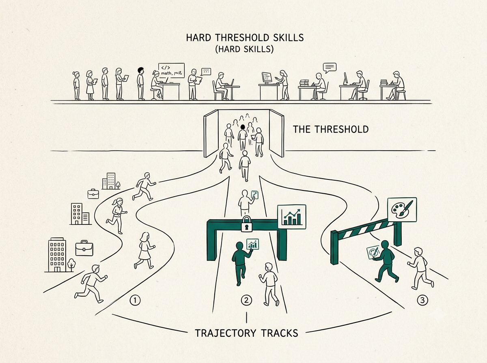
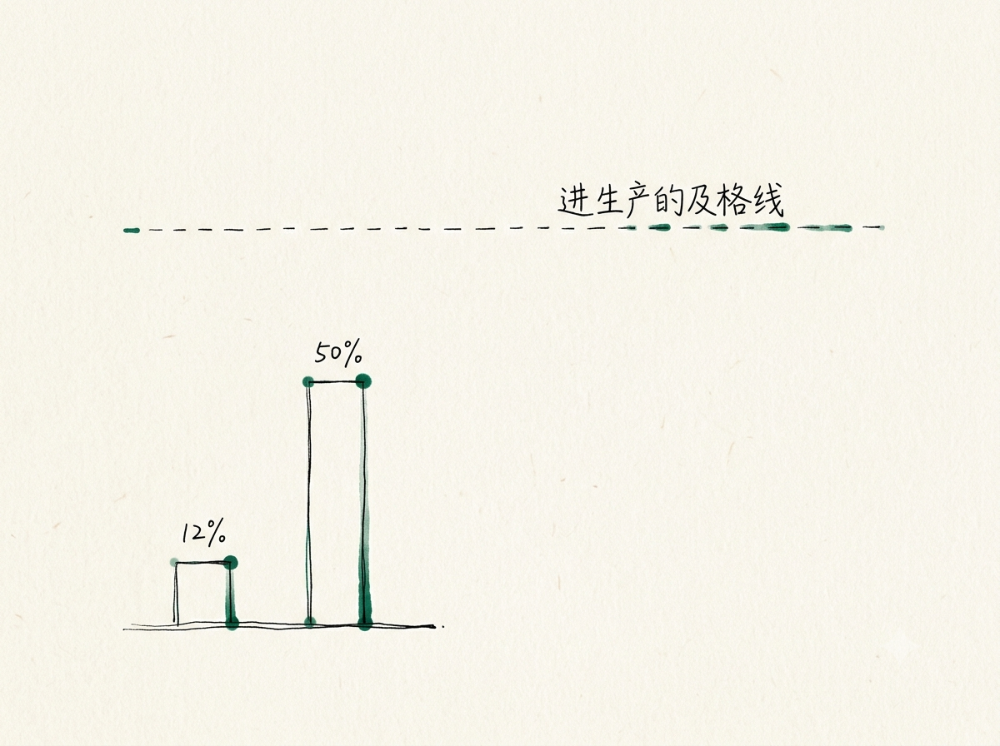
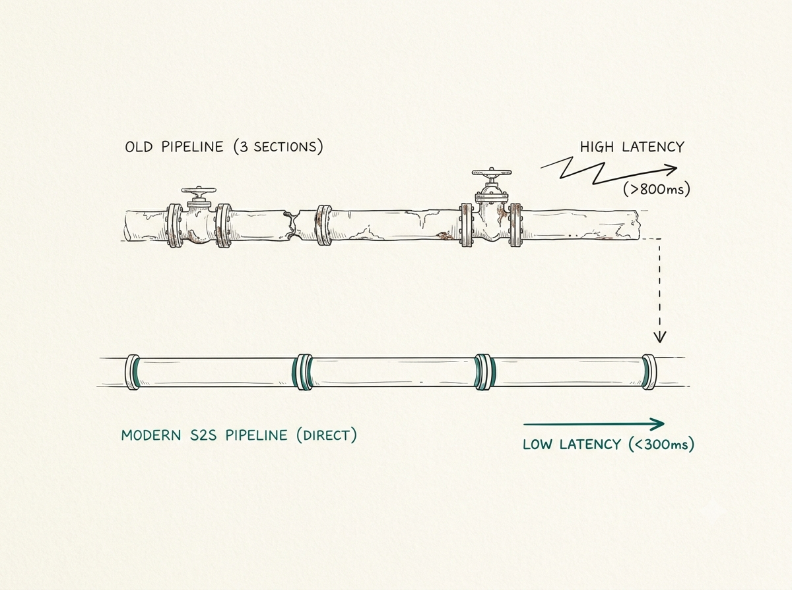
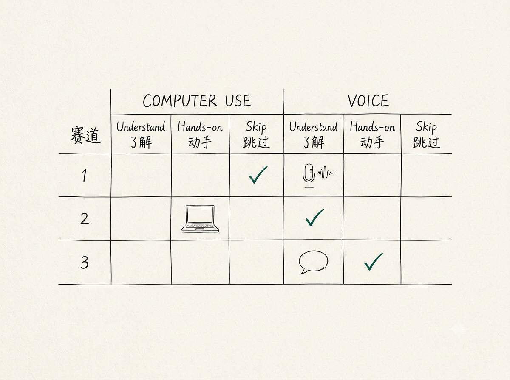

上一讲我们把模型接进了 CRM、ERP、数据仓库、工单和 SSO，还聊了国内绕不开的私有化部署——那是把 agent 焊进企业真实系统的硬功夫，是几乎每条赛道都要过的关。这一讲不一样，我们聊两个"看情况才补"的东西：computer use 和 voice。

它俩最近很热，很多人一看 demo 就慌，觉得自己是不是又落了一课。别急。这一讲要回答的就是一个问题：这两样，你到底该不该花时间学？

先记结论：它们是"赛道选修"，不是全员必修。学不学，取决于你投哪家。


## 先划条线：什么叫赛道选修

结论先给你：FDE 的技能里，有一批是"你投哪家都躲不掉"的硬门槛，也有一批是"只有某几条赛道才卡"的特化技能。computer use 和 voice 属于后者。

我们前面几讲反复敲的那五项——生产级 LLM 系统、客户面能力、agentic 开发、evals、MCP——是硬门槛。几乎每份 2026 的 JD 都在用同一个句式要它们：年限 + customer-facing + production LLM experience。这三块凑不齐，你连初筛都过不了。

computer use 和 voice 不是这个层级。它们更像餐厅菜单上的"当日特色"：只有点了那道主菜的桌子才配。你要是没坐那桌，硬点它就是浪费钱。

打个你熟的比方。这就像你学开车，方向盘、刹车、看后视镜是每个人都得练的；但"手动挡换挡"这门手艺，只有你买手动挡车才用得上。买自动挡的人再练离合，纯属浪费周末。



所以这一讲我不劝你都学。我要做的是帮你判断：你瞄的那几家，到底卡不卡这两样。判断清楚了，你就能把省下来的时间，砸回到 evals 和 MCP 这种真正决定 offer 的地方去。

传统的学法是"听说什么火就补什么"，结果样样沾、样样浅。FDE 的学法反过来——先锁定目标公司的 JD，再倒推补哪块。你手里的时间是有限的，别撒胡椒面。

## Computer use：可靠性还没到硬门槛

结论先行:computer use 现在还没到"硬门槛"这一档，你不用专门为它花大力气,但值得用一页纸的成本持续跟踪。

先说它是什么。computer use 就是让模型像人一样操作图形界面:看屏幕截图、移动鼠标、点按钮、填表单。听着很科幻,对吧?你可能已经在想,这不就是把 RPA(那种老式的"机器人流程自动化")换了个 AI 内核吗?方向上是,但现在的成熟度,得泼你一盆冷水。

看两个可靠性数字,你就明白为什么它还进不了硬门槛:

| 任务类型 | 大致可靠性 |
|---|---|
| 开放桌面任务(随便一台电脑上干活) | 约 12% |
| 动态网页任务(在网页里点点填填) | 约 50% |

12% 是什么概念?你交给它十件事,它能干对一件多一点。这种水平,你敢把它写进客户的生产环境吗?不敢。动态网页的 50% 好一些,但一半的失败率,离"离场后客户能自维护"还差得远——而那恰恰是 FDE 交付的验收线。



所以你该做什么?别急着上手写 computer use 的项目,那性价比太低。但你要盯住一个趋势:2026 到 2028,computer use 正在往"替代 RPA"的方向爬。传统 RPA 又脆又贵——界面一改就崩,维护起来能把人逼疯。一旦 computer use 的可靠性上来,那块存量市场是真金白银。

我给你一个"低成本跟踪"的动作,一页纸就够:

```text
Computer use 跟踪清单(每季度花 30 分钟过一遍)
1. 权威 benchmark 上的可靠性数字有没有明显跳变(比如动态网页从 50% → 80%)
2. 你的目标公司 JD 里有没有开始点名 "computer use / GUI agent"
3. 有没有出现"computer use 替代某类 RPA"的真实生产案例(不是 demo)
```

这三条只要没同时亮灯,你就继续把主力放在硬门槛上。哪天它们亮了,你再花两周补也来得及——因为到那时,它大概率已经被封装成好用的工具,而不是让你从底层像素点起。

对照一下你就懂这个取舍:传统做法是"技术一冒头就全力扑上去,生怕错过";FDE 的做法是"用可靠性数字和 JD 信号当闸门,不到点不投入"。省下来的每一天,都还给 evals。

## Voice:只有三条赛道把它当硬要求

结论先行:voice 是典型的赛道特化技能。只有你投 ElevenLabs、Sierra、Decagon 这类语音优先的公司,它才是硬要求;其他绝大多数赛道,了解个架构就够。

先帮你把范围划死。如果你的目标是 OpenAI、Anthropic、Google Cloud、Palantir、腾讯云这种大模型流或数据流的岗位,voice 基本不在你的必修清单里。你把时间花在语音上,JD 根本不给你加分。这就像你应聘后端,却猛练平面设计——努力用错了地方。

但如果你盯的是语音赛道,那 voice 就从"选修"变"必修"了。这几家的产品核心就是让 AI 用嘴跟客户对话——客服、外呼、实时助手。你要是连语音链路的架构都讲不清,面试第一关就露怯。


那"了解个架构"到底要了解到什么程度?我给你一页速览,以 OpenAI Realtime 为例,这是目前最值得先搞懂的那一种。

传统语音助手怎么做?是三段拼起来的流水线:先把语音转成文字(STT),再让文字模型想答案(LLM),最后把文字合成成语音(TTS)。你想想这条链子——每一段都要花时间,加起来延迟高,而且语气、停顿、情绪在文字这道关全丢了。客户跟它说话,总感觉隔着层玻璃。

OpenAI Realtime 的做法反过来:单个模型直接吃音频、直接吐音频,不再中间转文字。这叫 S2S(speech-to-speech,语音到语音)单模型架构。省掉了两次转换,延迟能压到 300 毫秒以内——差不多就是真人对话的反应速度。而且因为不经过文字,语气和情绪能保留下来。

这个 before/after 的差别,你一对比就清楚:

```text
传统三段式(STT → LLM → TTS)
  语音 → 文字 → 想答案 → 文字 → 语音
  延迟高、情绪丢失、三个环节各自可能出错

OpenAI Realtime 单模型 S2S
  语音 ──直接──→ 语音
  延迟 < 300ms、保留语气、链路更短
```



对多数人来说,你把上面这一页看懂,能在面试里讲清"为什么 S2S 比三段式强",就够用了。只有真投语音赛道的人,才需要往下走:亲手接一次 Realtime API、处理打断(用户说到一半插话)、做语音场景的 evals。别把这些细节当成人人要背的东西。

## 投谁补什么:一张赛道决策卡

结论先行:与其纠结"要不要学",不如先查"我投的这家卡不卡"。下面这张决策卡,你对着自己的目标公司填一遍,答案就出来了。

| 你的目标赛道 | computer use | voice | 你该补什么 |
|---|---|---|---|
| 大模型流(OpenAI/Anthropic/xAI) | 了解即可 | 了解即可 | 死磕 evals + MCP + agentic |
| 数据流(Palantir/Snowflake/腾讯云) | 了解即可 | 不用 | 死磕系统集成 + 数据工程 |
| 平台绑定(Vercel/Databricks) | 了解即可 | 不用 | 死磕对应平台栈 |
| 语音赛道(ElevenLabs/Sierra/Decagon) | 了解即可 | 硬要求,要动手 | Realtime API + 语音 evals |
| RPA 替代方向(观察中) | 持续跟踪 | 不用 | 盯 benchmark,暂不重投 |



怎么用这张卡?很简单,分三步:

第一步,把你近期真的会投的 3 到 5 家公司列出来。不是"听说很好的",是"我简历真的会发过去的"。

第二步,去翻它们最新的 JD,搜三个词:"computer use"、"GUI"、"voice / speech / realtime"。搜到了,对应技能就从选修变必修;搜不到,你就安心跳过。

第三步,把跳过省下来的时间,全部灌回硬门槛。你记得吧,evals 是 FDE 全线最重的那一项——多做一个 eval harness,比会一门用不上的 voice,对你的 offer 有用得多。

我知道你可能还是有点怕"万一以后要用呢"。看懵了也没关系,你就记住一句话:这两样都是"需要时两周能补上"的技能,不是"没有就出局"的门槛。真到了要用那天,它们多半已经被封装得很好上手了。你现在最该护住的,是那些别人两周补不来的硬功夫。

## 小结

computer use 和 voice 是赛道选修,不是全员必修。computer use 可靠性还低(开放桌面约 12%、动态网页约 50%),没到硬门槛,但 RPA 替代趋势值得用一页清单持续跟踪。voice 只对 ElevenLabs、Sierra、Decagon 这类语音赛道是硬要求,其余人搞懂 OpenAI Realtime 的单模型 S2S 架构即可。用那张决策卡对着你真会投的公司查一遍,别为不投的赛道浪费时间,把省下的时间还给 evals 和 MCP。

## 思考题

打开你近期真的会投的 3 家公司最新 JD,搜一遍 "computer use""voice""realtime" 这几个词——它们到底卡不卡这两项?如果都不卡,你打算把省下来的时间补到哪块硬门槛上?欢迎在评论区聊聊你的想法。
