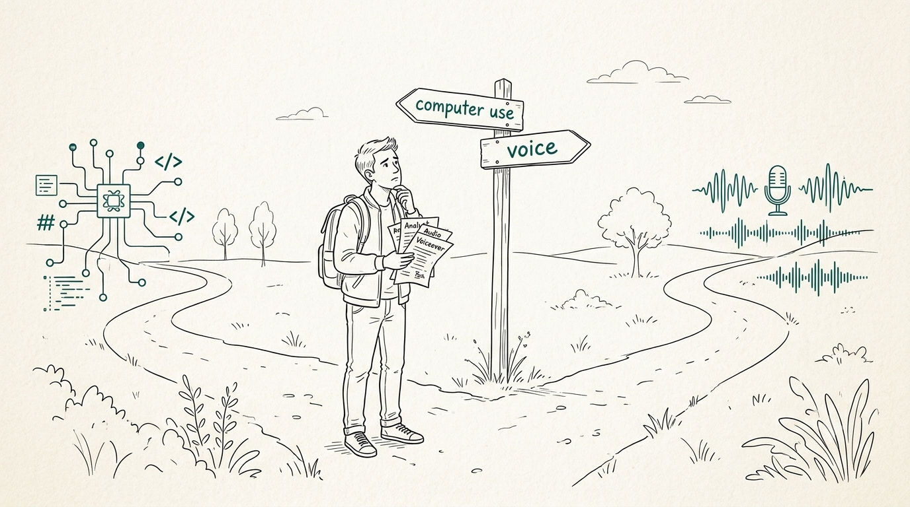
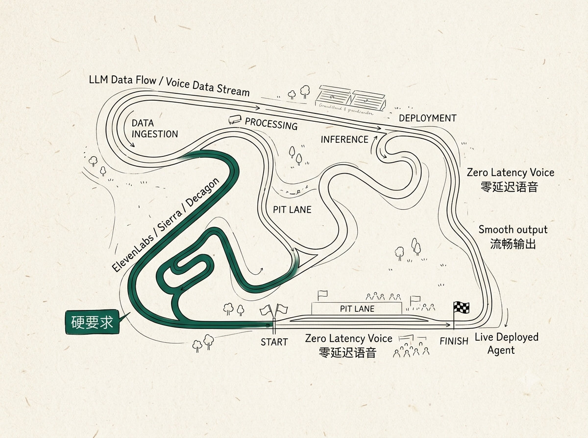

上一讲我们把模型接进了 CRM、ERP、数据仓库、工单和 SSO，还聊了国内绕不开的私有化部署——那是把 agent 焊进企业真实系统的硬功夫，是几乎每条赛道都要过的关。这一讲不一样，我们聊两个"看情况才补"的东西：computer use 和 voice。

它俩最近很热，很多人一看 demo 就慌，觉得自己是不是又落了一课。别急。这一讲要回答的就是一个问题：这两样，你到底该不该花时间学？

先记结论：它们是"赛道选修"，不是全员必修。学不学，取决于你投哪家。



## 先划条线：什么叫赛道选修

结论先给你：FDE 的技能里，有一批是"你投哪家都躲不掉"的硬门槛，也有一批是"只有某几条赛道才卡"的特化技能。computer use 和 voice 属于后者。

我们前面几讲反复敲的那五项——生产级 LLM 系统、客户面能力、agentic 开发、evals、MCP——是硬门槛。几乎每份 2026 的 JD 都在用同一个句式要它们：年限 + customer-facing + production LLM experience。这三块凑不齐，你连初筛都过不了。

computer use 和 voice 不是这个层级。它们更像餐厅菜单上的"当日特色"：只有点了那道主菜的桌子才配。你要是没坐那桌，硬点它就是浪费钱。

打个你熟的比方。这就像你学开车，方向盘、刹车、看后视镜是每个人都得练的；但"手动挡换挡"这门手艺，只有你买手动挡车才用得上。买自动挡的人再练离合，纯属浪费周末。


所以这一讲我不劝你都学。我要做的是帮你判断：你瞄的那几家，到底卡不卡这两样。判断清楚了，你就能把省下来的时间，砸回到 evals 和 MCP 这种真正决定 offer 的地方去。

传统的学法是"听说什么火就补什么"，结果样样沾、样样浅。FDE 的学法反过来——先锁定目标公司的 JD，再倒推补哪块。你手里的时间是有限的，别撒胡椒面。

## Computer use：跑分狂飙了，但在企业里它依然只是“兜底补丁”

结论先行：2026 年下半年，computer use 的学术跑分经历了戏剧性的三级跳，但它依然没变成全员硬门槛——在真实企业架构里，它的正确定位是 **“API 和 MCP 都走不通时的最后一道兜底”**。

先说它是什么。computer use 就是让模型像人一样操作图形界面：看屏幕截图、移动鼠标、点按钮、填表单。早在一两年前，它在开放桌面上的成功率只有可怜的 12% 左右；到了 2026 年下半年，前沿模型在单任务基准 `OSWorld-Verified` 上已经集体越过了人类参考线（72.36%）——Claude Sonnet 4.6 跑到 **72.5%**、GPT-5.4 达到 **75.0%**、Claude Opus 4.8 更是冲上 **83.4%**。

看到这组数字，你可能第一反应是：那是不是所有接口都不用写了，直接让模型点屏幕就行？**泼盆冷水：千万别这么干。** 看看更贴近真实办公跨多软件长链路的 **`OSWorld 2.0` 全成或全败通过率**，你就知道差距在哪了：

| 评测与生产维度 | 2026 下半年真实水位 | 对企业生产意味着什么 |
|---|---|---|
| `OSWorld-Verified`（标准单软件桌面任务） | **72.5%–83.4%** | 单步点按钮、填简单表单已经可用 |
| **`OSWorld 2.0`（跨软件长链路端到端全成率）** | **仅约 44%–49%** | 跑两次崩一次，远达不到金融/制造 99% 生产红线 |
| 延迟与安全代价 | 单任务耗时 **10–12 分钟**；视觉注入失守率高 | 弹窗藏一句恶意文字就可能劫持鼠标，且绕过了 API 级细粒度权限审计 |


所以 2026 年底一线 FDE 已经收敛出一套非常清醒的 **APA（Agentic Process Automation）选型铁律**，面试被问到“怎么替代老式 RPA”时你直接背这四级优先级：

```text
企业自动化四级优先级（从高到低，绝不越级）：
1. 有现成 REST/GraphQL API  ──→ 直接封装成 MCP Server（最快、最省钱、可审计）
2. 无 API 但能直连数据库/CLI ──→ 签发受限凭证走受控脚本 / ETL
3. 固定不变的浏览器表单      ──→ Playwright 确定性脚本
4. 彻底无接口的死古董客户端  ──→ 仅在最后这一步，用 Computer Use 局部兜底（必须跑在隔离沙箱 + 关键点击人工确认）
```

对照一下你就懂这个取舍：外行看到跑分破 80% 就想拿 GUI Agent 一把梭替代所有集成；真 FDE 看穿了长链路 45% 的复合失败率、10 分钟的截图延迟和视觉提示词注入风险，坚持“能走 MCP 绝不点屏幕，只有遇到二十年前的断网老 ERP 弹窗才局部启用 computer use”。记住这句判断，你在系统设计面里已经赢过八成跟风者。

## Voice:只有三条赛道把它当硬要求

结论先行:voice 是典型的赛道特化技能。只有你投 ElevenLabs、Sierra、Decagon（以及 OpenAI 刚从 FDE 驻场孵化出的 *OpenAI Presence* 等企业语音团队）这类语音优先岗位，它才是硬要求；其他绝大多数赛道，搞懂最新全双工架构就够。

先帮你把范围划死。如果你的目标是常规的大模型文档/工作流岗、Palantir 数据流或国内云厂商知识库/智能体岗，voice 基本不在你的必修清单里。你把时间花在调音频编解码上，JD 根本不给你加分。这就像你应聘后端，却猛练平面设计——努力用错了地方。

但如果你盯的是智能客服、金融外呼、门店/车载实时语音赛道，那 voice 就从"选修"变"必修"了。你要是连语音链路的代际演进和电话网接入都讲不清，面试第一关就露怯。



那"了解个架构"到底要了解到什么程度？我给你一页 2026 年末的最新速览。

传统语音助手是三段拼起来的流水线：先把语音转成文字（STT），再让文字模型想答案（LLM），最后把文字合成成语音（TTS）——每一段叠加延迟，语气、停顿、犹豫情绪在文字这道关全丢了。

而以 OpenAI 新一代 **`gpt-realtime-2.1` / 全双工 `GPT-Live 1`**（注：初代 `gpt-realtime` 已标记废弃并于 2027 年初下线）以及 **ElevenLabs `Eleven Realtime`** 为代表的现代语音栈，走的是原生 **S2S（speech-to-speech）全双工架构**，在生产工程上更补齐了三块拼图：
1. **亚 300ms 低延迟与自然打断（Barge-in）**：直接吃音频流、吐音频流，用户插话瞬间平滑收声；
2. **原生 SIP 电话专线直连**：直接对接企业呼叫中心网关（Twilio / 思科 / 运营商 SIP Trunk），不用自己手搓复杂的音频转码桥；
3. **原生挂载 Remote MCP + LiveKit Agents 编排**：一边跟客户自然通话，后台一边异步调 MCP 查订单、改预约，开源界普遍用 **LiveKit Agents 1.0+** 做 WebRTC/SIP 实时会话底座。

这个 before/after 的差别，你一对比就清楚：

```text
传统三段式(STT → LLM → TTS)
  语音 → 文字 → 想答案 → 文字 → 语音
  延迟 > 1.5s、情绪丢失、打断生硬

2026 全双工 S2S（GPT-Live 1 / Eleven Realtime + LiveKit + SIP/MCP）
  电话 SIP / WebRTC 音频流 ──全双工直通──→ 语音回复 + 后台异步调 MCP 工具
  延迟 < 300ms、支持随时插话、原生接入企业呼叫中心
```


对多数人来说，你把上面这一页看懂，能在面试里讲清"为什么全双工 S2S + SIP + MCP 比旧三段式强、什么时候又该为了合规审校退回可控 TTS"，就够用了。只有真投语音赛道的人，才需要往下走：用 LiveKit Agents 接一次 `gpt-realtime-2.1` 或 `Eleven Realtime`、处理嘈杂环境误打断、做语音端到端评测。

## 投谁补什么:一张赛道决策卡

结论先行:与其纠结"要不要学",不如先查"我投的这家卡不卡"。下面这张决策卡,你对着自己的目标公司填一遍,答案就出来了。

| 你的目标赛道 | computer use | voice | 你该补什么 |
|---|---|---|---|
| 大模型流(OpenAI/Anthropic/xAI) | 懂 APA 兜底边界即可 | 了解全双工架构即可 | 死磕 evals + MCP + agentic |
| 数据流(Palantir/Snowflake/腾讯云) | 了解即可 | 不用 | 死磕系统集成 + 数据工程 + ACL |
| 平台绑定(Vercel/Databricks) | 了解即可 | 不用 | 死磕对应平台栈 |
| 语音客服赛道(ElevenLabs/Sierra/Decagon) | 了解即可 | **硬要求,要动手** | LiveKit + S2S API + 语音打断/evals |
| 老旧无接口遗留系统改造(工业/传统政企) | **局部兜底选修** | 不用 | 优先 MCP/Playwright,沙箱 GUI 兜底 |


怎么用这张卡?很简单,分三步:

第一步,把你近期真的会投的 3 到 5 家公司列出来。不是"听说很好的",是"我简历真的会发过去的"。

第二步,去翻它们最新的 JD,搜三个词:"computer use"、"GUI"、"voice / speech / realtime / LiveKit"。搜到了,对应技能就从选修变必修;搜不到,你就安心跳过。

第三步,把跳过省下来的时间,全部灌回硬门槛。你记得吧,evals 是 FDE 全线最重的那一项——多做一个 eval harness,比会一门用不上的 voice,对你的 offer 有用得多。

我知道你可能还是有点怕"万一以后要用呢"。看懵了也没关系,你就记住一句话:这两样都是"需要时两周能补上"的技能,不是"没有就出局"的门槛。你现在最该护住的,是那些别人两周补不来的硬功夫。

## 小结

computer use 和 voice 是赛道选修,不是全员必修。computer use 虽然在单任务 `OSWorld-Verified` 上冲到了 72.5%–83.4%,但跨软件长链路 `OSWorld 2.0` 仍只有 44%–49% 且慢而脆,企业落地严守“API → MCP → 脚本 → 最后才用 Computer Use 沙箱兜底”的 APA 铁律。voice 只对 ElevenLabs、Sierra、Decagon 等语音赛道是硬要求,其余人搞懂 `GPT-Live 1` / `gpt-realtime-2.1` + SIP + LiveKit 的全双工架构即可。把省下的时间全部灌回 evals 和 MCP。

## 思考题

打开你近期真的会投的 3 家公司最新 JD,搜一遍 "computer use""voice""realtime" 这几个词——它们到底卡不卡这两项?如果都不卡,你打算把省下来的时间补到哪块硬门槛上?欢迎在评论区聊聊你的想法。
