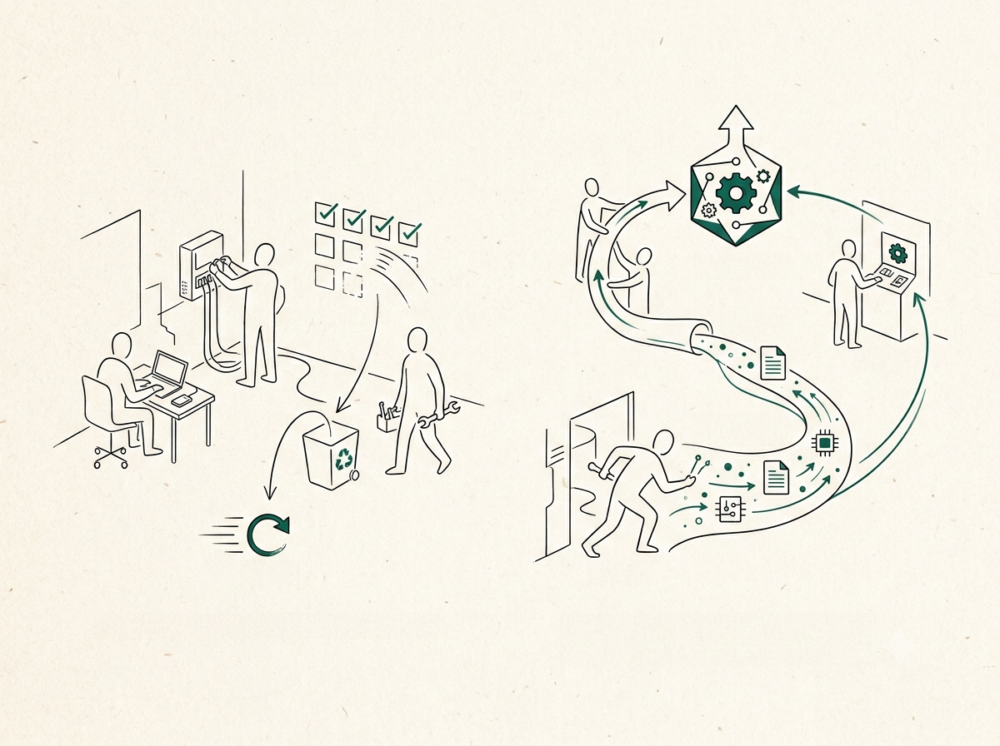
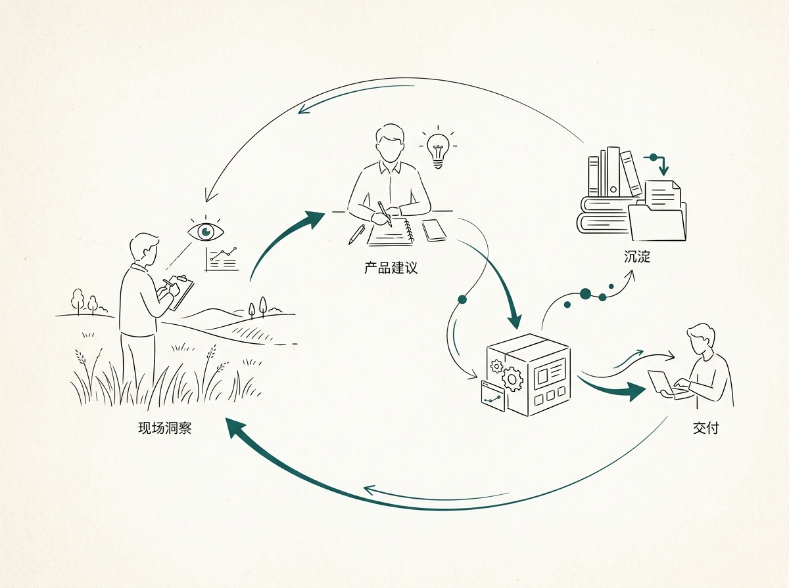
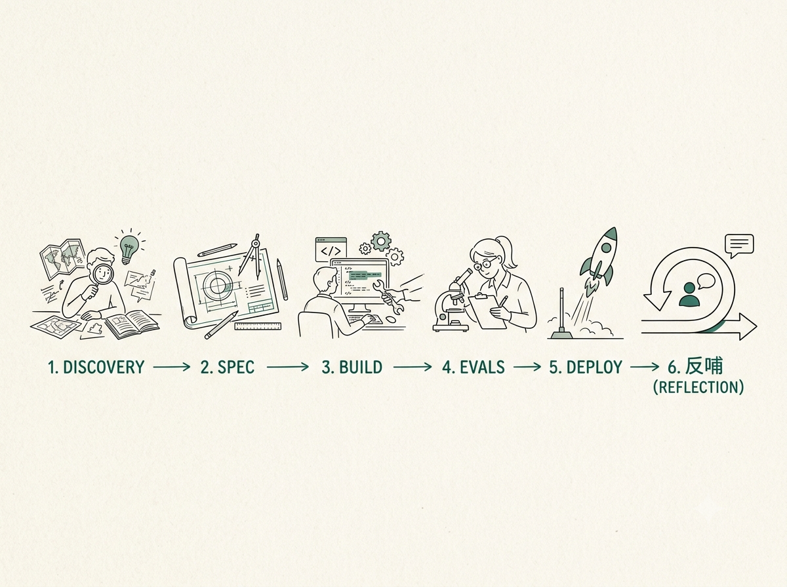
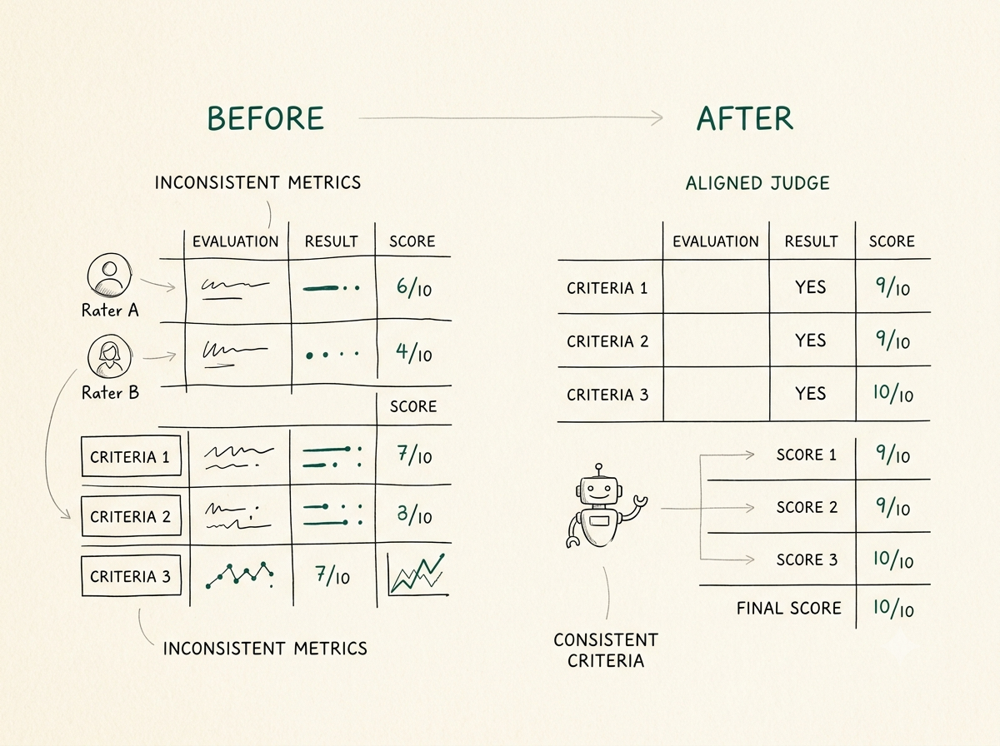
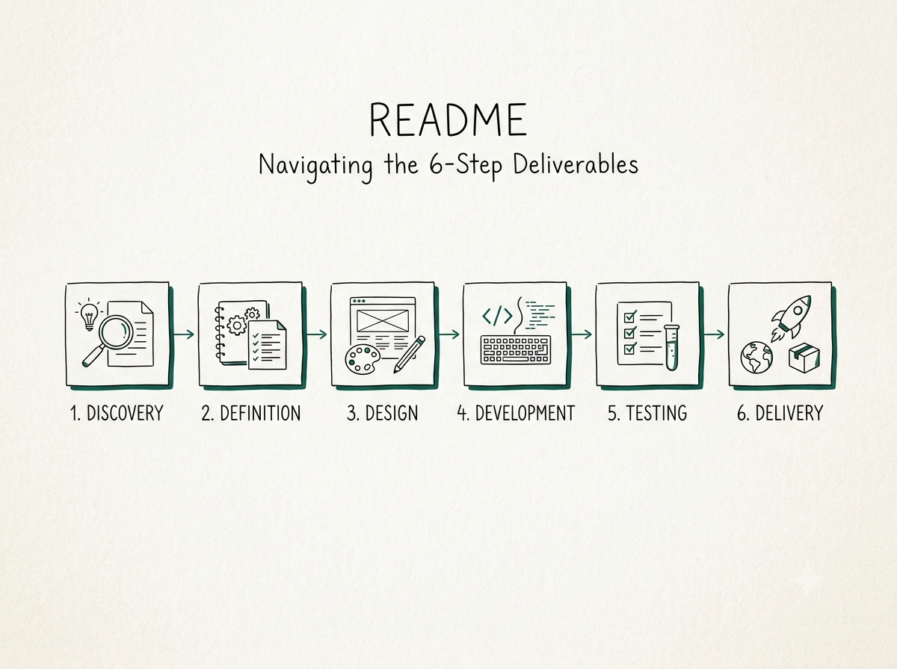

上一讲我们把 computer use 和 voice 定位成"赛道选修"，不是必修——毕竟跨软件长链路（OSWorld 2.0）的端到端成功率仍不到一半，企业现场主要拿它给无 API 的老系统兜底，你没必要现在就全押上去。选修讲完，实战篇的技能点也就攒齐了：客户发现、问题分解、context、MCP、agent、evals、部署。零件都在手上了。

那问题来了：这些零件怎么拼成一个能替你说话的东西？光在简历上列"我会 MCP、我会 evals"，招聘方一句"给我看"就把你问住了。这一讲要回答两件事——FDE 凭什么比纯实施的实施工程师值钱，以及你怎么用一个 Capstone 项目把前面所有技能一次性证明给别人看。

先记一句大白话结论：这一讲就是教你造一件"旗舰作品"，让别人 60 秒点开就知道你能干 FDE 的活。


## 反哺：FDE 和纯实施的分水岭

先给判断：如果你交付完就走，把每个客户当一次性项目做，那你干的是实施，不是 FDE。这两者薪资差一截，差就差在"反哺"这两个字。

我先把话说透。纯实施工程师的价值随项目结束而清零——这个客户的坑，下个客户还得重踩一遍。FDE 反过来：他把现场踩的每个坑，沉淀成能复用的资产，再把一线洞察喂回核心产品。腾讯云那条 FDE 的 JD 写得最直白，原文是「将一线经验沉淀为可复用的交付资产与行业方案模板，反哺产品」。你注意，这不是加分项，是岗位定义本身。



为什么这道缝这么值钱？说个你能对上的场景。就像一个老师傅修机床，修一台收一台的钱，那是手艺人；但如果他把每次故障写成排查手册、再反推厂家改设计图，那他就成了厂家离不开的人。FDE 干的是后者。国内 53AI 那篇三年实践长文把这套东西拆成了"七个基建"——从需求模板、prompt 资产库到评估集、交接文档，全是为了让第二个客户比第一个快。

这里有个反直觉的点，别急，我慢慢说。你可能觉得反哺是"额外工作"，做完交付再抽空整理。错了。反哺是嵌在交付流程里的：你做客户发现时顺手记下这个行业的共性痛点，你写 eval 时顺手攒下可复用的测试集，你部署时顺手把 runbook 写成模板。传统做法是先交付、后总结、总结常常没空做；FDE 做法是把总结变成交付的副产品，边干边沉淀。

再往深一层说，反哺其实有两个方向，你别只记住一个。一个方向是横向复用——这次的资产给下一个客户提速，让第二次部署比第一次快；另一个方向是纵向回流——把一线发现的产品缺口反推给核心产品团队，让产品自己长出这块能力。OpenAI 全球 FDE 负责人 Colin Jarvis 在 2026 年 10 月披露过一个极具说服力的案例：一套复杂多智能体方案在客户第一个团队落地足足花了 **2 个月**，但沉淀成模板之后，复用到第二个团队只用了 **1 天**；而一线踩坑还反向孵化出了核心产品能力 *OpenAI Presence*。国内那套"七个基建"两头都占：需求模板、prompt 资产库、评估集是横向的，产品建议清单是纵向的。你在 Capstone 里两个方向都要有痕迹，哪怕各只做一小块。



所以你该做什么？在你的 Capstone 里，专门留一个"反哺"环节，把它当成正式交付物，而不是事后感想。具体长什么样，下一节讲。你只要先记住：招聘方买的不是你会写代码，是你能把一次现场变成公司的长期资产。

## Capstone 六步：一个项目串起整条交付链

结论先行：你不需要三个作品集，你需要一个做到底的旗舰项目。它要能同时证明三件事——你会做客户发现、你会 build、你会 evals。这三样是 FDE 面试的命门，一个项目全包了，比十个半成品 side project 有用得多。

怎么选题？挑一个真实的垂直场景：制造、金融、政务、客服，四选一。别选"通用助手"这种飘的东西，越具体越像真交付。选定后，你完整走一遍下面这六步，每步都留档。



**第一步 Discovery（客户发现）。** 用前面学的 Mom Test 三原则做几场访谈——哪怕访谈对象是你自己找的行业朋友。产出一份 scoping 文档：这个场景的真需求是什么、成功长什么样、有哪些脏数据。这一步证明你不是闷头写代码的人。

**第二步 Spec（可执行规格）。** 把 scoping 变成一份 agent 能照着干的 spec，配一份 `AGENTS.md`。这份文件是你和 coding agent 的合同，写清项目结构、约束、验收标准。招聘方现在直接看 orchestration 能力，这份 `AGENTS.md` 就是证据。

**第三步 Build（构建 agent 应用）。** 这是技术含量最高的一环，硬性清单如下：

- 一个**亲手写的 MCP server**，连接这个场景的真实系统或数据库——不是抄模板，是你自己实现工具定义、鉴权、错误处理；
- 至少 **2 个 tool call**，让 agent 真的去调你这个 server 干活；
- 一段**清洗真实脏数据的 ETL**——真实业务数据永远是脏的，这段最像现场；
- 基本的 guardrails。

这一步对应 Anthropic FDE 那条逐字要求的交付物：MCP servers、sub-agents、agent skills。你把它做出来，等于把 JD 原话变成了 live 代码。

```python
# 你的 MCP server 至少要长这样：一个真能被 agent 调起来的工具
@mcp.tool()
def query_work_orders(status: str, since: str) -> list[dict]:
    """按状态和时间查工单，供 agent 排查客户问题时调用。"""
    rows = db.execute(
        "SELECT id, title, status, updated_at FROM work_orders "
        "WHERE status = %s AND updated_at >= %s",   # 参数化，别拼 SQL
        (status, since),
    )
    return [dict(r) for r in rows]
```

**第四步 Evals（评估）。** 这是全场最重的技能点，也是最容易被人省掉、于是最能拉开差距的地方。要求：**20+ 条测试集**、**二元 rubric**（pass/fail，别用 1–5 的 Likert）、用 **100 条人工标注去对齐你的 LLM judge**、最后出一张**前后指标对比表**。就像你减肥得有个体重秤，evals 就是这个项目的秤——没有它，你说"效果不错"都是空话。



**第五步 Deploy（部署与交接）。** Docker 打包 + 上云 + 加监控 + 写一份 **runbook 与 handback packet（交接包）**。FDE Hub 在《State of FDE 2026》里发现一个扎心事实：50% 的 FDE 每周要花超过 10% 的时间回头维护早已交接的系统；资深从业者 Falk Gottlob 因此指出，在 coding agent 让搭系统变快之后，FDE 最稀缺的本事其实是「体面离场（The Leaving）」——从第一天起就把架构决策、异常处理和回滚流程写进交接手册，对应 AWS 那句卖点：离场后客户能自己维护。你把服务跑起来，拿到一个 **live URL**，这就是招聘方 60 秒能验证的东西。

**第六步 反哺。** 把整个交付里攒下的洞察，浓缩成一页纸的**产品建议**：这个行业的共性痛点是什么、产品该加哪个能力、优先级怎么排。就这一页，把你和纯实施工程师彻底分开。

## 交付物怎么摆：让人 60 秒读懂你

给判断：作品做完只是一半，怎么"摆"决定招聘方看不看得懂。原则一句话——**live URL + eval 指标 胜过任何证书**。

每一步都要留下可点开的痕迹。整个项目用一份 `README` 串起来，让人从上到下读一遍就知道你走完了全链路。我给你一个可以直接抄的骨架：

```markdown
# 制造质检 Agent —— 端到端 FDE 交付

- Live URL: https://your-demo.app   （60 秒可验证）
- Discovery: /docs/scoping.md         （3 场访谈 + 真需求）
- Spec: /AGENTS.md                    （agent 合同）
- MCP server: /src/mcp_server.py      （亲手写，2+ tool call）
- Evals: /evals/report.md             （22 条测试集 + 前后指标表）
- Deploy: /docs/runbook.md            （Docker + 监控 + 交接手册）
- 反哺: /docs/product-insights.md     （一页纸产品建议）
```



如果你在国内投递，这套要加两样。第一是**私有化部署**——国内客户几乎都要求数据不出内网，你的 runbook 里得写清私有化方案，这是硬通货。第二是**可量化 ROI**：别只说"提效了"，要给出人效、良率或降本的 A/B 数字。就像你去谈薪资不能说"我很努力"，得说"我把良率从 92% 拉到 97%"。国内云厂商的 FDE 岗，最认这个。

再落一句到你自己身上。中文社区里真正带代码、带评测指标的第一人称 FDE 转型交付实录依然极少，你把这个 Capstone 的过程写成一篇技术博客，本身就是稀缺内容——Het Trivedi 当年就是靠一篇部署博客被联创私信挖走的。作品 + 公开写作，这是被反复验证的敲门砖。看懵了也没关系，你不用一天做完，前面九十天的节奏就是为这一个项目铺的路。

## 小结

FDE 比纯实施值钱，值在"反哺"：把每次现场沉淀成可复用资产、把洞察喂回产品。Capstone 就是把这件事做给别人看——选一个真实垂直场景，走完 Discovery→Spec→Build→Evals→Deploy→反哺六步，全部留 live URL 和 README。它一个人同时证明你会 discovery、会 build、会 evals。国内版再加私有化和可量化 ROI，你就有了一件能替你说话的旗舰作品。

## 思考题

如果让你现在就选一个垂直场景开工，你会选哪个行业、解决其中哪个具体到能一句话说清的痛点？想一想这个场景里最脏的那块数据长什么样，因为它八成就是你 ETL 那一步要啃的硬骨头。欢迎在评论区聊聊你的想法。
