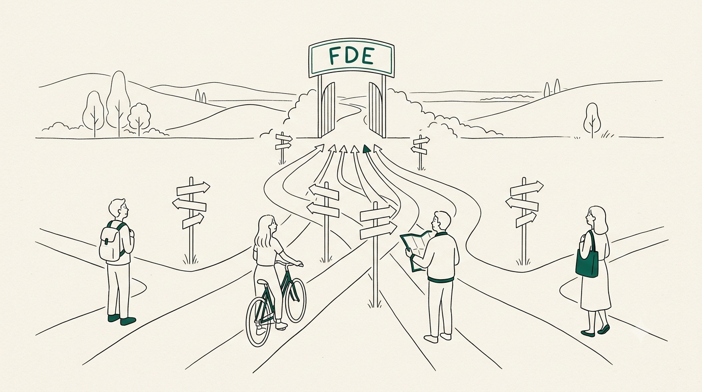
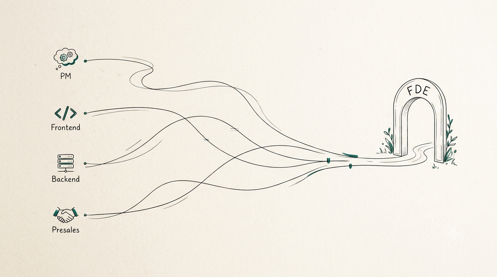
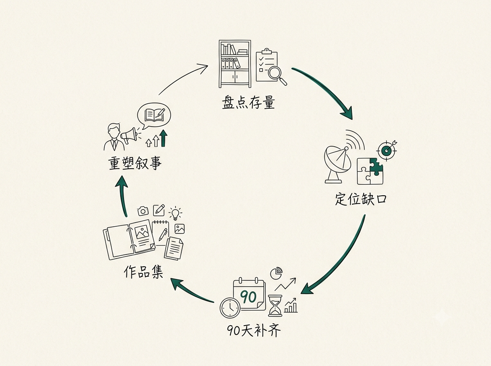
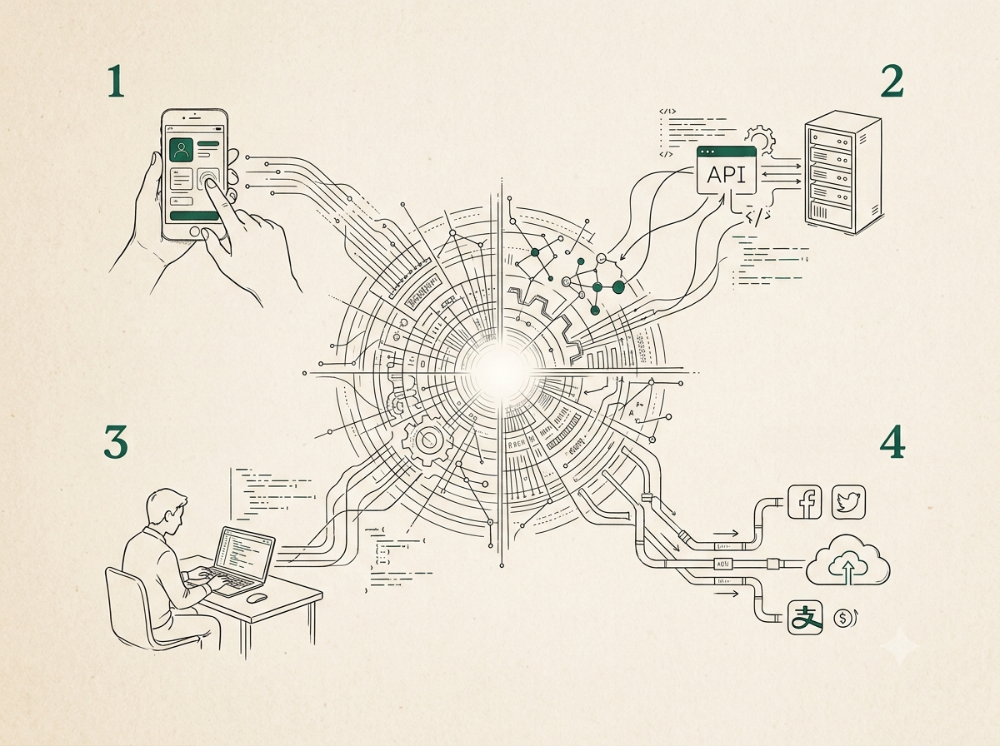
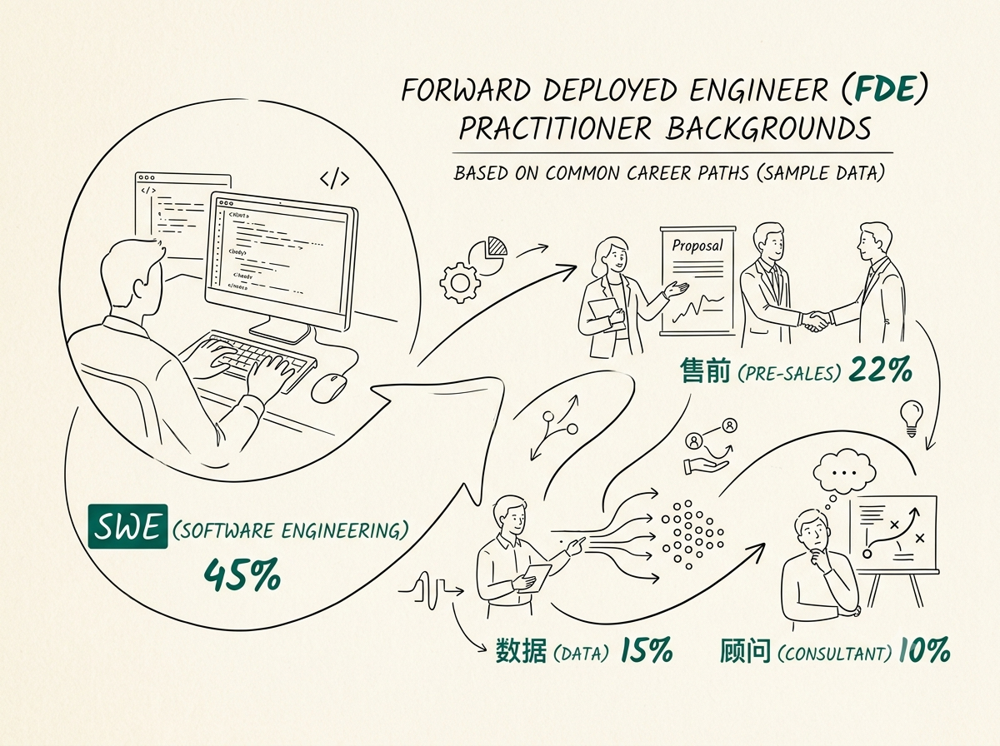
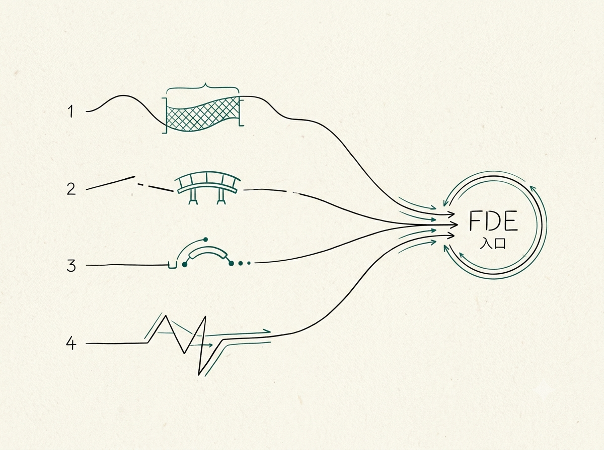
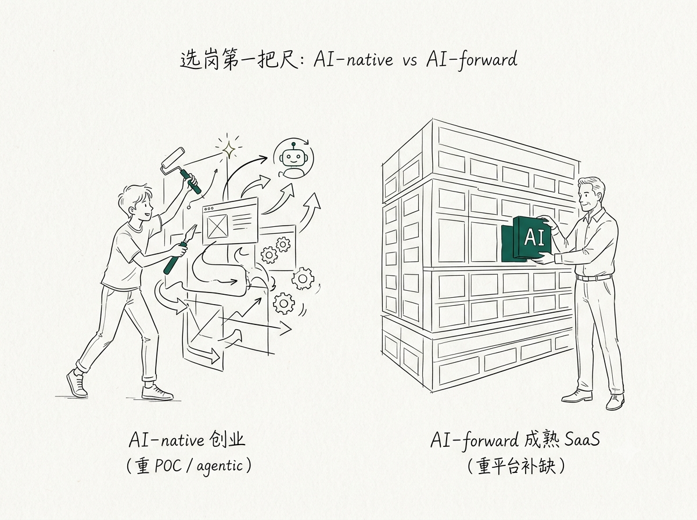
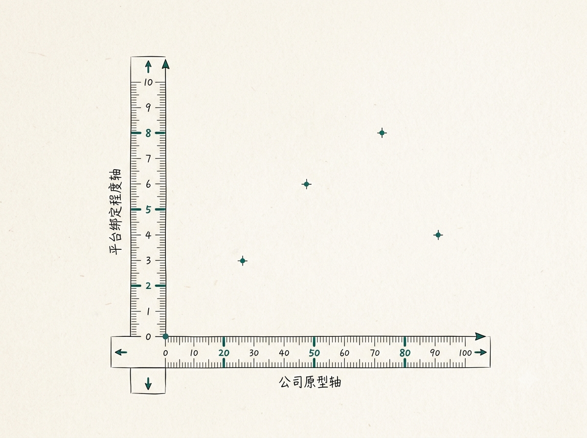

上一讲我们跑完了 Capstone:把一个端到端交付走了一遍,还把现场的坑沉淀成可复用资产、反哺回产品——这正是 FDE 区别于纯实施的那道分界线。现在你手里有了作品,也摸清了 FDE 到底在干什么。可下一个问题很现实:你,一个具体的你,前端也好、后端也好、PM 也好、售前也好,到底该怎么从现在的位置挪到 FDE 这个位置上?更狠一点问:市面上岗位这么多,你该往哪家投、补哪块短板、简历怎么写才不被秒拒?

这一讲我给你一套通用的转型框架,再给你两把选岗的尺子。说白了,就是帮你把"我想转 FDE"这句空话,拆成一张能照着走的地图。





## 通用五步框架:从存量到叙事

先给结论:不管你从哪来,转型这件事都能拆成同样的五步——盘点存量优势、定位核心缺口、90 天补齐、打造作品集、重塑简历与面试叙事。顺序别乱,尤其别一上来就闷头补短板。

第一步,盘点存量。这一步最反直觉,但最重要。大多数人一想到转型,第一反应是"我还差什么",然后焦虑地去补。错了。你得先问"我已经有什么"。就像你搬家,不会先冲去买新家具,而是先清点手里哪些还能用。前端的你,TypeScript 和交付演示是别人没有的牌;后端的你,生产系统经验就是硬通货;PM 的你,需求发现天然达标——而这一条,70%+ 的 FDE JD 都在明着要。

第二步,定位缺口。存量盘完,缺口自然就浮出来了。这里有个关键判断我先摆在这:所有 FDE 岗位,底座其实是同一套。哪一套?**Python 写生产级代码 + context/agent/MCP 三件套 + evals**。四条路径共享这同一个技术底座,区别只在于——你的入口叙事怎么讲,以及你要补的是这个底座的哪半边。



第三步,90 天补齐。缺口找准了,就进那套通用节奏。别自己瞎排,前面实战篇验证过的那条 12 周路线可以直接抄:

```text
W1–2   Python 流利 + Claude Academy(原 Anthropic Academy,免费带证书)起步
W3–4   端到端 RAG(pgvector 起步)
W5–6   eval pipeline(error analysis + 二元 judge)
W7–8   agent + MCP(亲手写一个 MCP server)
W9–10  部署 + 监控(Docker + 云 + runbook)
W11    作品集 README + 简历
W12    面试冲刺(decomposition + agentic eval 题 + 8 个 STAR)
```

第四步,打造作品集。记住一句话:**作品集(live URL + eval 指标)胜过证书**。招聘方一句"一个部署项目 60 秒可验证",比你贴十张结业截图都管用。旗舰项目就是端到端 FDE 模拟交付,自建 MCP server、eval harness、交接 runbook 一个都不能少——这几样都是 Anthropic、Harvey 的 JD 逐字写进交付物的东西。

第五步,重塑叙事。简历别再用"我们"了,全部换成"我",用 JD 的动词库改写:embed、own、ship、codify、harden、operationalize、white-glove。别小看这一步。同样一段经历,叙事一换,招聘方看到的就从"实施工程师"变成"FDE 候选人"。



传统做法是"我先去考个证、刷够经验再说";FDE 的转型逻辑正相反——先拿现有存量做一个能跑、能验证的真东西,让招聘方当场信你。这跟 FDE 的工作方式是一致的:不做 demo,直接写进生产环境。你的转型过程本身,就是一次小型 FDE 交付。

## 四条路径,同一个底座

结论先行:四条起点路径——后端/数据、前端、PM、售前/顾问——最后都汇进同一个入口,差别只在补哪半边底座、以及入口故事怎么讲。别把自己的出身当劣势,每条路都有人真的走通了。

这里我先给你一个定心丸,叫 bloomberry 背景占比:已入行 FDE 里,软件工程师约 45%、售前约 22%、数据约 15%、顾问约 10%。看懵了也没关系,你只需要记住一个结论——**这四类人加起来占了绝大多数,说明这四条路都是真实走得通的,不是我在画饼。**你现在的身份大概率就落在这张图里。



后端 / 数据 / ML 的你,底座的工程那半边基本现成,要补的是客户面那半边:Mom Test 提问法、咨询 case 题、evals 方法论。参照 Kanav 就行——Amazon SWE 干了约 3 年,靠咨询 case 题备考,24 岁进了 Rippling 创始 FDE 团队。他说最难的两关不是技术,是 context switching 和直面客户建立信任。

前端的你,TypeScript 是天生优势,要补的是 Python、检索光谱和 evals。你的入口叙事最好往"平台绑定型"靠——Vercel FDE 的 JD 原话就是把 TypeScript 当 primary language,还绑 Next.js 和 AI SDK,薪资 $137–207K。这条路暂时没有完美的第一人称公开案例,我如实告诉你;但也意味着,你的转型记录本身就能成为稀缺内容。

PM 的你,补短板最重,得做工程身份重建——Python、全栈、旗舰项目必须自己亲手写,不能外包给别人。但你的优势是需求发现天然达标。参照 aamir:干了 5 年 PM,决定回工程,朋友直接点名 FDE,因为它同时吃"跟客户深度协作 + 技术能力 + 拥有客户体验"这三样。就像你本来会看菜谱又懂食客口味,现在只差亲自下厨这一步。

售前 / 解决方案 / 顾问的你,要补的是生产级代码能力——从"能演示的 demo"跨到"能上生产的 production adoption"。参照 Milos:Elastic 培训师干了 6.5 年,自举创业 6 年,转 Lleverage FDE,同时并行 10–15 个客户。你还有一条最短的旁路:Deloitte 平台绑定 FDE,只要 3 年工程 + 1 年 GenAI 生产经验 + 1 年指定平台,$134.5–265.1K,是咨询系出身的低门槛入口。



看出来了吗?底座是同一个,四条路只是从不同的门进同一个房间。所以你该做的第一件事,不是羡慕别人的起点,而是认清自己缺的是"工程那半边"还是"客户那半边",然后照着补。

## 两把尺子:选对岗,别投错门

结论先给你:FDE 岗位不是铁板一块,投之前先用两把尺子量一量,能帮你省下大把无效简历。第一把量公司类型,第二把量技术栈的绑定程度。

第一把尺子,叫 Two Archetypes(两种原型),这是 Kanav 提出来的选岗框架。一端是 **AI-native 创业公司**,它们重 POC、重 agentic——你要能在几天里做出一个能跑的粗糙版本,快速验证价值。另一端是 **AI-forward 成熟 SaaS**,它们重平台补缺——产品已经很大,你要做的是在既有平台的边界上补齐客户缺的那块能力。

这两端对你的要求很不一样。去创业公司,像你进一个刚开张的餐馆,厨房设备不全,你得自己边搭边炒,速度和 owner 意识是命门。去成熟 SaaS,像你进一个连锁大厨房,流程和平台都摆好了,你得先摸清这套设备,再在规则内把缺的菜做出来。选错原型,你的优势会变成劣势——一个习惯大平台的人空降创业公司,很可能被"什么都得自己搭"逼疯。



第二把尺子,叫**平台绑定 vs 模型通用轴**。有些岗把你锁在一个具体平台上:Vercel 绑 Next.js、Snowflake 绑 Cortex、Deloitte 绑 Bedrock/Cortex/Azure AI Foundry。选这类,你得追加学对应的平台技能,而且要想清楚可迁移性——技能锁得越死,换赛道成本越高。另一些岗是模型通用型:OpenAI、Anthropic、xAI,通用栈优先,Python + context/agent/MCP + evals 走天下。

这两把尺子叠起来用,就是一张选岗坐标。举个例子,前端出身的你,如果偏爱成熟平台又不介意绑定,Vercel FDE(AI-forward + 平台绑定)就是顺位最高的门;后端出身、想要通用能力和最大自由度的你,OpenAI/Anthropic(可 AI-native、模型通用)更合身。



我再多说一句提醒你别踩坑。大约 30% 挂名 FDE 其实是售前或外包换皮（行业里叫 FDE Washing）——有 quota、有提成、交付的是可抛弃 demo 或纯按人天结算。真伪判据其实很清楚:看有没有 quota/提成、是不是售后嵌入、是否 own 生产代码、有没有反哺闭环。所以量完这两把尺子,你还得再问一句:这岗到底是工程岗,还是套了 FDE 名头的销售或外包岗?按公司分层判断——frontier lab 和 AI-native 多是真交付,Vercel 这类平台厂商 JD 里就明写含 pre-sales。

## 小结

转型不是玄学,是一套能照着走的流程。五步框架:先盘存量、再定缺口、90 天补齐、打造作品集、重塑叙事,顺序别乱。四条路径共享同一个技术底座——Python 生产代码 + context/agent/MCP + evals,区别只在补哪半边、故事怎么讲。选岗用两把尺子:Two Archetypes 量公司类型,平台绑定 vs 模型通用量技术栈,再叠一层"这是不是真交付岗"的判据。bloomberry 的背景占比告诉你:这几条路都有人真的走通了。

## 思考题

拿你现在的岗位对号入座:你手里已经攥着底座的哪半边(工程还是客户),缺的是哪半边?再用两把尺子想一想,你会优先投哪一类公司,为什么?欢迎在评论区聊聊你的想法。

下一讲我们进《真实案例库:成功、代价与出口》,把这些框架背后活生生的人——他们怎么成功、付了什么代价、最后又去了哪——一个个摊开给你看。
