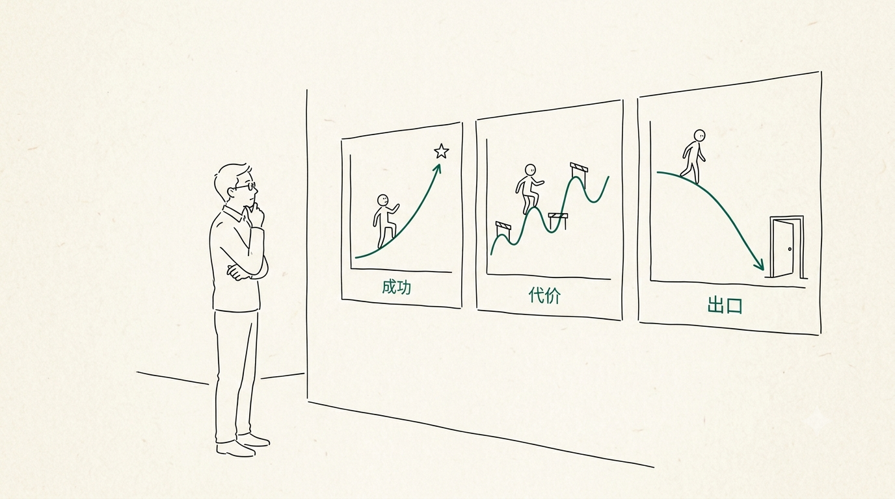
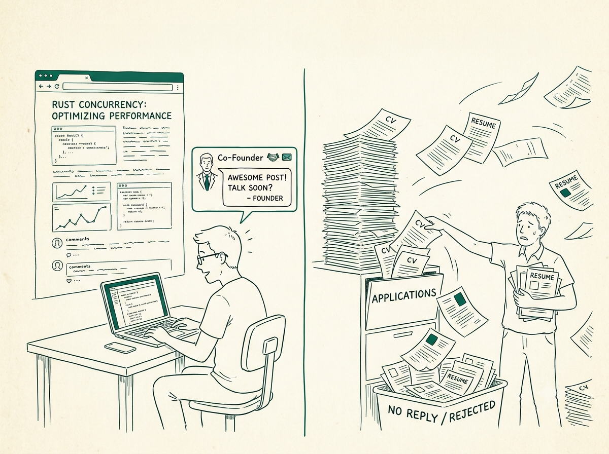
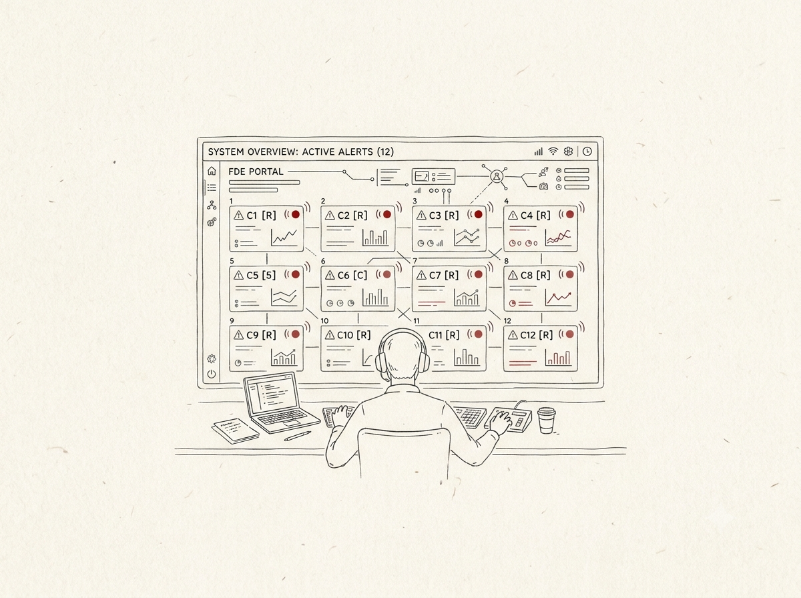
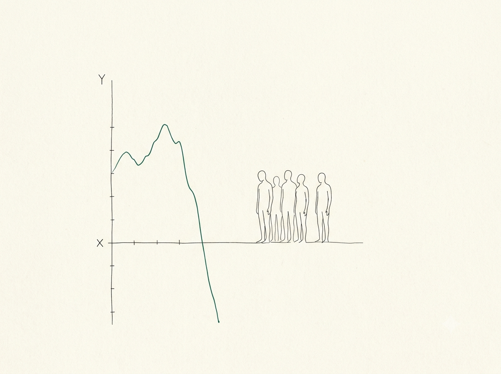
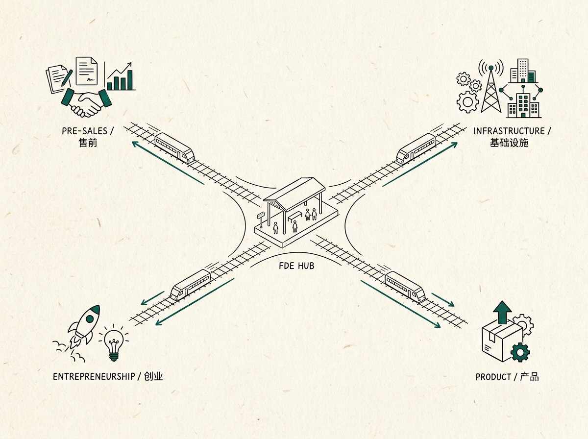

上一讲我给了你一套通用五步框架：盘点存量优势、定位核心缺口、90 天补齐、打造作品集、重塑简历和面试叙事。框架是骨架，可它有个毛病——太干净。真实的转型没这么线性。有人三年就熬到创始 FDE，有人四年把自己熬空了，也有人干着干着就跳去做投资人了。

所以这一讲我不讲框架，讲人。我把手头能找到原话的真实案例摊开给你看：他们怎么进来的、进来后付出了什么、又从哪个门走出去。你要回答的问题只有一个——把这些人的弧线对照你自己，你更像谁，你愿意变成谁。看完你要动手写一页纸，就写你自己的转型叙事。



## 成功组：三条不一样的进场路

先给结论：进 FDE 没有唯一正确姿势。有人靠大厂履历硬转，有人靠一篇博客被人挖，有人靠同时扛十几个客户杀出来。共同点不是背景，是自驱和面客能力。

先看 Kanav Bhatnagar。他的路径最像"标准答案"：Amazon 干了约三年 SWE，跳到 Actively AI 做 FDE，把 pilot 转付费率做到 100%，然后 24 岁进了 Rippling 的创始 FDE 团队。注意这个年龄——毕业才约三年。这一条就够你把"必须五年经验"那个念头扔掉了。

他备考用的方法很反直觉。不是刷算法，是借咨询行业的 case 面题来练。就像你要考驾照，不去背交规，而是先上路模拟各种路况。FDE 面试考的就是这个：快速诊断、澄清式提问、给出行动计划。他自己说最难的关卡是两件事——context switching（不停在客户之间切换）和直面客户。

> 记住 Kanav 这条：大厂 SWE 是最顺的转型跳板，但你得把"写代码"的肌肉换成"诊断+沟通"的肌肉。

再看 Het Trivedi，他的进场方式我最想让你抄。他创业失败过，然后自学 GenAI，写技术博客。就一篇讲怎么把 LLM 部署上线的博客，被 Baseten 的联合创始人私信挖走了。你品品这个杠杆——没投简历，没找内推，一篇公开写作把人钓来了。



这就是为什么我在前面反复说：公开写作是被验证过的敲门砖，比闷头做十个 side project 管用。他进去后的工作是这样拆的：

```text
Het 的 FDE 工作构成
60%  模型性能（让 AI 在客户场景真正好用）
20%  工程（把它接进生产）
10%  销售（帮着说服客户）
10%  支持（出事了顶上）
```

他有句话我特别喜欢，你先记着：「You're the one they call when shit hits the fan.」翻译过来就是——出事了，客户第一个打的电话是你。这既是 FDE 的价值，也是 FDE 的宿命。

第三条看 Milos Mandic。他之前是培训师、连续创业者，转成 Lleverage 的 FDE 后，同时跑 10 到 15 个客户。对，你没看错，十几个并行。他还顺手办了个 FDE Hub，每周访谈行业里的从业者。

他扔出的这句话，是这一整组里最该给你敲警钟的：「If you need long stretches of uninterrupted focus to be productive, this role will break you.」——如果你需要大段不被打断的专注才能干活，这个岗位会把你击垮。



看懵了也没关系，先记结论：成功组给你的不是一个模板，是三个方向。你是大厂工程师，走 Kanav 路线补面客能力；你是有内容能力的人，走 Het 路线用写作破圈；你能扛多线程、擅长跟人打交道，Milos 那种高并发角色就是为你留的。对了，还有个 aamir，五年 PM 背景反向补工程转 FDE——这条我们下一讲专门讲，这里先埋个点。

传统转型的思路是"先把技能补齐再投简历"。这三个人反过来了：他们都是先制造一个能被看见的证据（付费转化率、一篇博客、一个访谈节目），让机会主动找上来。这个差别，你越早想明白越好。

## 代价组：没人告诉你的账单

先说结论，这一节可能不好受，但我必须讲——FDE 的高薪是有对价的，账单写在时间、健康和毛利上。你要转，就得先看清楚要付什么。

第一张账单，Sanjay Saraf，Palantir 干了四年。他的原话是：「I got tired after four years or so… didn't date much, didn't have any hobbies.」四年之后我累垮了，没怎么约会，没有任何爱好。这话没有戏剧化，恰恰因为平淡才吓人。它描述的不是某一次崩溃，是四年被一点点掏空。

就像你办了张健身卡，头三个月练得神清气爽，可如果每天练四小时、连练四年、中间一天不休——身体不会当场罢工，它会在某个平平无奇的早晨突然告诉你，没劲了。FDE 的倦怠就是这种。

第二张账单更冷酷，来自一个干了五年 Echo 的人，代号 Barry。他写 pilot 的毛利是「literally negative infinity」——字面意义上的负无穷。然后他造了个词形容同行：「burnt-out husks of FDEs」，烧空的 FDE 空壳。



这里有个你必须懂的商业逻辑。为什么公司愿意做负毛利的 pilot？因为 a16z 那句话——「用毛利换护城河」。嵌入式交付一旦扎进客户生产环境，就成了拆不掉的承重基础设施。公司赚的是长期锁定，可短期这个负毛利的压力，是压在你——具体那个 FDE——的肩上的。

第三张账单是差旅，Nabeel Qureshi。他每周 3 到 4 天驻在客户现场，文化是「get on a plane first, ask questions later」——先上飞机，再问问题。听着热血，真过一遍你就知道，这意味着你的日历不归你管。

不过别急着被吓退，这里我要给你一个重要的修正：差旅是分层的，不是所有 FDE 都这样。

| 类型 | 代表 | 驻场强度 |
|---|---|---|
| 重驻场型 | Palantir、Anduril | 每周 3–4 天在客户现场 |
| 基本远程型 | PostHog、Cohere | 远程为主，差旅 20–40% |

数据也印证了这个焦虑是真的：只有约 12% 的 AI 工程师愿意接受面客差旅。所以差旅不是"要不要忍"，是"怎么选到适合你的那一层"。传统认知把 FDE 一律当成空中飞人，那是过时的一刀切；现在你完全可以按公司类型筛。

怎么筛？用我给你的 FDE Pulse 四问，拿去尽调任何一份 offer：

```text
FDE Pulse · offer 尽调四问
1. 驻场比例是怎么决定的？（客户定还是你定）
2. 会不会被轮换去啃困难部署？
3. on-call 有没有补偿？
4. 公司怎么保护你的专注时间？
```

再补一个防倦怠的行业做法：顶级项目每 18 到 24 个月给 FDE 轮岗一次。倦怠的典型模式是「干得好就奖励你下一个更难的客户」——你越能打，坑越深。看清这个循环，你才能在进去之前就想好退出机制。

小结这一节：代价是真的，但它可尽调、可分层、可对冲。看懂账单不是让你别转，是让你带着眼睛转。

## 出口组：这不是终点，是枢纽

先给结论：别把 FDE 当成一个要干一辈子的岗，把它当成一个高价值的中转站。它的技能可迁移性强到离谱，出口多得很。

看 Niles Lawrence 这条完整弧线：Palantir FDE → Enterprise Lead → 现在是 Sierra 的 Agent PM。他本人总结了 FDE 的四个出口，你把它当地图记下来：



| 出口 | 去向 | 为什么走得通 |
|---|---|---|
| 售前 | Sales Engineer / Solutions | 你太懂客户和成交逻辑了 |
| 基础设施 | Platform / Infra 工程 | 你趟过所有部署的坑 |
| 自开交付公司 | 创业做 FDE 服务 | 你亲历整套交付方法论 |
| 产品 | PM / Agent PM | 你带着一线洞察反哺产品 |

还有一条更野的，Langer：FDE 直接转天使投资人。为什么 FDE 能做投资？因为他嵌在无数客户现场，比谁都早看到哪些落地场景真能赚钱。

这不是个案，是有数据撑腰的规律。Palantir 的校友——大多是 FDE——已经创办了 111 家以上的公司，累计融资 116 亿美元。就像你在一家顶级餐厅后厨轮了一圈，出来自己开店的成功率，天然比没进过后厨的人高。FDE 这段经历，就是那个后厨。

传统职业焦虑是"这个岗会不会被 AI 取代"。FDE 的正确焦虑不是这个。agentic AI 确实在改变 FDE 的工作内容——从亲手写代码，转向设计和监督 agent 工作流——但它改的是"你每天干什么"，不是"这个角色还要不要存在"。「FDE is dead」这个说法始终没成气候。所以你该操心的不是被取代，是趁在这个枢纽的时候，把哪个出口的能力也顺手攒起来。

[[FIG: fde-transferable-skills | FDE 技能包被拆成四份，分别装进四个出口的行李箱]]

## 一个必须动手的练习：写你的转型叙事一页纸

这是本讲唯一的作业，也是这门课给你最实在的一件事。先说个关键事实：中文社区到现在，几乎没有第一人称的 FDE 转型记录。你看到的都是专家访谈、科普文，没有真人一步步的自述。

这意味着什么？意味着你的转型记录本身就是稀缺内容。就像 Het 那篇博客把联创钓来一样——你只要老老实实写，就自动站在了一个没什么人站的位置上。

现在动手，对照三组人物，写一页纸，四段：

```text
我的转型叙事 · 一页纸模板

一、我更像成功组的谁？为什么？
    （Kanav 大厂硬转 / Het 写作破圈 / Milos 高并发面客）

二、代价组哪张账单最戳中我？我怎么对冲？
    （时间耗尽 / 负毛利压力 / 差旅——用 Pulse 四问筛）

三、我想把 FDE 当跳板去哪个出口？
    （售前 / 基础设施 / 创业 / 产品 / 投资）

四、接下来 30 天，我要制造哪一个"能被看见的证据"？
    （一篇部署博客 / 一个带 eval 的作品集 / 一次真实客户诊断）
```

第四段是重点，别糊弄。成功组三个人的共同动作，就是先造一个能被看见的证据。你这一页纸写完，第四段那个证据，就是你接下来真正要去做的事。

## 小结

这一讲我给你摆了三组真人：成功组（Kanav、Het、Milos）证明进场路不止一条，核心是自驱加面客；代价组（Saraf、Barry、Nabeel）把时间、健康、负毛利的账单摊开，但差旅可分层、可用 Pulse 四问尽调；出口组（Niles 四出口、Langer 转投资）说明 FDE 是高价值枢纽而非终点。对照他们写你自己的一页纸，第四段的那个证据，就是你的起点。

## 思考题

把这三组人物摆在你面前，你现在的背景（工程、PM、还是售前）最像成功组的哪一个？如果按他那条路走，你能在 30 天内做出的第一个"能被别人看见的证据"具体是什么？欢迎在评论区聊聊你的想法。

下一讲我们单独拆一条路径——产品经理怎么转 FDE，就从上面埋的那个五年 PM 反向补工程的 aamir 讲起。
