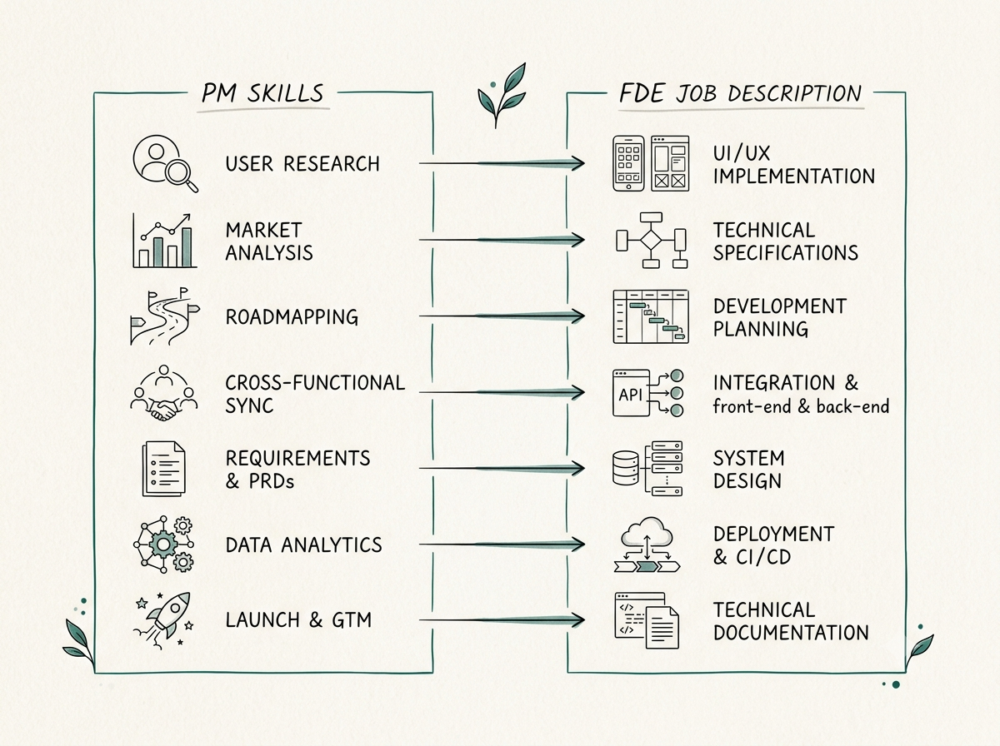
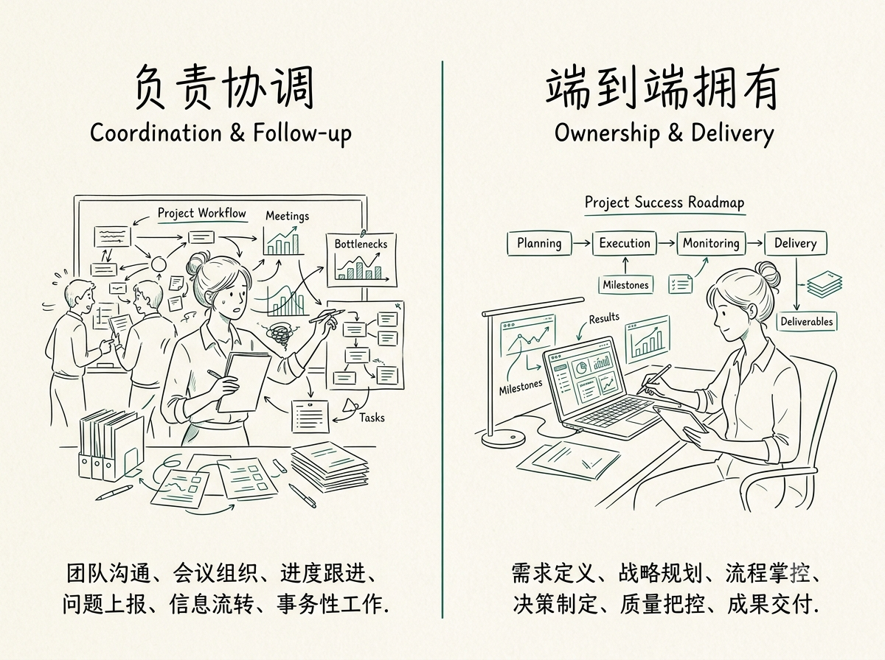

上一讲我们把真人弧线摊开看了：Kanav 从 Amazon SWE 三年跳到 24 岁的 Rippling 创始 FDE，Het 靠一篇部署博客被联创私信挖走。你可能已经发现，那几条弧线大多是工程师出身。那如果你是产品经理呢？

这一讲就回答一个问题：一个 PM 转 FDE，到底是短路还是绕远路。我先给你结论——你手里那半张牌特别好，另外半张得从头补，而且补的正是最硬的那块。别急，我会把这条路拆成"你已有什么、缺什么、90 天怎么补、简历怎么改、面试怎么讲"，一段一段过给你。


## 你的存量：一张别人羡慕的牌

先给结论：PM 转 FDE，最难的技能你天生就会一大半。

FDE 的招聘里，有一项占了 70% 以上 JD 的硬要求——客户面能力，也就是 requirements discovery 和 customer empathy。这恰恰是你每天在干的事。挖真需求、跟一堆干系人来回拉扯、把模糊的业务话翻译成能落地的方案、在资源有限时排优先级。这些不是你要学的东西，是你的肌肉记忆。

就像你已经会开手动挡，现在只是要学一辆结构更复杂的车。别人是连方向盘都没摸过。招聘方最怕的其实是"技术强但不会跟人打交道"的工程师，而你正好卡在他们的痛点上。

我给你把存量对齐到 JD 的语言，你感受一下这个匹配度：

```text
你的 PM 日常          →   FDE 的 JD 措辞
挖真需求              →   requirements discovery
跨部门拉齐            →   customer-facing / stakeholder management
把业务翻译成方案      →   scoping & problem decomposition
砍需求排优先级        →   ruthless prioritization under constraints
对结果负责            →   outcome ownership
```



看到没，这不是硬凑。FDE 面试里有个招牌题型叫 decomposition case study，Palantir 发明的，开场往往是一句开放的业务谜题——"我们为什么延误了这么多航班？"你作为 PM，做过用户访谈、写过 PRD，对"从一句模糊的话拆到可执行方案"这套动作再熟悉不过。很多工程师在这一关卡壳，你反而可能是全场最稳的。

所以第一件事不是焦虑短板，是先认清：你带着一张别人没有的牌进场。

## 你的缺口：从提需求的人，变成亲手交付的人

先给结论：你缺的不是"懂一点技术"，是"能亲手 ship 生产代码"。这两件事差着一整个身份。

传统 PM 的做法是这样：你发现问题、写清需求、把它交给工程团队，然后跟进排期、验收结果。你是提需求的人。FDE 反过来——没有那个"工程团队"接你的需求，客户现场就你一个人对着真实的生产环境。你得自己写代码、自己接系统、自己对线上跑起来的结果负责。

这就像你以前是餐厅里点菜、盯出品的经理，现在你得亲自进后厨掌勺。菜端上桌不好吃，赖不到别人头上。

Baseten 的 FDE 负责人说过一句很扎心的话，大意是"完全没有 AI 知识可能是个 red flag"。他还说，能进 FDE 团队的人，应该能进公司任何一个工程团队。这意味着技术水位不打折。你不能指望"我客户面强，技术就能放低要求"——这条路上没有这种交换。

那到底要补哪些硬东西？我按对你这个背景的紧迫程度排一下：

| 缺口 | 为什么最紧 | 目标水位 |
|---|---|---|
| Python 全栈 | 亲手写生产代码的地基 | 能独立交付一个后端 + 简易前端的 AI 应用 |
| AI 工程深度 | evals / MCP / agent 是 2026 硬门槛 | 会建 eval harness、亲手写一个 MCP server |
| 生产化交付 | FDE 只认"上线"不认 demo | 一个带监控和 runbook 的部署案例 |

[[FIG: pm-gap-stack | 三层缺口叠成一座塔：Python 打底、AI 工程居中、生产化封顶]]

这里我要给你一句最关键的心态转变。你的毕业标准不是"能听懂工程师说话"，而是"能和资深工程师平等对话"。平等，意思是你提得出技术方案、扛得住技术追问、对自己写的代码的边界心里有数。

你要成为的，是一个"用平台解决问题、亲手交付、并对结果负责的产品领导"。注意，产品视角没丢——它成了你的加分项，而不是你的舒适区。你比纯工程师更懂"这个功能到底为客户解决了什么"，但你现在还得会自己把它做出来。

看懵了也没关系，下一节我把这条补齐之路切成周，你照着走就行。

## 90 天怎么补：按周走的里程碑

先给结论：90 天不是让你变成十年老工程师，是让你攒齐三样证据——年限、customer-facing、production LLM experience。这三样凑齐，你的简历就成立了。

你的路径和纯工程师转型共用一条主干，差异只在一点：旗舰项目必须你自己从头写，不能找人代劳。因为你要补的恰恰是工程身份，代劳等于没补。

我把节奏按周给你排出来：

```text
第 1–2 周   Python 练到流利 + Claude Academy（原 Anthropic Academy）起步（Claude 101 → API）
第 3–4 周   端到端 RAG，用 pgvector 起步，把检索跑通
第 5–6 周   给上面的项目建 eval pipeline：错误分析 + 二元 judge
第 7–8 周   Agent + MCP：亲手写一个连真实系统的 MCP server
第 9–10 周  部署 + 监控：Docker 上云，配 tracing，写交接 runbook
第 11 周    作品集 README + 简历改写
第 12 周    面试冲刺：decomposition + agentic eval 设计题 + 8 个 STAR 故事
```

[[FIG: pm-90day-timeline | 12 周里程碑横轴，从 Python 起步到面试冲刺，每两周一个交付物]]

这里的顺序有讲究。evals 放在很前面不是偶然。Andrew Ng 说过，能不能做好 evals 和 error analysis，是能不能构建 agent 能力的最大预测因子。OpenAI 给 FDE 定的成功标准里，"eval-driven feedback"是三件套之一。所以你每个动手项目都必须带一个 eval harness，这是全图最重的技能点。

MCP 是另一个 2026 才冒出来的硬门槛。别被这个词唬住——本质就是给模型接一个能调用你系统的标准插头，你写过 API 就能上手。Anthropic 的 FDE 交付物 JD 里逐字写着"MCP servers, sub-agents, and agent skills"。你亲手写一个接进真实业务系统的 server，就直接对上了这句原文。

关于作品集，我给你两三个特别适合 PM 背景的选题，都能借上你的存量：

- 选题一：给一个你真正懂的垂直场景（你做过的行业最好）做端到端 agent 交付。走完 Discovery → Spec → Build → Evals → Deploy → 反哺一页纸。你的 PM 经历让 Discovery 和"反哺产品建议"这两头天然出彩。
- 选题二：检索光谱对比。同一份数据，实现"传统 RAG"和"agentic search"两版，用你自建的 eval harness 比忠实度和成本，写成一篇对比博客。一石三鸟：检索、evals、公开写作全占了。
- 选题三：spec-driven 交付。全程用 Claude Code 按你写的 spec 交付一个小工具，把"哪里 agent 失控、你怎么把它收敛回来"记录下来。你写 PRD 的功底在这里直接迁移成 spec writing。

记住一件事：作品集要给出 live URL 加 eval 指标。一个部署项目，招聘方 60 秒就能验证真假。这比任何证书都硬。

## 简历和"Why FDE"：把身份重讲一遍

先给结论：你的简历不能再用"负责协调"这种词，得换成"我亲手交付"。动词一变，身份就变了。

传统 PM 简历爱写"负责协调团队完成 X"。这句话在 FDE 眼里是减分的——它暴露你是提需求的人，不是交付的人。你要用 FDE 的动词库重写：embed、own、ship、codify、harden、operationalize。而且全部用"我"，不用"我们"，把功劳明确落到你头上。

我给你一个前后对比，你直接感受这个落差：

```text
改写前（PM 腔）
负责协调工程团队，推动某客户 AI 项目落地，提升了业务效率。

改写后（FDE 腔）
端到端拥有 X 客户的问题：自己做需求发现，亲手用 Claude + RAG
写出 PoC 并部署上线，搭 eval harness 把幻觉率从 A 降到 B，
再把一线洞察反哺回产品路线图。
```



看出差别了吗？前一句里你是个协调者，谁都能替换。后一句里，发现、交付、量化、反哺，四段全是你亲手做的，而且有 A 到 B 的数字。这就是"能和资深工程师平等对话"在简历上的样子。

数字很关键。A 降到 B 这种前后指标，是把你和"只会讲故事的 PM"区分开的东西。所以前面才让你每个项目都建 eval harness——它最后就变成简历上这一行有据可查的数字。

再说"Why FDE"这道必问题。别答"我想做更有挑战的工作"这种空话。你的黄金答法恰恰藏在你的背景里：

> 我做了 N 年 PM，最大的挫败是——我能看清客户要什么，却要隔着一个工程团队才能交付，中间信息一路衰减。FDE 让我把发现问题和亲手解决问题合成一个人。我补上了工程和 AI 深度，就是为了不再只是提需求，而是端到端对结果负责。

这个答法为什么好？它把你的"转型"讲成了"能力合体"，而不是"逃离"。招聘方听到的是一个既懂客户又能动手的人，正好是 FDE 最稀缺的那种。

最后给你一个备选入口，万一你评估下来觉得纯工程实在补不动。FDE 岗位名裂解成了大概六个变体，其中有个叫 Deployment Strategist，是偏业务、非纯工程的那一支。Salesforce 的 pod 制就是"1 个 Deployment Strategist + 2 个 FDE"，Palantir 内部的 Echo 角色也是业务侧。这条路对你的产品存量更友好，但说实话——技术缺口你早晚还是得补一部分，只是深度要求低一档。别把它当逃生舱，当成一个坐标系上的选项。

## 小结

PM 转 FDE，你的客户面能力是现成的强项，占了 70% JD 的硬要求。真正的缺口是亲手 ship 生产代码加 AI 工程深度，心态上要从提需求的人变成亲手交付、对结果负责的产品领导，毕业标准是能和资深工程师平等对话。90 天按周补齐 Python、evals、MCP、部署，旗舰项目必须你自己写。简历把"负责协调"换成"端到端拥有"，"Why FDE"讲成能力合体。实在补不动，Deployment Strategist 是备选入口。

## 思考题

回想你做 PM 时最想亲手交付、却卡在"得等工程排期"的那个需求——如果现在让你端到端拥有它，你最先需要补的技术缺口是哪一个，你打算用哪个作品集选题来补？欢迎在评论区聊聊你的想法。
