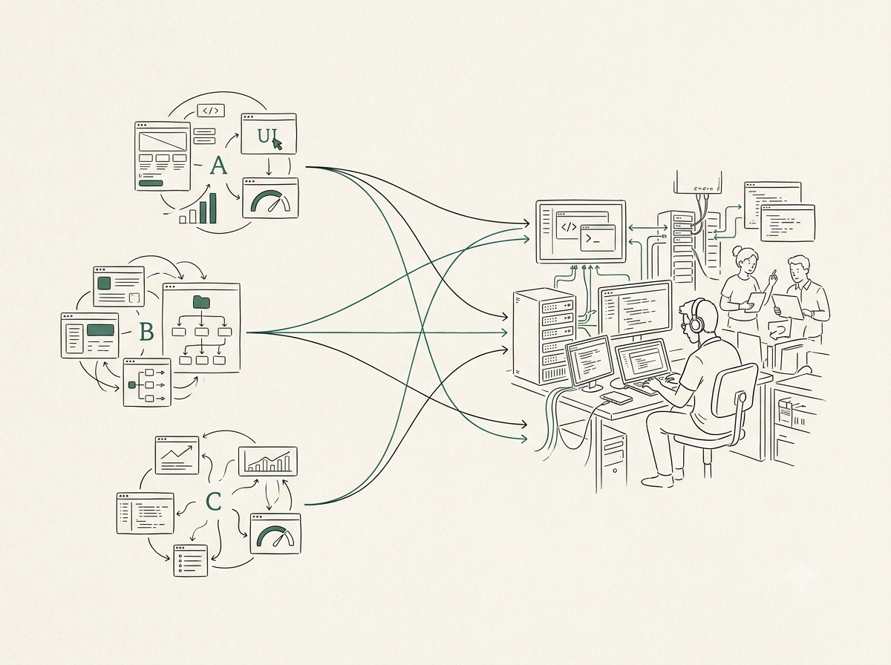
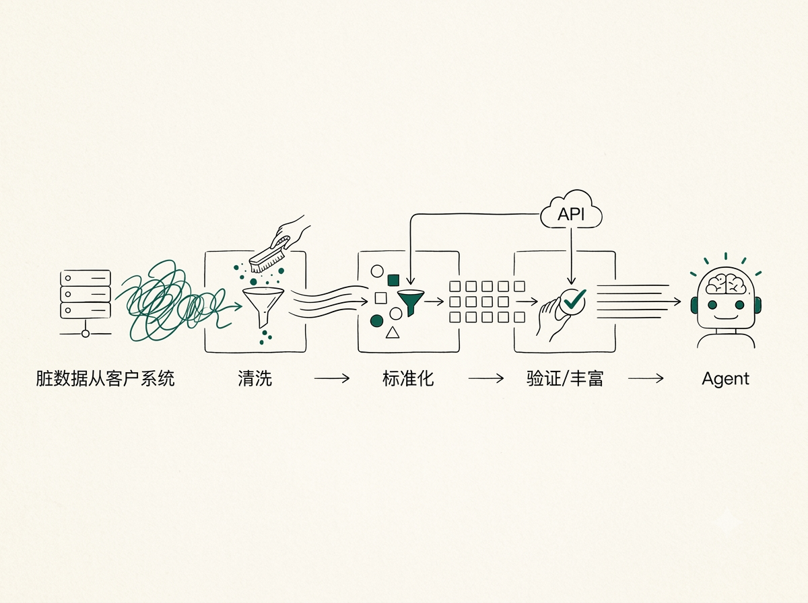
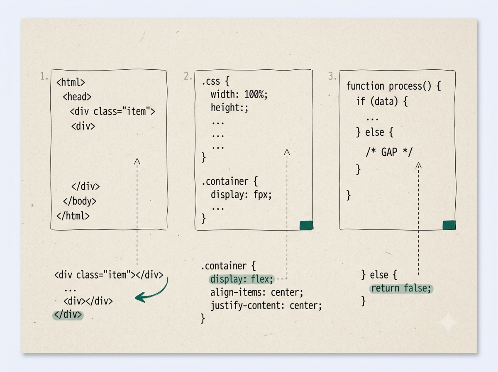
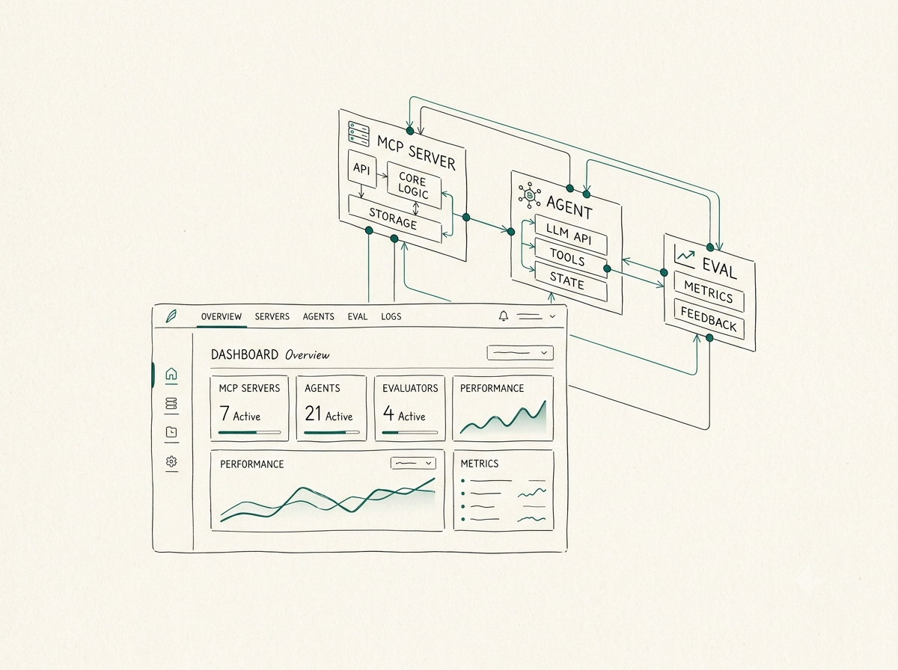
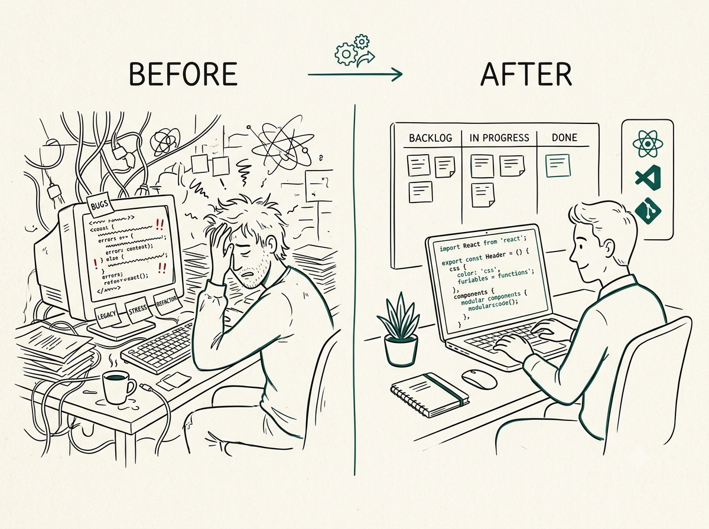

上一讲我们盘了产品经理这条路：需求发掘、跨干系人沟通、把模糊业务翻成方案，这些是 PM 的存量长板；缺口是亲手 ship 生产代码和 AI 工程深度，得先把工程身份补回来。这一讲我换个人跟你聊——如果你现在是前端工程师，你转 FDE 到底难在哪、爽在哪？

我知道很多前端心里有个疙瘩：AI 一来，切图、写页面这些活儿好像最先被替代。所以你想往上走、往客户那头走。问题是，FDE 招聘里满屏 Python、ETL、evals、MCP，你会觉得自己站错了队。

先给结论，你别慌：前端不是劣势，反而是这条路上少见的差异化底牌。这一讲就干一件事——把你手里的牌摊开，告诉你缺哪几张、按什么顺序补、最后怎么把简历改成招聘方一眼想聊的样子。

[[HERO: 一个前端工程师把自己做的运营 dashboard 投屏给客户，屏幕上跑着一个 agent，客户当场点头]]

## 你已经攥着的那张牌

先说长板，因为这决定你整条转型路怎么走。

FDE 的核心信条是一句话：不做 demo，直接写进客户生产环境的代码。你注意这个词——demo。前端工程师做 demo、做原型、做 UI，本来就是吃饭的手艺。招聘方最缺的恰恰是这个。

为什么？你去翻大厂 JD 会发现，FDE 交付的第一现场往往是"让客户当场信"。Cursor 的 JD 写得直白：先在几天内 ship 一个能跑的粗糙版本，再用几周把它硬化成可靠系统。这个"几天内的第一版"，前端做起来比后端快得多。你能把一个 agent 的输出，包成一个客户领导看得懂、点得动的界面。这就是价值。



说个你能对上的场景。这就像你去朋友家帮忙装修，别人还在纠结水管走线，你已经把样板间的效果图贴墙上了——客户要的信任感，你先给到了。FDE 现场最值钱的东西之一，就是这份"让人当场信"的能力。

具体到能力，你手里其实攥着三样：

- 自定义 dashboard：客户的运营台、监控面板、审批流界面，你能快速搭出来。
- UI 原型：把一个还没成型的 agent 工作流，先用界面讲清楚。
- demo 落地：把"能跑"和"好看、能用、敢给老板看"之间那段距离补上。

还有一样容易被你忽略——TypeScript。事实包里的数据很清楚：有一批 FDE 岗位直接把 TypeScript 当主语言。Vercel FDE 的 JD 原文就是 expert TypeScript，"this is your primary language"。这意味着什么？你不是从零开始学一门陌生语言去够门槛，你是带着母语进场。

所以第一个"你该做什么"很简单：别急着补短板。先把你做过的每一个 dashboard、每一个前端项目，重新用 FDE 的眼光过一遍，问自己一句——这个界面，如果背后接的是一个 agent，客户会不会天天用？这个视角，是你后面所有改造的地基。

## 三块缺口，别慌，一块一块补

长板盘完，说缺口。结论先行：你缺的不是"聪明"，是三块具体的、能一块一块补上的东西。

第一块，后端和数据工程。说白了就是 SQL、ETL、和写服务端逻辑。

为什么这块躲不掉？因为 FDE 干的活，一大半是跟客户的真实脏数据打交道。事实包里那个川宁生物的案例特别典型——FDE 在发酵罐旁边驻场九个月，干的就是数据重录入、参数校正、把老师傅的经验数字化。Snowflake 的 JD 甚至把离场标准写成一句金句：你走的时候，客户的数据得是"structured, trusted, and agent-ready"。

翻译成人话：数据得先被你洗干净、理顺、喂得进 agent。这活儿前端平时不碰，但它不难，只是你没练过。



第二块，LLM 系统。就是怎么调模型、集成 API、把一个 AI 功能真正 ship 上线。这块我们下面单独给你一条六周路线，先按下不表。

第三块，面客业务发现。就是坐到客户对面，问出他真正的问题，而不是他嘴上说的需求。

这块前端普遍偏弱，因为前端离客户远。传统做法里，需求是产品经理嚼碎了喂给你的；FDE 反过来，你得自己去客户现场，把模糊的业务谜题挖成能做的方案。Palantir 的项目甚至直接以一个开放问题开场，比如"我们为什么延误了这么多航班"。你得有本事从这种问题里，拆出第一步该建什么。



看懵了也没关系，这里你只需要记住一个判断：三块缺口里，后端数据是"体力活"，练就会；面客发现是"心态活"，得逼自己走出去；而 LLM 系统是"新手艺"，有现成的路线可抄。没有一块是天赋门槛。

对比一下你就踏实了。传统前端的成长是往框架深处钻——React 更熟、性能更极致、动画更丝滑。FDE 要的是横向铺开：会一点后端、拎得清数据、聊得动客户、跑得通模型。前者是把一口井打深，后者是先把几口井都打通水。你转的不是"更高级的前端"，是换了个打法。

## 六周 LLM 路线，加上数据和云的补丁

这是最实操的一节。结论先给你：LLM 这块，六周足够你从"没碰过"到"ship 过一个 AI 功能"。别被那些黑话吓住。

先拆六周的主线，三段，每两周一段：

第一段（1–2 周）：prompt 与模型基础。走 Anthropic Academy 的免费带证书路线，从 Claude 101 到 Building with the Claude API。这一段你要拿到的不是知识，是手感——能让模型稳定地按你要的格式输出。

第二段（3–4 周）：API 集成。把模型接进你熟悉的前端应用里。这一步对你其实最轻松，因为调 API、处理流式返回、管状态，本来就是前端的日常。

别急，MCP 这个词听着唬人，本质就是给模型接一个能调你系统的插头。事实包里说得很清楚：你写过 REST API 就能上手 MCP server。它现在是 2026 的硬门槛之一，Anthropic 直接把"MCP servers、sub-agents、agent skills"写进了交付物原文。你早点碰它，简历上就多一张别人没有的牌。

第三段（5–6 周）：ship 一个真的 AI 功能。不是 demo，是能跑、有 eval、敢给人看的东西。

这里我要单独拎出来讲 evals，因为它是全图最重的技能点。Andrew Ng 有句话你记一下：能不能做好 evals 和 error analysis，是能不能构建 agent 的最大预测因子。

[[FIG: six-week-llm | 六周 LLM 路线的三段主线与每段的产出物]]

evals 是什么？就像你写前端时的那套测试——但对象是模型的输出质量。看懵了也没关系，先记结论：evals 是把"demo"和"能上线"分开的那道线。免费入门走 Braintrust Evals Foundations，大概一小时；再配 Hamel 的《Evals FAQ》。方法上记两条：先做 error analysis 再谈别的；LLM 当裁判时用二元 pass/fail，别用打分。

六周主线之外，你还得打两个补丁，跟主线并行、不用额外排期：

**SQL / ETL 补丁**。目标不是成为数据工程师，是能独立把一批客户的脏数据，清洗成能喂进 agent 的样子。pgvector 起步就够。你练的产出物是：拿一份真实的、乱七八糟的表，跑通一条"读取→清洗→入库→被检索"的链路。

**云与部署补丁**。目标是能把你的 AI 功能装进 Docker、推上云、加一个最简单的监控。前端平时部署静态站点，这里你要多学的是让一个带状态的服务在云上稳定跑起来，并且能被人接手。

下面这段极简的伪代码，就是你六周结束时该能徒手写出来的骨架——一个带工具调用和最小 eval 的 agent 循环：

```python
# 一个最小 agent 循环:接收问题 → 决定调哪个工具 → 汇总答复
def run_agent(question: str) -> str:
    context = retrieve(question)          # 检索层:agent 的记忆
    plan = model.plan(question, context)  # 让模型决定调用哪些 tool
    results = [call_tool(step) for step in plan.tool_calls]  # ≥2 个 tool call
    return model.answer(question, context, results)

# 最小 eval:二元 pass/fail,而不是打分
def evaluate(cases: list) -> float:
    passed = sum(1 for c in cases if judge(run_agent(c.q), c.expected))
    return passed / len(cases)   # 这个数字,就是你简历上的"上线指标"
```

看不懂每一行没关系，你只要记住结构：检索、规划、调工具、答复，外加一个能算出通过率的 eval。这套骨架，就是你后面作品集的心脏。

现在把六周路线和三个补丁拼进 90 天，给你一个可以照抄的节奏：

| 阶段 | 时间 | 你要做完的事 | 拿到的证据 |
|---|---|---|---|
| 起步 | 第 1–30 天 | Anthropic Academy 证书链 + Braintrust evals 入门 + 第一篇技术博客 | 免费证书串 + 一篇公开写作 |
| 攻坚 | 第 31–60 天 | 旗舰作品集:带前端 dashboard 的 Agentic RAG + eval harness + tracing | 一个 live URL + 前后指标表 |
| 冲刺 | 第 61–90 天 | 第二个差异化项目 + 简历改写 + 面试题演练 + 开始投递 | 3–5 篇博客 + 分层投递清单 |

[[FIG: ninety-day-timeline | 前端版 90 天转型节奏:三阶段各自的里程碑与证据]]

记住一条贯穿始终的原则：作品集里带 live URL 和 eval 指标，胜过任何证书。事实包里那句话很硬——一个部署项目，60 秒就能被验证。

## 把前端优势变成差异化：作品集、简历、入口

最后一节讲怎么把前面的东西，变成招聘方看得见的东西。结论先行：你的差异化不在"我也会后端了"，而在"我的 agent 有一个别人都没有的、精美的前端"。

先说旗舰作品集。选题我直接给你——带前端 dashboard 的 Agentic RAG。

为什么是它？因为它一口气把你的长板和补齐的短板全秀出来。后端有你亲手写的 MCP server、至少两个 tool call、guardrails、清洗真实脏数据的 ETL；中间有 agentic 的检索层和一套完整的 eval harness；而最外面那层——那个让客户当场信的运营 dashboard——是别的转型者做不出来的。

这就像一群人都在比谁的引擎更强，你把引擎调到及格线，然后给这台车配了一个所有人里最好看的驾驶舱。客户和面试官，都是会先看驾驶舱的人。



作品集的完整交付清单，你照着走一遍：

- Discovery：用《The Mom Test》的问法，做一次真实的客户访谈和 scoping。
- Spec：写一份可执行的 spec 加 AGENTS.md。
- Build：agent 应用，含亲手写的 MCP server、≥2 tool call、guardrails、清洗脏数据的 ETL。
- Evals：20+ 测试集、二元 rubric、100 条标注对齐的 judge、一张前后指标对比表。
- Deploy：Docker + 云 + 监控 + runbook。
- 前端差异化：把上面这一切，包进一个你引以为傲的 dashboard，给一个 live URL。

再说简历改写，这是转化率最高的一步。

传统前端简历怎么写？"用 React 做后台管理系统"。招聘方一扫而过，因为这句话里没有一个 FDE 关心的词。

FDE 版怎么写？我给你一个改写示范，你体会这个落差：

> 给客户做 agent 驱动的运营台：前端我扛，后端是我写的、带 2 个 tool call 的 agent + RAG + eval，上线后客户天天在用。

你看差别在哪。前者只有"技术+页面"；后者有客户、有 own、有生产、有 agent、有 eval、有"天天被用"。事实包里那套 JD 动词库你直接抄：embed、own、ship、codify、harden、operationalize、white-glove。还有一条铁律——全程用 'I'，不用 'we'。FDE 要的是能独立扛下一个客户的人。



最后说入口，这里我得对你诚实，好坏都讲。

对前端最天然的入口是 Vercel FDE。它把 TypeScript 当主语言，绑 Next.js 和 AI SDK，薪资档 $137–207K。TS 是你母语，这条路进场摩擦最小。

但有两个坑我必须跟你点明，别到时候怪我没说：

第一，这类岗明确含 pre-sales 成分。事实包写得很直白，Vercel FDE 的 JD 明确含 pre-sales。这意味着它不是纯交付岗，会掺一部分售前的活儿。你得想清楚，自己是不是接受这个混合形态。

第二，平台绑定风险。你的技能会被锁进一个特定平台的栈里——Next.js、AI SDK 这些。爽的地方是上手快、匹配度高；风险是万一你哪天想换赛道，这套平台专属技能的可迁移性要打折。

所以我的建议是：把 Vercel 型入口当作"最短起跑线"，而不是"唯一目的地"。进场之后，有意识地补通用栈——多写点 Python、多碰不绑平台的 agent 框架，让自己随时能横跳到模型通用型的岗位去。

下一讲，我们聊技术底子最厚的那一批人——后端、数据、ML 工程师怎么转 FDE，他们的长板和你正好互补。

## 小结

前端转 FDE，长板是做 dashboard、UI 原型、demo 落地的能力，还有 TypeScript 这门 FDE 母语。缺口是后端数据工程、LLM 系统、面客业务发现三块，一块一块补就行。六周 LLM 路线走 prompt 到 API 集成再到 ship AI 功能，并行打上 SQL/ETL 和云部署两个补丁。旗舰作品集选带精美前端 dashboard 的 Agentic RAG，把前端优势变成别人复制不了的差异化。入口首选 Vercel FDE，但记住它含 pre-sales 成分、有平台绑定风险。

## 思考题

翻出你做过的一个前端项目——任意一个 dashboard 或后台系统都行。如果要把它改造成一个"带 agent 的运营台"，你会给它接上哪一个能真正帮客户省时间的 tool call？把这个改造想清楚，它可能就是你旗舰作品集的雏形。欢迎在评论区聊聊你的想法。
