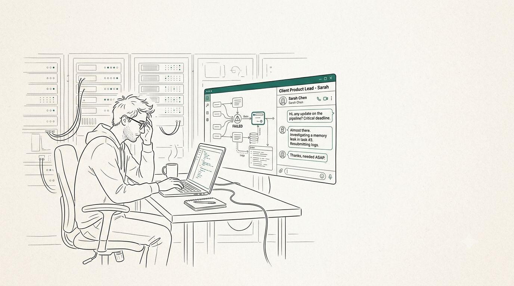
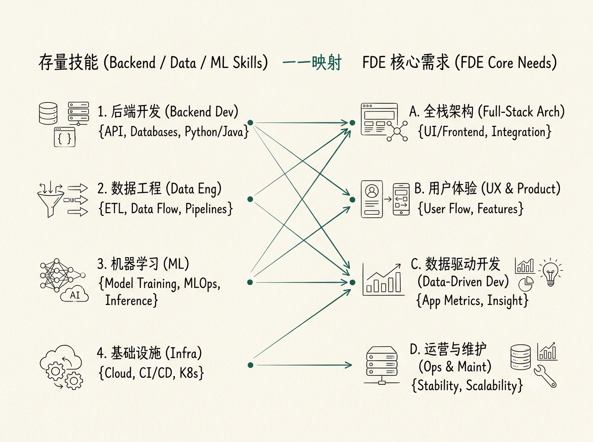
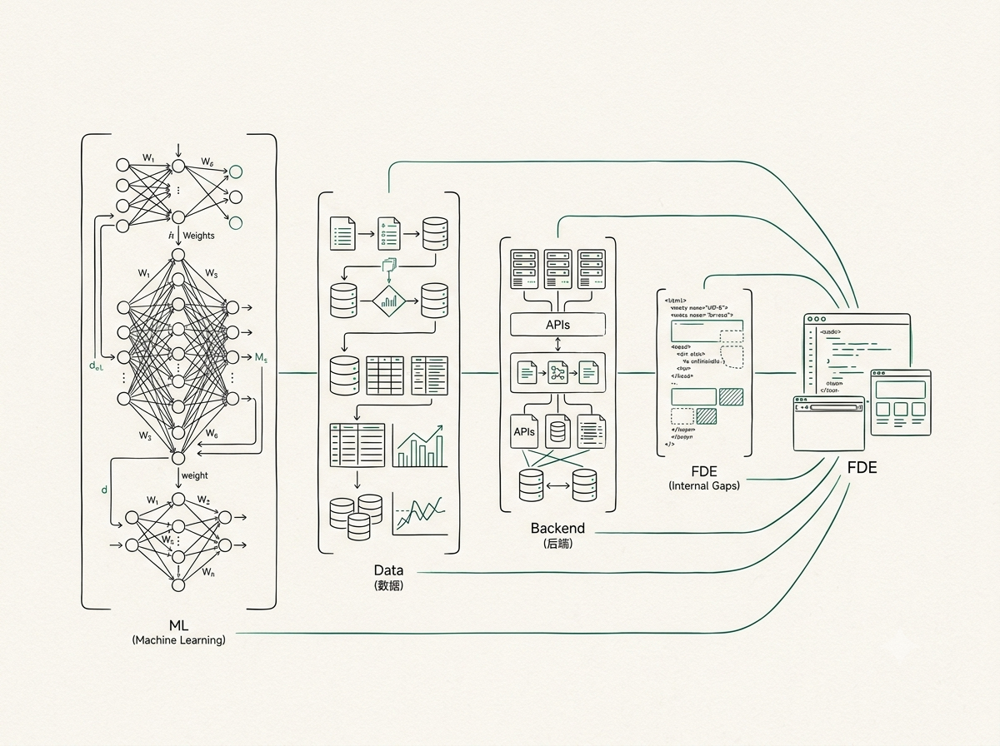
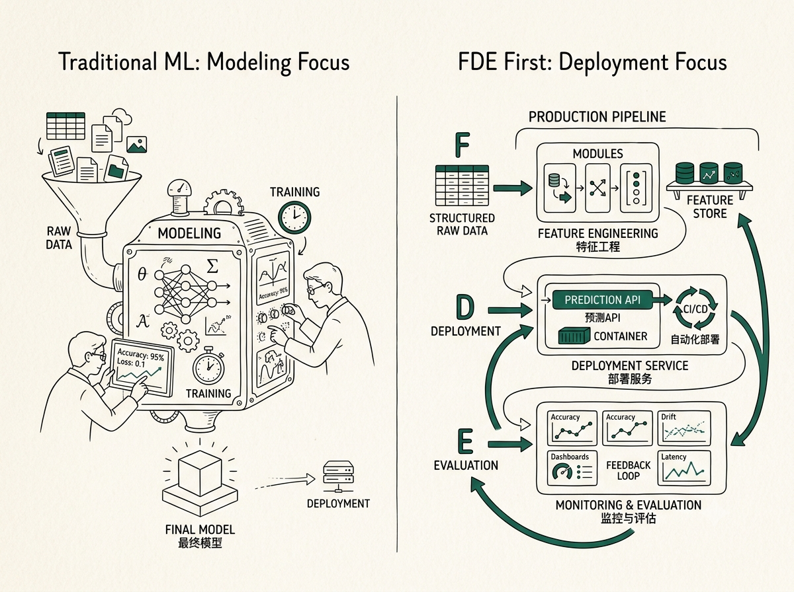
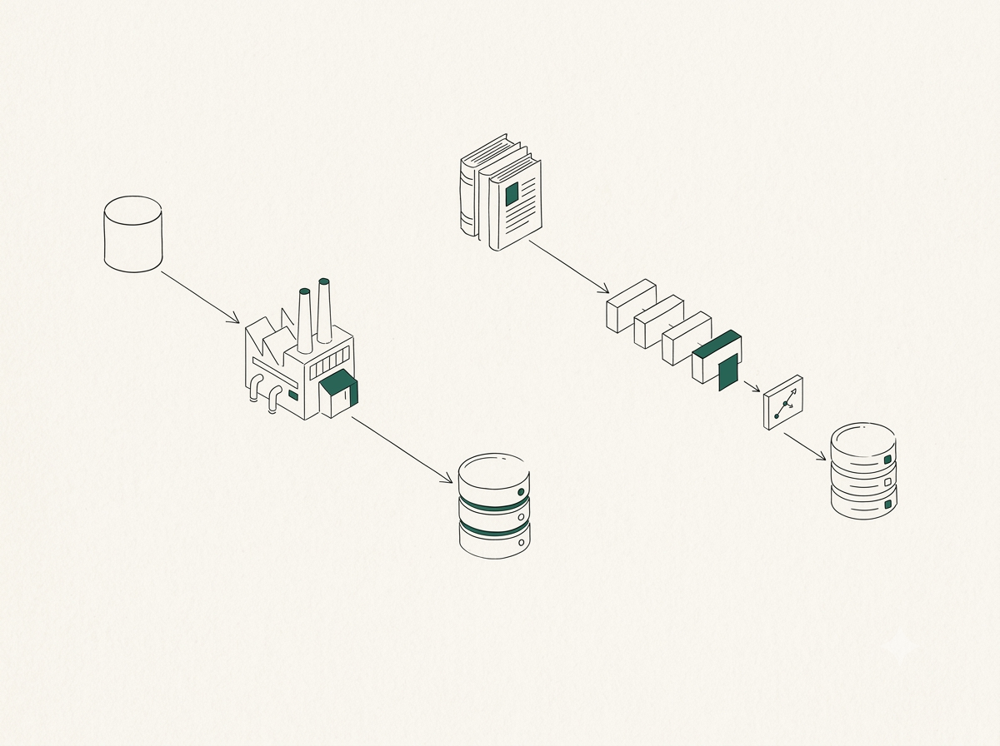

上一讲我们盘了前端工程师的牌：自定义 dashboard、UI 原型、demo 落地是天然强项，缺的是后端数据工程和 LLM 那一块。这一讲轮到你了——如果你是写后端、搭数据管道、或者调 ML 模型出身的，情况正好反过来。你缺的东西前端有，前端缺的东西你手里攥着一大把。

那么问题来了：你天天写 ETL、调 SQL、在分布式系统里追 bug，这些跟 FDE 到底有多大关系？转过去要补什么、要扔掉什么？这一讲我把话说白：你离 FDE 比你以为的近，但近的方向可能和你想的不一样。先记结论，后面一层层拆。



## 你手里已经有半张 FDE 牌

先给判断：后端/数据/ML 背景，是四条转型路径里技术存量最厚的一条。你不用从零补工程身份，很多"FDE 的活"你其实已经在干了。

看一眼 Palantir 的 FDSE（他们内部叫 Delta）。这个岗位横跨什么？数据工程、AI、应用开发三域一把抓。Databricks 的 FDE JD 写得更直白，一句话点名：你要 own 的系统"spanning data engineering, AI, and application development"。这三个域里，头两个半你早就在里面泡着了。

我们把你的存量摊开对一下 FDE 的核心需求：

| 你现在的技能 | 在 FDE 里对应什么 | JD 里的原话痕迹 |
|---|---|---|
| ETL / 数据清洗 | 客户数据永远是脏的，清洗是部署第一道坎 | Snowflake："data … structured, trusted, and agent-ready" |
| SQL / 数据建模 | 把客户业务翻译成可查询的结构 | Databricks："own the architecture … data engineering" |
| 云基建 / Docker / K8s | agent 要真上生产，不是跑在你笔记本上 | Cursor："not just prototypes … running in production" |
| 分布式系统调试 | 客户现场一半时间在追"为什么这条跑挂了" | Palantir："increasing your pain threshold" |



说个你能对上的场景。你第一次帮客户接一个 RAG 系统，发现他们的"知识库"是三百个格式各异的 Excel、几万条没有主键的工单、还有一个字段名全是拼音缩写的老数据库。这时候前端同学会看懵，而你会条件反射地打开终端开始写清洗脚本——这就是你的护城河。文档写的和现实对不上的那道缝，恰恰是数据工程师最熟的地方。

还有一类人存量更满：创业早期的全栈工程师。如果你在一个五六个人的小公司干过，需求你定、后端你写、数据库你建、上线你部署、客户投诉也是你接——那你其实已经在做 FDE 的活了，只是没这个头衔。Palantir 官方那句最出名的类比就是给你准备的："your responsibilities look similar to those of a startup CTO"。小团队、极少监督、端到端 own。你要是当过那个"什么都得管"的人，这句话读起来会特别亲切。

[[FIG:startup-cto-analogy | 早期全栈工程师的日常职责与 FDE "像客户的 startup CTO" 的重叠圈]]

所以第一个"你该做什么"：别急着报班从头学。先拿张纸，把你过去三年真正 own 过的系统列出来——哪些是你从数据源头一路搭到上线的。那张清单就是你简历改写的原材料，这一讲最后我们会用到它。

## 缺口在人不在机器

先给判断：你要补的短板，几乎全在"人"这一侧，不在技术这一侧。别再往下卷技术深度了，那是你最容易掉进去的坑。

我把后端/数据/ML 转 FDE 最常见的四个缺口列出来，从大到小：

**第一，客户沟通和需求发现。** 这是 70%+ 的 FDE JD 都在要求的东西——customer empathy、requirements discovery。你习惯了拿到一份写好的需求文档再开工，FDE 没有这份文档。客户只会甩给你一句"我们想用 AI 提效"，剩下的全靠你问出来。

传统做法是：客户提需求 → 你评估工期 → 排期开发 → 交付验收。FDE 反过来：你坐进客户的会议室，把"提效"这个模糊的词一层层剥，剥到"你们采购部每天花四小时手工核对三个系统的价格差异"这种具体到能写代码的真问题。这个动作有个现成的方法论叫 The Mom Test，三条原则你先记住：谈客户的生活而不是你的方案、问过去具体发生过的事、少说多听。

[[FIG:requirement-peeling | 从"想用 AI 提效"到"每天四小时手工核价"的需求剥层漏斗]]

**第二，产品 sense 和范围谈判——核心是学会说不。** 这条最反工程师直觉。你被训练成"需求来了就实现"，但 FDE 最值钱的能力之一是判断哪些需求不该做、这个 pilot 的边界画在哪。客户什么都想要，你全答应，结果就是 Barry 那句著名的形容——pilot 毛利"literally negative infinity"，最后交付出一堆"burnt-out husks of FDEs"。会说不，是保护你自己，也是保护这单生意。

就像你去餐厅点菜，好厨子会告诉你"这两道一起点口味会打架，减一道"，而不是你说什么他做什么。FDE 就是那个会拦你的厨子。

**第三，演示与叙事。** 你能把系统跑通，但能不能在客户高管面前用三句话讲清楚"它省了你们多少钱"？数据/后端出身的人常常代码写得漂亮，一开口就掉进技术细节里。客户不关心你用了 ReAct 还是 plan-and-execute，他们关心良率从 88% 到了 97%、年增收多少。

**第四，evals 方法论。** 这条一半是技术一半是思维。你会跑指标，但 FDE 的 evals 不是刷个 benchmark 分数，是给每个客户单独建一套 harness。Harvey 的 JD 原话："Build and maintain evals & harnesses that capture real-world quality on a client-by-client basis"。error analysis 优先于 LLM judge，judge 用二元 pass/fail 不用 Likert——这套后面专门有讲，这里你先有个印象。



说完缺口，说一个更重要的反直觉，专门给 ML 背景的你：**别再卷传统 ML 建模了。**

我知道这话可能扎心。你花了好几年练特征工程、调超参、读论文复现 SOTA。但 2026 年招 FDE 的公司，要的不是你能把 AUC 再抠高 0.5 个点。他们要的是你能把一个 LLM 或 agent 系统，从"demo 能跑"推到"客户生产环境里天天有人用、出了问题你顶得住"。

对比一下就清楚了。传统 ML 岗位：给定数据集，优化一个模型指标，离线评估达标即交付。FDE：客户给你一堆脏数据和一个模糊业务目标，你要选模型、写 MCP server 接他们的系统、编排 agent、建 eval、上生产、还要写 runbook 让客户走了之后自己能维护。前者是"把一个模型做到最好"，后者是"把一个能用的系统交到客户手里并且它不塌"。



所以给 ML 背景的你的"该做什么"：把你调模型的那股钻劲，转到 evals 和 error analysis 上去。Andrew Ng 有句话值得你贴在显示器上——evals 与 error analysis 是构建 agent 能力的最大预测因子。你的 ML 直觉在这里不是白费，是换了个战场继续打。别急，你那套"看数据找问题"的本能，正是做 error analysis 需要的。

## 90 天：把数据肌肉搬到 agent 管线

先给判断：你的 90 天转型，重点不是从零学新东西，而是把已有的数据工程肌肉，平移到 chunking/embedding 这类 AI 管线上，同时逼自己主动接一个真正面客的活。

这条路径和别人共用同一个 90 天主干（Anthropic Academy 证书链 → 旗舰项目 → 面试冲刺），差异在于你补短板的重心和你能抄的近道。我按三段给你拆。

**第 1–30 天：起步，同时把数据优势变现。**

Anthropic Academy 那条免费证书链先走起来：Claude 101 → Building with the Claude API → MCP 入门/进阶 → Agent Skills/Subagents → Claude Code。配上免费的 Braintrust Evals Foundations（大概一小时）。这些对你不难，你的编码底子会让你走得比别人快。

关键动作在这里：当别人在学"怎么搭一条 RAG 管线"时，你要意识到 chunking → embedding → 向量存储 → 检索，这套东西的骨架和你天天写的 ETL 几乎一模一样。

就像你之前搭一条数据管道：抽取源数据、清洗、转换、写进数仓、建索引供查询。RAG 管线换汤不换药：

```python
# 你熟悉的 ETL 骨架
def etl_pipeline(source):
    raw = extract(source)          # 抽取
    clean = transform(raw)         # 清洗转换
    load_to_warehouse(clean)       # 入库
    build_index(clean)             # 建索引

# 换个名字就是 RAG 的 ingestion 管线
def rag_ingestion(documents):
    raw = load_documents(documents)      # 抽取
    chunks = chunk_and_clean(raw)        # 清洗 + 切块
    vectors = embed(chunks)              # 转换成向量
    upsert_to_vectorstore(vectors)       # 入向量库
```

看出来了吗？`chunk_and_clean` 这一步——切块策略、去重、处理脏数据、保留元数据——就是你最擅长的数据清洗，只是产物从行列变成了 chunk。你在这一步能做的精细度，是前端同学短期追不上的。这是你的第一个杠杆点。



**第 31–60 天：旗舰作品集，往"数据密集"的方向选题。**

作品集别选那种玩具级的聊天机器人。你的差异化优势是数据，就选一个数据密集、要真集成的场景：制造业的设备工单、金融的对账、政务的表单核验都行。跟着 Harvey 的工作流原话走——"Design → prototype → productionize"——完整交付这么一套：

- **自己手写一个 MCP server**，去连那个场景里真实的系统或数据库。别用现成的，亲手写。这是 2026 年的硬门槛，Anthropic 直接把"MCP servers, sub-agents, and agent skills"写进了交付物清单。
- **一条清洗真实脏数据的 ETL**，喂给 agent。这块你闭着眼睛都能做得比别人漂亮，一定要突出。
- **agent 应用**：至少两个 tool call、加 guardrails，用 Claude Agent SDK 编排。
- **一套 eval harness**：20+ 测试集、二元 rubric、拿 100 条标注对齐一个 LLM judge、附一张前后指标对比表。
- **部署**：Docker + 云 + 监控 + 一份 runbook。
- **反哺一页纸**：把你从这个场景里挖到的洞察，写成给产品团队的一页建议。

[[FIG:flagship-portfolio | 数据密集型旗舰作品集的六个交付件，突出 ETL 与 MCP 两块存量优势]]

**第 61–90 天：补人的短板 + 主动接一个面客项目。**

技术件你都能搞定，这 30 天要逼自己做最不舒服的事：面对真人。最好的办法是主动去接一个真实的面客项目——你司内部的、朋友创业公司的、甚至开源社区的都行。哪怕免费，你要的是那种"直接对着一个真实的人把需求剥出来、交付、再被挑刺"的经历。Kanav 转型时说，最难的两关就是 context switching 和直面客户建立信任——这两关只能靠真刀真枪过，看书没用。

面试准备上，用咨询行业的 case 题练"快速诊断 → 澄清式提问 → 行动计划"，这是 Kanav 验证过的转型者近道。再准备好应对 2026 的新题型：agentic eval 设计题（比如"为物流改线 agent 设计 eval suite，保证 99% 送达率且不超支"）。

最后是简历改写，这是把你所有存量兑现成 offer 的临门一脚。

传统简历你会这么写：

> 负责维护数据管道，进行模型训练与调优，优化 SQL 查询性能。

这三句话在 FDE 招聘官眼里几乎没有信号——它讲的是任务，不是 ownership，更没提客户。改写成 FDE 的语言：

> 像每个客户的 startup CTO 一样端到端 own 项目：从坐进客户会议把需求剥到真问题、做数据集成、定架构，到自定义开发和生产部署全栈负责，并在交接后留下可维护的系统。

[[FIG:resume-rewrite | 简历改写前后对照：从"维护管道/训练模型"到"像客户的 startup CTO 全栈 own"]]

注意几个改写要点：全程用 "I" 不用 "we"；动词换成 JD 里的那批——embed、own、ship、harden、operationalize；把每段经历硬套进那个万能句式：年限 + customer-facing + production LLM experience。你那张第一节列的"我 own 过的系统"清单，现在就派上用场了。

还有个预期修正你得知道：别觉得非要五年经验才够格。Google FDE I、Scale AI、Harvey Founding FDE 都只要两年，微软 IC3 也是两年档。Kanav 24 岁、毕业才三年就进了 Rippling 创始 FDE 团队。国内的话，投云厂商和应用服务商（腾讯云那个"AI 前线部署工程师 FDE"就是 35–65K×15 薪），别去投 DeepSeek、月之暗面这类模型研究公司——它们不设 FDE 岗。

## 小结

后端/数据/ML 是四条转型路径里技术存量最厚的一条：你的 ETL、SQL、云基建、分布式调试，正好是 Palantir 数据流 FDE 的核心，早期全栈工程师更是已经在做 FDE 的活。缺口几乎全在人这侧：客户沟通、需求发现、产品 sense、会说不。给 ML 背景的最大反直觉是别再卷传统建模，把钻劲转到 evals 上，把 LLM/agent 真正推进生产。90 天里，把数据肌肉平移到 chunking/embedding 管线，做一个数据密集型的旗舰作品集，主动接一个面客项目，最后按 JD 语言把简历从"维护管道"改写成"像客户的 startup CTO 全栈 own"。下一讲我们换一批人聊——如果你是售前、解决方案或顾问出身，你的客户面能力天生达标，缺的恰好是你羡慕数据同学的那块：把 demo 变成能上生产的代码。

## 思考题

回想你过去三年真正端到端 own 过的一个系统——从数据源头一路搭到上线的那种。如果现在要把它改写成一句 FDE 简历，你会怎么用"I + own + production + 面客"这四个要素重新描述它，其中最难补齐的是哪一块？欢迎在评论区聊聊你的想法。
