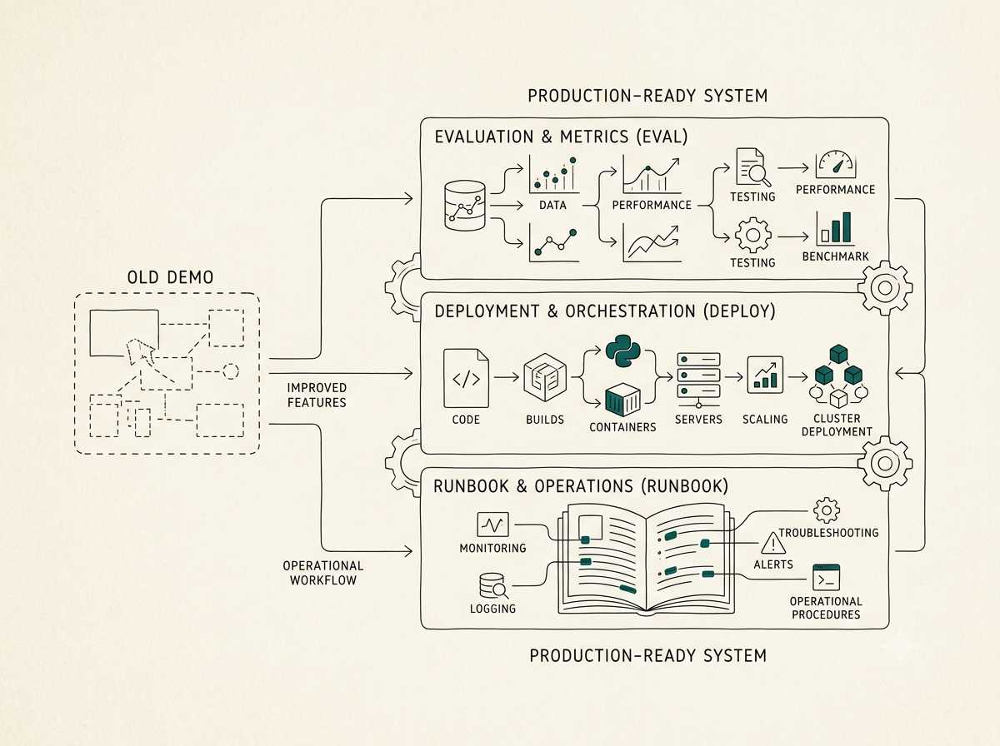

上一讲我们聊了后端、数据、ML 出身的人怎么转 FDE。那一群人的存量是数据管道、SQL、云基建、分布式调试——正好卡在 Palantir 数据流的核心;有些创业早期的全栈工程师，其实早就在干 FDE 的活，只是没这个名字。这一讲换一批人:你做过售前、解决方案架构师、或者咨询顾问。

那问题来了:你天天见客户、天天讲方案、天天做 demo，这些跟 FDE 到底差多少?你是离 FDE 最近的人，还是最容易被误认成 FDE 的人?这两个判断天差地别，选错了方向就白折腾。

先给你结论:你离终点线其实只差一段，但那一段恰恰是最难的。这一讲我把你的长板和缺口摊开讲清楚，再给你一套能立刻上手的 90 天动作。

[[HERO: 一个解决方案架构师站在客户会议室，白板上画满架构图，但客户问"这东西什么时候能真上线"时，他愣了一下]]

## 你的存量:离 FDE 最近的一拨人

先说好消息。在所有转型路径里，你的起点几乎是最靠前的。

为什么?打开任何一份 FDE 的招聘要求，排在最前面的两条硬需求是什么?一是客户面能力，empathy 加 requirements discovery，70% 以上的 JD 都写着;二是系统设计和技术选型。这两样，恰恰是你每天在干的活。

传统工程师转 FDE，最怕的一关是"直面客户建立信任"。上一讲提到的 Kanav，Amazon 出身的工程师，他说自己转型最难的两关，一个是 context switching，另一个就是直面客户。可这一关，对你根本不是关——你早就跨过去了。

我给你拆一下你手里攥着的牌:

| 你现在在做的事 | FDE 招聘要求里对应的项 | 权重 |
|---|---|---|
| 客户需求发掘、澄清式提问 | customer empathy / requirements discovery | ▲ 70%+ JD 明写 |
| 画架构图、定技术选型 | 系统设计能力 | 恒定硬需求 |
| 在客户面前把方案讲清楚 | 客户可信度、危机沟通 | 行为面直接考 |
| 见过几十种行业的真实系统 | 企业系统集成的现场感 | ▲ 上升 |

这就像你要考驾照，别人还在背交规、认离合，你已经能把车开上路了——只是还没在高架和暴雨里独立跑过长途。

[[FIG: presales-existing-stock | 售前/顾问的四项存量，直接对应 FDE 招聘要求的前排硬需求]]

而且招聘方是明着认这份账的。看 Deloitte 那批平台绑定的 FDE 岗，任职资格里 consulting experience 是被写进去的加分项。咨询、解决方案的背景在这条路上不是包袱，是敲门砖。frontier lab 那边也一样——OpenAI 的 JD 写"Former founder"是加分，Anthropic 写"Former technical founders are also encouraged to apply"，它们要的就是那种能跟 C-level 平视对话、能在混乱里定方向的人。你干售前顾问这些年练的，正是这个。

所以第一件"你该做什么":别急着自卑补短板。先把过去三年最硬的三个客户项目翻出来，按"诊断 → 定界 → 交付 → 量化"重写成三个 STAR 故事。这是你面试时最锋利的武器，先磨好它。

## 你的缺口:从"卖愿景"到"坏了是你的问题"

好消息讲完，说真话。你的缺口不多，但每一条都硬，绕不过去。

缺口就两个字能概括:**所有权**。再展开是两层——编码强度，和生产所有权。

先看编码强度。招聘方对 FDE 的编码要求是从 moderate 抬到 high 的。注意这个词:high，不是 moderate。你做售前 demo 时写的代码，目标是"当场让客户信"，能跑通、演示效果炸裂就够了，跑完这个 demo 就可以扔。可 FDE 交付的东西不能扔。

我给你翻译一下 Cursor 那句筛人的 JD 原文，它几乎是给你这类人量身写的:"You've built and owned AI-native workflows in production, not just prototypes."——你得在生产环境里建过、并且 own 过 AI 工作流，不是只做原型。它还补一刀:"These aren't prototypes."

看懵了也没关系，我用一个对比把这道缝画出来:

| 维度 | 你现在的售前 demo | FDE 的生产交付 |
|---|---|---|
| 目标 | 当场让客户信、赢单 | 进客户真实生产环境、持续被用 |
| 代码寿命 | 演示完可抛弃 | 要活几个月甚至几年 |
| 质量线 | 效果好看即可 | 带测试、eval、监控、可回滚 |
| 出事了谁负责 | 没人，反正是 demo | **坏了是你的问题** |
| 计酬方式 | 按 bookings / quota | 按成功的生产部署 |

[[FIG: demo-vs-production | 可抛弃 demo 与生产交付的五维对比，缺口集中在右列]]

这就是第二层缺口:生产所有权。Harvey 那份 JD 把 FDE 的完整工作流写成一句话，你把它背下来:"Design → prototype → productionize"，设计、做原型、然后产品化。你现在只走到 prototype 就交给别人了。FDE 要自己把它 productionize，再"harden them for reliability, observability, and scale"——为可靠性、可观测性和规模去加固它。

加固之后还没完。生产所有权最扎心的部分，是 on-call 和事故响应。Het Trivedi 有句话我特别喜欢，他说 FDE 是"You're the one they call when shit hits the fan."——出事的时候，客户第一个打的就是你的电话。你的 demo 从来不会半夜三点把你叫醒，但你 own 的生产系统会。

说到这你可能有点慌。别慌，这不是让你回炉重造成一个纯后端工程师。缺口是明确的、有限的，下面这套 90 天节奏就是专门来填这两个坑的。

## 你的 90 天:把编码拉起来，把一个老 demo 重做成生产件

结论先行:你这 90 天的主线只有两条——把编码强度拉起来，和把一个你最熟的售前 demo 重做成真正的生产件。别的路径要补客户面能力，你不用，省下的力气全砸这两条。

### 前 30 天:编码拉起来 + 读真实的 postmortem

第一个月，目标是让你的手重新变热。

Python 要流利，别停在"能改改脚本"的水平。跟着官方免费主线走:Anthropic Academy 那一串带证书的课，从 Claude 101 到 Building with the Claude API，再到 MCP 入门和 Claude Code。这是零成本起步的官方路线，把证书链攒起来。

同时做一件反常识但极其有用的事:去读生产事故的 postmortem（事后复盘报告）。你过去做售前，见过系统"应该怎么跑"，但很少见过系统"怎么坏的"。而 FDE 的日常有一大块就是收拾烂摊子。多读几份真实的故障复盘，你会开始用"这里会不会挂"的眼光看代码——这正是从 demo 思维切到生产思维的开关。

这就像你一直在看菜谱和摆盘照片，现在得去后厨看几次爆炒翻车、看厨师怎么救回一锅快糊的菜。视角一换，你对"能上线"三个字的理解就不一样了。

### 中间 30 天:把一个经典售前 demo 重做成生产件

这是你整个转型里回报最高的一步，我建议你重点砸这里。

方法很简单:挑一个你过去做过、最熟、当年也最出彩的售前 demo，把它从头重做一遍。但这次不是为了演示，是为了"能上线"。按这个清单把 demo 里缺的三层补齐:

```text
原 demo:  一个能跑的效果演示（跑完即弃）
              ↓  补齐三层
生产件:
  1. Eval harness   —— 20+ 测试集 + 二元 pass/fail rubric
                        + 用 100+ 标注对齐的 LLM judge
                        + 前后指标对比表
  2. 部署与监控     —— Docker + 云 + tracing + 可回滚
  3. 交接 runbook   —— 别人（客户）照着就能自己维护
```

为什么是 eval?因为它是全线招聘最重的技能点，权重排第一。Andrew Ng 有个判断:能不能做好 evals 和 error analysis，是能不能构建 agent 的最大预测因子。OpenAI 给 FDE 定的成功标准里就有一条"eval-driven feedback"。你做售前时靠"感觉效果不错"，FDE 靠一张前后指标对比表说话——这张表，就是把 demo 和"能上线"分开的那道线。

为什么要 runbook?因为 FDE 的交付终点不是"我做完了"，是"客户自己会用了"。Harvey 的原文写得很直白:"write crisp runbooks, and hand-off durable playbooks to customer champions." AWS 那个新部门的卖点干脆就是"离场后客户可自维护"。你交出去的东西，得让客户在你走之后还能自己撑住。

如果你走国内路线，这个作品集再加两样:私有化部署，和可量化的 ROI（比如人效、良率、降本的 A/B 数据）。腾讯云那份"AI 前线部署工程师 FDE"的 JD 原文写着要"将一线经验沉淀为可复用的交付资产与行业方案模板，反哺产品"——反哺产品那一环，你也在作品集里补一页纸:把这次交付的洞察，写成给产品团队的一页改进建议。



### 最后 30 天:第二个项目 + 面试冲刺

最后一个月，做第二个差异化项目，同时开始投递和面试准备。

面试这块你有个别人没有的优势，也有个坑。优势是:Kanav 的备考捷径就是用咨询行业的 case 题练"快速诊断 → 澄清式提问 → 行动计划"——这套你本来就熟。坑是:别指望"客户面强就能降技术要求"。Baseten 的 FDE 负责人说得很硬，"完全没有 AI 知识可能是 red flag"，技术门槛跟任何工程团队一致。所以前 60 天的编码，不能省。

2026 还有个新题型你要专门练:agentic eval 设计题。比如"为物流改线 agent 设计一套 eval suite，保证 99% 送达率且不超支"。你在中间那 30 天建过 eval harness，这题就有底气答。

[[FIG: presales-90day | 售前/顾问版 90 天节奏:编码拉起来 → demo 重做成生产件 → 第二项目加面试]]

## 你的简历怎么改:从 sell the vision 到 make it real

结论:你简历里最值钱的那句话，现在最不值钱，得整个翻新。

大多数售前、顾问的简历上都写着类似这样的话:"做售前 PoC，帮团队赢下 XX 万的单子。"这句话在 FDE 招聘官眼里，恰恰暴露了你的缺口——按 bookings 计酬、交付可抛弃 demo、售前置。它把你钉在了"你不是交付方"的位置上。

你要改成的意思是这样:我不止 sell the vision，我 make it real。展开就是——我亲手把方案写成了进客户生产环境的耐用代码，我建了 eval 和监控，我 own 事故响应。

给你个改写前后的对照:

| before（售前腔） | after（FDE 腔） |
|---|---|
| 做售前 PoC 帮团队赢单 | 亲手把 PoC 重做成进客户生产环境的耐用系统 |
| 演示 AI 能力打动客户 | 建 eval harness 与监控，用前后指标证明工作流影响 |
| 支持交付团队落地 | own 从 pilot 到生产的端到端交付，含事故响应 |

改写时用 JD 里的动词库:embed、own、ship、codify、harden、operationalize、white-glove——而且全部用"I"，不用"we"。售前顾问最容易犯的毛病就是满篇"我们团队"，FDE 招聘官要看的是"你一个人 own 了什么"。这就像相亲，你老说"我们家怎么怎么样"，对方想知道的其实是"你自己什么样"。

## 你还有条旁路:Big 4 咨询系的低门槛入口

最后给你一条别人可能没注意的近路。结论:如果你是咨询系出身，你有一个全场最低的技术门槛入口，别错过。

看 Deloitte 那批平台绑定的 FDE 岗，绑 AWS Bedrock、Snowflake Cortex、Microsoft AI Foundry，薪酬 $134.5K–265.1K。它的门槛是什么?3 年工程经验 + **仅 1 年 GenAI 生产经验** + 1 年指定平台。这个"仅 1 年 GenAI"，是我在所有大厂 FDE 里见过的最低技术门槛。对咨询系出身的人，这是最短的一条路。

而且 Big 4 已经整体入局了。OpenAI 的 DeployCo 那个交付公司，McKinsey、Bain、Capgemini 既是出资方又是合作伙伴;Salesforce 的 FDE Partner Network 开放给了 Accenture、Deloitte、PwC、IBM 等 30 多家伙伴。这意味着什么?咨询公司自己就在成建制地招 FDE、建 FDE 通道。你如果本来就在这类公司体系里，或者履历跟它们对得上，这是一条阻力最小的旁路。

所以你该做的是:投递时把同义头衔一起搜——Customer Solutions Engineer、Solutions Architect、Deployment Strategist，很多是内部转岗就能过去的;同时把咨询系 JV 和平台绑定岗单独列一条投递线。用你的存量优势，走门槛最低的那扇门。

[[FIG: consulting-bypass | Big 4 咨询系 FDE 入口:Deloitte 1 年 GenAI 门槛 + JV/伙伴网络通道]]

下一讲我们聊聊那些不在这五条主路上的人——非典型背景，以及国内特有的路径，怎么找到属于自己的那扇门。

## 小结

你是离 FDE 最近的一拨人:客户面能力、系统设计、技术选型、需求发掘都是现成的，招聘方还把 consulting experience 写进任职资格。缺口只有两个但都硬——编码强度要从 demo 级拉到生产级，以及从"做完就走"变成"坏了是你的问题"的生产所有权。90 天主线就干两件:把编码拉起来读真实 postmortem，把一个老售前 demo 重做成带 eval、部署、runbook 的生产件。简历从"帮团队赢单"翻新成"我亲手把它 make it real"。再记住 Deloitte 那条仅 1 年 GenAI 的咨询系旁路。

## 思考题

翻出你做过的、当年最出彩的一个售前 demo。如果现在要把它重做成能进客户生产环境、且你走之后客户能自己维护的生产件，你觉得最先垮掉的会是哪一层——是代码本身、eval，还是交接 runbook?欢迎在评论区聊聊你的想法。
