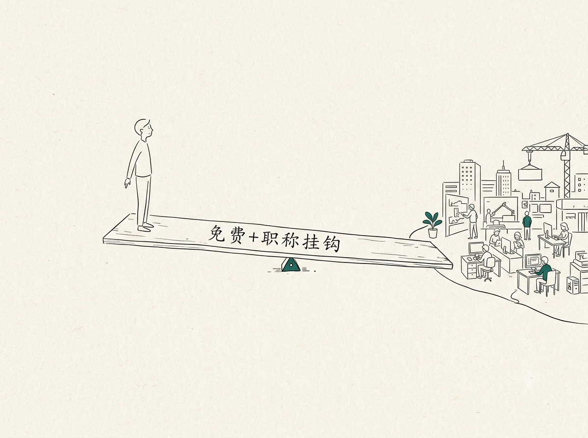
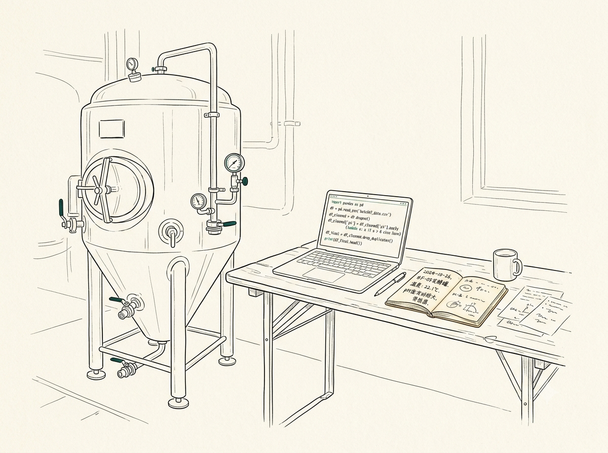
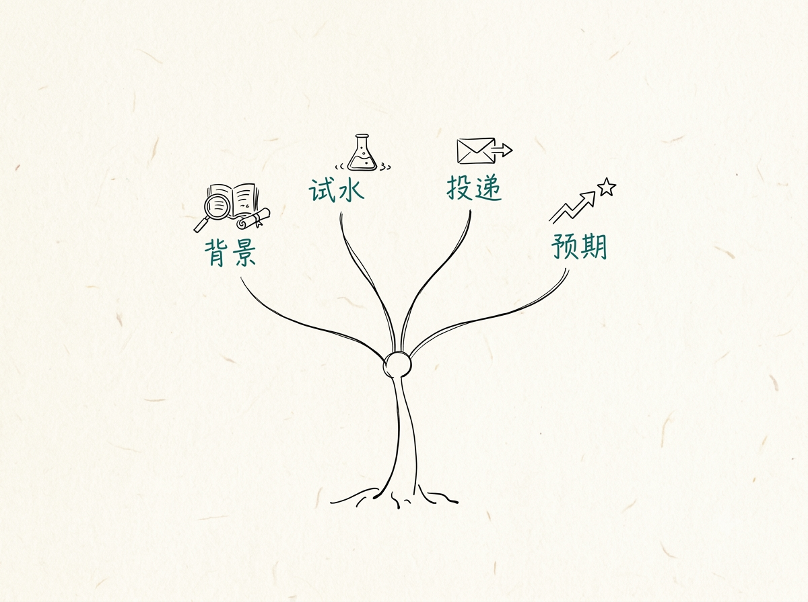

上一讲我们盘了售前、解决方案、顾问这几条"离得最近"的路——系统设计、客户可信度、技术选型、需求发掘,你手里其实早就攒着招聘方要的牌。但我知道你在想什么:那我要是既不是工程师,也不是售前,背景还有点"歪",是不是就没戏了?这一讲专门回答两件事:非典型背景到底还有没有路,以及在国内,这条路和硅谷长得有多不一样。说白了,就是帮你在自己这副牌里找到能打的那张。

[[HERO: 一个学小语种的女生,在国内 FDE 团队里成了最会问客户真需求的人]]

## 招聘方赌的是学习能力,不是你的简历标签

先给结论:招聘方最看重的是两样东西——学习能力,和洞察本质的能力。你是什么专业出身,反而排在很后面。

这不是安慰话。国内一线 FDE 团队有过很实在的观察:设计背景、小语种背景的人,进来之后表现出色。为什么?因为 FDE 干的活,一半是技术,一半是"听懂客户到底想要什么"。设计的人天生对"用户真实场景"敏感,小语种的人习惯在信息不对称里搭桥。这两样,恰恰是纯工程背景最容易缺的。

就像你去一个陌生的城市点菜,菜单看不懂没关系,能看懂老板脸色、知道本地人都点啥,你照样吃得好。FDE 也是这样——技术栈是菜单,可以现学;洞察本质是那份"读空气"的本事,难教。


所以你该做什么?别再盯着"我不是科班"这件事自我否定了。把你原来那个领域最锋利的一项能力拎出来,翻译成 FDE 语言。做过设计,你就是"需求发掘 + 用户同理心";做过运营,你就是"把脏数据理成能用的东西";做过翻译或对外业务,你就是"在客户和产品之间做翻译层"。

这里有个信息差我得先给你补上。国内招聘平台上,FDE 相关岗位 2026 上半年涨了 10 到 20 倍,应聘主力其实是实施部署程序员、产品经理、数字化咨询顾问——没有一类是"纯算法科学家"。这说明什么?这个岗位从设计上就是留给"混搭背景"的人的。看懵了也没关系,你只要记住一句:非典型不是短板,是差异化。

## 上海创智学院:一块零成本的官方跳板

结论先行:如果你在国内、又想低风险试水 FDE,上海创智学院的免费官方培训是我见过性价比最高的入口,没有之一。

这事的分量在于"官方"两个字。2025 年 11 月 29 日,上海创智学院办了全国首期 FDE 专题培训,推的是"百千万"工程——链接百家企业、打造千个智能体、带动万名开发者,还要建一个千人规模的 FDE 储备库。培养用的是"3+3+3"矩阵,2026 年度面向全社会招募,而且——这条最关键——拟与人社的中级职称评定挂钩。

你品品这个组合:零学费 + 官方背书 + 可能换来一个中级职称。传统的转型路子是你自己掏几万块报个商业课,证书含金量还得打问号;这条路反过来,政府替你把信用背书做了,你只出时间。



顺带说个术语,你搜信息时会用到。这个岗位有两个官方译名:媒体和腾讯云 JD 用"前线部署工程师",而百度百科词条和上海的政策文件用的是"前沿部署工程师(FDE)"。你查政策、找培训时两个词都要搜一遍,不然会漏。政策里还冒出一个新角色叫 FDR(前沿部署研究员),做前后方协同的,你先记个名字。

那你该做什么?去查上海创智学院 2026 年度的招募通道,把它当成一次"零成本压力测试"。就算最后你发现自己不适合 FDE,这段经历翻译成简历也是加分的。别急着 all in,先用官方免费资源探个底。

## 国内 FDE 到底怎么干活:双人组、按结果收费、驻场九个月

这一节最重要,因为国内的干活方式,和你在硅谷 JD 里读到的很不一样。先给两个结论,再展开:第一,国内成熟团队是"业务+工程"双人组,单打独斗必败;第二,驻场的活里有大量"脏活",而脏活恰恰是价值所在。

### 双人组,和"Prompt 工程师"的一个血泪教训

深圳的 53AI 做了三年 FDE 实践,趟出一个很清晰的模式:Echo(业务专家)+ Delta(工程师)双人组一起进场。收费方式也很硬核——按结果收费,不是按人天。流程大概是驻场 3 到 5 天先做诊断,然后共建,最后用 A/B 测试把效果量化出来给客户看。

他们踩过的最大的坑,我原样转给你:**Prompt 工程师单独接项目,必败。**

为什么?因为一个只会调 prompt 的人,进了客户现场既讲不清业务、又扛不住工程落地。就像你派一个只会颠勺的厨子去开一家店,菜再好吃,采购、算账、招呼客人全塌了,店照样关门。FDE 的价值从来不是单点技巧,是"业务洞察 + 工程交付"这对组合拳。


这对你意味着什么?如果你是非典型背景,别焦虑"我技术不够硬"。你完全可以先卡住 Echo 这一侧——把业务诊断、需求发掘、结果量化做到极致,再慢慢补 Delta 的工程能力。国内团队本来就是分工的,你不需要一个人是全能。

### 川宁生物:发酵罐旁边的九个月

"驻场到底在干什么?"这是我被问得最多的问题。我给你讲个最不硅谷、但最真实的例子。

金锃科技的 FDE,在川宁生物的发酵罐旁边,驻场了整整九个月。九个月里干的很多是"脏活":数据重新录入、参数校正,还有一件最关键的——把老师傅脑子里的经验数字化。老师傅凭手感调发酵参数几十年,这套隐性知识以前没人写下来。FDE 蹲在罐子旁边,一点点把它变成模型能用的规则。

结果呢?精度从 88% 提到 97%,产能 +5%,年增收超过 10 亿。



我把这个案例的活儿拆成一段伪代码,你感受下驻场的真实节奏:

```text
驻场 Day 1-30:  蹲现场,跟老师傅,记下他每个"凭感觉"的动作
驻场 Day 31-120: 数据脏活——重录入、清洗、参数对齐(占了大半时间)
驻场 Day 121-240: 把老师傅经验编码成规则/特征,喂给模型,反复调
交付标准:      精度 88% → 97%,产能 +5%,系统留在产线上继续跑
```

看出门道了吗?传统的做法是给客户交一份漂亮的分析报告,讲完就走人。FDE 的做法正相反——你得在发酵罐旁边待够九个月,把脏数据一勺勺舀干净,把老师傅的手感翻译成代码,最后系统留在产线上,你走了它还在跑。这就是"不做 demo,直接写进客户生产环境"这句话在国内工厂里的样子。

一句提醒:国内驻场,数据脏活的占比比你想象的高得多。这既是门槛,也是护城河——愿意蹲下来干脏活的人不多,你要是能干,反而稀缺。

## 给你一棵国内路径决策树

前面讲了这么多,最后我给你一张能直接照着走的图。别把它当教条,当成一个帮你少走弯路的路标。

```text
你想在国内转 FDE?
│
├─ 你是什么背景?
│   ├─ 工程背景 ────────→ 直接补 evals / MCP / agent,主攻 Delta 侧
│   ├─ 业务/产品/咨询 ──→ 主攻 Echo 侧(诊断+需求+量化),工程慢慢补
│   └─ 非典型(设计/小语种/运营)
│                     └─→ 先把原领域最锋利那项能力翻译成 FDE 语言
│                         再从 Echo 侧切入
│
├─ 想低成本试水?
│   └─ 报上海创智学院免费培训(3+3+3、拟挂钩中级职称)
│      顺手考个阿里云大模型 ACP(约 ¥1000,考纲和 FDE 栈重合)
│
├─ 简历往哪投?
│   ├─ 投:云厂商(腾讯云/阿里云/火山引擎)、应用服务商、垂直行业公司
│   └─ 别投:纯模型研究公司(DeepSeek/月之暗面/MiniMax 不设 FDE 岗)
│
└─ 心理预期怎么摆?
    ├─ 初级实证:上海月薪 2-3 万起(别信"人人年薪百万")
    ├─ 高职级年包 40 万+,头部 50-100 万,另有国内特有的驻场补贴
    └─ 做好"驻场干脏活"的准备——脏活是价值,不是掉价
```



我把薪资这段单拎出来再叮一句,因为落差最容易让人心态崩。腾讯云的"AI 前线部署工程师 FDE"挂的是 35-65K × 15 薪,听着诱人;但上海一线从业者的实证是,初级月薪就 2-3 万,高职级才上 40 万年包。就像你看房产广告的"起"字,真实成交价得按一线数据来。先把预期摆平,你才不会入行三个月就幻灭。

至于投递方向,记住一条硬规则:国内 FDE 集中在云厂商和应用服务商,模型研究公司基本不设这个岗。你把简历投给 DeepSeek 要 FDE,就像去面包店点火锅——不是你不行,是那家店压根不卖这个。

## 小结

这一讲我想让你记住三点。第一,招聘方赌的是学习能力和洞察本质,非典型背景是差异化,不是短板,设计和小语种在国内 FDE 团队都有出色实证。第二,上海创智学院的免费官方培训(3+3+3、拟挂钩中级职称)是零成本跳板,配上阿里云 ACP 就是一套低风险起步组合。第三,国内干活是 Echo+Delta 双人组、按结果收费,驻场里大量是数据脏活和经验数字化——川宁那九个月换来产能 +5%,脏活就是护城河。投递认准云厂商,预期按一线数据摆平。

## 思考题

盘一盘你现在这副牌:你原来那个领域里,最锋利的一项能力是什么?试着把它翻译成 FDE 语言(比如"需求发掘""脏数据治理""业务翻译"),然后想清楚,你是该主攻 Echo 侧还是 Delta 侧。下一讲我们就把这些牌收拢起来,教你做《作品集与简历总装》。欢迎在评论区聊聊你的想法。
