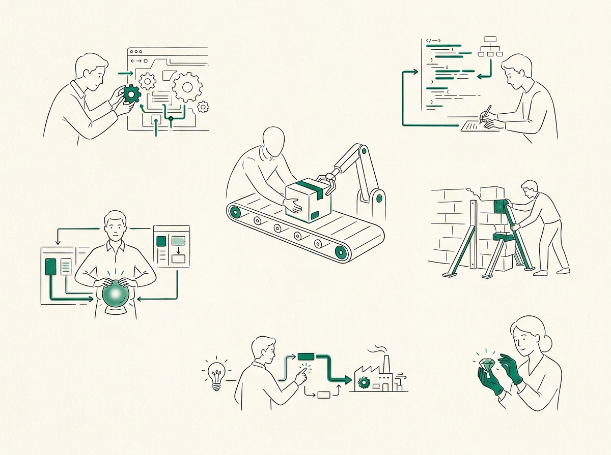

上一讲我们给非典型背景的你留了一条路：招聘方最看重的是学习能力和洞察本质，设计、小语种这些底子在国内 FDE 团队里都有出色实证。可光有底子还不够。到了要投简历那一刻，你手上得有能让人 60 秒看懂的东西。

这一讲要回答的就是一个很具体的问题：前面十几讲你练的那些零件——检索、evals、MCP、agent、部署——怎么攒成一份能拿去面试的求职资产？

说白了，这一讲就是总装车间。我们把散落的零件拼成三件作品，加一份简历，再加一件你可能没想到的东西。装完，你就能投了。

[[HERO: 一个转型者把散落的项目、博客、简历零件在工作台上拼成一套完整求职资产]]

## 三件作品，一条上升的证据链

先给结论：你不需要十个 side project，你需要三件作品，而且它们要能连成一条往上走的线。

为什么是三件、为什么要递进？因为招聘方看作品集不是数数量，是看你能走多远。一件比一件难，能证明你的天花板在抬高。就像你去健身房，教练不看你练了多少个动作，看你卧推的重量有没有涨。

三件作品从易到难，正好对应 FDE 技术栈的三段爬升。


**第一件：带 eval 的端到端检索应用。** 这是入门砖。选一个真实数据集，搭一条完整的 RAG 管线：切块、embedding、pgvector 存储、检索、生成。关键不在管线本身，在你给它配了一套 eval harness——20 条以上的测试集，二元 pass/fail 的 rubric，一个用 100 条标注对齐过的 LLM judge，最后一张前后对比的指标表。

记住这个口径：evals 是把 demo 和"能上线"分开的那道线。第一件作品就要把这道线画出来。

**第二件：Agentic RAG + MCP。** 这是从"检索"跨到"agent"。同一个场景，你把它改造成会自己决定"要不要检索、检索什么"的 agent，再亲手写一个 MCP server 把它接进某个真实系统。为什么加 MCP？因为它已经是 2026 的硬门槛——Anthropic 的 JD 把"MCP servers、sub-agents、agent skills"直接写进了交付物原文。

别被 MCP 这个词唬住。它本质就是给模型接一个能调你系统的插头，你写过 REST API 就能上手。

**第三件：多智能体研究助手。** 这是天花板件。用 LangGraph 编排多个 agent，做一个能拆解任务、分工、汇总的研究助手。这里你要能讲清楚 ReAct、plan-and-execute、hierarchical delegation 这几种模式的区别——Google FDE 的 JD 里点名要这些。

三件都必须满足两个铁条件：一个 live URL，一个 README。没有 live URL 就不算作品——"一个部署项目 60 秒可验证"，这句话你要刻在脑子里。README 不是装样子，它是你唯一能替你说话的文档。

[[FIG:live-url-readme | 每件作品的两个交付铁条件：可访问的 live URL 加一份讲清选型的 README]]

### README 里最值钱的一段：我为什么这么选型

这是最多人漏掉、也最能拉开差距的地方。每个 README 里，你都要写一段"我为什么这么选型"。

传统做法是 README 里堆一串"技术栈：Python、FastAPI、pgvector、LangGraph"。招聘方看了没感觉——谁都会列。FDE 做法反过来：不列清单，讲权衡。你要让读的人看到你脑子里那场取舍。

至少讲清楚三组决策：

**第一组，prompt vs RAG vs fine-tune。** 你为什么用检索而不是把知识塞进 prompt，又为什么不上 fine-tune？一句话原则：知识会变、要溯源，就用 RAG；行为要稳定、格式要固定，才考虑 fine-tune；能靠上下文解决的，先别动模型。

**第二组，pgvector vs Pinecone。** 你为什么用 pgvector 起步而不是托管向量库？就像你租房还是买房——数据量小、要省钱、想和现有 Postgres 待在一起，pgvector 够用；等规模和检索延迟压上来了，再谈托管方案。把这个"什么时候该换"写出来，比你用了哪个更值钱。

**第三组，何时用 agent。** 这条最关键。Anthropic 那篇《Building Effective Agents》开篇先教的就是"何时不用 agent"。你要在 README 里诚实写下：这个场景为什么值得上 agent，哪些子任务其实一条固定链路就够了。敢说"这里我没用 agent，因为不值得"，反而是加分项。

下面是一段 README 骨架，你可以直接抄这个结构。

```markdown
## 为什么这么选型

### 检索 vs 微调
- 场景：客服知识库每周更新，答案必须能溯源到原文。
- 决策：选 RAG，不选 fine-tune。知识变动频繁，微调成本和滞后都吃不消。
- 放弃项：没把全部文档塞进长上下文——成本和噪声都不划算。

### 向量存储：pgvector
- 决策：pgvector 起步。数据 ~5 万块，和业务库同在 Postgres，省一套运维。
- 触发换型的信号：QPS 过阈值 / p95 检索延迟超标 → 迁 Pinecone/托管方案。

### 是否引入 agent
- 决策:检索+改写用固定链路;仅"需不需要追问澄清"这一步交给 agent 判断。
- 理由：全流程 agent 化会引入不必要的不确定性，只在真正需要决策的节点用。
```

[[FIG:why-i-chose-block | README 里"我为什么这么选型"三组决策：检索vs微调、pgvector vs Pinecone、何时用agent]]

看懵了也没关系，你不用一上来就写得这么全。先把三件作品跑起来，每件补一段选型说明，你的作品集就已经甩开一大半只贴代码的人了。

## 第四件作品：把你的项目写出来

这里我要给你一个可能没想到的结论：公开写作，是你的第四件作品。而且它的性价比，比再做一个 side project 高得多。

先讲个真事。Het Trivedi 创业失败后自学 GenAI，写了一篇"用 Truss 部署开源 LLM"的技术博客。就这一篇，被 Baseten 的联合创始人私信挖走。对他来说，作品集就是那篇博客本身。

[[FIG:blog-as-fourth-work | 一篇技术博客成为第四件作品：Het 靠一篇部署博客被联创私信挖走]]

为什么写作这么好用？因为它替你完成了一件招聘方最想验证、又最难验证的事：你能不能把复杂的东西讲清楚。FDE 天天要对着客户做这件事。你写一篇讲清楚的博客，等于当场演示了这个能力。

传统做法是海投简历，等 HR 从关键词里捞你。写作做法反过来——你把东西摆到台面上，让对的人主动来找你。这就像摆摊和坐等派单的区别：一个是你被动等，一个是你主动亮出手艺。

而且这里有个国内特有的空白：中文社区几乎没有第一人称的 FDE 转型记录。你的 90 天转型过程本身就是稀缺内容。你不是在和一堆高手抢版面，你是在一片空地上插第一面旗。

关键动作很简单：每做完一件作品，写一篇。三件作品就是三篇博客，正好和你的项目一一对应。

那第一篇写什么？别在选题上卡壳，给你一份清单，挑一个能立刻动笔的。

[[FIG:blog-topic-list | 首篇技术博客六选题清单：从选型复盘到脏数据清洗到部署 runbook]]

- **选型复盘**：把你第一件作品的"为什么这么选型"展开成一篇。prompt、RAG、fine-tune 各自的边界在哪，你怎么选的。这是最好上手的一篇，因为素材你 README 里已经有了。
- **传统 RAG vs agentic search 对比**：同一个数据集，两种实现，用你的 eval harness 跑出忠实度和成本的对比数据。一篇文章顺手证明了检索、evals、写作三件事。
- **手写第一个 MCP server 的踩坑记**：工具定义、鉴权、错误处理，你卡在哪、怎么爬出来的。MCP 是硬门槛，这篇最抢手。
- **给 agent 建 eval harness 的全过程**：error analysis 怎么做，为什么用二元 judge 不用 Likert，100 条标注怎么对齐。Andrew Ng 说过，evals 和 error analysis 是构建 agent 能力的最大预测因子，这篇直接踩在最重的技能点上。
- **清洗一份真实脏数据的 ETL 实录**：这是 FDE 驻场天天干的脏活。你把真实数据里的坑写出来，比任何漂亮 demo 都让人信你上过战场。
- **一份能交接的部署 runbook**：Docker、监控、离场后客户怎么自己维护。对应 AWS 那个卖点——"离场客户可自维护"。

先记结论：写作不是额外负担，是把你已经做过的事再榨出一份价值。项目和博客是一套动作的两半。

## 简历总装：用招聘方的动词说话

到简历了。先给结论：简历不是写给你自己看的，是写给一个扫十秒就翻页的人看的。所以每一行都得用招聘方的词，说招聘方要的事。

FDE 的 JD 反复用同一批动词。你把这批动词当成一个词库，拿它去改写你的每一条经历。



- **embed（嵌入）**：你和客户团队一起干，不是隔着需求文档。
- **own（负责到底）**：端到端 ownership，Palantir 说 FDE 的职责像创业公司 CTO。
- **ship（交付上线）**：不是做完，是上线跑起来。
- **codify（沉淀成资产）**：把一次性经验固化成可复用的东西——正好对上腾讯云 JD 那句"将一线经验沉淀为可复用的交付资产与行业方案模板，反哺产品"。
- **harden（加固）**：Cursor 和 Harvey 都爱用——先快速交付一版，再把它加固成可靠、可观测、能扩展的系统。
- **operationalize（运营化落地）**：Harvey 原文——做培训、写 runbook、把可持续的 playbook 交接给客户。
- **white-glove（白手套）**：Anthropic 说的贴身高端交付。

传统写法是"参与了一个推荐系统项目，负责部分模块开发"。这行字招聘方一秒划过——参与、部分、负责，全是虚的。

FDE 写法是把它翻译成动词库加可量化结果。看这组对照：

```text
改写前：
  参与客服知识库问答系统的开发，负责检索模块，效果有提升。

改写后：
  I shipped an end-to-end retrieval-augmented QA system embedded
  with the client's support team; I hardened it with a 24-case
  eval harness (binary pass/fail, judge aligned on 100 labels),
  lifting answer faithfulness from 71% to 93%, and codified the
  handoff into a runbook the client now maintains solo.
```

看出差别了吗？动词从"参与"变成 shipped、hardened、codified；模糊的"有提升"变成 71%→93%；还顺手把 embed、runbook、客户自维护都塞了进去。同一段经历，招聘方看到的信息密度差了一个量级。

这里有一条容易被忽略、但极其要命的规则：全程用 "I"，不要用 "we"。

为什么这么较真？因为 FDE 是一个高度个人 ownership 的角色。用 "we" 招聘方会立刻起疑：这活到底哪部分是你干的？就像你说"我们拿了冠军"，别人会追问你到底上没上场。用 "I" 是逼你把功劳和责任都认领到自己头上，也逼你面试时真的答得出细节。

[[FIG:i-not-we | 简历措辞对照：we 稀释个人 ownership，I 认领功劳与责任]]

改写时按这个顺序过一遍你的每条经历：先找出你真正 own 的那部分，用 "I" 开头；配一个动词库里的词；再补一个可量化的结果（指标、时间、成本、良率都行）。三样齐了，这一行就立住了。

别急着一次改完。你先挑三条最能打的经历，按这个法子改到位，剩下的照着模板套。一份能投的 FDE 简历，核心就是这三条经历撑起来的。

## 小结

这一讲把前面的零件总装成了求职资产。三件递进作品——带 eval 的检索应用、Agentic RAG+MCP、多智能体研究助手——每件都要 live URL、README，和一段"我为什么这么选型"。公开写作是第四件作品，每个项目配一篇博客，在中文社区这片空地上尤其值钱。简历用 JD 动词库改写，全程用 "I" 不用 "we"，每条经历都要动词加可量化结果。装完这一套，你就有东西可投了。

## 思考题

翻出你现在简历里最拿得出手的一条经历，用今天的动词库和 "I" 规则把它改写一遍：你真正 own 的是哪部分？配哪个动词？能补上什么可量化的结果？如果补不出数字，说明你下一件作品该在哪里留下可量化的痕迹。欢迎在评论区聊聊你的想法。

下一讲我们摊开岗位地图，教你识别哪些挂着 FDE 名头的岗位是真交付、哪些其实是换了皮的售前。
