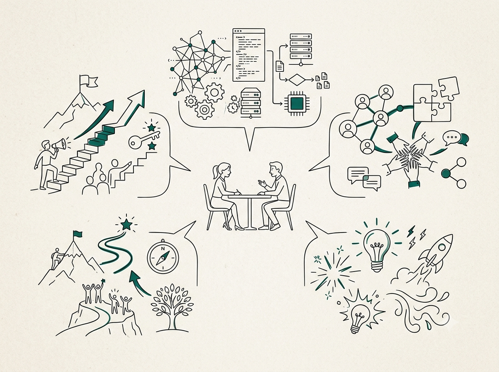
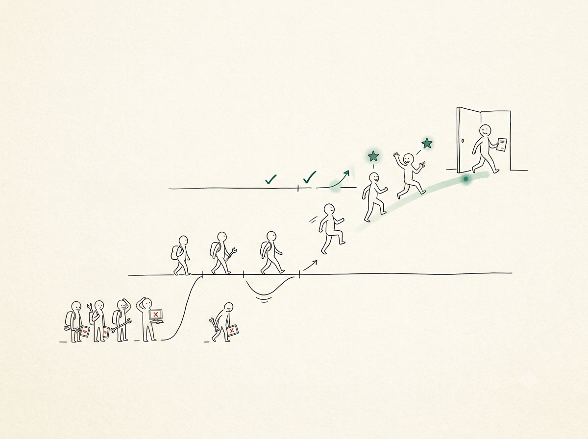

上一讲我们把真伪 FDE 分开了——有没有 quota、own 不 own 生产代码、是不是售后嵌入,你现在应该能一眼看穿那三成挂名售前的岗。识别完了,你就要去投、去面。这一讲我回答一个很具体的问题:FDE 的面试到底长什么样?先给你结论:各家花样看着五花八门,底层其实是同一副骨架,再叠上每家一点私货。你把骨架背下来,再针对目标公司补那点私货,就不会慌。说白了,这一讲就是给你一张能照着走的面试流程地图。

## 三段式:所有面试共享的骨架

先记结论:不管你投 OpenAI 还是腾讯云,FDE 面试都是三段式——先 behavioral/fit,再技术 deep dive,最后一道 decomposition case study。看懵了也没关系,我一段一段拆给你。

第一段是行为面/文化契合。考的不是你会不会写代码,是你面对客户的样子。客户同理心、需求挖掘、危机处理——这些词你在 JD 里已经见过。Palantir 的一线面试就明说:考客户场景和调试叙事,不考理论算法。所以别一上来背红黑树,准备好 8 个 STAR 故事更管用。

第二段是技术 deep dive。这里分两块:实战 coding,加一道 data-heavy 的 system design。注意是"data-heavy",不是让你手撕 LeetCode,而是给你一堆脏数据、一个真实场景,看你怎么搭一条能上生产的管线。

第三段最有 FDE 特色:decomposition case study。这道题是 Palantir 发明的,现在几乎家家在抄。它长这样——面试官抛一个开放业务谜题,让你当场拆:

> "Why are we delaying so many flights?"
> "How can we better identify instances of money laundering?"

它不考标准答案,考你怎么把一坨含糊的业务问题,拆成能落地的技术步骤。这就像你第一次进客户会议室,对方只会说"我们效率低",你得自己把这句话翻译成"哪个环节、什么数据、用什么指标衡量好了"。下一讲我们会专门实战这道题,这里你先知道它存在、知道它压轴。

2026 还多了一个新变体,你必须知道:agentic eval 设计题。题目大概是"为一个物流改线 agent 设计一套 eval suite,保证 99% 送达率还不超预算"。它其实是 decomposition case 换了层皮——把业务谜题换成了"怎么衡量一个 agent 好不好"。evals 这条线我们前面花了大力气讲,现在你看到它直接变成了面试题,应该明白为什么它是全课最重的技术模块了。

一句话收束这一节:三段式是地基,你先把这三段各模拟两遍,再谈各家差异。

## 各家差异:同一骨架,四种私货

结论先行:骨架一样,但每家在某一段上加码,加的那点决定你该重点练什么。我挑四家最有代表性的,给你摊开。

**xAI:一周极速,四轮技术面。** 别的公司拖你一个月,xAI 一周走完。流程公开过:CV + statement → 15 分钟电话 → 4 场技术面(coding、systems hands-on、project deep-dive、team meeting)。密度大、节奏快。所以你投 xAI,别指望"面完一轮回去慢慢准备下一轮"——它要的就是你能高压连轴转,这本身就是 FDE 日常的预演。

**OpenAI:design-doc take-home + evals 高权重。** Blind 上有人实测过 OpenAI 流程:传统 system design 面,加一份非编码的 take-home——让你写一份 design doc,再叠上权重极高的 evals 考察。它的成功标准 JD 里写死了:

> "production adoption, measurable workflow impact, and eval-driven feedback that changes product and model roadmaps"

翻译过来:能不能上生产、能不能量化影响、evals 能不能反哺产品路线图。而且新 JD 已经点名 MCP、sub-agents、Codex。你投 OpenAI,重点练三样:system design、写 design doc、答 eval 设计题。

**Anthropic:MCP 直接进面试,而且不议价。** Anthropic 的岗叫 Applied AI Engineer(其实就是 FDE)。它的技术 use-case 面直接考"用 MCP 让模型规划并执行长任务"——MCP 不再是加分项,是考题。交付物 JD 也写死了:

> "Deliver technical artifacts for customers like MCP servers, sub-agents, and agent skills that will be used in production workflows."

还有一点你得提前有心理准备:Anthropic 薪酬不议价,给的档就是那个档($200–300K,高级档 $280–400K)。你别指望靠谈判抬价,能做的是把自己面进更高的级别。所以投它之前,亲手写过一个能跑的 MCP server,比什么都硬。

**Salesforce:6 周 onboarding,反过来就是技能清单。** Salesforce 有个特别有用的信号:新人 onboarding 6 周(2 周技术 + 4 周在岗),然后进"1 个 Deployment Strategist + 2 个 FDE"的 pod,一个客户约 3 个月。这对你意味着什么?企业愿意花 6 周补的东西,就是它认为你入职时可以还没有的东西;反过来,6 周补不出来的——客户面能力、生产级交付直觉——就是它面试时一定会卡你的。这就像你看一份新员工培训表,能倒推出这家公司默认你已经会什么、允许你还不会什么。

下面这张对照表,你面前哪家就看哪行:

| 公司 | 岗位名 | 流程特点 | 你要重点练 |
|---|---|---|---|
| xAI | FD AI Engineer | 一周极速,4 轮技术面 | 高压连轴、hands-on coding |
| OpenAI | FDE / FDSWE | design-doc take-home + evals 高权重;点名 MCP | system design、写 design doc、eval 题 |
| Anthropic | Applied AI Engineer | MCP 进面试;薪酬不议价 | 亲手写 MCP server、长任务编排 |
| Palantir | FDSE(Delta) | 开放业务谜题开场、行为面重 | decomposition、调试叙事 |
| Salesforce | FDE(pod 制) | 6 周 onboarding、pod 交付 | 客户面能力、3 个月交付节奏 |

传统投简历是"海投一份通用简历";FDE 求职反过来——你得按这张表,给每家改一份针对性准备。before 是广撒网碰运气,after 是拿着地图精准打击。

## 招聘方视角:他们到底在筛什么

这一节最反直觉,也最重要。结论先给你:FDE 面试的技术水位,就是普通工程团队的水位,不比它高;真正筛人的,是动机。

Baseten 的 FDE 负责人说过一句话,你要刻在脑子里:

> "any person who can join the FDE team should be able to join any other engineering team."

意思是,技术门槛和普通 SWE 团队一样,没有额外拔高。这对你是天大的好消息——你不需要成为算法之神。但紧接着他补了另一句,是真正的筛子:不可妥协项是"被客户产出激励"。他们要找的,是那种看到客户真的用起来、业务真的变好就会兴奋的人。技术合格是入场券,这个动机才是录取线。

再说一个你一定要避的坑:agent take-home 经常翻车。同一位负责人说,他们试着出"回家做一个 agent"的作业,结果——

> "every time we tried this, it was a disaster."

为什么翻车?因为一个开放的 agent take-home,考生很容易堆一堆花哨功能,却做不出可靠、可评测的东西——而可靠可评测恰恰是 FDE 的命根子。这对你的启发是双向的:如果你抽到这类作业,别炫技,做一个小而稳、带 eval、能讲清楚失败模式的东西,你就赢了一大半。这就像你去客户现场,与其上来搭一个华丽的 demo,不如先交一个丑但真能跑、还带监控的版本——FDE 的价值从来在"能上线"这一侧。

还有一点关于行为面。Palantir 一线明确:考客户同理心、危机处理、调试方法论和实用脚本,不考理论算法。OpenAI 甚至把"高压下保持冷静和判断力"("Model calm and judgment when the stakes are high")写成显性考察项。所以你准备行为面时,别背成功学套话,准备真实的"我当时怎么在一团糟里稳住"的故事。

那到底怎么练动机面和拆解题?已经转型成功的 Kanav 给了最省事的答案:借用咨询行业的 case 面题来练。快速诊断、澄清式提问、给行动计划——这套咨询打法,恰好覆盖了 FDE 三段式里最难的那两段。你不用另起炉灶,拿一本咨询 case 集,每天拆一道,就是最对口的备考。

收束这一节:你去面 FDE,技术准备到"能进任何工程团队"就够了,剩下的力气全花在证明一件事——你是真的会为客户把东西用起来而激动的那种人。

## 小结

FDE 面试是三段式骨架:行为面筛动机、技术 deep dive 筛水位、decomposition case 筛你把业务翻译成技术的能力,2026 还多了 agentic eval 设计题。各家在骨架上加私货:xAI 一周极速、OpenAI 重 design-doc 和 evals、Anthropic 把 MCP 搬进考题且不议价、Salesforce 的 6 周 onboarding 反推出技能清单。招聘方的技术水位等同普通工程团队,真正卡人的是"被客户产出激励"的动机,而开放式 agent take-home 是最常见的翻车点。

## 思考题

拿你现在正在盯、或最想投的那家 FDE 岗,把它对号入座到本讲的三段式和对照表里:它在哪一段加码最狠?你手上最缺的是那段所需的哪块准备?欢迎在评论区聊聊你的想法。
