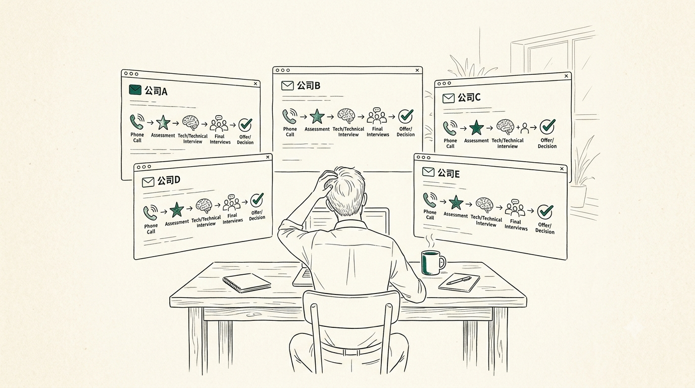

上一讲我们把真伪 FDE 分开了——有没有 quota、own 不 own 生产代码、是不是售后嵌入,你现在应该能一眼看穿那三成挂名售前的岗。识别完了,你就要去投、去面。这一讲我回答一个很具体的问题:FDE 的面试到底长什么样?先给你结论:各家花样看着五花八门,底层其实是同一副骨架,再叠上每家一点私货。你把骨架背下来,再针对目标公司补那点私货,就不会慌。说白了,这一讲就是给你一张能照着走的面试流程地图。

## 三段式:所有面试共享的骨架

先记结论:不管你投 OpenAI 还是腾讯云,FDE 面试都是三段式——先 behavioral/fit,再技术 deep dive,最后一道 decomposition case study。看懵了也没关系,我一段一段拆给你。

第一段是行为面/文化契合。考的不是你会不会写代码,是你面对客户的样子。客户同理心、需求挖掘、危机处理——这些词你在 JD 里已经见过。Palantir 的一线面试就明说:考客户场景和调试叙事,不考理论算法。所以别一上来背红黑树,准备好 8 个 STAR 故事更管用。

第二段是技术 deep dive。这里分两块:实战 coding,加一道 data-heavy 的 system design。注意是"data-heavy",不是让你手撕 LeetCode,而是给你一堆脏数据、一个真实场景,看你怎么搭一条能上生产的管线。

第三段最有 FDE 特色:decomposition case study。这道题是 Palantir 发明的,现在几乎家家在抄。它长这样——面试官抛一个开放业务谜题,让你当场拆:

> "Why are we delaying so many flights?"
> "How can we better identify instances of money laundering?"

它不考标准答案,考你怎么把一坨含糊的业务问题,拆成能落地的技术步骤。这就像你第一次进客户会议室,对方只会说"我们效率低",你得自己把这句话翻译成"哪个环节、什么数据、用什么指标衡量好了"。下一讲我们会专门实战这道题,这里你先知道它存在、知道它压轴。

2026 还多了一个新变体,你必须知道:agentic eval 设计题。题目大概是"为一个物流改线 agent 设计一套 eval suite,保证 99% 送达率还不超预算"。它其实是 decomposition case 换了层皮——把业务谜题换成了"怎么衡量一个 agent 好不好"。evals 这条线我们前面花了大力气讲,现在你看到它直接变成了面试题,应该明白为什么它是全课最重的技术模块了。

一句话收束这一节:三段式是地基,你先把这三段各模拟两遍,再谈各家差异。

## 各家差异与 2026 最大变量：面试到底让不让开 AI 写码？

结论先行：三段式骨架一样，但 2026 下半年面试桌上出现了一个最大的分水岭——**技术面到底允不允许用 Cursor / Claude Code 等 coding agent？** 现在全球雇主已经清晰分化成三大阵营，你面哪家必须提前换哪套档位：

1. **阵营一：全程鼓励用 Coding Agent 实战构建（代表：Sierra）。** Sierra 的 Agent Engineer 已经彻底废除 LeetCode 算法题，改成 **2 小时独立 Build 实战轮**，明确鼓励你打开 Cursor 或 Claude Code 走「Plan → Build → Review」。但别以为这更轻松——交付体量要求翻倍，且最后 20 分钟面试官会指着 AI 生成的代码逐行拷问架构权衡和边界兜底，答不出"为什么这么写"直接一票否决。
2. **阵营二：双轨隔离——无 AI 基础筛查 + 专属 Agentic 实战轮（代表：Anthropic、OpenAI、Cursor、Ode with Anthropic）。**
   - **Anthropic（Applied AI Engineer）**：技术面不仅必考 MCP 长任务编排，2026 下半年还普遍加上了独立的 **`Claude Code Round`**——给你一个真实代码库和历史 PR，允许开 Claude Code 与联网搜索现场排障加功能（工程经理 Felix Rieseberg 等团队甚至直接用它取代了传统算法轮）。另外记住：Anthropic 薪酬坚持不议价（随 2026 年 10 月秘密递交 S-1 冲刺 IPO，期权吸引力极强，只能靠面进更高职级提包）。
   - **OpenAI（FDE / FDSWE）**：保留传统 System Design、非编码 Design-Doc 作业与超高权重 Evals 考察，同时试点 **`Agentic Coding Round`**——塞给你一个 45 分钟靠人肉绝对读不完的庞大仓库，专门考你调度 coding agent 定位和改代码的吞吐力。
   - **Cursor**：前两轮 60 分钟技术筛查**严禁使用任何 AI**（手写流式解析器、Merkle 树同步等真工程题），筛掉离开 AI 不会写码的人；终面则是 **1–2 天带薪 Work Trial（试工）**，反向考察你重度驾驭 Cursor Agent 当天向主干提 PR 的速度。Ode with Anthropic 则主打 **TDD 结对编程**。
3. **阵营三：全程禁用 AI 考硬底子（代表：Palantir、微软 Frontier）。** Palantir 全程严禁外部 AI 辅助，重考开放业务拆解（Decomposition）和陌生老代码重构（Learning / Re-engineering）；微软则保留经典算法 + **Azure PTU 预置吞吐与并发延迟成本精算** + STAR(R) 复盘。

**xAI 与 Salesforce 也有鲜明私货：** **xAI** 主打一周极速通关（15 分钟电话 + 4 轮高强度技术连轴转）；**Salesforce** 则给新人配 6 周 onboarding（2 周技术 + 4 周在岗）进「1 个 Deployment Strategist + 2 个 FDE」的 pod，反过来说明它面试最卡的是 6 周培训补不出来的**客户面定力与生产交付直觉**。

下面这张对照表，你面前哪家就看哪行：

| 公司 | 岗位名 | AI 辅助规则与流程特点 | 你要重点练 |
|---|---|---|---|
| Sierra | Agent Engineer | 废除刷题，2h 开 Cursor/Claude Code 实战 Build | 驾驭 AI 快速搭全栈 + 逐行架构答辩 |
| Anthropic | Applied AI Engineer | MCP 必考 + 专属 `Claude Code Round`；不议价 | 亲手写 MCP server、Claude Code 仓库排障 |
| OpenAI | FDE / FDSWE | Design-doc + 高权重 Evals + 试点 `Agentic Coding` | 系统设计、写 design doc、eval 设计题 |
| Cursor | FDE | 前两轮禁 AI 工程题 + 1–2 天带薪 Work Trial | 纯手写底层数据结构 + 极速 Agent 试工 |
| Palantir | FDSE(Delta) | 全程禁 AI；业务谜题开场 + 陌生代码重构 | Decomposition、无 AI 调试叙事 |
| xAI / 微软 | FD AI Eng / FDE | xAI 一周极速 4 轮；微软考算法 + PTU 成本账 | 高压连轴 coding / 企业并发与算力精算 |
| Salesforce | FDE(pod 制) | 6 周 onboarding、1 DS + 2 FDE pod 交付 | 客户面能力、3 个月交付节奏 |

传统投简历是"海投一份通用简历、背同一套八股"；FDE 求职反过来——你连"练不练开着 AI 写代码"都得按这张表分档准备。before 是广撒网碰运气，after 是拿着地图精准换挡。

## 招聘方视角:他们到底在筛什么

这一节最反直觉,也最重要。结论先给你:FDE 面试的技术水位,就是普通工程团队的水位,不比它高;真正筛人的,是动机。

Baseten 的 FDE 负责人说过一句话,你要刻在脑子里:

> "any person who can join the FDE team should be able to join any other engineering team."

意思是,技术门槛和普通 SWE 团队一样,没有额外拔高。这对你是天大的好消息——你不需要成为算法之神。但紧接着他补了另一句,是真正的筛子:不可妥协项是"被客户产出激励"。他们要找的,是那种看到客户真的用起来、业务真的变好就会兴奋的人。技术合格是入场券,这个动机才是录取线。

再说一个你一定要避的坑:agent take-home 经常翻车。同一位负责人说,他们试着出"回家做一个 agent"的作业,结果——

> "every time we tried this, it was a disaster."

为什么翻车?因为一个开放的 agent take-home,考生很容易堆一堆花哨功能,却做不出可靠、可评测的东西——而可靠可评测恰恰是 FDE 的命根子。这对你的启发是双向的:如果你抽到这类作业,别炫技,做一个小而稳、带 eval、能讲清楚失败模式的东西,你就赢了一大半。这就像你去客户现场,与其上来搭一个华丽的 demo,不如先交一个丑但真能跑、还带监控的版本——FDE 的价值从来在"能上线"这一侧。

还有一点关于行为面。Palantir 一线明确:考客户同理心、危机处理、调试方法论和实用脚本,不考理论算法。OpenAI 甚至把"高压下保持冷静和判断力"("Model calm and judgment when the stakes are high")写成显性考察项。所以你准备行为面时,别背成功学套话,准备真实的"我当时怎么在一团糟里稳住"的故事。

那到底怎么练动机面和拆解题?已经转型成功的 Kanav 给了最省事的答案:借用咨询行业的 case 面题来练。快速诊断、澄清式提问、给行动计划——这套咨询打法,恰好覆盖了 FDE 三段式里最难的那两段。你不用另起炉灶,拿一本咨询 case 集,每天拆一道,就是最对口的备考。

收束这一节:你去面 FDE,技术准备到"能进任何工程团队"就够了,剩下的力气全花在证明一件事——你是真的会为客户把东西用起来而激动的那种人。

## 小结

FDE 面试是三段式骨架:行为面筛动机、技术 deep dive 筛水位、decomposition case 筛你把业务翻译成技术的能力,2026 还多了 agentic eval 设计题。各家在骨架上加私货:xAI 一周极速、OpenAI 重 design-doc 和 evals、Anthropic 把 MCP 搬进考题且不议价、Salesforce 的 6 周 onboarding 反推出技能清单。招聘方的技术水位等同普通工程团队,真正卡人的是"被客户产出激励"的动机,而开放式 agent take-home 是最常见的翻车点。

## 思考题

拿你现在正在盯、或最想投的那家 FDE 岗,把它对号入座到本讲的三段式和对照表里:它在哪一段加码最狠?你手上最缺的是那段所需的哪块准备?欢迎在评论区聊聊你的想法。
