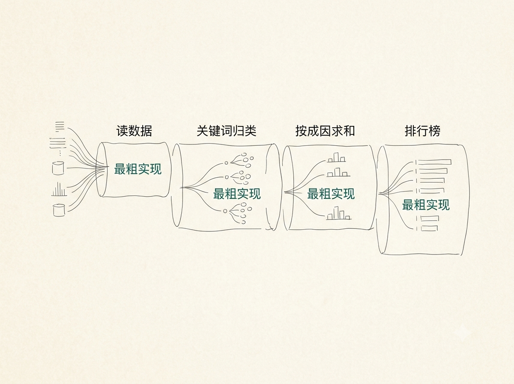
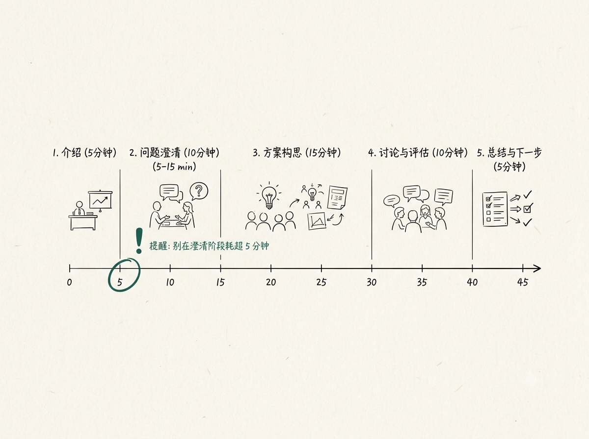

上一讲我们把面试流程地图摊开了：behavioral/fit 先摸你合不合群，technical deep dive 再考你实战 coding 和 data-heavy system design。三段式里，最后那段 decomposition case study 才是真正的分水岭。这一讲就专门啃它。

我先把话撂这儿：decomposition 是整个面试里通过率最低、权重最高的一关。它给你一个开放的业务谜题，比如 Palantir 那句经典的"我们为什么延误这么多航班？"，然后看你怎么把一团乱麻拆成能动手的东西。别急，看懵了也没关系，它考的不是聪明，是套路——套路我这一讲给你。

说白了，这一讲教你：面试官甩给你一个含糊到没边的大问题时，你怎么当场把它拆开、出声、然后端出一个能跑的糙方案。


## 这一关到底在卡什么

先给判断：decomposition 是最大的过滤关，通过率大概只有 40%，在整轮技术面里权重约 30%。也就是说，前面 coding 写得再溜，这一关塌了，offer 基本没了。

为什么它这么难？因为它故意不给你完整信息。传统的算法面有标准答案，输入输出都定死，你把题解背熟就行。decomposition 反过来——它给你一句人话，剩下全靠你问、你拆、你排。这就像你第一次去客户机房，对方只丢下一句"系统有点慢"，然后走了，你得自己把"有点慢"翻译成一个能查的具体问题。

[[FIG: filter-funnel | 三段式面试漏斗，decomposition 那一层画成最窄的瓶颈，标注 40% 通过、30% 权重]]

那面试官到底在你身上打什么分？记住三条，它们几乎等权重：

第一，**你会不会出声**。这一关有个铁律：沉默等于卡住。你脑子里转得再快，不说出来，面试官只看到一个盯着白板发呆的人。他要的是听见你的思考路径——你怎么澄清、怎么假设、怎么排序。哪怕你想错了，出声的错也比沉默的对更值钱，因为他能顺着你的话把你往回带。

第二，**编码和沟通几乎一样重**。很多工程师以为这是技术面，闷头写代码就行。错。FDE 天天面对客户，decomposition 考的正是"你能不能一边想一边讲清楚"。这一关里，你敲键盘的时间和你张嘴的时间，分量差不多。

第三，**头 10 分钟严禁画架构框图，能跑的糙方案 > 漂亮但跑不通的架构**。这是 2026 一线面试官反复强调的铁律：候选人如果开场前 10 分钟就在白板上画 Kafka、向量库、微服务的方框，基本直接挂。比如 Cursor 有一道很出名的真题：「某大客户买了 2,000 个席位，遥测显示 Cursor 使用量涨了，但合并 PR 数反而跌了——你怎么跟工程 VP 诊断？」你要是上来画数据看板就完了，正确反应是先追问 Code Review 队列是不是被大 PR 堵死了、CI 耗时是不是炸了。面试官想看你在有限时间里，先把业务瓶颈抠准，再把从输入到输出的那条线真的打通，哪怕每个环节都糙得不行。

[[FIG: rough-vs-pretty | 左边一个能跑通的丑陋管道亮着绿灯，右边一张精美但断了一截的架构图亮着红灯]]

所以你该做什么？从现在起，练习的时候就强迫自己"先忍住不画架构框，出声把业务瓶颈剥开"。对着空气把拆解过程讲一遍，讲到自己都嫌啰嗦为止。面试那天，你的嘴要比手更忙。

## 五步框架，这次为面试而调

结论先行：decomposition 不靠灵感，靠一套固定动作。实战篇第 13 讲我们搭过这套五步法，这一讲把它调成"面试可用"的版本——每一步都配一句你当场该说出口的话。

五步是：澄清成功标准 → 命名假设 → 找失败模式 → 按风险排序 → 先给 walking-skeleton MVP。顺序不能乱，后一步都踩在前一步的答案上。

[[FIG: five-step-interview | 五步横向排成一条流水线，每步下面挂一个对话气泡，写这一步该对面试官说的话]]

**第一步，澄清成功标准。** 面试官说"为什么延误这么多航班"，你第一反应不是猜原因，是反问：怎样算"太多"？我们要把哪个数从多少降到多少？是把平均延误分钟数砍一半，还是把延误航班占比从 20% 压到 10%？

出声话术：**"在动手之前，我想先跟你对齐成功标准——我们这次是想解释延误，还是想减少延误？盯的是哪个指标？"** 这一句一出口，面试官就知道你是个会先定义问题的人。没有数字的目标等于没有目标，这点在客户现场和在白板前一样成立。

**第二步，命名假设。** 你手上信息不全，必然要做假设。关键是把假设**说出来**，而不是偷偷埋在脑子里。比如"我先假设我们能拿到每个航班的历史起降时间、机型、天气、机组排班这几张表"。

出声话术：**"我要做几个假设，你随时可以纠正我。"** 这句话是护身符。它把你的盲区变成一次和面试官的对话，而不是一个会被抓包的漏洞。

**第三步，找失败模式。** 别急着想"怎么做对"，先想"哪里最容易做错"。延误的成因可能有十几种：天气、连锁晚点、机组不到位、机场拥堵、机械故障。哪一种数据最脏、最难归因？那就是你的失败模式高发区。

**第四步，按风险排序。** 把子问题拆开谁都会，难在排序。按风险排，不按顺手排。风险最高的那块——"搞不定整个项目就废了"的那块——排最前面。

举个例子。这道航班题里，最高风险的假设往往是"延误原因能不能从现有数据里归因出来"。如果连"这班为什么晚"都归不了因，后面做什么都白搭。那它就得第一个验。

传统做法是按开发层次拆：先建数据仓、再洗数据、再上模型、最后做看板，一层层堆上去。FDE 反过来：先揪出最可能翻车的那个假设，第一个就去戳它。这个 before/after 的差别，就是面试官区分资深和新手的关键。

[[FIG: risk-first-ordering | 两条拆解路线对比，上条按数据仓到看板的层次堆叠，下条把最高风险假设插到最前面]]

**第五步，先给 walking-skeleton MVP。** 前四步都在想，这一步开始动手。你不做全功能，你做一具"会走路的骨架"——把从原始数据到一个能回答问题的输出，整条主链路打通，每个环节都用最粗糙的实现。下一节我们就现场搭一个给你看。

这里插一句安抚：你不用五步都答得完美。面试官真正在盯的，是第一步的成功标准你敢不敢追问，和第四步的风险你排得对不对。这两步稳了，这一关就稳了大半。

## 完整解题示范：为什么延误这么多航班

结论先行：下面这段是一道 timed 开放案例的完整解法。假设面试是 45 分钟，题目就是那句"我们为什么延误这么多航班？"。我把候选人（也就是你）该说的、该写的，一步步走一遍。你可以把它当模板，套到任何一道 decomposition 题上。

**0–5 分钟，澄清成功标准。**

你开口："在拆之前我想先对齐目标。我们这次是要**解释**延误的主要成因，还是要建一个能**预测**某班会不会延误的东西？这俩方向差很远。"

面试官（大概率会松口一点）："先解释成因吧，管理层想知道钱和时间浪费在哪。"

你："好。那我把成功标准定成——产出一个按成因归类的延误分钟数排行，让管理层一眼看出前三大元凶占了多少比例。这个定义你认可吗？"

到这儿，你已经把一个没边的问题，收敛成"给延误分钟数按成因归类"。这就像你打车先报了目的地，司机才知道往哪开。

[[FIG: goal-narrowing | 一个漏斗，顶部是"为什么延误这么多航班"，底部收窄成"按成因归类的延误分钟数排行"]]

**5–12 分钟，命名假设 + 盘数据。**

你一边在白板写一边说："我做几个假设，你随时打断我。第一，我们有航班级别的历史数据：计划起降、实际起降、机型、出发到达机场。第二，我们有一张延误原因码表，哪怕它是人工填的、很脏。第三，天气和机组数据可能要从别的系统拉，先标成'待确认'。"

这一步你要显式地把脏数据风险摆出来："经验告诉我，原因码这一栏八成是客服手填的，缺失和乱填会很多。这会是我最大的不确定性。"——这句话会让面试官眼睛一亮，因为它说明你干过真活。

**12–20 分钟，找失败模式 + 按风险排序。**

你把可能的成因列在白板上，然后当场排序：

```text
子问题（按风险从高到低）
1. [最高风险] 延误原因能不能归因？——原因码脏/缺失，可能根本归不了因
2. [高] 连锁延误怎么拆？——一班晚导致后面连环晚，成因会被重复计
3. [中] 天气/机组数据能不能对齐到航班级别？——跨系统 join
4. [低] 怎么把结果做成管理层看得懂的排行榜？——纯展示层
```

你出声解释排序逻辑："我把'能不能归因'排第一，因为它要是不成，剩下全是空中楼阁。连锁延误排第二，因为不拆开它，我的排行榜会把同一个根因重复算好几次，数字全错。"

这一步是整场的胜负手。你排对了，面试官就知道你会挑那块最硬的骨头先啃，而不是挑最顺手的先做。

**20–40 分钟，搭 walking-skeleton MVP。**

现在动手。你不建数据仓、不上模型、不做花哨看板。你只写一根打通主链路的糙管子，先拿最高风险那步验：能不能从脏原因码里归出个大概的类。

你边写边讲，代码大概长这样：

```python
import pandas as pd

# walking-skeleton：只打通"原始航班 -> 按成因归类的延误分钟"这一条线
# 每一步都用最糙的实现，先证明主链路能跑通

def load_flights(path: str) -> pd.DataFrame:
    df = pd.read_csv(path)
    # 糙但够用：实际起飞晚于计划起飞的分钟数，负数截零
    df["delay_min"] = (df["actual_dep"] - df["sched_dep"]).clip(lower=0)
    return df

# 最高风险那步：脏原因码 -> 粗类。先用关键词映射兜底，跑通再谈模型
CATEGORY_RULES = {
    "weather": ["rain", "snow", "fog", "storm", "天气"],
    "crew": ["crew", "staff", "机组", "排班"],
    "mechanical": ["mech", "engine", "故障", "维修"],
    "knock_on": ["late aircraft", "连锁", "前序"],
}

def categorize(reason: str) -> str:
    text = str(reason).lower()
    for cat, keywords in CATEGORY_RULES.items():
        if any(k in text for k in keywords):
            return cat
    return "unknown"   # 归不出来的先兜到 unknown，量有多大本身就是信号

def rank_causes(df: pd.DataFrame) -> pd.DataFrame:
    df["cause"] = df["raw_reason"].apply(categorize)
    ranked = (df.groupby("cause")["delay_min"]
                .sum()
                .sort_values(ascending=False)
                .reset_index())
    ranked["pct"] = (ranked["delay_min"] / ranked["delay_min"].sum() * 100).round(1)
    return ranked

if __name__ == "__main__":
    flights = load_flights("flights.csv")
    print(rank_causes(flights))
```

写的时候你要一直讲，别闷头敲。你可以说："我先用关键词映射把原因码归类，这肯定不准，但它能立刻告诉我一件事——`unknown` 桶占多大。如果 `unknown` 占了 60%，那结论就是'我们连延误原因都没好好记录'，这本身就是给管理层的第一条洞察。"

看见没？这就是"能跑的糙方案 > 漂亮架构"。这段代码丑得很，关键词写死、没建模、没处理连锁延误。但它端到端跑得通，还顺手把最高风险的假设验了。这比你在白板上画一张完美的 pipeline 图然后说"接下来接个大模型"值钱得多。



**40–45 分钟，收口 + 反哺。**

最后五分钟，你要主动把话题从"我做了什么"抬到"客户该怎么办"。你说："跑出这个排行后，我下一步会做三件事：一，如果 `unknown` 占比高，先回去和运营团队把原因码规范化；二，把连锁延误单独拆出来，避免重复计根因；三，等归因稳了，再考虑上模型做预测。"

这一收口，把你从"会写代码的人"变成"会替客户想下一步的人"。FDE 面试要的，正是后者。



一句提醒：全程盯着时间。最常见的翻车是在澄清阶段问个没完，40 分钟过去了代码一行没写。记住权重——出声、拆解、跑通，三者都要，缺一块都掉分。

## 小结

decomposition 是通过率约 40%、权重约 30% 的最大过滤关。它考的不是标准答案，是一套动作：澄清成功标准、命名假设、找失败模式、按风险排序、先给 walking-skeleton MVP。全程必须出声，沉默等于卡住；编码和沟通几乎等权重；能跑的糙方案永远赢过跑不通的漂亮架构。把那道航班题的解法当模板，反复对着空气演练，你就把这一关的运气成分压到了最低。

## 思考题

拿你现在工作里一个"含糊到没边"的真实需求——老板或客户扔过来的那种一句话大问题——套用这五步走一遍：你会怎么澄清成功标准？哪个假设风险最高、该第一个验？你的 walking-skeleton 会先打通哪条主链路？欢迎在评论区聊聊你的想法。

下一讲我们进入 2026 才冒出来的新题型：agentic eval 设计题——面试官让你为一个 agent 从零设计一套评测方案，这关正在迅速变成 decomposition 之后的第二道分水岭。
