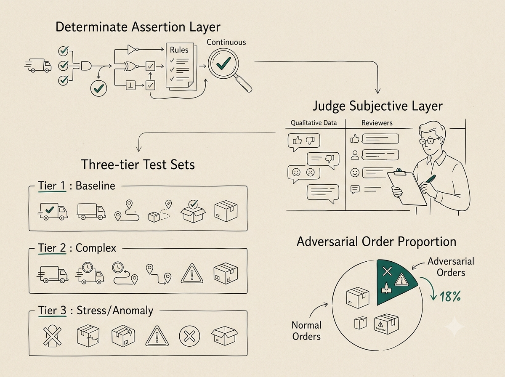

上一讲我们啃了 decomposition 案例题——那道通过率只有约 40%、却占了约 30% 权重的最大过滤关。我给你的是一套五步框架：澄清成功标准、命名假设、找失败模式、按风险排序、先给一个能跑的粗糙版本。你有没有发现，那五步里藏着一根隐线？"成功标准""失败模式""按风险排序"——这几个词，其实就是 evals 的骨架。

这一讲我们把这根隐线单拎出来。因为 2026 年冒出了一道新面试题型，专门冲着它来：agentic eval 设计题。面试官甩给你一个 agent 场景，让你现场设计一整套评测方案。别急，看懵了也没关系。先记住一句话：这题考的不是知识，是你把 evals 当成本能的肌肉记忆。


## 这题到底在考什么

先给判断：这道题考的不是你会不会背评测指标，而是你有没有把 evals 内化成条件反射。

场景通常长这样。"为一个物流改线 agent 设计 eval suite，保证 99% 送达率且不超支。""为一个客服退款 agent 设计评测，既要解决问题又不能乱退钱。"给你一个模糊目标，一个会自己做决策的 agent，然后看你怎么把"我觉得它还行"变成"我有证据它能上线"。

为什么 2026 年突然爱考这个？回到招聘方的原话。OpenAI 把 FDE 的成功标准逐字写成三件套："production adoption, measurable workflow impact, and eval-driven feedback that changes product and model roadmaps。" eval-driven 直接进了 KPI。Harvey 更狠，要求你"按客户逐一建 eval harness"。Andrew Ng 那句话我在第 15 讲贴过，这里再贴一遍："evals 与 error analysis 是构建 agent 能力的最大预测因子。"

[[FIG:why-this-question | 招聘方三处原话——OpenAI 的 eval-driven KPI、Harvey 的 per-client harness、Andrew Ng 的"最大预测因子"——共同指向同一道面试题]]

所以这题的本质，是招聘方在验货。他们不想听你讲 Braintrust 和 LangSmith 有什么区别——工具三分钟能学会。他们想看的是：丢给你一个没人给过标准答案的乱摊子，你的第一反应是什么。

这里有个鲜明对比。传统软件面试考算法题，有标准答案，你背过就能写。agentic eval 设计题反过来，没有标准答案，考的是你面对不确定性时的工作方法。就像考驾照，路考不问你发动机原理，只看你遇到突发情况先踩刹车还是先打方向——那是肌肉记忆，装不出来。

所以你该做什么？别把这一讲当面试技巧背。你要做的是从现在起，每写一个 AI 功能都顺手配一套 eval，把它练成本能。等你真坐上面试桌，这题就不是"设计题"，而是"你昨天刚干过的活"。

## 解题模板：把第 15 讲那套方法搬上白板

结论先行：你不需要为这道题准备新东西。第 15 讲的 evals 方法论，原封不动就是标准解法。你要做的只是把它变成一套能在白板上讲出来的流程。

我把它拆成五步，跟上一讲 decomposition 的五步是同构的——这不是巧合，好的 FDE 思维本来就是一套。

第一步，澄清成功标准，把它变成二元判据。面试官说"99% 送达率且不超支"，你不能点头就走。你得追问：99% 是按单量算还是按金额算？"不超支"的预算上限是多少？超时算不算失败？这一步你在干一件事——把一句模糊的话，翻译成一条条"过/不过"的判据。记住第 15 讲的铁律：打分用二元 pass/fail，别用 Likert 五分制。让你给一次改线打 3 分还是 4 分，你自己都拿不准；但"这次改线有没有导致某个包裹晚到"，答得干脆。

[[FIG:clarify-to-binary | 一句"保证 99% 送达"经过追问，落成一张 pass/fail 判据表：晚到？超预算？改错路线？]]

第二步，先做 error analysis，别急着搭自动打分器。这是新手最爱跳、也最扣分的一步。正确答案是：先攒一批真实或仿真的 trace，一条条人肉读，把每条的失败原因写成一句大白话。这件事该占你评测工作的六到八成时间。就像医生看病，不能上来就开一堆化验单，得先亲手按一按、问一问，才知道该查什么。面试时你把这句讲出来，面试官立刻知道你不是纸上谈兵。

第三步，从失败模式建测试集。读完 trace，你会发现错误就那么几类。把每一类都变成测试用例，覆盖正常单、边界单、和那种专门坑人的对抗单。20 条起步，按客户场景往上加。

第四步，设 LLM-as-judge，并且说清楚怎么对齐。有些判据用代码就能判（超没超预算，一个减法的事），这种别浪费模型。但"这个改线理由讲得通吗"这种主观的，才交给 judge。关键是对齐：你得先攒 100 条以上你自己标注好的样本，拿去校准 judge，测它的 TPR 和 TNR——你判"过"的它也判过吗，你判"不过"的它也拦下了吗。没对过答案的 judge，只是又一个说得很顺的模型。

[[FIG:eval-five-steps | 五步解题模板：澄清成功标准→error analysis→建测试集→设 judge 并对齐→接 CI 与生产监控]]

第五步，接 CI 和线上监控，闭环。测试集不是跑一次就完。改一版 prompt 就自动重跑，通过率从 71% 到 78%，白纸黑字。上线后再采样真实 trace，回灌测试集。这一步呼应 OpenAI 的 "eval-driven feedback that changes roadmaps"——评测不是终点，是反哺产品的入口。

这五步你要练到能脱口而出。面试白板上，你不用写完美的代码，你要展示的是这套流程在你脑子里是刻好的。

## 两道题的完整解法

光讲框架你还是会慌。我带你把两道真题从头走一遍，你照着套就行。

### 题一：物流改线 agent，保证 99% 送达率且不超支

先别碰代码，先澄清。我会当场问面试官四个问题：99% 按包裹数还是按金额？预算红线是每单成本还是日总成本？agent 是自动执行改线还是给人审批？有没有绝对不能碰的硬约束，比如冷链时限？把答案钉死，成功标准就从一句话变成一张判据表。

假设面试官答：99% 按包裹数，单均成本不超原路线 1.15 倍，agent 自动执行，冷链单 24 小时是硬红线。那判据表长这样。

| 维度 | pass/fail 判据 | 怎么判 |
|---|---|---|
| 送达率 | 改线后预计送达时间 ≤ 承诺时间 | 代码算，确定性 |
| 成本 | 单均成本 ≤ 原路线 × 1.15 | 代码算，确定性 |
| 冷链硬约束 | 冷链单全程 ≤ 24h | 代码算，一票否决 |
| 改线合理性 | 改线理由与路况/天气证据一致 | LLM judge |
| 安全兜底 | 无解时是否正确上报人工 | LLM judge |

看出门道没？前三条是确定性判据，一行减法搞定，绝不交给模型。后两条主观，才用 judge。这个"能用代码判的绝不用模型"的取舍，本身就是加分点。

确定性判据可以直接写成断言，像这样：

```python
def check_hard_constraints(plan, order):
    # 冷链一票否决：超时直接 fail，不给 agent 狡辩空间
    if order.is_cold_chain and plan.total_hours > 24:
        return "FAIL: 冷链超 24h 硬红线"
    # 成本红线
    if plan.unit_cost > order.base_cost * 1.15:
        return "FAIL: 单均成本超 1.15 倍"
    # 送达时间
    if plan.eta > order.promised_time:
        return "FAIL: 预计晚于承诺送达"
    return "PASS"
```

然后是 error analysis。这题没有现成生产数据怎么办？造。用历史订单跑 agent，攒 50 条改线 trace，一条条读。你大概率会发现失败集中在几类：暴雨/封路时它改了个更糟的路、为压成本牺牲了送达时间、遇到无解不上报反而硬编一个方案。这三类就是你测试集的主线。

测试集我会分三档：正常单（路况平稳，考基本盘）、边界单（临近成本红线、临近时限）、对抗单（多点同时封路、冷链叠加暴雨）。对抗单最能暴露 agent 的莽撞，占比要够。

judge 的对齐我会特别强调，因为这是区分"读过书"和"干过活"的地方。我拿 100 条自己标注好的改线，去测 judge 判"改线合理性"准不准，TPR/TNR 都过 0.9 才敢批量用。面试官听到这句，基本就放心了。



### 题二：客服退款 agent，既解决问题又不乱退钱

同一套流程，换个场景，你就知道它是通用肌肉记忆，不是背题。

澄清阶段我会问：退款额度上限谁定？哪些情形必须转人工？"解决问题"按什么衡量，是复购率还是工单关闭率？假设答案是：单笔退款不超 500、疑似欺诈必须转人工、成功按"客户未二次投诉"算。

这题的风险结构和物流题镜像。物流题怕"送不到"，退款题怕"乱退钱"——一个是漏，一个是滥。所以判据表里，"该退没退"和"不该退乱退"要分开建两组用例，一组都不能塌。

| 类型 | 用例 | 期望行为 |
|---|---|---|
| 该退 | 商品破损有图证 | 正常退，≤500 |
| 不该退 | 无凭证要求全额退 | 拒绝并解释 |
| 该转人工 | 同一账号高频退款 | 触发欺诈上报 |
| 边界 | 金额恰好 500 | 放行；501 拦截 |

error analysis 我照样先人肉读 50 条真实工单。退款题的经典失败模式：被客户话术带着走、把"我很生气"当成退款理由、遇到欺诈信号仍然照退。judge 在这题判"拒绝理由是否有同理心又守住了原则"——这正是 FDE 岗最看重的客户面能力，被你塞进了 eval 里。

[[FIG:refund-mirror | 退款题与物流题的镜像风险：一个防漏一个防滥，测试集必须双向覆盖]]

两道题走下来，你该看出那个反复出现的骨架了：澄清→人肉分析→建集→对齐 judge→闭环。场景千变万化，骨架一动不动。这就是这道题真正在考的东西——不是某个答案，是你有没有把这套动作练成条件反射。

## 高阶追问：2026 下半年把高级岗拉开差距的四个加分点

如果你面的是 OpenAI、Anthropic、Sierra 或国内头部大厂的高职级岗，面试官听完上面那套基础框架后，大概率会顺着追问四刀。你提前备好这四刀，当场就能把分数拉满：

1. **为什么企业场景要看 $pass^k$ 而不是 $pass@k$？**（Sierra 面试高频考点）刷算法 benchmark 爱看 $pass@k$（试 $k$ 次只要蒙对 1 次就算成功），但企业生产里的退款或改线 agent，客户不会给你重骰三次的机会。你要主动提出测 **$pass^k$（同一道题连续跑 $k$ 次全部通过的概率）**——哪怕单次成功率有 90%，连跑 5 次不翻车的 $pass^5$ 也只剩 59%，这才是客户体感里的真实稳定性。
2. **光看最终结果够吗？怎么评轨迹（Trajectory Grading）？** 有的 agent 运气好蒙对了最终退款金额，但中间先越权查了别人的订单、报错三次才撞对。你要补一句：除了判最终输出，还要对 **tool call 轨迹**打分——有没有调不该调的工具、遇到 API 超时有没有走优雅降级而不是瞎编。
3. **LLM Judge 本身偏心怎么办？** 主动点破两个实战坑：一是同源模型偏见（别让同一个模型既当运动员又当裁判，用异构模型交叉审）；二是 **60–70% 的位置偏置（Positional Bias）**——做 A/B 对比评测时必须正反交换顺序跑两次，两边一致才算数。
4. **顺手追问 MCP 安全：怎么防越权（Confused Deputy）？** 面试官常指着你的退款/改线工具问："agent 调你的 MCP server 时，怎么防止 A 客户套出 B 客户的单？" 按 MCP `2026-07-28` 生产规范干脆作答：**严禁把客户端的宽泛 Token 直接透传给下游数据库（No Token Passthrough）**，MCP Server 必须做 OAuth 2.1 的 `aud`（受众）校验，并通过 OBO（On-Behalf-Of）换取绑定当前用户行级权限的短效窄域凭证；如果企业工具超过 100 个，再用渐进披露或子代理隔离防止上下文膨胀。

## 小结

agentic eval 设计题是 2026 面试新题型，本质在验一件事：你有没有把 evals 当成工作本能。它没有标准答案，考的是你面对模糊目标时的第一反应。解法不用新学，第 15 讲那套方法原封搬来即可：澄清成功标准并落成二元判据、先做 error analysis 再建自动器、从失败模式建测试集、设 judge 且用 100+ 标注对齐 TPR/TNR、最后接 CI 与线上监控闭环。能用代码判的绝不交给模型，对抗用例占比要够，双向风险都要覆盖。练熟它的唯一办法，是从今天起给你写的每个 AI 功能都配一套 eval。

## 思考题

挑一个你现在工作里最熟的业务流程——审批、派单、对账、客服都行——把它想象成一个 agent 来做。你会先问哪三个澄清问题把"做得好"变成二元判据？你觉得它最容易栽的失败模式是哪一类？下一讲我们聊 client simulation 与行为面 STAR，看招聘方怎么用一场模拟客户对话，把你的沟通和危机处理扒个底朝天。欢迎在评论区聊聊你的想法。
