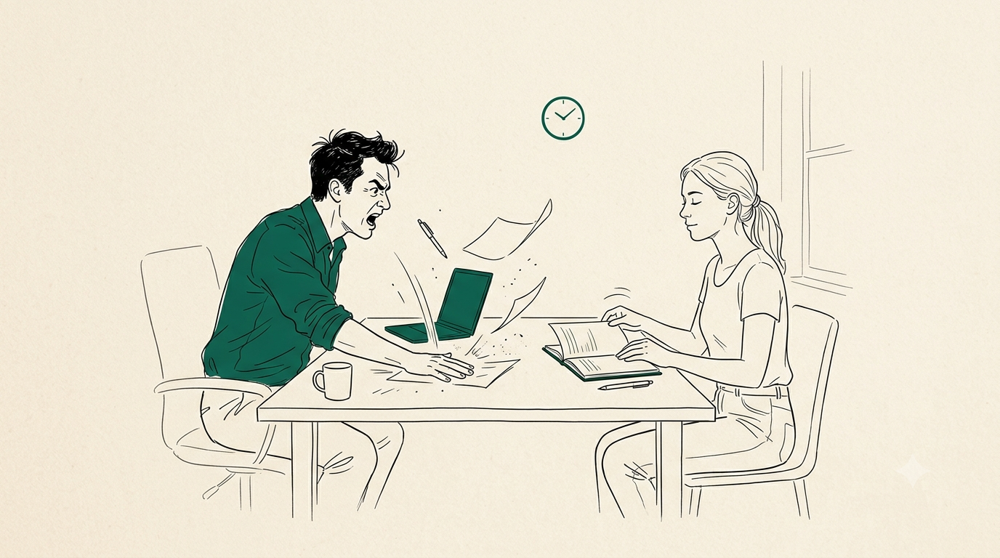
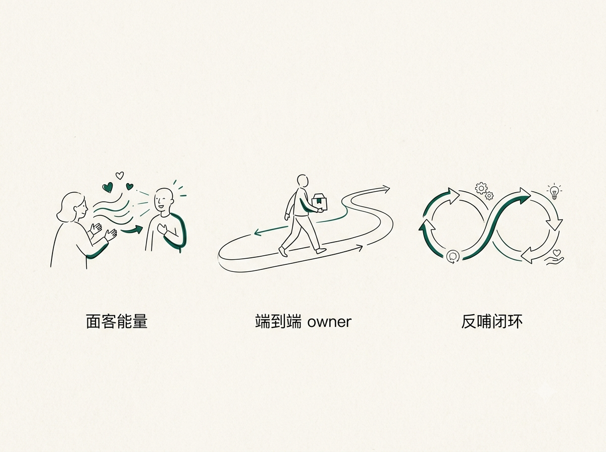

上一讲我们拆了 2026 的面试新题型——agentic eval 设计题，你学会了怎么给一个 agent 场景搭出一套能兜住 99% 送达率的 eval suite。那是纯技术脑力活。但 FDE 面试里，有一整块跟你写不写得出代码几乎没关系，权重却一样重：它考的是你面对一个真实的、正在发火的客户时，嘴和心稳不稳。

这一讲要回答两个问题。一，client simulation 到底怎么考、你该怎么接招？二，行为面那 8 个 STAR 故事，尤其是最要命的"Why FDE not SWE"，你怎么提前备好子弹？说白了，这一讲教你在没有编译器帮你兜底的房间里，怎么把人搞定。



[[CHAPTER:1 | 一张双轴天平，左边写"写码"、右边写"面客"，两边几乎平衡]]

## Client simulation：把你扔进一场客户模拟战

先给结论：client simulation 不是考你懂不懂技术，是考你在坏消息、坏情绪、坏关系里还能不能把事推下去。招聘方会当场扮演客户，你要即兴接住。这一关很多技术很强的人栽了，因为他们把它当技术题答，其实它是一道沟通题。

为什么招聘方这么较真？因为 FDE 的日常就是这个。Het Trivedi 有句话特别传神：

> "You're the one they call when shit hits the fan."

出事的时候第一个被叫的人，就是你。Palantir 的面试直接写明，行为面考的是"客户同理心"和"危机处理"，不是算法。OpenAI 更把一句话列成显性考察项：

> "Model calm and judgment when the stakes are high."

高压之下的冷静和判断力——这不是加分项，是准入项。

[[FIG:sim-two-scenarios | 两个模拟场景卡：左"向暴怒 CTO 交付延期"，右"就合规问题礼貌 pushback"]]

**场景一：向暴怒的客户 CTO 交付延期消息。** 这是最常见的模拟题。项目要 delay 两周，客户 CTO 在电话那头炸了。新手的本能反应是解释、是甩锅给"数据太脏"、是拼命道歉。这三样全是坑。

正确的接法有个骨架，你背下来：**先共情，再定界，后给路径。** 就像你去医院，最烦的不是医生说"要多住三天"，而是他支支吾吾不告诉你为什么、也不说接下来怎么办。客户要的也是这个。给你一段可以直接改的脚本：

```text
共情：我知道这个时间点对你们的发布计划意味着什么，这个影响我完全理解。
定界：我先把话说清楚——核心的 X 模块本周能上，延的是 Y 这部分，原因是
     它依赖你们那边还没打通的 SSO，这一条卡在我们双方的边界上。
给路径：我有两个选项。A 是我们先上 X、Y 下周补，你们的发布不受影响；
     B 是等 SSO 一起上，但要多五天。你更倾向哪个？
```

看出门道了吗？传统做法是"道歉+解释原因"，把自己放在被告席上；FDE 做法是"共情+给客户做选择题"，把客户重新拉回同一条船上决策。全程不甩锅，但也不把不属于你的责任揽过来——SSO 没打通是双方的边界，你如实点出来，这不是推卸，是诚实。

**场景二：就治理/合规问题礼貌 pushback。** 客户拍脑袋要你把所有生产数据一股脑喂给模型、还要跳过审计日志赶进度。你要顶回去，但不能把客户顶翻脸。这就考你会不会"带着尊重说不"。Cohere 的 JD 那句话就是你 pushback 的底气：

> "agents must be reliable, observable, safe, and auditable from day one."

你不是在拒绝客户，你是在替他挡一个他自己现在看不见的雷。话术是：认同他的目标（快），再把风险翻译成他能疼的语言（一旦审计缺失，出了合规事故，锅是你们 CTO 背），最后给一个不牺牲目标的折中方案。

[[FIG:pushback-ladder | 礼貌 pushback 三阶梯：认同目标→翻译风险→给不牺牲目标的折中]]

国内大厂在 2026 下半年的面经里（牛客、脉脉高频复盘），特别爱把这种合规 pushback 和技术底线揉在一起考。比如字节豆包、蚂蚁数科、贝壳的面试官会扮成银行或政企客户：「下周一领导就要看全库智能问数，权限隔离来不及做了先全放开行不行？」这时候你的"折中方案"必须落到具体工程动作上：**前置动态行级 RBAC/ACL 权限过滤 + 输出侧敏感词零容忍硬拦截，核心高敏表先走白名单视图，一周内照样能演示，但绝不裸奔越权。** 再比如转转等团队常追问现场多轮长对话把上下文撑爆时怎么跟客户对齐体验取舍（对比 Claude Code 与国产 CodeBuddy 的压缩策略）。技术兜底配沟通艺术，才是国内面官眼里的满分。

**记住一个底层判断：这一关里，编码和沟通近乎等权重。** 你在白板上写得再漂亮，只要面对模拟客户时语气一慌、开始甩锅或过度承诺，这一关就废了。别急，这东西不是天赋，是可以练的——找个朋友扮客户，把上面两个场景各演五遍，你会明显感觉到第三遍开始不慌了。

## 8 个 STAR 故事：你的弹药库

结论先行：行为面不是临场发挥的地方，是提前装弹的地方。你要准备好 8 个 STAR 故事，每个能在 60–90 秒讲完，覆盖 FDE 最爱问的几类情境。面试时对方一开口，你就知道该抽哪一发。

STAR 你应该熟：Situation（背景）、Task（你的任务）、Action（你干了什么）、Result（结果，最好带数字）。FDE 的行为面爱抠的不是"你做了个大项目"，而是"你在混乱、没授权、要得罪人的处境里怎么办"。所以这 8 个故事要专门往这些角落里挖。

[[FIG:eight-star-slots | 八个弹匣格子，每格一个 STAR 主题标签]]

| # | 故事主题 | 面试官真正想验证的 |
|---|---|---|
| 1 | 端到端 owning 一个项目 | 你能不能像"startup CTO"一样独自扛完 |
| 2 | 搞定一个难缠的 stakeholder | 客户同理心 + 危机处理 |
| 3 | 推翻自己之前的技术决策 | 有没有把自尊放在结果后面 |
| 4 | 无正式授权却驱动了跨团队对齐 | 影响力，而非职权 |
| 5 | 对客户说"不"并守住了底线 | 会不会带着尊重 pushback |
| 6 | 一次线上事故的诊断到修复 | 高压冷静 + 调试叙事 |
| 7 | 清洗真实脏数据 / 硬骨头交付 | 抬高"pain threshold"的意愿 |
| 8 | Why FDE not SWE（下一节单讲） | 动机是否真实 |

我挑三个最容易讲砸的，给你上料。

**故事 3，推翻自己的技术决策。** 这题是照妖镜。它照的是你把"我对"看得重，还是把"客户成"看得重。讲这个故事，关键在 Action 里必须出现"我意识到自己错了、主动换方案"这个转折，Result 里要体现换了之后更好。别怕暴露自己判断失误——FDE 面试官反而怕你从不认错。就像一个老中医，你信的不是他从不误诊，而是他发现不对会立刻改方子。

**故事 4，无授权驱动对齐。** FDE 常常是客户公司里那个"谁都不归他管、但事都指着他"的人。你要证明你能靠说清楚利害、而不是靠职位把三个部门拉到一张桌子上。Palantir 的开场白就是这种味道：

> "your responsibilities look similar to those of a startup CTO: you'll work in small teams with minimal supervision and own end-to-end execution."

极少监督、端到端 own——这背后全是"没人给你授权，你自己去挣"的处境。

**故事 5，对客户说"不"。** 接上一节的 pushback，把它变成一个具体的过去时故事。注意：结果不能是"我拒绝了他，然后关系闹僵"，而要是"我顶回去，但用别的方式满足了他的真实目标，关系反而更铁"。这才是招聘方想看到的成熟度。

写这 8 个故事时，有三条硬纪律：第一，全用"我"不用"我们"，面试官要听你干了什么，不是你团队干了什么。第二，Result 尽量带数字（良率从 88% 提到 97%、pilot 转付费率 100% 这种）。第三，每个故事掐表念，超过 90 秒就砍。传统做法是准备一堆流水账；FDE 做法是把每段经历压成一颗能精准命中某类问题的子弹。

## Why FDE not SWE：最重要的一题与咨询 case 练法

如果这一讲你只带走一件事，就是这个：**"你为什么选 FDE 而不是普通 SWE"是整场行为面最重要的一题，几乎每家必问，而且是筛人的决定性一问。** Baseten 的 FDE 负责人说得很直白，他们招人时技术水位就是普通工程团队的水位，真正在筛的是动机——他的原话是，不可妥协项是候选人"被加速客户产出所激励"。

为什么这题这么重？因为 FDE 的代价是真金白银的。你要 context switching、要直面暴怒客户、要驻场、要在别人下班时接"出事了"的电话。Sanjay Saraf 在 Palantir 干了四年后说"我累垮了，没约会、没爱好、没朋友"。招聘方太清楚这份苦，所以他们必须确认：你是真想干这个，还是只是被薪水或热度冲昏了头。一个动机不实的人，撑不过第一个负毛利的 pilot。



**这题不能背模板，但有骨架。** 一个能过关的回答，通常立在三根柱子上：

- 你享受面客、享受把技术翻译给非技术的人——不是忍受，是享受。
- 你要的是端到端 own 一件事的掌控感，而不是在大公司里拧一颗螺丝。
- 你想离真实业务问题最近，看着自己的东西被人真的用起来、还能反哺回产品。

把这三根柱子各配一个你自己的真实证据（一段经历、一个你主动跳出去面客的选择）。就像相亲，你说"我很顾家"没用，你得讲一件具体顾家的事对方才信。空喊"我热爱面客"会被一眼看穿，讲一个你当年主动请缨去客户现场救火的事，才立得住。

**练法：借咨询行业的 case 面题。** 这是 Kanav Bhatnagar 亲测有效的捷径——他 24 岁、Amazon 出来约三年就进了 Rippling 当创始 FDE，备考用的正是咨询公司的 case interview 题。为什么这招管用？因为咨询 case 和 FDE 的 decomposition case 是一个内核：给你一个模糊的开放问题，考你怎么快速澄清、拆解、给行动计划。

[[FIG:consulting-case-loop | 咨询 case 四步循环：澄清式提问→结构化拆解→给假设→行动计划，标注可迁移到 FDE]]

具体怎么练？找一批咨询 case 题（"某航空公司为什么这么多航班延误、你怎么查"这类，恰好也是 Palantir 真实的开场谜题），按这个循环走：

```text
1. 澄清式提问：先别急着答，反问三五个问题把边界问清楚
2. 结构化拆解：把大问题切成 MECE 的几块
3. 给假设 + 要数据：说出你怀疑哪里，需要什么数据验证
4. 行动计划：给出一二三步，而不是一个笼统结论
```

练熟这个循环，你同时补上了三样东西：decomposition case 的技术打法、行为面里"结构化沟通"的印象分、还有 client simulation 里那份"不慌、先澄清"的定力。Kanav 自己说，转型最难的两关是 context switching 和直面客户——这两关，恰好都能靠 case 练法磨出来。

所以你现在该做什么？今晚就干两件事：把 8 个 STAR 故事的标题列出来、每个填上一段你真实的经历；再找 5 道咨询 case 题，对着上面那个四步循环各走一遍。别等到面试通知来了才动手，那时候来不及。

## 小结

Client simulation 考的是坏消息、坏情绪里你稳不稳：向暴怒 CTO 交付延期用"共情→定界→给路径"，就合规问题 pushback 用"认同目标→翻译风险→给折中"，编码和沟通近乎等权重。行为面提前备好 8 个 60–90 秒的 STAR 故事，专挑端到端 owning、难缠 stakeholder、推翻自己、无授权对齐、对客户说不这些角落，全用"我"、带数字。最重要的一题是"Why FDE not SWE"，靠三根柱子加真实证据立住，用咨询 case 题的四步循环一并练出 decomposition 和面客定力。下一讲，我们进 offer 尽调与谈判——把 offer 到手后那半场也打漂亮。

## 思考题

拿你自己最真实的一段经历，试着套进"推翻自己之前的技术决策"这个 STAR 框架，掐表讲一遍——你能在 90 秒内讲清那个"我意识到错了、主动换方案"的转折，并让结果带上一个数字吗？如果讲不出这样一个故事，你打算去哪段经历里把它挖出来？欢迎在评论区聊聊你的想法。
