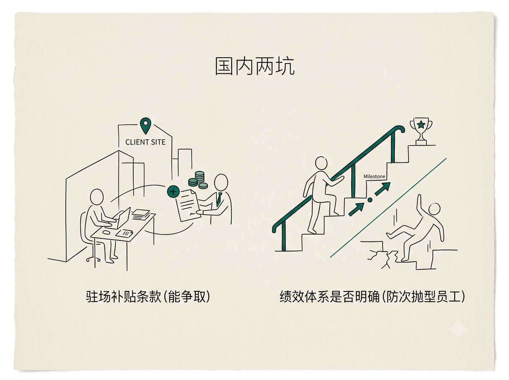

上一讲我们练了 client simulation 和行为面 STAR——你学会了怎么向暴怒的客户 CTO 交付延期消息、怎么在合规问题上礼貌 pushback。那些都是"拿 offer"之前的功夫。这一讲反过来:offer 拿到手了,你该怎么审它。

我知道你现在最想做的是看那个总包数字,然后截图发给朋友。别急。FDE 这个岗位有一堆藏在数字背后的坑:驻场比例、期权占比、on-call 补不补、国内的绩效体系明不明。这些东西入职前不问清楚,入职后没人替你兜底。

所以这一讲就一件事:教你把"差旅太苦"这种抽象抱怨,变成一张能逐条打勾的尽调清单。拿到 offer,别只看钱,按清单查一遍再签。

[[HERO: 一个工程师面前摊着一份 offer letter,旁边是一张写满勾选项的尽调清单,笔停在"驻场比例"那一行]]

## FDE Pulse 四问

先给结论:面 FDE 的最后一轮,你反过来面试它,只问四个问题就够。这四问来自 FDE Pulse 的从业者调研,专门戳这个岗最容易让人崩的地方。

为什么是这四个?因为 FDE 的差旅不是"高"或"低"那么简单,它是**分层**的。Palantir、Anduril 这类每周 3–4 天驻客户现场;PostHog、Cohere 这类基本远程。一刀切地说"FDE 就是空中飞人"是错的。数据也印证了这点:只有约 12% 的 AI 工程师愿意接受面客差旅——你不问清楚,很可能签下一份自己扛不住的合同。

第一问:**驻场比例怎么定?** 别只听"大概 25%"这种模糊话。你要问的是这个百分比谁说了算——是按项目排、按客户排,还是老板一句话临时加。就像你租房只看月租没看物业费,真正咬人的往往是那些没写进 offer 的浮动项。

第二问:**能不能轮换出困难部署?** 有的客户就是又难又毒,项目毛利是负的。顶级团队的做法是每 18–24 个月给你轮岗一次,防倦怠。你要确认这个机制存不存在,还是"干得好就奖励你下一个更难的客户"。

第三问:**on-call 补不补偿?** FDE 常被客户当成"出事就打的那个人"。Het Trivedi 有句话很传神:"You're the one they call when shit hits the fan." 半夜救火算不算工时、有没有调休或补贴,这条必须白纸黑字。

第四问:**怎么保护专注时间?** 这是最容易被忽略、也最要命的一条。Milos Mandic 同时跑 10–15 个客户,他的原话是:"If you need long stretches of uninterrupted focus to be productive, this role will break you." 翻译过来:你要是靠大块深度工作才出活,这岗会把你磨碎。所以你得问清楚,公司有没有制度性地留白,还是全天都在被客户打断。

[[FIG:fde-pulse-four-questions | FDE Pulse 四问对应的四个崩溃点:差旅浮动、毒项目困住、无偿救火、注意力被切碎]]

传统求职是你单方面被公司挑;FDE 的最后一轮应该是双向尽调。你把这四问抛出去,对方的反应本身就是信号——答得具体、有制度托底的是好公司;支支吾吾"看情况"的,你心里就该打个折。

## Equity 拆解

先说结论:头部 FDE 的总包数字很漂亮,但你得知道里面有一大半是期权,不是现金。

看个真实口径。前沿实验室的 FDE,equity 占总包的 **55–70%**——注意这个数字 2024 年还只是 35–45%,两年就涨上来了。也就是说,如果一份 offer 报你总包 40 万美元,可能只有 12–18 万是实打实的工资,剩下的全是纸面上的期权。

期权不是钱,它是"未来可能变成钱的一张券"。这张券有三重风险,你签之前每一重都得算清楚。

第一是**归属风险(vesting)**。大多数 AI 初创和独立合资实体通常走 **4 年归属、第一年 1-year cliff**——什么意思?就像健身房年卡,你头一年不满 12 个月走人,期权一分不给全部归零。不过前沿大厂之间也有重大分化:**OpenAI 完成 PBC(公益企业)股改后已取消 1 年归属悬崖(No-Cliff)**,入职即按月/季归属,对高强度的 FDE 友好得多。你签之前必须看清你的合同到底有没有 cliff。

第二是**流动性风险**。非上市公司的期权或 RSU,没有二级市场回购或上市就卖不掉。这里也要看清各家进度:比如 **Anthropic 在 2026 年 10 月已秘密递交 S-1 招股书(拟用代码 `ANT` 冲刺 IPO,市场估值预期指向 3,800 亿–8,000 亿美元+)**,流动性窗口高度明确;而早期初创或刚拆出来的交付子公司,变现可能要锁好几年。

第三是**估值风险**。offer 上写的期权价值,是按公司当前轮次估值算的。估值会波动。DeployCo 这类新实体估值本身就有 100 亿到 140 亿美元的口径差异——同一家公司不同报道差 40%。你手里那份"值 20 万"的期权,遇到一轮 down round 就可能缩水。

[[FIG:equity-three-risks | 期权的三重风险:归属(vesting cliff)、流动性(卖不掉)、估值(会跌)]]

所以谈判时你该问什么?问有没有 1-year cliff、问行权价(strike price)和类型(RSU、ISO 还是 NSO)、问最近一年有没有员工二级市场回购(tender offer)、问离职后有多长的行权窗口。这些不是贪心,是基本尽调。

```text
总包拆解速算(以某前沿实验室 offer 为例)
─────────────────────────────────────
名义总包    $400K/年
  现金工资  $140K   ← 你能确定拿到的
  期权部分  $260K   ← 65%,受归属/流动性/估值三重影响
─────────────────────────────────────
风险调整后你该心里默认的"确定收入" ≈ 现金 + 期权 × 你对公司的信心系数
```

对比一下:Palantir 传统 FDSE 的上市公司二级市场股票随时能卖(中位总包已涨至 $240K–290K+),前沿实验室 mid 档名义总包能到 38.5 万左右——听着高一截,但必须把流动性折价算进去。数字大不等于当月到手多。这一点你务必想清楚再签。

## 国内的两个特有坑与反问四刀

结论先行:如果你投的是国内岗,除了上面这些,还得盯死两件事——驻场差补写没写清、到底是真研发序列还是换皮外包。查不清这两条,你很可能被干成"次抛型员工"。

先说好消息。国内 FDE 有个海外没有的东西:**驻场差旅补贴**。头部大厂与独角兽年包 50–100 万之外,长期异地驻场通常还会按天发 **300–800 元/天的差补**(一个月驻 20 天就是大几千到上万的免税/补贴现金)。这是国内特色,谈判时你完全可以主动问、主动争。

但坑也在这。猎聘《2026 FDE 人才供需趋势洞察报告》统计全市场平均年薪是 **40.8 万元(中位数 36.6 万元)**,一线城市初级 FDE 实证月薪也就 2–3 万,和自媒体"人人年薪百万"的宣传落差极大(全网百万级岗也就几十个)。所以一份国内 offer,你要把驻场补贴的**触发条件和日标准**问到白纸黑字——是满几天触发、每天补多少,还是"公司统筹"这种虚词。

第二个坑更隐蔽:**假 FDE 真外包**。虎嗅在 2026 下半年报道过真实踩坑案例:有资深架构师冲着年薪 70 万签进某大厂 FDE,入职后发现干的全是按人天结算的驻场外包和传统售前陪聊,离核心模型团队十万八千里。为了防变成用完即弃的"次抛型员工",你在终面必须抛出这**国内反向尽调四问**:
1. 客户合同是按**业务里程碑/效果**结算,还是按**工程师人天(外包模式)**结算?
2. 单个客户驻场交付结束后,我回到哪个核心产品或平台研发序列?
3. 我的绩效考核里有没有**跨客户复用组件沉淀**的权重?
4. 我和后方核心算法/产品团队有没有固定的双周反馈通道?

这里有个正面参照。53AI 三年实践跑出来的模式是 Echo(业务专家)+ Delta(工程师)双人组进场,按结果收费,绝不让人单枪匹马填无底洞。



还有一条投递方向的提醒。国内 FDE 主力集中在云厂商(阿里云、腾讯云、火山引擎)和头部应用商;大模型独角兽里月之暗面 Kimi、MiniMax、阶跃星辰在 2026 秋招已放出少量战略大客户 FDE,唯独死磕基础研究的 **DeepSeek** 坚持零 FDE 编制。腾讯云的同名 JD 挂 35–65K × 15 薪,原话写明"将一线经验沉淀为可复用的交付资产与行业方案模板,反哺产品"——有反哺闭环的是真 FDE,只让你驻场按人天干活的必须拉响警报。

## 一张 offer 尽调评估表

前面讲的都汇到这张表里。拿到任何一份 FDE offer,你就照着这张表逐行打勾。哪一行对方答不上来或答得虚,那一行就是你的谈判筹码,或者你的红灯。

| 尽调维度 | 具体要问什么 | 绿灯 | 红灯 |
|---|---|---|---|
| 驻场比例 | 百分比谁定、按什么排 | 按项目/客户明确排 | "看情况"、老板临时加 |
| 轮换机制 | 能否轮换出困难部署 | 18–24 月制度性轮岗 | 干得好奖励更难客户 |
| on-call | 救火算不算工时、补不补 | 白纸黑字补偿/调休 | 默认无偿 |
| 专注时间 | 有无制度性留白 | 有 focus block 制度 | 全天被客户切碎 |
| 岗位真伪 | 有无 quota/提成、结算模式 | 售后嵌入、按结果/里程碑交付 | 挂 FDE 名实为售前或按人天外包 |
| 期权占比 | 现金 vs 期权比例 | 现金够覆盖生活 | 期权占比高且估值虚 |
| 期权条款 | 有无 1yr cliff、IPO/回购流动性 | 无 cliff 或定期回购/S-1 明确 | 语焉不详、刚 down round |
| 驻场补贴(国内) | 触发条件、每日标准 | 明确 300–800 元/天或按项目 | "公司统筹" |
| 绩效体系(国内) | 成长序列、考核标准 | 有研发序列与组件沉淀 KPI | 一个人驻场填坑 |
| 反哺闭环 | 交付是否产品化回流 | JD 写明反哺产品且有双周通道 | 只驻场不回流 |

用法很简单,就像你买二手车会带张检查清单挨个敲一遍。这张表你敲下来,十行里有三四行亮红灯,这份 offer 就得慎重;全绿,那你可以放心谈价、放心签。

多提一句谈判姿态。你不是求着人家给饭吃。无论海外 Lenny's Newsletter 统计的 FDE 岗位同比 **+361%(4.6 倍)**、Indeed 的 +729%,还是国内猎聘 **0.28 的供需比**,平均招聘周期 29 天——真正既能写生产 agent 又能面客的 FDE 极度稀缺。你手里的筹码比你以为的多。把这张表问出来,既是保护自己,也是让对方看到你懂这行、心里有数。

## 小结

这一讲把"差旅苦不苦"从情绪变成了可操作的尽调。FDE Pulse 四问戳的是四个崩溃点:驻场浮动、毒项目困住、无偿救火、注意力被切碎。期权要拆开算,前沿实验室 55–70% 是期权,带着归属、流动性、估值三重风险,数字大不等于到手多。国内还得盯死驻场补贴条款和绩效体系,防止被干成"次抛型员工"。最后落到一张十行尽调表——拿到 offer,别只看数字,按清单查一遍再签。

## 思考题

拿你现在最想去的那家公司(或一份你手头真实的 offer),用这一讲的十行尽调表逐行过一遍,你会在哪一行卡住、哪一行会亮红灯?如果是期权占比过高或驻场机制不清,你打算怎么把它变成谈判桌上的筹码?欢迎在评论区聊聊你的想法。

下一讲是劝退章《入坑前想清楚》——尽调完 offer,我们再退一步,聊聊这个岗到底适不适合你。
